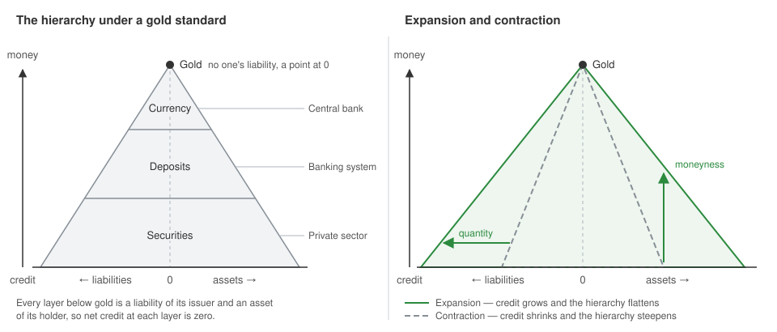

# Credit and Currency

This note follows two views of money and credit. The theory of currency of Carlos A. Bondone derives currency from exchange and credit. The hierarchy of money of Perry Mehrling describes every monetary system as a pyramid of promises to pay. Both treat most of what people call money as credit, but draw the line between money and credit in different places.

## Terms

The two sources use the same words in different senses, and this note follows the terms of Bondone.

| Term | Original term | Meaning in this note |
| --- | --- | --- |
| Currency | *moneda* | Any economic good that satisfies the need for liquidity, whatever its form |
| Money | *dinero* | A present good that serves as currency, such as gold, silver, or grain |
| Credit | *crédito* | An interpersonal exchange of present goods for future goods |
| Currency-money | *moneda-dinero* | Currency that is a present good |
| Currency-credit | *moneda-crédito* | Currency that is a credit, regular or irregular |

This use reverses the usual one, in which money is the general concept and currency means notes and coins (see [Modern Money Creation](04-modern-money-creation.md)). Mehrling calls money the means of final settlement at a given layer of the hierarchy, and currency the notes of a national issuer. National currency keeps this meaning in the sections on his hierarchy.

## Exchange and Liquidity

Bondone derives currency from exchange in one chain of causes, so without the need to exchange there is no barter, no credit, and no currency.

*Isolated person → society → division of labor → specialization → exchange → barter, credit, and currency*

A specialist produces a surplus of one good and must exchange it. In a small tribe, people exchanged goods directly for their own consumption, which is barter. When towns grew and producers worked for a surplus, the volume and complexity of exchange made barter costly and impractical. This created the need for liquidity, which Bondone defines as the need for a good of quick saleability that makes interpersonal exchanges efficient. Liquidity implies immediacy, with terms very short compared with the usual short, medium, and long term.

Currency is the economic good that satisfies liquidity, as bread satisfies hunger. It is a generic concept, like a means of transport, which includes the cart, the car, and the airplane. Different goods can satisfy the same need, each at its own price.

Bondone sorts exchanges by the parties and the goods that take part.

| Exchange | Parties | Goods |
| --- | --- | --- |
| Intrapersonal | One agent over time | Goods now for goods later, as in saving |
| Spot, barter | Two or more agents | Present goods only, without money |
| Spot, with money | Two or more agents | Present goods, one of which is money |
| Credit | Two or more agents | Present goods for future goods |

Two consequences follow.

- **Currency obeys the law of exchange.** People exchange to improve their position, and currency removes the illiquidity of barter.
- **Currency is not unique.** For some exchanges, such as credits, arbitrage, or contracts for work, a currency other than the common one can be more convenient, and some exchanges, such as those among friends, use no currency at all.

The market is the place of interpersonal exchange, so currency always originates in the market and can exist without a state, but not without a market. This places Bondone with Menger and against chartalism (see [Money Origins and Role](00-money-origins-and-role.md)).

## Credit

**Definition**

Bondone defines credit as an interpersonal exchange of economic time, which in his theory is the only economic good that has no life of its own, because it always materializes in another present good. Credit is thus an interpersonal exchange of present goods for future goods.

**Conditions**

A credit exists only with three elements.

1. **Two or more agents.** One agent alone makes only intrapersonal exchanges.
2. **An initial materialization.** One party delivers a present good.
3. **Economic time.** It takes part in every exchange.

The credit ends with a final materialization, which is the delivery of a present good at maturity, so every credit needs two materializations. Its price is interest, the price of economic time.

**Regular and Irregular Credit**

The two types differ in what the contract states at its birth about the final materialization.

| Type | Does the contract state the quality and quantity of the good for settlement? | Example |
| --- | --- | --- |
| Regular | Yes | A loan of 100 kg of wheat of a stated grade, repaid with 105 kg of the same grade, or a note payable in a stated weight of gold |
| Irregular | No, not clearly for the quality, the quantity, or both | A note that names no good and no quantity for its settlement, such as today's paper money |

Irregular credit can look like an odd case, but for Bondone the economic life of society turns around it, because paper money is irregular credit.

The irregular credit of Bondone is not the irregular deposit of law. In Roman and civil law, a regular deposit holds specific goods, and an irregular deposit holds fungible goods, such as money, that mix with others of the same kind and quality. The depositary must keep the *tantundem*, an equal quantity of the same kind and quality, continuously available to the depositor, so the custody of money requires a 100% reserve. A loan of fungible goods, the *mutuum*, instead transfers this availability to the borrower for a fixed term. For this reason Mises held that a deposit payable on demand "is not a credit transaction", because no present good is exchanged for a future good. Bondone calls a certificate of deposit of gold irregular only in this legal sense, which he places in a different theoretical sphere from irregular credit.

## Properties of a Good That Becomes Currency

Bondone, after Menger, gives two conditions for a good to satisfy liquidity.

1. **Higher saleability.** The good sells easily and quickly.
2. **Small loss of value.** The gap between the price to buy it and the price to sell it, today the bid-ask spread, is small.

A holder of surplus goods can accept such a good and be certain to exchange it again very quickly with little or no loss (see [Money Origins and Role](00-money-origins-and-role.md) for the factors of saleableness). Later Bondone keeps only immediacy in his definition of liquidity and calls the second condition unnecessary, because the law of exchange already contains it. Nobody exchanges at a loss or uses a currency when a more efficient form of exchange is available.

**Functions**

Bondone sorts the functions that economic theory gives to currency into four groups.

| Group | Functions | Reason |
| --- | --- | --- |
| Exclusive | Satisfy liquidity, and serve as the unit of economic calculation | Liquidity is the necessary and sufficient function, and the unit of calculation follows from the common use of currency |
| Not exclusive | Store of value, purchasing power, Gresham's law | Every economic good stores value and has purchasing power, so these need no special theory of currency |
| Not pertinent | Functions of economic time, and aims such as fighting unemployment or controlling prices | They lead to theories that are improper or inconsistent |
| Virtual | Functions that treat currency as if it were not an economic good | They come from the dichotomies of Böhm-Bawerk and Wicksell between a real and a monetary world |

For Bondone, the unit of account is the price of currency, not currency itself, because economic calculation uses prices, which are quantities to calculate, not goods, which are qualities to value. The so-called money prices of goods are thus the price of currency, expressed in each of the other goods. When the same goods cost more units of currency, the price of currency has fallen, and a price index measures its average change against a basket of goods.

The usual list has three roles, which are store of value, unit of account, and medium of exchange. Many good stores of value, such as houses, are not good media of exchange, which supports the view that the store of value is not exclusive to currency. Bondone links this function to Wicksell, but Jevons already listed it in 1875 among "the four functions which money fulfils", together with medium of exchange, common measure of value, and standard of value.

## Currency-Money and Currency-Credit

**Theorem of Currency**

Currency is an economic good, and every economic good is either a present good or a future good. Money is a present good with the status of currency, and credit is a future good, so the theorem of currency of Bondone says that if currency is not money, it is necessarily credit. He showed it with mixed double-entry bookkeeping, in monetary units and in physical units of present goods, which also shows who is the debtor and who is the creditor when currency is credit.

Two consequences follow.

- **No regression theorem.** Currency must be an economic good, but it need not have been one before it became currency, because people can invent a present or a future good for this purpose. Bondone thus rejects the regression theorem of Mises, which traces the value of money back to a good used in barter.
- **No currency without backing.** A currency that is not money is credit, and the present good delivered at its birth is its backing, whatever the solvency of the debtor.

**Three Types**

| Type | What satisfies liquidity | Contract | Case |
| --- | --- | --- | --- |
| Currency-money | A present good, or a certificate of deposit of it | Spot, implicit and unwritten | Gold or silver coin, a certificate of gold on deposit |
| Regular currency-credit | A credit that states the quality and quantity of the good for settlement | Credit, explicit and written | A note payable on demand in a stated weight of gold |
| Irregular currency-credit | A credit that does not state them | Credit, written in the note and in the law of legal tender | Paper money |

A note payable at sight is still credit, because the term changes only the date of the settlement, not the nature of the promise, and a note that circulates as currency has an indefinite maturity. If it were not a credit, it would be a simple certificate of deposit.

**Regular Case**

In the United States, the Gold Standard Act of 1900 fixed the dollar at $20.67 per ounce of gold, and Federal Reserve notes were redeemable in gold. The Gold Reserve Act of 30 January 1934 ended the redemption of dollars in gold, and the new price of $35 per ounce cut the gold value of the dollar to 59% of its 1900 value. Foreign governments could still convert dollars into gold at $35 until 15 August 1971. For Bondone, the debtor changed the final materialization by itself, a breach of contract that economic language calls devaluation.

**Irregular Case**

For Bondone the contract of paper money has two documents, which are the printed note and the law of legal tender, the compulsory acceptance of the note as a means of payment. This law gives the power to settle debts to what is in fact a credit, so it erases, at the institutional level, the difference between spot and credit exchanges.

The issuers describe their notes in terms that fit this type. Federal Reserve notes are "obligations of the United States" but are "not redeemable in gold, silver, or any other commodity", and Section 16 of the Federal Reserve Act says that they are redeemed "in lawful money" on demand at the Treasury. Bank of England notes are a liability of the Bank and an asset of their holders, and the "promise to pay the bearer on demand" printed on them now means only an exchange "for other Bank of England notes of the same face value". The debtor and the promise exist, but the good for final settlement is not defined.

**Origin in the Market**

For Bondone, a printed note becomes a contract only when the creditor signs it, which happens when the market accepts it in a first exchange for a present good. The first holder is thus a creditor of the issuer. A later payment of a debt with currency-credit is a novation, which replaces one debt with another, not a final settlement. The same logic applies to bank deposits, so for Bondone banks do not originate credit, the market does, when it exchanges their liabilities for present goods.

This view can be read together with the creation of deposits by loans (see [Modern Money Creation](04-modern-money-creation.md)). A new loan is a swap of two promises, because the borrower promises to repay and the bank promises to pay currency on demand. Credit in the sense of Bondone appears only when a seller delivers a present good in exchange for the new deposit.

**Fiat Money**

Mises separated three kinds of money. Commodity money is at the same time a commercial commodity, credit money is "a claim against any physical or legal person", and fiat money consists of "things with a special legal qualification". For Bondone fiat money is not a separate kind, because paper money is irregular credit.

## The Hierarchy of Money

"Always and everywhere, monetary systems are hierarchical." Mehrling starts from the classic distinction between money, the means of final settlement, and credit, a promise to pay money that delays final settlement. He finds it too short, because it has only two layers, and too rigid, because "what looks like money at one level of the system looks like credit from the standpoint of the level above".

Under a gold standard the hierarchy has four layers.

| Layer | Instrument | Promise |
| --- | --- | --- |
| 1 | Gold | None, because gold is no one's liability |
| 2 | National currency | To pay gold |
| 3 | Bank deposits | To pay national currency on demand |
| 4 | Securities | To pay currency or deposits at a future date |

An issuer that holds a reserve of the instrument one layer up makes its promise more credible. The reserve does not make its own instrument represent the higher one, or put it on the same layer. For Mehrling this holds even with 100% reserves or a currency board, because national currency is not a "cloakroom ticket" for gold but a promise that can be broken. Here he differs from Bondone, Mises, and Huerta de Soto, for whom a certificate of deposit with a 100% reserve is a title to a present good, not a credit.

**A Relative Line**

The line between money and credit depends on the problem of settlement.

| Point of view | Means of final settlement (money) | Promise to pay (credit) |
| --- | --- | --- |
| A country that settles with other countries | Gold under a gold standard, or the currencies of the other countries | Its own national currency |
| A bank that settles with other banks at the end of the day | Central bank currency and reserves, or high-powered money | Its deposits |
| A household or a company | Bank deposits | Securities |

The United States is an exception to the first row, because the dollar has an international role. For the top of the modern system, Mehrling suggests the Special Drawing Right (SDR), a reserve asset that the IMF created in 1969 and that is not a currency. The textbook measures of money, such as M1, M2, and M3, take the point of view of households and draw the line between deposits and securities, and the number of measures shows that the line is not fixed.

Mehrling draws two lessons. Money and credit are not fixed things, so the useful idea is that the whole system is hierarchical. Theories that rise from different layers, such as those of a central banker and of a local grocer, cannot agree unless both look at the system as a whole. The real world also has more layers than this example. High-powered money includes currency and the deposits of banks at the central bank, money market fund shares act like deposits but are not the liability of any bank, and securities differ in maturity and credit quality.

The two authors draw the line in different ways but agree on the result. For Bondone the line is absolute, between present and future goods, and for Mehrling it is relative to the layer. In the gold-standard hierarchy only gold is a present good, which Bondone calls currency-money, and every lower layer is credit, which he calls currency-credit.

**Double-Entry View**

Mehrling shows the same hierarchy in the balance sheets of the institutions that issue each instrument.

| Sector | Assets | Liabilities |
| --- | --- | --- |
| Central bank | Gold | Currency |
| Banking system | Currency | Deposits |
| Private sector | Deposits, securities | Securities |

The table leaves out entries, so the sheets do not balance. The main asset of a central bank is government debt, banks hold loans, and a shadow banking system finances securities with loans in the wholesale money market. Every instrument except gold is an asset of one sector and a liability of another, so it is credit. If the three balance sheets are consolidated into one, all the credit cancels and only gold remains.

National accounts use the same rule, so each IOU is a financial liability for one sector and a financial asset for another. The only exception in the 2008 SNA and the BPM6 is the gold bullion that monetary authorities hold as a reserve asset, which by convention is a financial asset with no corresponding liability, "unlike any other financial assets". Other gold bullion is a nonfinancial asset.

**Outside and Inside Money**

Gurley and Shaw (1960) separated outside money, which is fiat money or money backed by an asset that is not in zero net supply within the private sector, such as gold, from inside money, which is backed by private credit and so nets to zero within the private sector. The class of an asset depends on the group that is consolidated. Gurley and Shaw consolidated only the private sector, so fiat currency looked like outside money, and in the United Kingdom base money is still called outside money. Mehrling consolidates the whole economy, and even the world economy, so currency becomes inside money too, and only gold stays outside.

**Pyramid**

Mehrling draws the hierarchy as a symmetric pyramid on a vertical axis that runs from credit at the base to money at the peak. At each layer the liabilities on the left equal the assets on the right, so net credit at every layer is zero. He puts the peak at zero even though some gold exists, because its quantity is very small next to the credit below it. Most aggregate macroeconomic models consolidate the balance sheets, so the pyramid disappears. Mehrling instead leaves open the possibility that interest rates and GDP depend on the gross quantity of inside credit, on who issues it, and on who holds it.

## Scarcity and Elasticity

For Mehrling, liquidity is at the same time scarce and elastic.

- **Scarcity of the ultimate money, which the Currency Principle stresses.** No agent can create the money of a higher layer, as central banks cannot create gold and banks cannot create central bank currency. At every layer the money of the layer above disciplines expansion, because "credit is payable in money, but money is scarce". Mehrling, after Minsky (1957), calls this discipline the survival constraint, to separate it from the intertemporal budget constraint of standard economics.
- **Elasticity of derived credit, which the Banking Principle stresses.** Every agent can create credit at its own layer, which is money for the layers below. Even at the base, if a seller accepts an IOU from a buyer, the two can trade, and the trade is an expansion of credit. Banks relax the constraint of central bank reserves when they lend reserves to each other, but only for a time. Credit is a promise to pay money, so relief today means a tighter constraint in the future.

**Quantity and Quality**

The hierarchy moves at every time scale, with daylight overdrafts and end-of-day clearing within a day, credit cycles over the business cycle, and wars and depressions over decades. The motion has two dimensions.

- **Quantity.** At each layer assets and liabilities expand and contract. In expansion, credit reaches even marginal borrowers. In contraction, marginal borrowers must repay, and only the best borrowers can refinance.
- **Quality, or moneyness.** In expansion, the liabilities of the best borrowers at a layer trade as close substitutes for the liabilities of the layer above, that is, as money. In contraction, the difference returns.

| Phase | Credit | Hierarchy | Usual name | Spreads between the rates of different borrowers |
| --- | --- | --- | --- | --- |
| Expansion | Expands | Flattens | Irrational exuberance | Narrow |
| Contraction | Contracts | Steepens | Financial crisis | Widen |

This gives a discrete view of credit, as a set of layers whose moneyness moves with the cycle, not as one block.

Monetary thought swings with the system, from the Currency Principle to the Banking Principle, from monetarism to Keynesianism, and from metallism to chartalism, and back. At each extreme, calls for the other aspect gain ground. Neither tradition wins, because the system has both aspects at all times. The Bank Charter Act of 1844, which tied new notes beyond a fixed amount to the gold held, was a victory of the Currency School over the Banking School (see [Role of Central Banks](02-role-of-central-banks.md)).

## Market Makers and the Prices of Money

At each layer, dealers stand ready to exchange credit for money and money for credit at prices that they quote. A security dealer buys and sells securities at a bid and an ask price and holds inventories of both securities and money. Mehrling, after Hicks, treats a bank as a dealer that buys and sells deposits for currency (see [Evolutionary Emergence of Banks](01-evolutionary-emergence-of-banks.md)), and a central bank under a gold standard as a dealer that buys and sells currency for gold.

| Layers | Market maker | Price of money |
| --- | --- | --- |
| Gold and national currency | Central bank | Exchange rate, the price of currency in gold |
| Currency and deposits | Banking system | Par, the price of deposits in currency |
| Deposits and securities | Security dealers | Interest rate, the price of securities in deposits or currency |

These three prices link, in quantity, layers that differ in quality, and each market maker straddles two layers with its own balance sheet. When the market makers work well, the markets are continuous and the hierarchy looks like a smooth set of prices, which is why most theories of economics and finance can ignore it. The hierarchy shows itself when the market makers fail or are overwhelmed, as in war finance or a financial crisis.

When the hierarchy steepens, a market maker faces two challenges.

- **Solvency.** Its assets are credit, and their price falls in terms of money.
- **Liquidity.** Its liabilities promise money, and their holders ask for it.

Price changes are a limited remedy. Interest rates move with the stress, but the move can make the strain worse. Par and a fixed exchange rate by design do not move, so banks, which defend a fixed price between layers that move apart, are the most exposed. Reserves of money are the first defense, and a large contraction soon uses them up.

In a liquidity crisis everyone wants money and nobody wants credit. Money at one layer is only credit for the layer above, so a higher layer can solve the crisis of a lower one. The layer immediately above can solve a small crisis, but a large crisis needs the top. In the US crisis of 2007–09 the banking system first absorbed the strain, and then the Federal Reserve had to act as dealer of last resort.

Monetary policy uses the same position at the top, because the liabilities of the central bank are more money-like than those of anyone below it. The central bank can assert scarcity with higher rates when elasticity dominates, and elasticity with lower rates when scarcity dominates. In this reading, the rule of Bagehot has two parts, to lend freely so that banks can defend par, and to lend at a high rate so that the central bank attracts gold and defends the exchange rate (see [Role of Central Banks](02-role-of-central-banks.md)).

**An Inherent Hierarchy**

For Mehrling the hierarchy and its motion are inherent, because they come from the internal logic of market making and not from the power of a government or the force of law. He adds that the system does not organize or regulate itself in the Austrian sense, and that Austrian thinkers such as Menger miss its hierarchy. Chartalists such as Bell (2001) put state money at the top, because the state can impose taxes payable in it. Bondone places the origin of all currency in the market and sees the state as a participant that the market does not need.

## Agreement and Disagreement

| Question | Bondone | Mehrling | Other sources |
| --- | --- | --- | --- |
| Where is the line between money and credit? | Absolute, only present goods are money | Relative to the layer | Textbook aggregates (M1, M2, M3) put it between deposits and securities |
| Is a note with a 100% gold reserve a credit? | No, a certificate of deposit is money | Yes, a promise that can be broken | Mises and Huerta de Soto agree with Bondone |
| What is paper money? | Irregular credit of the state | A liability of the central bank, and inside money in a world view | Outside money for the private sector (Gurley and Shaw). An obligation with no redemption in a commodity (Federal Reserve, Bank of England) |
| Who creates credit? | The market, at the first exchange for a present good | Every layer, with promises that the layer below accepts | Banks create deposits when they lend (Bank of England) |
| Where does the order come from? | The market, without need of the state | The logic of market making | The state, through taxes (chartalism) |
| Is store of value a function of currency? | Not an exclusive one | Not discussed | One of three roles (Bank of England). One of four functions (Jevons) |

## References

- Bank of England. "Banknote FAQs." [Online](https://www.bankofengland.co.uk/faq/banknote).
- Bell, Stephanie. 2001. "The Role of the State and the Hierarchy of Money." *Cambridge Journal of Economics* 25 (2): 149–163. [DOI](https://doi.org/10.1093/cje/25.2.149).
- Board of Governors of the Federal Reserve System. "Is U.S. Currency Still Backed by Gold?" [Online](https://www.federalreserve.gov/faqs/currency_12770.htm).
- Bondone, Carlos A. 2006. "Teoría de la relatividad económica." *Revista Libertas* 13 (45), October. Instituto Universitario ESEADE. [PDF](https://www.eseade.edu.ar/wp-content/uploads/2016/08/Bondone-Teoria-de-la-relatividad-economica-Carlos-Bondone.pdf).
- Bondone, Carlos A. 2012. *Teoría de la moneda (crisis de las teorías monetarias-financieras)*. Buenos Aires, February.
- Ghizoni, Sandra Kollen. 2013. "Nixon Ends Convertibility of U.S. Dollars to Gold and Announces Wage/Price Controls." Federal Reserve History. [Online](https://www.federalreservehistory.org/essays/gold-convertibility-ends).
- Goodhart, Charles, and Meinhard Jensen. 2015. "Currency School versus Banking School: An Ongoing Confrontation." *Economic Thought* 4 (2): 20–31. [LSE Research Online](https://researchonline.lse.ac.uk/id/eprint/64068/).
- Gurley, John G., and Edward S. Shaw. 1960. *Money in a Theory of Finance*. Brookings Institution. [Internet Archive](https://archive.org/details/moneyintheoryoff0000gurl).
- Hicks, John. 1989. *A Market Theory of Money*. Clarendon Press. [Oxford Academic](https://academic.oup.com/book/9948), [Internet Archive](https://archive.org/details/markettheoryofmo0000hick).
- Huerta de Soto, Jesús. 2020. *Money, Bank Credit, and Economic Cycles*. 4th ed. Translated by Melinda A. Stroup. Ludwig von Mises Institute. [PDF](https://cdn.mises.org/money_bank_credit_and_economic_cycles_4th_edition.pdf).
- International Monetary Fund. "Special Drawing Rights (SDR)." Factsheet. [Online](https://www.imf.org/en/About/Factsheets/Sheets/2023/special-drawing-rights-sdr).
- International Monetary Fund, Statistics Department. 2017. "International Reserves and Foreign Currency Liquidity Data Template — Clarification on the Recording of Gold Under Other Foreign Currency Assets." [PDF](https://www.imf.org/external/bopage/pdf/Clarification.pdf).
- Jevons, William Stanley. 1875. *Money and the Mechanism of Exchange*. Chapter 3. Henry S. King & Co. [Online edition](https://www.econlib.org/library/YPDBooks/Jevons/jvnMME.html?chapter_num=4).
- Lagos, Ricardo. 2006. "Inside and Outside Money." Staff Report 374, Federal Reserve Bank of Minneapolis. [EconPapers](https://econpapers.repec.org/RePEc:fip:fedmsr:374).
- McLeay, Michael, Amar Radia, and Ryland Thomas. 2014. "Money in the Modern Economy: An Introduction." *Bank of England Quarterly Bulletin* 54 (1): 4–13. [PDF](https://www.bankofengland.co.uk/-/media/boe/files/quarterly-bulletin/2014/money-in-the-modern-economy-an-introduction.pdf).
- Mehrling, Perry. 2011. *The New Lombard Street: How the Fed Became the Dealer of Last Resort*. Princeton University Press. [DOI](https://doi.org/10.1515/9781400836260).
- Mehrling, Perry. 2013. "The Inherent Hierarchy of Money." In *Social Fairness and Economics: Economic Essays in the Spirit of Duncan Foley*, edited by Lance Taylor, Armon Rezai, and Thomas Michl, 394–404. Routledge. Draft dated 25 January 2012. [Publisher](https://www.routledge.com/Social-Fairness-and-Economics-Economic-Essays-in-the-Spirit-of-Duncan/Taylor-Rezai-Michl/p/book/9780415538190).
- Menger, Carl. 1892. "On the Origin of Money." *The Economic Journal* 2 (6): 239–255. [DOI](https://doi.org/10.2307/2956146).
- Minsky, Hyman P. 1957. "Central Banking and Money Market Changes." *The Quarterly Journal of Economics* 71 (2): 171–187. [DOI](https://doi.org/10.2307/1883812).
- Mises, Ludwig von. 1912. *The Theory of Money and Credit*. Translated by H. E. Batson (1934). Part 1, chapter 3. [Mises Institute](https://mises.org/online-book/theory-money-and-credit/chapter-3-various-kinds-money/3-commodity-money-credit-money-and-fiat-money).
- Richardson, Gary, Alejandro Komai, and Michael Gou. 2013. "Gold Reserve Act of 1934." Federal Reserve History. [Online](https://www.federalreservehistory.org/essays/gold-reserve-act).
- Wikipedia. "Gold Standard Act." [Online](https://en.wikipedia.org/wiki/Gold_Standard_Act).
