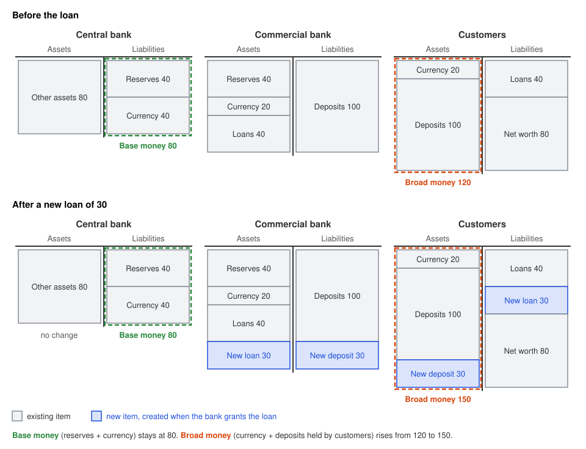

# Modern Money Creation

## Misconceptions

The vast majority of money held by the public takes the form of bank deposits. Notes and coins are only a small share.

- **United Kingdom (2014).** Bank deposits were about 97% of the money held by the public and currency was the remaining 3%.
- **Euro area (September 2026).** Currency in circulation was €1,618 bn out of an M2 of €16,492 bn (about 10%). Deposits were the remaining 90%.
- **United States (September 2026).** Currency was $2,397 bn out of an M2 of $23,414 bn (about 10%). The remaining 90% was mostly bank deposits, with a small part in retail money market funds.

### Misconception 1 — Banks Need Deposits Before They Lend

In this view banks are simple intermediaries. Households save first, and banks then lend those existing deposits to borrowers.

In reality the sequence is the reverse, and lending creates deposits. When a bank makes a loan, it credits the borrower's account with a new deposit. A deposit is a liability of the bank (an IOU, short for "I owe you", meaning the bank's promise to pay the customer that amount on demand), not an asset that it can lend out. Saving (keeping income in the bank instead of spending it) also does not give banks more to lend. Income already arrives as a deposit, and spending it only moves that deposit to a company's account, so total deposits stay the same.

### Misconception 2 — Central Banks Control Money Through Reserves

Reserves are central bank money that commercial banks hold in their accounts at the central bank. In the 'money multiplier' view, the central bank fixes the quantity of reserves, and a constant ratio of broad money to base money (all central bank money, which is currency plus reserves) multiplies them into a much larger change in loans and deposits. The theory needs reserves to be a binding limit on lending and a quantity fixed by the central bank. Neither holds in practice.

- Central banks set the price of reserves (the policy interest rate), not their quantity.
- Commercial banks first decide how much to lend, based on the profitable opportunities available, which depend in part on that interest rate. The new deposits then set how many reserves banks want, to meet withdrawals, payments to other banks and liquidity rules. In normal times the central bank supplies these reserves on demand.
- Reserve requirements, the minimum share of deposits that regulation obliges banks to hold as reserves, are small or absent. The UK has none, the US cut them to zero from 26 March 2020, and the euro area requires 1% of short-term liabilities, mainly customer deposits.
- Banks cannot lend reserves to the public, because only banks hold reserve accounts at the central bank.

## Money Creation and Destruction

Broad money is the total money held by households and companies. It consists of bank deposits, which are IOUs from commercial banks, and currency, which is mostly IOUs from the central bank. Deposits are the vast majority of broad money, and commercial banks create most of them.

Commercial banks create money when they lend. A bank that grants a mortgage does not hand over banknotes. It credits the borrower's account with a new deposit equal to the loan, and at that moment new money exists. For this reason some economists call deposits 'fountain pen money', created with the stroke of a pen when a loan is approved.

The new deposits may lead banks to want, or by regulation need, more reserves to meet withdrawals and payments to other banks. In normal times the central bank supplies these reserves on demand, in exchange for other assets that banks hold, so the total quantity of reserves does not directly limit lending or deposit creation.

Just as a new loan creates money, the repayment of a loan destroys it, because the bank removes the deposit from the borrower's account. Lending and repayment are the main ways that money is created and destroyed, but not the only ones. Deposits also appear or disappear whenever the banking sector (including the central bank) buys or sells existing assets with households or, more often, with companies or the government.

- **Government bonds.** Banks hold government bonds as liquid assets that they can quickly sell for central bank money, for example if depositors withdraw large amounts of currency. When banks buy bonds from the non-bank private sector, they credit the sellers with new deposits. When they sell bonds to it, the buyers pay with deposits and that money disappears. Central bank asset purchases, known as quantitative easing (QE), have a similar effect.
- **Long-term debt and equity.** Besides deposits, banks keep some capital and long-term debt to limit risks and meet regulatory requirements. These 'non-deposit' liabilities are longer-term investments by households and companies, and they cannot be exchanged for currency as easily as deposits, so they make the bank more resilient. When banks issue them to non-bank financial companies, the buyers pay with deposits. Deposit (money) liabilities of the banking sector fall and its non-deposit liabilities rise.

## Limits on Money Creation

Commercial banks create money when they lend, but not without limit. James Tobin (1963) wrote that "neither individually nor collectively do commercial banks possess a widow's cruse", the biblical jar of oil that refills itself without end. The public must want to hold the new deposits, and this depends on lending opportunities and interest rates. The price of a loan, which is the interest rate plus any fees, sets how much households and companies want to borrow. Many factors affect this price, not least the monetary policy of the central bank, which moves the level of interest rates in the economy.

### Bank Limits Due Market Forces

Banks are businesses that must lend profitably in a competitive market and manage the risk of each loan. A bank earns interest on its assets, such as loans, and usually pays interest on its liabilities, such as savings accounts. The spread between the two covers its operating costs and gives its profit.

Both rates follow the central bank's policy rate. Banks settle payments with one another in reserves, which only the central bank supplies, so it sets their price, usually the interest rate that it pays on reserves. Any bank can earn this rate without risk, so it is the opportunity cost of every other use of its funds. Interbank rates therefore stay close to the policy rate, and loan rates sit above it by a margin for risk, term and operating costs.

Deposit rates follow the policy rate too, because savers can earn close to it elsewhere. Savers can move their deposits, with the reserves, to a bank or fund that pays more. A bank that lends cheaply cannot afford such deposit rates, so it soon has to raise its loan rates or lose funding. If its loan rate were below the deposit rate of another bank, a customer could borrow from it, deposit the money at the other bank and keep the difference with little risk. Each such loan moves deposits and reserves to the bank that pays more, until the cheap lender raises its rates. Credit checks, fees and loan limits make this arbitrage hard in practice, but the pressure remains.

The policy rate is therefore the balance point for the rates that banks charge and pay, although banks pass only part of each change to deposits, and with a lag. A rise in the policy rate raises the funding costs and loan rates of banks, so households and companies borrow less. This makes monetary policy the ultimate constraint on money creation.

A bank grows its business mainly by lending more. When it does, competition squeezes the spread in two ways.

- **Lower loan rates.** To attract more borrowers, the bank usually has to cut its loan rates relative to its competitors, so it earns less on each loan.
- **Lost deposits.** The borrower spends the new deposit, and the payee probably banks elsewhere. The bank settles the payment in reserves and must replace them, for example by paying more on savings accounts, so its funding costs rise.

Both effects lower the profit on an extra loan, so an individual bank cannot lend without end. Each new loan needs new funding, or the bank soon runs out of reserves to meet its outflows. Other banks also lend, so deposits keep moving between banks, and each bank competes for them with higher rates on savings accounts. It can also borrow from other banks or issue other liabilities, at least for a while. If it keeps cutting loan rates and raising deposit rates, the spread closes and extra lending stops being profitable. This limit is weaker when all banks lend more at the same time, because each bank also gains deposits from the loans of the others.

### Behaviour of Holders

### Monetary Policy and QE

## References

- Board of Governors of the Federal Reserve System. 2026. "Money Stock Measures - H.6 Release." 27 October 2026. [Online](https://www.federalreserve.gov/releases/h6/20261027/).
- Board of Governors of the Federal Reserve System. "Reserve Requirements." [Online](https://www.federalreserve.gov/monetarypolicy/reservereq.htm).
- Deutsche Bundesbank. 2017. "The Role of Banks, Non-banks and the Central Bank in the Money Creation Process." *Monthly Report* April 2017: 13–33. [PDF](https://www.bundesbank.de/resource/blob/654284/df66c4444d065a7f519e2ab0c476df58/mL/2017-04-money-creation-process-data.pdf).
- European Central Bank. 2026. "Monetary Developments in the Euro Area: September 2026." Press release, 27 October 2026. [PDF](https://www.bancaditalia.it/media/bce-comunicati/documenti/2026/ecb.md2609.pdf).
- European Central Bank. "What Are Minimum Reserve Requirements?" [Online](https://www.ecb.europa.eu/ecb-and-you/explainers/tell-me/html/minimum_reserve_req.en.html).
- Federal Reserve Bank of St. Louis. "Currency Component of M1 (CURRSL)" and "M2 (M2SL)." FRED. [Online](https://fred.stlouisfed.org/graph/?id=CURRSL,M2SL).
- Jakab, Zoltan, and Michael Kumhof. 2015. "Banks Are Not Intermediaries of Loanable Funds — and Why This Matters." Staff Working Paper No. 529, Bank of England. [PDF](https://www.bankofengland.co.uk/-/media/boe/files/working-paper/2015/banks-are-not-intermediaries-of-loanable-funds-and-why-this-matters.pdf).
- Kang-Landsberg, Alena, Stephan Luck, and Matthew Plosser. 2023. "Deposit Betas: Up, Up, and Away?" *Liberty Street Economics*, Federal Reserve Bank of New York, 11 April 2023. [Online](https://libertystreeteconomics.newyorkfed.org/2023/04/deposit-betas-up-up-and-away/).
- Keating, Thomas, and Marco Macchiavelli. 2018. "Interest on Reserves and Arbitrage in Post-Crisis Money Markets." *FEDS Notes*, Board of Governors of the Federal Reserve System, 1 March 2018. [Online](https://www.federalreserve.gov/econres/notes/feds-notes/interest-on-reserves-and-arbitrage-in-post-crisis-money-markets-20180301.html).
- McLeay, Michael, Amar Radia, and Ryland Thomas. 2014. "Money Creation in the Modern Economy." *Bank of England Quarterly Bulletin* 2014 Q1: 14–27. [PDF](https://www.bankofengland.co.uk/-/media/boe/files/quarterly-bulletin/2014/money-creation-in-the-modern-economy.pdf).
- Tobin, James. 1963. "Commercial Banks as Creators of 'Money'." Cowles Foundation Discussion Paper No. 159, Yale University. [Online](https://elischolar.library.yale.edu/cowles-discussion-paper-series/388/).
