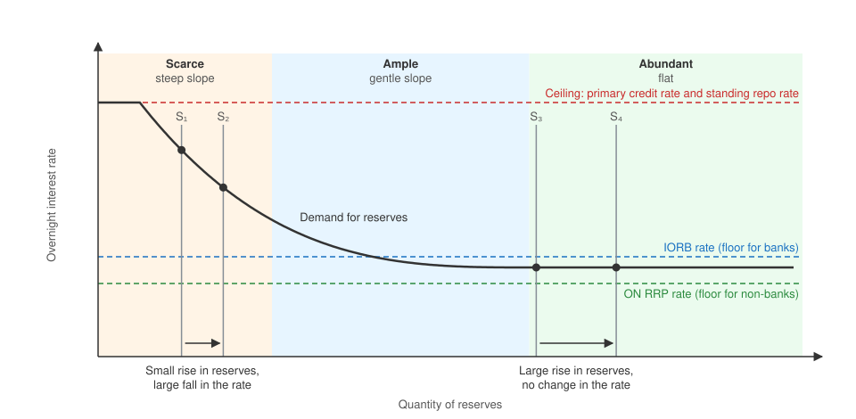

# Monetary Policy Implementation

A central bank announces a target for the overnight interest rate, and implementation is the set of tools that makes banks trade reserves at that rate. The Fed and the ECB moved from scarce reserves before 2008 to floor systems with abundant and then ample reserves.

## Scarce Reserves Before 2008

Reserves are the balances that banks hold at the central bank, which they use to pay each other and to meet liquidity needs (see [Role of Central Banks](02-role-of-central-banks.md)). Before 2008 they were scarce. In the week to 1 August 2007, US banks held on average $12 billion of reserve balances at the Fed, whose total assets were $874 billion. A scarce and useful good has a price, and the price of reserves is the overnight rate at which banks lend them to each other, in the US the federal funds rate.

- **Demand.** The demand curve slopes down. A bank about to run short of reserves for its payments pays a high rate to borrow them, and each extra unit is worth less.
- **Supply.** The supply curve is vertical, because it does not depend on the rate. The central bank alone sets it, as the monopoly issuer of reserves, which today sit at the top of the hierarchy of money (see [Credit and Currency](03-credit-and-currency.md)).

The Fed set a target for the federal funds rate and reached it with daily open market operations. To lower the rate it bought Treasury securities, which created reserves and moved the supply curve to the right, and to raise the rate it sold them. The Fed thus controlled the price through the quantity, and because reserves were scarce, small operations kept the rate close to the target.

The discount window, the lending facility of the Fed for banks, capped the rate. A bank had little reason to pay more in the market than the discount rate at which the Fed would lend to it, although the stigma of the window made this ceiling imperfect (see [Role of Central Banks](02-role-of-central-banks.md)).

## Abundant and Ample Reserves

From 2008, quantitative easing (QE) added Treasuries and agency mortgage-backed securities (MBS) to the assets of the Fed and created an equal amount of new reserves on its liabilities (see [Modern Money Creation](04-modern-money-creation.md)). Reserve balances were above $4 trillion in December 2021, and total assets peaked at $8.97 trillion on 13 April 2022.

Once banks hold all the reserves they need, extra reserves lose their value, and the demand curve has three regimes.

| Regime | Slope of the demand curve | Effect of a change in reserves on the rate |
| --- | --- | --- |
| Scarce | Steep | Large |
| Ample | Gentle | Small |
| Abundant | Flat, because banks are satiated | None |

Estimates of the curve find it flat when reserves exceed about 13% of bank assets, as in 2012–2017 and from mid-2020. With trillions of dollars of reserves, operations of a few billion no longer move the rate, so the pre-2008 tool stops working. In January 2019 the FOMC chose to keep a regime of ample reserves, in which it controls short-term rates mainly through its administered rates and does not need to manage the supply of reserves actively.

## The Floor

To raise rates with abundant reserves, the Fed sets the price of reserves directly instead of their quantity.

- **Interest on reserve balances (IORB).** The Fed has paid interest on reserves since October 2008, with a single IORB rate since 29 July 2021. A bank does not lend reserves to another bank below the IORB rate, because the Fed pays that rate with no credit risk. The Fed can always pay by creating reserves, while the other bank can fail.
- **Overnight reverse repo (ON RRP).** Many lenders, such as money market funds and government-sponsored enterprises (GSEs), cannot earn IORB and would lend below it. Through the ON RRP they lend cash overnight to the Fed against Treasury securities at the ON RRP rate. Primary dealers, money market funds, banks and GSEs can use it, up to $160 billion each per day.

The IORB rate is the floor for banks and the ON RRP rate the floor for the other institutions. This floor leaks, because only banks earn IORB. Banks borrow below IORB from lenders without access, such as the Federal Home Loan Banks, and deposit the funds at the Fed. The effective federal funds rate (EFFR) therefore stays above the ON RRP rate, almost always below IORB, and always below the discount rate. It was 7 basis points (bp) below IORB from 2022 to August 2025, and only 1 to 3 bp below it since December 2025.

## Quantitative Tightening

Quantitative tightening (QT) reverses QE. The Fed does not reinvest the principal of maturing securities, up to monthly caps, so its balance sheet shrinks.

| Period | Phase | Detail |
| --- | --- | --- |
| October 2017 – August 2019 | QT1 | Ended in August 2019, two months earlier than planned |
| 15 March 2020 – early March 2022 | Pandemic QE | Purchases of at least $500 billion of Treasuries and $200 billion of MBS at the start |
| June 2022 – November 2025 | QT2 | Monthly caps of $30 billion for Treasuries and $17.5 billion for MBS, raised to $60 billion and $35 billion after three months. The Treasury cap fell to $25 billion in June 2024 and to $5 billion in April 2025. Securities holdings fell by more than $2.2 trillion, from 33% to 20% of GDP. |
| From 12 December 2025 | Reserve management purchases (RMPs) | Purchases of Treasury bills to keep reserves ample, about $40 billion in the first month |

**Balance Sheet of the Fed on 18 November 2026**

| Assets | $ trillion | Liabilities and capital | $ trillion |
| --- | --- | --- | --- |
| Treasury securities (of which bills 0.58) | 4.59 | Reserve balances | 3.00 |
| MBS | 1.88 | Currency (Federal Reserve notes) | 2.45 |
| Other | 0.27 | Treasury General Account (TGA) | 0.89 |
| | | Reverse repos, almost all with foreign official accounts | 0.32 |
| | | Other liabilities and capital | 0.08 |
| **Total** | **6.74** | **Total** | **6.74** |

Reserves are what remains of the assets after the other liabilities and capital.

$$\text{Reserves} = \text{Assets} - \text{Currency} - \text{TGA} - \text{Reverse repos} - \text{Other liabilities and capital}$$

QT lowers the assets, but reserves fall one for one only if the other items stay constant.

- **ON RRP.** From 1 June 2022 to 3 December 2025, total assets fell by $2.38 trillion but reserves by only $0.48 trillion, because the ON RRP fell by $1.96 trillion to almost zero. It had peaked at $2.55 trillion on 30 December 2022.
- **TGA.** A rise in the account of the Treasury drains reserves. After the debt limit rose on 4 July 2025, the Treasury rebuilt its cash, and from 2 July to 29 October 2025 the TGA rose from $0.37 trillion to $0.98 trillion while reserves fell from $3.26 trillion to $2.83 trillion.

The boundaries between the regimes are not known in advance and move as the demand of banks for reserves changes, so the Fed finds them by watching money market rates. In October 2025 these rates suggested that reserves were approaching the lowest level that the Fed considers ample, and the Fed ended QT. In the year to 18 November 2026, RMPs raised its bill holdings by $0.39 trillion while its MBS fell by $0.19 trillion.

## Signals of Scarcity

Money market rates, and their distance from the administered rates, show how close reserves are to scarcity.

- **Repo rates.** A repo is a short-term loan of cash against securities, mostly Treasuries, and both banks and non-banks trade in this market. The Secured Overnight Financing Rate (SOFR) measures its cost.
- **Calendar.** Pressure peaks at month-ends, quarter-ends and especially year-ends, when banks and dealers adjust their balance sheets, and on tax and Treasury settlement dates, when cash moves to the TGA.
- **Distribution.** Large aggregate reserves can coexist with shortages in some banks or market segments, so who holds the reserves matters as well as how many exist.

SOFR was rarely above IORB before September 2025. It was above IORB on 17 of 22 days in October 2025, by up to 32 bp on 31 October, and on 21 of 22 days in December 2025. In 2026, to 23 November, it was above IORB on about one day in four, by at most 10 bp.

## Ceiling and Corridor

A floor stops the rate from falling, but not from rising. Two facilities lend reserves at a higher rate and form a ceiling.

- **Discount window.** Banks borrow at the primary credit rate, the top of the target range.
- **Standing repo operations (SRP).** Introduced in 2021 as the Standing Repo Facility (SRF). Twice a day, primary dealers and banks can borrow cash overnight against Treasuries, agency debt and agency MBS at the top of the target range, in full allotment and, since December 2025, with no aggregate limit. Use reached $50 billion on 31 October 2025 and a record $75 billion on 31 December 2025.

Market rates thus move in a corridor between the floor and the ceiling, and their position in it shows how tight the system is. A rate near the floor means abundant or ample reserves, and a rate near the ceiling means that reserves are becoming scarce.

| Tool | Rate since 17 September 2026 | Users | Role |
| --- | --- | --- | --- |
| Primary credit (discount window) | 4.00% | Banks | Ceiling |
| Standing repo operations | 4.00% | Primary dealers and banks | Ceiling |
| IORB | 3.90% | Banks | Floor |
| ON RRP | 3.75% | Money market funds, GSEs, primary dealers and banks | Floor |

The target range for the federal funds rate is 3.75–4.00%. On 23 November 2026 the EFFR was 3.88% and SOFR 3.92%, both close to the IORB rate.

**September 2019**

Without a ceiling facility, the rate can leave the target range. On 16 September 2019, corporate tax payments moved to the TGA and $54 billion of Treasury securities settled, so reserves fell by about $120 billion in two days, to $1.34 trillion, the lowest level since 2012. On 17 September SOFR jumped to 5.25% from 2.43% the day before, with some trades at 9%, and the EFFR rose to 2.30%, above its target range of 2.00–2.25%. The Fed lent through repo operations from 17 September and bought Treasury bills at about $60 billion per month from October 2019, and QE from March 2020 then made reserves abundant again.

## The ECB

### From Corridor to Floor

Before 2008, euro area banks needed reserves to cover banknotes and minimum reserve requirements, and the ECB supplied most of them by lending. Its three key rates formed a corridor.

- **Main refinancing operations (MROs).** Weekly one-week loans of reserves against collateral, from June 2000 by variable-rate tender with a minimum bid rate.
- **Deposit facility.** The floor. Banks deposit surplus reserves overnight at the deposit facility rate (DFR).
- **Marginal lending facility (MLF).** The ceiling. Banks borrow reserves overnight against collateral at the MLF rate.

The DFR and the MLF rate were 100 bp below and above the MRO rate, for example 3.00%, 4.00% and 5.00% from June 2007. Because the ECB supplied the reserves that the system needed, the overnight rate stayed in the middle of the corridor.

From 15 October 2008 the MROs became fixed-rate tenders with full allotment, so banks received all the reserves they asked for at the MRO rate, and the corridor narrowed to 50 bp either side until January 2009. Long-term lending and, from 2015, asset purchases created excess liquidity, which peaked at €4,748 billion in November 2022. With surplus reserves, banks stopped borrowing in the MROs and the overnight rate fell to the DFR, so since 2015 the Eurosystem has worked as a de facto floor system. As the portfolios of the asset purchase programme (APP) and the pandemic emergency purchase programme (PEPP) ran off, excess liquidity fell to €2,201 billion by July 2026, but credit operations still averaged only €27 billion.

### Supply-Driven and Demand-Driven Floors

A floor system can supply its surplus of reserves in two ways.

| | Supply-driven floor | Demand-driven floor |
| --- | --- | --- |
| The central bank fixes | The quantity of reserves, with asset purchases or fixed-quantity operations | The price, and lends all that banks ask for at a fixed rate (full allotment) |
| The demand of banks sets | The price | The quantity |
| Examples | The Fed, which buys bills to keep reserves ample, and the Eurosystem from 2015 | The ECB under its 2024 framework, and the Bank of England, whose Short-Term Repo supplies unlimited reserves for one week at Bank Rate |

In March 2024 the ECB decided to keep steering through the DFR and to supply reserves through a broad mix of instruments. These are MROs and three-month longer-term refinancing operations at a fixed rate with full allotment and, later, structural longer-term operations and a structural bond portfolio. From 18 September 2024 the MRO rate is only 15 bp above the DFR, instead of 50 bp, to encourage bidding, while the MLF rate stays 25 bp above the MRO rate. Since 16 September 2026 the DFR, MRO and MLF rates have been 2.50%, 2.65% and 2.90%. Both kinds of floor seek enough reserves and control of the overnight rate, but they deliver the reserves in different ways.

### €STR and the Deposit Facility Rate

The euro short-term rate (€STR), published by the ECB since 2 October 2019, is the euro counterpart of the federal funds rate. It measures the overnight unsecured borrowing of euro area banks from financial corporations, banks and non-banks alike. It has always been below the DFR, because only banks can use the deposit facility. Money market funds, investment funds, insurers and pension funds lend to banks below the DFR, and the banks deposit the cash at the DFR, so the floor leaks as in the US.

The spread between the €STR and the DFR therefore measures excess liquidity. When liquidity is abundant, banks need little funding and pay non-banks little, so the spread is wide. As excess liquidity falls, banks compete more for these funds and the spread narrows.

| Period | Average €STR minus DFR |
| --- | --- |
| Q4 2019 | −4 bp |
| Q4 2021 | −7 bp |
| 2023 | −10 bp |
| Q4 2024 | −9 bp |
| Q4 2025 | −7 bp |
| Q4 2026, to 23 November | −6 bp |

## References

- Afonso, Gara, Domenico Giannone, Gabriele La Spada, and John C. Williams. 2022. "Scarce, Abundant, or Ample? A Time-Varying Model of the Reserve Demand Curve." Staff Report No. 1019, Federal Reserve Bank of New York (revised 2025). [Online](https://www.newyorkfed.org/research/staff_reports/sr1019).
- Afonso, Gara, Domenico Giannone, Gabriele La Spada, and John C. Williams. 2024. "When Are Central Bank Reserves Ample?" *Liberty Street Economics*, Federal Reserve Bank of New York, 13 August 2024. [Online](https://libertystreeteconomics.newyorkfed.org/2024/08/when-are-central-bank-reserves-ample/).
- Anbil, Sriya, Alyssa Anderson, and Zeynep Senyuz. 2020. "What Happened in Money Markets in September 2019?" *FEDS Notes*, Board of Governors of the Federal Reserve System, 27 February 2020. [Online](https://doi.org/10.17016/2380-7172.2527).
- Bieber, Samuel, and Christian Lizarazo. 2026. "Liquidity Conditions and Monetary Policy Operations from 6 May to 28 July 2026." *Economic Bulletin* Issue 6/2026, European Central Bank. [Online](https://www.ecb.europa.eu/press/economic-bulletin/focus/2026/html/ecb.ebbox202606_07~68d5d49c60.en.html).
- Board of Governors of the Federal Reserve System. 2008. "Board Announces That It Will Begin to Pay Interest on Depository Institutions' Required and Excess Reserve Balances." Press release, 6 October 2008. [Online](https://www.federalreserve.gov/newsevents/pressreleases/monetary20081006a.htm).
- Board of Governors of the Federal Reserve System. 2019. "Statement Regarding Monetary Policy Implementation and Balance Sheet Normalization." Press release, 30 January 2019. [Online](https://www.federalreserve.gov/newsevents/pressreleases/monetary20190130c.htm).
- Board of Governors of the Federal Reserve System. 2019. "Federal Reserve Issues FOMC Statement." Press release, 31 July 2019. [Online](https://www.federalreserve.gov/newsevents/pressreleases/monetary20190731a.htm).
- Board of Governors of the Federal Reserve System. 2020. "Federal Reserve Issues FOMC Statement." Press release, 15 March 2020. [Online](https://www.federalreserve.gov/newsevents/pressreleases/monetary20200315a.htm).
- Board of Governors of the Federal Reserve System. 2021. "Federal Reserve Board Issues Final Rule Amending Regulation D with Regard to Interest on Reserve Balances." Press release, 2 June 2021. [Online](https://www.federalreserve.gov/newsevents/pressreleases/bcreg20210602a.htm).
- Board of Governors of the Federal Reserve System. 2022. "Federal Reserve Issues FOMC Statement." Press release, 26 January 2022. [Online](https://www.federalreserve.gov/newsevents/pressreleases/monetary20220126a.htm).
- Board of Governors of the Federal Reserve System. 2024. "Federal Reserve Issues FOMC Statement." Press release, 1 May 2024. [Online](https://www.federalreserve.gov/newsevents/pressreleases/monetary20240501a.htm).
- Board of Governors of the Federal Reserve System. 2025. "Federal Reserve Issues FOMC Statement." Press release, 19 March 2025. [Online](https://www.federalreserve.gov/newsevents/pressreleases/monetary20250319a.htm).
- Board of Governors of the Federal Reserve System. 2026. "Implementation Note Issued September 16, 2026." [Online](https://www.federalreserve.gov/newsevents/pressreleases/monetary20260916a1.htm).
- Board of Governors of the Federal Reserve System. "FOMC Communications Related to Policy Normalization." [Online](https://www.federalreserve.gov/monetarypolicy/policy-normalization.htm).
- Board of Governors of the Federal Reserve System. "H.4.1 Factors Affecting Reserve Balances of Depository Institutions and Condition Statement of Federal Reserve Banks." Releases of 2 August 2007, 23 December 2021, 14 April 2022, 2 June 2022, 3 July 2025, 30 October 2025, 4 December 2025 and 19 November 2026. [Online](https://www.federalreserve.gov/releases/h41/).
- Board of Governors of the Federal Reserve System. "Interest on Reserve Balances." [Online](https://www.federalreserve.gov/monetarypolicy/reserve-balances.htm).
- Cavallino, Paolo, Mathias Drehmann, Richard Finlay, and Julie Remache. 2025. "Monetary Policy Operational Frameworks – A New Taxonomy." *BIS Quarterly Review*, September 2025. [Online](https://www.bis.org/publ/qtrpdf/r_qt2509d.htm).
- Congressional Research Service. 2025. "Federal Debt and the Debt Limit in 2025." Insight IN12045, 11 September 2025. [Online](https://www.everycrsreport.com/reports/IN12045.html).
- European Central Bank. 2008. "Changes in Tender Procedure and in the Standing Facilities Corridor." Press release, 8 October 2008. [Online](https://www.ecb.europa.eu/press/pr/date/2008/html/pr081008_2.en.html).
- European Central Bank. 2024. "Changes to the Operational Framework for Implementing Monetary Policy." Statement by the Governing Council, 13 March 2024. [Online](https://www.ecb.europa.eu/press/pr/date/2024/html/ecb.pr240313~807e240020.en.html).
- European Central Bank. "ECB Data Portal." Series of the euro short-term rate (EST.B.EU000A2X2A25.WT) and of the key ECB interest rates (FM.B.U2.EUR.4F.KR). [Online](https://data.ecb.europa.eu/).
- European Central Bank. "Euro Short-Term Rate (€STR)." [Online](https://www.ecb.europa.eu/stats/financial_markets_and_interest_rates/euro_short-term_rate/html/index.en.html).
- Federal Reserve Bank of New York. 2025. "Statement Regarding Reserve Management Purchases Operations." 10 December 2025. [Online](https://www.newyorkfed.org/markets/opolicy/operating_policy_251210a).
- Federal Reserve Bank of New York. 2026. "How Monetary Policy Tools Helped Limit Money Market Pressures at Year-End." *The Teller Window*, 16 January 2026. [Online](https://tellerwindow.newyorkfed.org/2026/01/16/how-monetary-policy-tools-helped-limit-money-market-pressures-at-year-end).
- Federal Reserve Bank of New York. "FAQs: Reverse Repurchase Agreement Operations." [Online](https://www.newyorkfed.org/markets/rrp_faq.html).
- Federal Reserve Bank of New York. "FAQs: Standing Repurchase Agreement Operations." [Online](https://www.newyorkfed.org/markets/repo-agreement-ops-faq).
- Federal Reserve Bank of New York. "Markets Data APIs." Effective federal funds rate, SOFR, and results of repo and reverse repo operations. [Online](https://markets.newyorkfed.org/static/docs/markets-api.html).
- Ihrig, Jane, and Scott A. Wolla. 2020. "Closing the Monetary Policy Curriculum Gap: A Primer for Educators Making the Transition to Teaching the Fed's Ample-Reserves Framework." FEDS Notes, Federal Reserve Board, October 23. [Online](https://www.federalreserve.gov/econres/notes/feds-notes/closing-the-monetary-policy-curriculum-gap-20201023.htm).
- Keating, Thomas, and Marco Macchiavelli. 2018. "Interest on Reserves and Arbitrage in Post-Crisis Money Markets." *FEDS Notes*, Board of Governors of the Federal Reserve System, 1 March 2018. [Online](https://www.federalreserve.gov/econres/notes/feds-notes/interest-on-reserves-and-arbitrage-in-post-crisis-money-markets-20180301.html).
- Saporta, Victoria. 2025. "Learning by Doing." Speech, Bank of England, 11 June 2025. [Online](https://www.bankofengland.co.uk/speech/2025/june/victoria-saporta-speech-at-the-bank-of-finland-and-suerf-conference-monetary-policy-implementation).
- Schnabel, Isabel. 2024. "The Eurosystem's Operational Framework." Speech, European Central Bank, 14 March 2024. [Online](https://www.ecb.europa.eu/press/key/date/2024/html/ecb.sp240314~8b609de772.en.html).
