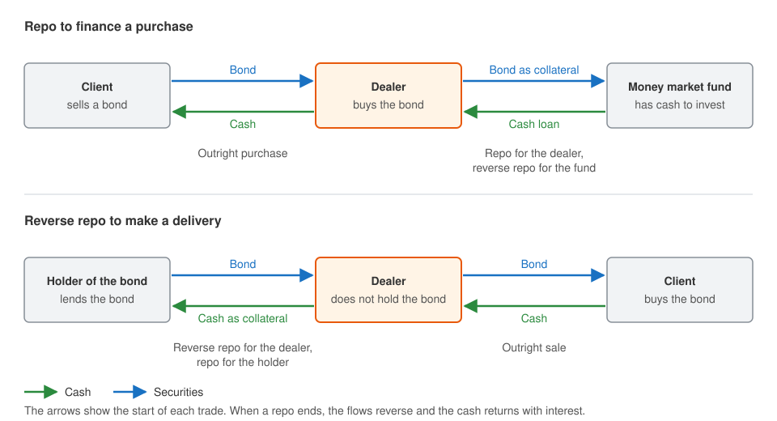
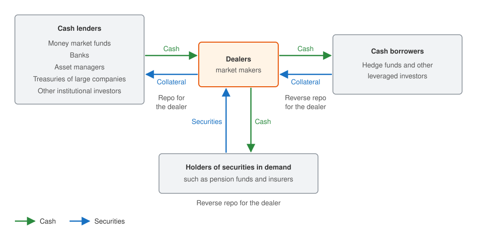

# Money Market Funds, Dealers and Repo

The money market brings together institutions that have cash to invest for a short time and institutions that have securities to finance. Money market funds are the largest lenders of cash, dealers are the main intermediaries, and repo is the instrument that connects them.

## Money Market Funds

### Origin

The Banking Act of 1933, passed after the crash of 1929, banned interest on checking accounts and let the Fed set ceilings on the interest rates of other deposits, a rule later known as Regulation Q. Until the mid-1960s inflation and market rates stayed low, so the ceilings caused few problems. Banks paid depositors in kind instead, with services such as credit lines and cash management, which were an implicit interest.

Inflation rose from 1965 and peaked near 15% in March 1980, and the Fed raised interest rates to contain it. Money market rates moved far above the ceilings, for example in 1973–74 and 1978–79, but a saver with less than $10,000, the minimum for a Treasury bill, could only hold deposits at the ceiling rates. Money market funds filled this gap. They pooled savings, bought money market instruments and passed the market yield, less expenses, to their shareholders. The first fund opened to the public in 1972. Assets reached almost $4 billion by the end of 1975, stayed between $3 billion and $4 billion until late 1977, and then grew by more than $2 billion a month in the first five months of 1979.

The Depository Institutions Deregulation and Monetary Control Act of 1980 phased the ceilings out by 1986, and the Dodd-Frank Act allowed interest on checking accounts from July 2011, but the funds remained.

### Shares, Not Deposits

A money market fund looks like a bank but is an investment fund. A depositor is a creditor of a bank, and the deposit is a liability of the bank. An investor in a fund owns shares, which are claims on the assets of the fund.

Most funds keep the value of a share, the net asset value (NAV), fixed at $1. The fund does not add its daily income to this value. It credits the income as dividends, usually reinvested as new shares at $1, so a share works like a deposit and the dividends like its interest. Under SEC Rule 2a-7, only government funds and retail funds, which only natural persons can own, may keep a stable price. Government funds held over 80% of the assets of US money market funds in March 2026. Other funds, such as institutional prime funds, must let the price float.

| | Bank | Money market fund |
| --- | --- | --- |
| Assets | Loans and securities with long maturities, and reserves | Short-term instruments, such as Treasury bills, repos and commercial paper |
| Liabilities | Deposits, many of them payable on demand | Shares, redeemable on demand, usually at $1 |
| Losses fall first on | The capital of the bank, then its creditors | The shareholders, because the fund has no capital buffer |
| Maturity mismatch | Large | Small |
| Account at the central bank | Yes | No |
| Deposit insurance | Yes, up to a limit | No |

### Short and Safe Assets

A bank funds long-term loans with deposits that customers can withdraw at any time. This maturity mismatch earns the bank a spread but exposes it to runs (see [Evolutionary Emergence of Banks](01-evolutionary-emergence-of-banks.md)). A money market fund also issues claims that investors can redeem at short notice, but Rule 2a-7 lets it hold only short-term assets, so its mismatch is small.

- **Maturity.** No instrument can mature in more than 397 days, and the weighted average maturity of the portfolio cannot exceed 60 days.
- **Liquidity.** At least 25% of the assets must be daily liquid assets, which are cash, Treasury securities and assets that mature within one business day, such as overnight repos. At least 50% must be weekly liquid assets.
- **Assets.** Government funds must invest at least 99.5% of their assets in cash, government securities and fully collateralized repos.

A money market fund is not a bank, so it cannot hold reserves at the central bank or borrow from it, and deposit insurance does not cover mutual funds. The fund can, however, lend cash to the Fed through the ON RRP, the overnight reverse repo facility (see [Monetary Policy Implementation](05-monetary-policy-implementation.md)). With no public guarantee, the fund must avoid losses for its shareholders, so it buys very safe assets, and repo is one of the most important.

At the end of October 2026, US money market funds held $8.47 trillion of investments. Treasury securities were $3.62 trillion (43%) and repos $2.79 trillion (33%), of which 82% were overnight or open. At the end of 2022, $2.34 trillion of their repos were with the Fed through the ON RRP and only $0.64 trillion with private borrowers. As the ON RRP drained, their private repos rose to $2.79 trillion, and by October 2026 almost none were with the Fed.

## Brokers and Dealers

A broker brings buyers and sellers together for a commission and does not use its own balance sheet. US law defines a broker as a person in the business of effecting transactions in securities for the account of others. A real estate agency is a broker, because it does not buy the houses that it advertises.

A dealer buys and sells for its own account, with its own balance sheet. A supermarket is a dealer, because it buys goods, holds them as inventory and sells them to customers, who never deal with the producers. Many securities firms do both and are called broker-dealers.

### Market Making

A dealer that stands ready to buy or sell a security at publicly quoted prices is a market maker. It quotes two prices.

- **Bid.** The price at which the dealer buys, which an investor receives when it sells.
- **Ask, or offer.** The price at which the dealer sells, which an investor pays when it buys. It is higher than the bid.

The difference between the two is the bid-ask spread, the main income of the dealer. An investor who buys and sells at the same moment loses the spread, and the dealer, on the other side of both trades, earns it. In exchange, the dealer gives immediacy. Investors can open or close a position at once, which makes the secondary market deeper and more liquid.

### The Cost of Inventory

To quote at all times, a dealer needs an inventory of securities, to sell, and of cash, to buy. Suppose that a client wants to sell $10 million of five-year Treasury notes. The dealer buys them to earn the spread and holds them until another client wants to buy. In the meantime it bears two costs.

- **Funding.** It must finance $10 million of notes. Unsecured borrowing or its own capital would be expensive.
- **Price risk.** The price of the notes can fall before it sells them.

## Repo

### A Sale and a Repurchase

The natural way to finance the notes is to borrow cash against the notes themselves, with a repurchase agreement, or repo. In a repo, one party sells a security and commits to buy it back on a later date at a higher price. Legally this is a sale and a repurchase, but economically it is a secured loan, in which the seller borrows cash and the security is collateral for the buyer. If the seller defaults, the buyer owns the security and can sell it to recover the cash. In the US, the bankruptcy code exempts repos on Treasury and agency securities from the automatic stay, so the buyer can sell the collateral at once.

The difference between the two prices is the interest, and its annual rate is the repo rate. US dollar repos use a 360-day year and the actual number of days. For example, the dealer finances the notes with a one-week repo with a money market fund.

| Date | Dealer | Money market fund |
| --- | --- | --- |
| 10 August | Sells the notes and receives $10,000,000 | Pays $10,000,000 and receives the notes |
| 17 August | Buys the notes back for $10,007,000 | Returns the notes and receives $10,007,000 |

The fund earns $7,000 of interest in the week, a repo rate of 3.6% a year.

$$\text{Repo rate} = \frac{7{,}000}{10{,}000{,}000} \times \frac{360}{7} = 0.036$$

In practice, the lender often pays less than the market value of the collateral. The difference is the haircut, for example 2%, and it protects the lender if the price of the collateral falls.

### Repo and Reverse Repo

The same trade has two names. For the party that delivers the security and receives cash, here the dealer, it is a repo. For the party that delivers cash and receives the security, here the fund, it is a reverse repo.

Central banks name their operations from the side of the private counterparty. In the ON RRP the Fed receives cash from money market funds and delivers securities, so for the funds it is a reverse repo. In the standing repo operations the Fed lends cash to dealers and banks against securities, so for them it is a repo (see [Monetary Policy Implementation](05-monetary-policy-implementation.md)).

### Financing a Dealer

The repo solves the problem of the dealer. It buys the notes from the client, sells them at once in a repo to a money market fund, and pays the client with the cash of the repo. The fund needs to invest cash for a short time and the dealer needs to finance securities, so each solves the problem of the other.

The dealer pays interest on the repo, but it also earns the interest of the notes. If its yield does not change, a bond gains value as time passes, through the coupon interest that accrues or, for a discount bond, through the rise of its price toward face value. If the notes yield 4.5%, they earn about $8,630 in the week, while the repo costs $7,000.

$$10{,}000{,}000 \times 0.045 \times \frac{7}{365} \approx 8{,}630$$

The net gain of about $1,630 is the carry of the position, if the price of the notes does not change. The carry is positive because the five-year rate is above the one-week rate. The dealer borrows short and lends long, so it earns money from maturity mismatch, and the mismatch that the money market fund avoids appears on the balance sheet of the dealer.

### Borrowing a Security

A repo can also run the other way. Suppose that a client wants to buy a bond that the dealer does not hold. The dealer does a reverse repo with a holder of the bond, in which it lends cash and receives the bond, and it delivers the bond to the client. To end the reverse repo, the dealer must buy the bond in the market and return it.

The same technique lets an investor sell short. It borrows a bond, sells it and later buys it back to return it, so it gains if the price falls in the meantime. A dealer uses it to hedge, too. After it buys bonds from a client, it can sell short a similar bond that it borrows in repo, so that a gain on the short position offsets a fall in the price of the bonds.

## Four Functions of Repo

Repo is a market for cash and a market for securities at the same time, and it has four functions.

1. **Invest surplus cash.** Deposit insurance covers only $250,000 per depositor, per bank and per ownership category in the US, and €100,000 per depositor and per bank in the EU. A large holder of cash is safer with a loan secured by collateral than with a bank deposit, so repo channels wholesale investment in the money market.
2. **Finance a position.** An investor or a dealer borrows cash against the security that it buys, as in the example above.
3. **Lend an idle security.** A holder of a security that others want lends it in a repo and receives cash. When a security is in high demand, a "special", its repo rate falls below the rate for general collateral, the basket of interchangeable securities. Its holder then borrows cash cheaply and can reinvest it at a higher rate, which raises the return of the portfolio.
4. **Borrow a specific security.** A dealer borrows a security to deliver it to a client, or an investor borrows it to sell short.

In the first two functions the cash matters, and the repo is cash-driven. In the last two a particular security matters, and the repo is securities-driven.

## Why Repo Matters

Repo lets a dealer buy from a client at once, because it can finance the purchase cheaply and does not need another client who wants to buy the same bonds at the same moment. It also lets the dealer sell a bond that it does not hold and hedge the bonds that it holds.

Without repo, market making would cost much more. Dealers would need larger inventories or expensive unsecured funding, or they would buy only when another client is ready to buy. Less market making means less liquidity and wider bid-ask spreads, so every investor who trades through a broker pays more, because the investor always buys at the ask and sells at the bid. As in any market, limits on wholesale activity give retail customers worse prices, and this is as true for securities as for groceries.

## Who Lends and Who Borrows

Cash lenders are institutions with large amounts of cash that they may need at short notice, such as money market funds, banks, asset managers, the treasuries of large companies and other institutional investors. Cash borrowers are dealers and other market makers, which finance their inventories, and leveraged investors such as hedge funds, which borrow to finance their positions. Holders of securities in demand, such as pension funds and insurers, lend them to raise the return of their portfolios.

The US repo market has about $13.5 trillion of repos outstanding on a typical day, or 40% of GDP. About 70% use Treasury securities as collateral, and most mature overnight. Money market funds are the largest lenders, with about $3 trillion in January 2026, and hedge funds are the largest borrowers, with about $3 trillion in late 2025.

Dealers stand between the two sides. A dealer borrows cash in a repo from a money market fund and lends it at a higher rate in a reverse repo to a hedge fund, and it keeps the difference. It also passes to one client the securities that it receives from another. In late 2024, US dealers borrowed $3.7 trillion and lent $3.4 trillion a day in repo. A dealer thus uses the cash and the collateral of some clients to meet the needs of others, with little capital of its own, and this leverage makes the business risky for the dealer itself.

## References

- Afonso, Gara, Jun-Davinci Choi, Gonzalo Cisternas, and Will Riordan. 2026. "Who's Borrowing and Lending in Repo Markets?" *Liberty Street Economics*, Federal Reserve Bank of New York, 28 September 2026. [Online](https://doi.org/10.59576/lse.20260928).
- Afonso, Gara, Jun-Davinci Choi, Gonzalo Cisternas, and Will Riordan. 2026. "Follow the Cash! Microstructure of Repo Markets." *Liberty Street Economics*, Federal Reserve Bank of New York, 29 September 2026. [Online](https://doi.org/10.59576/lse.20260929).
- Afonso, Gara, Jun-Davinci Choi, Gonzalo Cisternas, and Will Riordan. 2026. "The Role of Repos in Monetary Policy Implementation." *Liberty Street Economics*, Federal Reserve Bank of New York, 30 September 2026. [Online](https://doi.org/10.59576/lse.20260930).
- Bryan, Michael. 2013. "The Great Inflation." Federal Reserve History, 22 November 2013. [Online](https://www.federalreservehistory.org/essays/great-inflation).
- Cook, Timothy Q., and Jeremy G. Duffield. 1979. "Money Market Mutual Funds: A Reaction to Government Regulations or a Lasting Financial Innovation?" *Economic Review* 65 (4): 15–31, Federal Reserve Bank of Richmond. [PDF](https://www.richmondfed.org/-/media/RichmondFedOrg/publications/research/economic_review/1979/pdf/er650402.pdf).
- European Commission. "Deposit Guarantee Schemes." [Online](https://finance.ec.europa.eu/banking/banking-regulation/deposit-guarantee-schemes_en).
- European Parliament and Council of the European Union. 2014. "Directive 2014/49/EU of 16 April 2014 on Deposit Guarantee Schemes." *Official Journal of the European Union* L 173, 12 June 2014, 149. Article 6. [Online](https://eur-lex.europa.eu/legal-content/EN/TXT/?uri=CELEX:32014L0049).
- Federal Deposit Insurance Corporation. "Understanding Deposit Insurance." [Online](https://www.fdic.gov/resources/deposit-insurance/understanding-deposit-insurance).
- Federal Reserve Bank of Boston. "Depository Institutions Deregulation and Monetary Control Act of 1980." Summary of the act. [PDF](https://www.bostonfed.org/about/pubs/deposito.pdf).
- Federal Reserve Bank of New York. "FAQs: Reverse Repurchase Agreement Operations." [Online](https://www.newyorkfed.org/markets/rrp_faq.html).
- International Capital Market Association. 2019. "Frequently Asked Questions on Repo." Published in February 2013 and amended in January 2019. [PDF](https://www.icmagroup.org/assets/documents/Regulatory/Repo/Repo-FAQs-January-2019.pdf).
- Maues, Julia. 2013. "Banking Act of 1933 (Glass-Steagall)." Federal Reserve History, 22 November 2013. [Online](https://www.federalreservehistory.org/essays/glass-steagall-act).
- Office of Financial Research. "U.S. Money Market Fund Monitor." Holdings of money market funds from SEC Form N-MFP, December 2022 to October 2026. [Online](https://www.financialresearch.gov/money-market-funds/).
- Securities Industry and Financial Markets Association. 1996. "Master Repurchase Agreement." September 1996 version. [PDF](https://www.sifma.org/wp-content/uploads/2017/08/MRA_Agreement.pdf).
- U.S. Code. Title 15, Section 78c, "Definitions and Application," paragraphs (a)(4) and (a)(5). [Online](https://www.law.cornell.edu/uscode/text/15/78c).
- U.S. Securities and Exchange Commission. "Bid Price/Ask Price." Investor.gov glossary. [Online](https://www.investor.gov/introduction-investing/investing-basics/glossary/ask-price).
- U.S. Securities and Exchange Commission. "Market Makers." Investor.gov glossary. [Online](https://www.investor.gov/introduction-investing/investing-basics/glossary/market-makers).
- U.S. Securities and Exchange Commission. "Money Market Funds." 17 CFR 270.2a-7. Electronic Code of Federal Regulations. [Online](https://www.ecfr.gov/current/title-17/chapter-II/part-270/section-270.2a-7).
