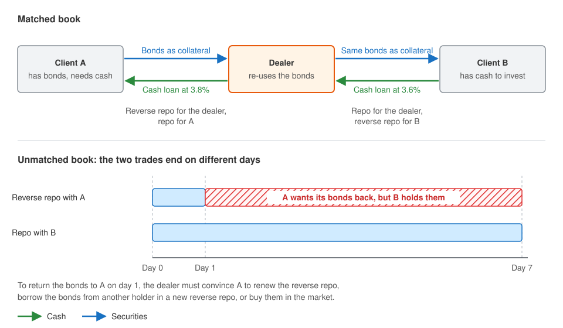

# Matched Book and the September 2019 Repo Spike

A dealer earns the bid-ask spread, not the change in the price of the securities that it trades, so it tries to hold no net exposure to that price. A matched book removes the exposure with repo, but no book is perfectly matched, and the repo spike of September 2019 shows what happens when many mismatches surface at the same time.

## Price Risk

### Silicon Valley Bank

In mid-2021 short-term interest rates were close to zero. On 30 June 2021 the one-year Treasury yielded 0.07% and the 30-year bond 2.06%. To earn more on their assets, some banks bought long-term Treasury securities and agency mortgage-backed securities (MBS), which a government agency or the government-sponsored enterprises (GSEs) guarantee. These assets had almost no credit risk, but long maturities.

Silicon Valley Bank (SVB) took this furthest. Its deposits rose from $103.2 billion at the end of 2020 to $191.4 billion at the end of 2021, and at the end of 2022 about 94% of them were uninsured, mostly from technology firms and venture capital. Its securities rose from $23 billion in 2018 to $125 billion in 2021, and its held-to-maturity (HTM) securities from $15 billion to $98 billion, mostly agency MBS with maturities of 10 years or more.

To fight inflation, the Fed raised the top of its target range from 0.25% in March 2022 to 4.50% in December 2022, and the prices of long-term bonds fell. A 30-year bond with a 2% coupon, bought at par in mid-2021, lost about 30% of its value by March 2023 and about 46% by October 2023.

| Date | 30-year yield | Price of the bond per 100 of face value |
| --- | --- | --- |
| Mid-2021 | About 2% | 100 |
| 10 March 2023 | 3.70% | 70.2 |
| 19 October 2023 | 5.11% | 54.3 |

The prices discount the remaining semiannual coupons of 1 and the face value of 100 at the 30-year yield of each day.

At the end of 2022, SVB had unrealized losses of $15.2 billion on its HTM securities and $2.5 billion on its available-for-sale (AFS) securities, close to or above its capital of $15.5 billion. HTM securities are carried at amortized cost, so their losses did not reduce the reported capital, but the bank could not sell them without making the losses real. On 8 March 2023 SVB announced that it had sold $21 billion of AFS securities at an after-tax loss of $1.8 billion and that it planned to raise $2.25 billion of capital. The next day depositors withdrew $42 billion, about 25% of its $166 billion of deposits, and requests for $100 billion more were pending for 10 March. On 10 March the California Department of Financial Protection and Innovation closed the bank and appointed the Federal Deposit Insurance Corporation (FDIC) as receiver. Signature Bank failed on 12 March and First Republic Bank on 1 May 2023.

Assets with no credit risk can thus sink a bank if rates rise while it funds them with deposits that can leave at once.

### Leverage

A dealer works with little capital. If its capital is 3% of its assets, the minimum leverage ratio of Basel III, a fall of 3% in the value of its assets wipes out the capital, and a fall of 30% is far beyond what it can absorb. A dealer therefore tries to remove the price risk of the securities that it intermediates, and its main tool is the matched book.

## Matched Book

### Repo Against Reverse Repo

To remove the price risk of a security, a dealer can match it with an equal obligation to deliver the same security, so that a long position offsets a short one. Repo gives the dealer this match (see [Money Market Funds, Dealers and Repo](06-money-market-funds-dealers-and-repo.md)). Suppose that the dealer has two clients.

1. **Client A** has bonds and needs cash. The dealer does a reverse repo with A, so it lends cash and receives the bonds as collateral.
2. **Client B**, for example a money market fund, has cash and wants a safe short-term investment. The dealer does a repo with B, so it delivers the same bonds as collateral and borrows cash.

The dealer finances A with the cash of B and the collateral of A, which is called collateral re-use. When repos fund offsetting reverse repos, the dealer has a matched book.

The bonds belong to A. The dealer must return them to A and will receive them back from B, so its claim and its obligation in bonds cancel. A change in the price of the bonds changes both sides of its balance sheet equally, and the equity of the dealer does not move.

A repo of a bond that the dealer owns is different. It finances the bond but leaves the price risk with the dealer, because the dealer must buy the bond back at a fixed price. To hedge that bond, the dealer must also sell short a similar bond (see [Money Market Funds, Dealers and Repo](06-money-market-funds-dealers-and-repo.md)).

The dealer earns the bid-ask spread on its trades and the difference between the rate at which it lends to A and the rate at which it borrows from B. For example, it lends $10 million to A for one week at 3.8% and borrows the same amount from B at 3.6%.

$$10{,}000{,}000 \times (0.038 - 0.036) \times \frac{7}{360} \approx 389$$

Large US dealers do this every day, in what is known as matched book activity. They borrow cash from money market funds in the triparty repo market, where a custodian bank settles the trades, and lend it at a higher rate to smaller dealers and hedge funds in the cleared bilateral market, where the Fixed Income Clearing Corporation stands between the two sides.

## Limits of a Matched Book

A dealer has dozens of trades on each side, and they rarely match perfectly.

- **Maturity.** Assets and liabilities can end on different dates, which creates a maturity mismatch.
- **Counterparty.** The clients on the two sides carry different credit risk. If A defaults and its bonds are worth less than the cash lent, the dealer bears the loss and still owes B in full.
- **Correlation.** The dealer may match securities of different classes whose prices usually move together, and the correlation can break under stress.

A book that is matched in theory then stops being matched in practice. A dealer with an unmatched book takes liquidity risk, credit risk and interest rate risk, and these risks can destroy its balance sheet very fast.

Suppose that A can end the reverse repo tomorrow, return the cash and ask for its bonds, but the repo with B ends in one week. The dealer must deliver bonds that it will receive only in a week, because it lent them to B for longer than it held them from A. It has three ways out.

1. Convince A to renew the reverse repo.
2. Borrow the bonds from another holder in a new reverse repo.
3. Buy the bonds in the market and deliver them to A.

Each way is cheap in normal times but can be very costly under stress, for example if the bonds become hard to find just when many clients want theirs back. An unmatched book can run for a long time without problems. Strains usually build slowly and break out fast. Because the funding given to one client depends on the collateral supplied by another, a dealer becomes fragile in ways that partly resemble a bank (see [Evolutionary Emergence of Banks](01-evolutionary-emergence-of-banks.md)).

The same analysis applies to any financial intermediary, which can match or mismatch the maturity, credit and liquidity of its assets and liabilities. When mismatches build up across intermediaries, imbalances grow in the financial system, and some money market indicators can signal them.

## The September 2019 Repo Spike

### Background

After three rounds of quantitative easing (QE), reserves peaked at about $2.8 trillion in October 2014. From October 2017 quantitative tightening (QT) shrank the balance sheet of the Fed (see [Monetary Policy Implementation](05-monetary-policy-implementation.md)), and by mid-September 2019 reserves were below $1.4 trillion. This was still far above the less than $10 billion of the end of 2007, but nobody knew where the boundary between ample and scarce reserves lay. At the same time, Treasury securities outstanding were at an all-time high, and in early 2019 the net Treasury positions of primary dealers reached an all-time high too.

Primary dealers are the trading counterparties of the New York Fed in its monetary policy operations, and they are expected to bid for their pro-rata share in every Treasury auction. They buy new Treasuries in the primary market, sell them to investors and, in the meantime, finance them with repos.

### Two Shocks

On Monday 16 September 2019, two shocks drained reserves at the same time.

| Shock | What happened | Effect |
| --- | --- | --- |
| Corporate taxes | Quarterly tax payments moved cash from bank and money market fund accounts to the Treasury General Account (TGA) at the Fed | Private deposits and reserves fall, and the TGA rises |
| Treasury settlement | $54 billion of long-term Treasury securities settled. Primary dealers paid for them and financed them with repos | The payment moves to the TGA, so reserves fall, and the demand for repo funding rises |

Reserves fell by about $120 billion in two business days, to $1.34 trillion, the lowest level since 2012. The repo market had more Treasuries to finance with less cash.

### Lenders Held Back

Higher rates did not bring out more cash.

- **Large banks.** The largest US banks held reserves well above their lowest comfortable level, the level below which a bank acts to keep or raise its reserves, but did not lend more in repo or federal funds. Uncertainty and internal risk limits likely held them back.
- **Banks near their minimum.** Other banks were close to their lowest comfortable level and borrowed instead. On 16 and 17 September, over half of the federal funds borrowing of the surveyed banks came from banks near or below this level, about double the usual 25%.
- **Money market funds.** Government funds had cut their repo lending by about $80 billion from mid-August to mid-September as they moved into Treasury bills, $45 billion of it in the week to 17 September. Uncertainty about outflows for the tax payments made them reluctant to lend more.

Dealers needed the cash to keep financing their positions, so their demand for funding did not fall as the rate rose. SOFR volume rose only $20 billion, to $1.18 trillion on 17 September, while the rate more than doubled, and the spiral carried other money market rates with it.

### Rates Leave the Range

SOFR, the Secured Overnight Financing Rate, measures the cost of overnight repo on Treasuries, and the EFFR, the effective federal funds rate, the cost of overnight unsecured loans of reserves (see [Monetary Policy Implementation](05-monetary-policy-implementation.md)).

| Date | SOFR | SOFR, 99th percentile | EFFR | Target range |
| --- | --- | --- | --- | --- |
| 13 September | 2.20% | 2.40% | 2.14% | 2.00–2.25% |
| 16 September | 2.43% | 4.60% | 2.25% | 2.00–2.25% |
| 17 September | 5.25% | 9.00% | 2.30% | 2.00–2.25% |
| 18 September | 2.55% | 5.00% | 2.25% | 2.00–2.25% |
| 19 September | 1.95% | 2.50% | 1.90% | 1.75–2.00% |
| 20 September | 1.86% | 2.08% | 1.90% | 1.75–2.00% |

The FOMC lowered the target range by 25 basis points on 18 September, with effect from 19 September. The pressure spread from repo to the federal funds market, where banks lend reserves to each other, and on 17 September the EFFR rose above the top of the target range. For two days the Fed lost control of the overnight rate, because it had no ceiling facility for repo yet. The standing repo operations started only in 2021.

### The Fed Steps In

On 17 September the New York Fed offered up to $75 billion in an overnight repo with primary dealers against Treasury, agency debt and agency MBS collateral, at a minimum bid rate of 2.10%. Dealers took $53.15 billion. The Fed offered up to $75 billion every morning for the rest of the week, then term repos over the quarter-end, and from October 2019 it bought Treasury bills. Rates returned to normal in the following days. Private cash was missing to finance a large issuance of government debt, and the Fed supplied it against Treasuries as collateral.

QE from March 2020 ended the scarcity of reserves. Inflation rose after this round, unlike after the earlier ones, and US consumer prices rose 9.1% in the year to June 2022. The rate rises that followed caused the losses of SVB.

### Lessons

Repo is more than an overnight funding market, because it lets a large part of the financial system turn long-term assets into liquidity. When long-term government debt is financed overnight, someone holds a large maturity mismatch, which is an unmatched book. When this transformation works, nobody talks about it. When it fails, the stress passes from the balance sheets of dealers to repo, from repo to federal funds, and at last forces the central bank to step in.

## References

- Anbil, Sriya, Alyssa Anderson, Stephanie Curcuru, et al. 2019. "Recent Money Market Developments." Memo to the Federal Open Market Committee, 8 October 2019. [PDF](https://www.federalreserve.gov/monetarypolicy/files/FOMC20191008memo02.pdf).
- Anbil, Sriya, Alyssa Anderson, and Zeynep Senyuz. 2020. "What Happened in Money Markets in September 2019?" *FEDS Notes*, Board of Governors of the Federal Reserve System, 27 February 2020. [Online](https://doi.org/10.17016/2380-7172.2527).
- Basel Committee on Banking Supervision. 2014. "Basel III Leverage Ratio Framework and Disclosure Requirements." Bank for International Settlements, January 2014. [Online](https://www.bis.org/publ/bcbs270.htm).
- Board of Governors of the Federal Reserve System. 2019. "Federal Reserve Issues FOMC Statement." Press release, 18 September 2019. [Online](https://www.federalreserve.gov/newsevents/pressreleases/monetary20190918a.htm).
- Board of Governors of the Federal Reserve System. 2019. "Statement Regarding Monetary Policy Implementation." Press release, 11 October 2019. [Online](https://www.federalreserve.gov/newsevents/pressreleases/monetary20191011a.htm).
- Board of Governors of the Federal Reserve System. 2023. "Review of the Federal Reserve's Supervision and Regulation of Silicon Valley Bank." April 2023. [PDF](https://www.federalreserve.gov/publications/files/svb-review-20230428.pdf).
- Federal Deposit Insurance Corporation. "Bank Failures in Brief – 2023." [Online](https://www.fdic.gov/resources/resolutions/bank-failures/in-brief/2023).
- Federal Open Market Committee. 2019. "Conference Call of the Federal Open Market Committee on October 4, 2019." Transcript. [PDF](https://www.federalreserve.gov/monetarypolicy/files/FOMC20191004confcall.pdf).
- Federal Reserve Bank of New York. 2019. "Statement Regarding Repurchase Operation." 17 September 2019. [Online](https://www.newyorkfed.org/markets/opolicy/operating_policy_190917).
- Federal Reserve Bank of New York. "Markets Data APIs." SOFR, effective federal funds rate, and results of repo operations, September 2019. [Online](https://markets.newyorkfed.org/static/docs/markets-api.html).
- Federal Reserve Bank of New York. "Primary Dealers." [Online](https://www.newyorkfed.org/markets/primarydealers).
- International Capital Market Association. 2019. "Frequently Asked Questions on Repo." Published in February 2013 and amended in January 2019. [PDF](https://www.icmagroup.org/assets/documents/Regulatory/Repo/Repo-FAQs-January-2019.pdf).
- Office of Inspector General, Board of Governors of the Federal Reserve System and Consumer Financial Protection Bureau. 2023. "Material Loss Review of Silicon Valley Bank." Evaluation Report 2023-SR-B-013, 25 September 2023. [PDF](https://oig.federalreserve.gov/reports/board-material-loss-review-silicon-valley-bank-sep2023.pdf).
- U.S. Bureau of Labor Statistics. "Consumer Price Index for All Urban Consumers (CPI-U), U.S. City Average, All Items." Series CUUR0000SA0. [Online](https://data.bls.gov/timeseries/CUUR0000SA0).
- U.S. Department of the Treasury. "Daily Treasury Par Yield Curve Rates." 2021 and 2023. [Online](https://home.treasury.gov/resource-center/data-chart-center/interest-rates/TextView?type=daily_treasury_yield_curve).
