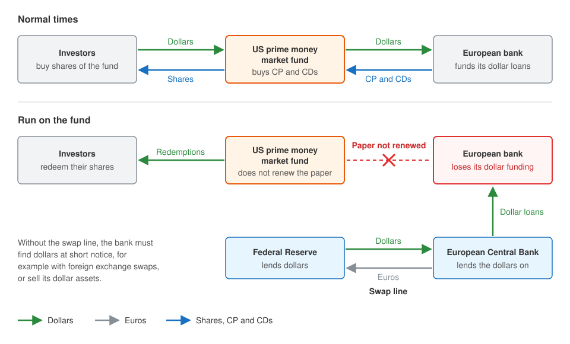

# Unsecured Money Market

Repo is the main form of secured funding in the money market (see [Money Market Funds, Dealers and Repo](06-money-market-funds-dealers-and-repo.md)). A large part of the money market, however, has no collateral at all. The lender relies only on the promise of the borrower to pay, as a saver does with a three-month time deposit at a bank. In the wholesale market, the two main unsecured instruments are commercial paper (CP) and certificates of deposit (CDs).

| | Commercial paper | Large negotiable CD | Repo |
| --- | --- | --- | --- |
| Borrower | Companies and financial firms | Banks only | Dealers, banks and hedge funds |
| Legal form | Short-term promissory note | Time deposit with a negotiable certificate | Sale and repurchase of a security |
| Collateral | None | None | Securities, with a haircut |
| Maturity | Up to 270 days in the US, about 30 days on average. Up to one year in Europe | At least 7 days, mostly 1 to 12 months | Mostly overnight |
| Interest | Discount to the face value | Usually paid at maturity | Repurchase price above the sale price |
| Secondary market | Small. The dealer often buys the paper back as a service | Dealers make a market | Not traded |
| Main lenders | Money market funds, companies and other financial firms | Money market funds and other non-bank investors | Money market funds, banks and other holders of cash |

## Commercial Paper

CP is a short-term promissory note that a company or a financial firm issues without collateral. In the US, the Securities Act of 1933 exempts it from registration with the SEC under two main conditions. Its maturity must be 270 days or less, and it must finance current transactions, such as inventories and receivables, not fixed assets on a permanent basis. In practice, the maturity is much shorter, about 30 days on average. In Europe the limit is one year, which is 364 days for Euro Commercial Paper (ECP) and 365 days for Negotiable European Commercial Paper (NEU CP), the French market.

Like a Treasury bill, CP is issued at a discount and pays no coupon. The investor pays less than the face value and receives the face value at maturity, and the difference is the interest. For example, an investor pays $9,970,000 for 30-day paper with a face value of $10 million.

$$\text{Discount rate} = \frac{10{,}000{,}000 - 9{,}970{,}000}{10{,}000{,}000} \times \frac{360}{30} = 0.036$$

The discount rate is 3.6% a year. Because CP needs no registration, a company can issue it quickly and at a low cost, and for many large issuers it is cheaper than a bank loan.

CP trades mainly in the primary market. Each issue has its own maturity and size, so it is difficult to put together blocks large enough to trade. Investors also know how long they want to invest, and most of them keep the paper to maturity. An investor that must sell early usually sells to the dealer that placed the paper. The dealer buys it back as a service to its clients, with no legal duty, unlike the second leg of a repo, which is part of the contract. Dealers tend to stop such services when markets come under stress, as in March 2020.

## Certificates of Deposit

A certificate of deposit is the document of a time deposit at a bank, which states the amount, the maturity and the interest rate. A large negotiable CD, usually of $1 million or more, can be sold to another investor before it matures, so it is a deposit that trades like a security. Only banks can issue CDs, but in most other respects a CD is similar to CP.

## Regulation Q and the Rise of CDs and CP

The negotiable CD appeared for the same reason as the money market fund, which is Regulation Q. This rule banned interest on demand deposits and capped the rates on time deposits (see [Money Market Funds, Dealers and Repo](06-money-market-funds-dealers-and-repo.md)).

After the Second World War, interest rates rose, and companies kept less cash in demand deposits, which paid no interest. Demand deposits and currency fell from 29% of the financial assets of nonfinancial companies in 1946 to 16% in 1960, as the companies moved cash to commercial paper and other money market instruments. To win back these funds, First National City Bank of New York, now Citibank, began to sell large negotiable CDs in 1961. At the same time, the Discount Corporation of New York, a government securities dealer, agreed to make a secondary market in them. Other New York banks followed, and within a year the CDs outstanding exceeded $1 billion. A company now earned the rate of a time deposit and could still sell the CD when it needed cash.

The CD was still a time deposit, so the ceilings of Regulation Q applied to it. In 1966, and more severely in 1969 and early 1970, market rates rose above the ceilings, and the CDs outstanding fell sharply. Banks then raised funds in the Eurodollar and commercial paper markets. In 1970, after the failure of Penn Central, the Fed removed the ceilings on large CDs with maturities of less than three months, and in 1973 on all large CDs.

Regulation Q thus led the financial system to create two new instruments. Savers moved their cash to a vehicle outside the banks, the money market fund. Banks created a deposit that companies could sell and that, from 1970 and 1973, escaped the ceilings. Where a profitable arbitrage exists, the market usually finds a way to exploit it, whatever the rules say.

The money market funds then brought the cash back to the banks by another route. They grew from $10 billion in 1978 to $206 billion in 1982, and a large part of their assets were CDs. Savers who left the banks thus still financed them, through the CDs that their funds bought.

CP grew in a similar way. US CP outstanding rose from $33 billion at the end of 1970 to $558 billion at the end of 1990, about 17 times. Many large companies found that CP cost less than a bank loan, and money market funds became its main buyers. Their share of the CP outstanding rose from 1% in 1975 to 36% in 1990, when CP was 48% of their assets.

## Issuers

At the end of October 2026, US commercial paper outstanding was $1.44 trillion.

| Issuer | US | Foreign | Total |
| --- | --- | --- | --- |
| Nonfinancial companies | 271 | 73 | 344 |
| Financial firms | 252 | 350 | 602 |
| Subtotal | 523 | 423 | 946 |
| Asset-backed programs | – | – | 498 |
| Total | – | – | 1,444 |

Billions of dollars, end of October 2026, not seasonally adjusted.

Foreign issuers sold 45% of the CP that is not asset-backed, and about half of it at the end of 2024 and of 2025. Among US issuers, nonfinancial companies sold 52%. This share was 27% or less at each year-end from 2001 to 2010, when financial firms issued most of the paper.

Most of the foreign paper comes from financial firms, $350 billion of $423 billion, and foreign banks alone issued $165 billion. A European, Japanese or Canadian bank issues CP in the US because it needs dollars. It holds dollar assets, such as dollar loans to its clients, but has few retail deposits in dollars, so it borrows them in the US wholesale market.

Asset-backed CP, about a third of the total, is issued by special purpose entities that buy receivables from one or more firms and finance the purchase with CP. The risk of this paper depends on the receivables, not on the whole business of a company or a bank.

## Investors

| Holder | End of 2007 | End of 2015 | End of 2016 | Mid-2026 |
| --- | --- | --- | --- | --- |
| Money market funds | 688 (38%) | 389 (42%) | 146 (17%) | 314 (22%) |
| Nonfinancial companies | 70 | 139 | 133 | 301 |
| Rest of the world | 226 | 104 | 141 | 174 |
| Other financial institutions | 278 | 12 | 110 | 154 |
| Total outstanding | 1,788 | 931 | 875 | 1,451 |

Billions of dollars. Smaller holders, such as mutual funds, dealers and insurers, are not shown.

Money market funds are the usual buyers of CP. Just before the 2008 crisis they held almost 40% of it. Their share stayed above 40% from 2009 to 2015, while the market shrank, and then fell to 17% at the end of 2016.

The fall came from the reform that the SEC adopted in 2014 and that took effect in October 2016. It hit prime funds, which are the funds that buy CP and CDs. Institutional prime funds had to let the price of their shares float instead of keeping it at $1. The boards of all prime funds could also charge redemption fees or suspend redemptions if the weekly liquid assets of the fund fell below 30%. Investors moved to government funds, which kept the stable price, and the assets of prime funds fell by more than $850 billion from April to October 2016. A later reform, adopted in 2023, removed the suspension of redemptions and raised the minimum liquid assets to 25% daily and 50% weekly. Government funds, which hold government debt and repos backed by it, now hold most of the assets of the industry (see [Money Market Funds, Dealers and Repo](06-money-market-funds-dealers-and-repo.md)). The reforms thus moved savings from the short-term debt of banks and companies to government debt.

The gap that the money market funds left did not stay empty. Other financial institutions filled much of it, a group that includes funding subsidiaries, custodial accounts that reinvest the cash collateral of securities lending, central clearing counterparties and the special purpose vehicles of Fed facilities. The treasuries of large companies also bought more CP. In mid-2026, money market funds held 22% of US CP, about as much as nonfinancial companies, with 21%.

## Behavior Under Stress

US money market funds are procyclical in unsecured markets. They buy a lot of CP and CDs in calm times and withdraw under stress, just when the issuers most need to renew their paper. Other financial institutions then partly fill the gap.

March 2020 shows the pattern. By the end of the month, investors had redeemed about $200 billion from prime funds, around 20% of their assets, while government funds received more than $800 billion. To pay the redemptions, prime funds sold CP or did not renew it. Dealers were already near the limits of their balance sheets and could not absorb all the paper, so activity in CP and CDs almost stopped.

The Fed then created two facilities for this market. On 17 March it announced the Commercial Paper Funding Facility (CPFF), which bought CP directly from US issuers through a special purpose vehicle. On 18 March it announced the Money Market Mutual Fund Liquidity Facility (MMLF), which lent to banks against assets that they bought from money market funds. Dealers took more CP into inventory only after the MMLF, and prime funds received modest inflows again by mid-April.

The funding of non-US banks shows the same pattern. US and offshore money market funds cut their dollar funding to these banks by about $207 billion in February and March 2020, and by about $300 billion over the year, and it did not come back. Other non-bank financial institutions replaced this funding, mostly with dollar deposits.

## Dollar Funding of Non-US Banks

The typical case is a European bank with dollar assets, such as dollar loans to European clients. The bank has few dollar deposits and does not want a currency mismatch. It therefore funds the loans with one-month or three-month CP or CDs issued in New York, and a US prime money market fund buys them.

If the investors in the fund become afraid and redeem their shares, as depositors run from a bank, the fund does not renew the paper. The bank then loses its dollar funding. It must find dollars at short notice, for example with foreign exchange swaps that turn its euros into dollars, or sell its dollar assets. If it funds the dollar loans with euros, it takes on exchange rate risk. A run on the funds thus becomes a shortage of dollars, which is most acute outside the US, where banks have no direct access to Fed loans.

This happened after the failure of Lehman Brothers in September 2008. In mid-2008, US prime funds had about $1 trillion invested in non-US banks, half of the portfolios of the 15 largest prime funds. Money market funds supplied about an eighth of the $8 trillion of dollar funding of European banks, so the run on the funds after Lehman cut a large source of dollars.

A foreign central bank can then borrow dollars from the Fed through a swap line, against its own currency, and lend them to its banks. On 18 September 2008 the Fed raised its swap line with the ECB to $110 billion. On 13 October it made the lines with the ECB, the Bank of England and the Swiss National Bank unlimited. On 15 March 2020 the Fed and five other central banks cut the price of their standing swap lines and added operations with an 84-day maturity.

## References

- Aldasoro, Iñaki, Egemen Eren, and Wenqian Huang. 2021. "Dollar Funding of Non-US Banks through Covid-19." *BIS Quarterly Review*, March 2021, 31–40. [PDF](https://www.bis.org/publ/qtrpdf/r_qt2103c.pdf).
- Baba, Naohiko, Robert N. McCauley, and Srichander Ramaswamy. 2009. "US Dollar Money Market Funds and Non-US Banks." *BIS Quarterly Review*, March 2009, 65–81. [PDF](https://www.bis.org/publ/qtrpdf/r_qt0903g.pdf).
- Board of Governors of the Federal Reserve System. "About Commercial Paper." [Online](https://www.federalreserve.gov/releases/cp/about.htm).
- Board of Governors of the Federal Reserve System. "Commercial Paper Rates and Outstanding Summary." Commercial paper outstanding by type of issuer, 2001 to October 2026. [Online](https://www.federalreserve.gov/releases/cp/).
- Board of Governors of the Federal Reserve System. 2020. "Coordinated Central Bank Action to Enhance the Provision of U.S. Dollar Liquidity." Press release, 15 March 2020. [Online](https://www.federalreserve.gov/newsevents/pressreleases/monetary20200315c.htm).
- Board of Governors of the Federal Reserve System. 2020. "Federal Reserve Board Announces Establishment of a Commercial Paper Funding Facility (CPFF) to Support the Flow of Credit to Households and Businesses." Press release, 17 March 2020. [Online](https://www.federalreserve.gov/newsevents/pressreleases/monetary20200317a.htm).
- Board of Governors of the Federal Reserve System. 2020. "Federal Reserve Board Broadens Program of Support for the Flow of Credit to Households and Businesses by Establishing a Money Market Mutual Fund Liquidity Facility (MMLF)." Press release, 18 March 2020. [Online](https://www.federalreserve.gov/newsevents/pressreleases/monetary20200318a.htm).
- Board of Governors of the Federal Reserve System. 2026. "Financial Accounts of the United States – Z.1." Release of 10 September 2026, table F3.1.s "Open Market Paper" and the sector note of table L.132 "Other Financial Business." [Online](https://www.federalreserve.gov/releases/z1/).
- Eren, Egemen, Andreas Schrimpf, and Vladyslav Sushko. 2020. "US Dollar Funding Markets during the Covid-19 Crisis – the Money Market Fund Turmoil." *BIS Bulletin* 14, 12 May 2020. [PDF](https://www.bis.org/publ/bisbull14.pdf).
- Hahn, Thomas K. 1998. "Commercial Paper." Chapter 9 in *Instruments of the Money Market*. Federal Reserve Bank of Richmond. Last updated in 1993. [PDF](https://www.richmondfed.org/-/media/richmondfedorg/publications/research/special_reports/instruments_of_the_money_market/pdf/chapter_09.pdf).
- International Capital Market Association. 2025. "Creating the Conditions to Scale Up the European Commercial Paper Market." November 2025. [PDF](https://www.icmagroup.org/assets/documents/Regulatory/CP/ICMA-paper-Creating-the-conditions-to-scale-up-the-European-commercial-paper-market-November-2025.pdf).
- Morris, Marc D., and John R. Walter. 1998. "Large Negotiable Certificates of Deposit." Chapter 4 in *Instruments of the Money Market*. Federal Reserve Bank of Richmond. Last updated in 1993. [PDF](https://www.richmondfed.org/-/media/richmondfedorg/publications/research/special_reports/instruments_of_the_money_market/pdf/chapter_04.pdf).
- U.S. Securities and Exchange Commission. 2023. "SEC Adopts Money Market Fund Reforms and Amendments to Form PF Reporting Requirements for Large Liquidity Fund Advisers." Press release 2023-129, 12 July 2023. [Online](https://www.sec.gov/newsroom/press-releases/2023-129).
