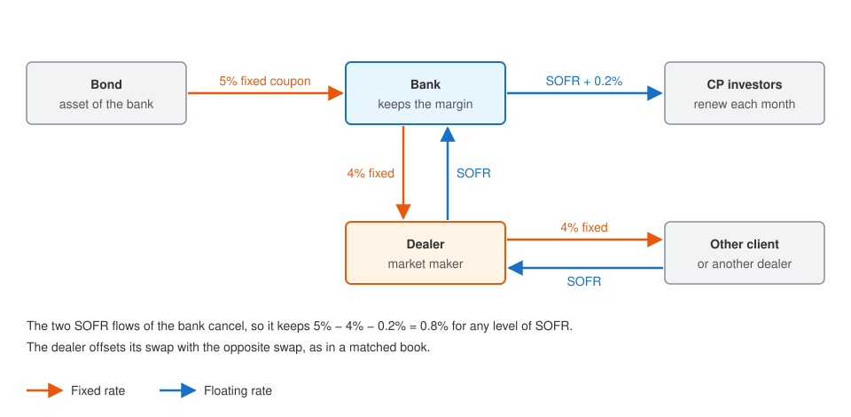
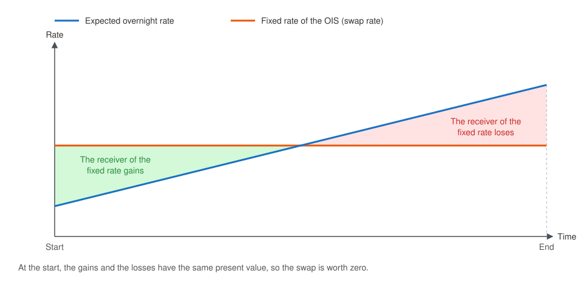

# From LIBOR to SOFR and OIS

Banks borrow without collateral for one to three months in the wholesale market (see [Unsecured Money Market](08-unsecured-money-market.md)). For decades, the price of this funding was LIBOR. Today the US dollar benchmark is SOFR, an overnight repo rate, and the overnight indexed swap (OIS) turns overnight rates into rates for longer terms.

## LIBOR

### What LIBOR Measured

LIBOR, the London Interbank Offered Rate, measured the cost of unsecured term funding for large banks. Each business day, a panel of banks submitted the rate at which each bank estimated that it could borrow unsecured funds in the wholesale market. For each tenor, the highest and lowest quarters of the submissions were removed, and the rest were averaged. Until the end of 2021, LIBOR covered five currencies (US dollar, sterling, euro, Swiss franc and yen) and seven tenors from overnight to 12 months, and the US dollar panel had 16 banks.

LIBOR priced two things in one number. The first was the credit risk of the banking sector. The second was a premium for term liquidity, which pays the lender to commit funds for a fixed term instead of overnight.

### Why Banks Liked It

Suppose that a bank funds itself with three-month CP and lends to a company at three-month LIBOR plus a margin. LIBOR moves with the funding costs of banks. When these costs rise, the interest on the loan rises too, so the margin of the bank, which is its core business, stays protected.

LIBOR was also forward-looking. It was set at the start of each interest period, so when a bank signed a three-month loan, it already knew the rate for those three months.

### Why LIBOR Ended

Two problems ended LIBOR, or forced its reform where it survived.

1. **Quotes, not trades.** LIBOR came from estimates, not transactions, and the banks that submitted them had money at stake in the result. Some banks understated their borrowing costs to look more creditworthy, and some traders asked the submitters to move the rate in favor of their derivative positions. In June 2012, Barclays agreed to pay a $200 million penalty to the US Commodity Futures Trading Commission for attempted manipulation of LIBOR and Euribor and for false reports. During the crisis of 2007–09, its senior managers had told the submitters to report artificially low rates to protect the reputation of the bank.
2. **A market with few trades.** The unsecured interbank term market that LIBOR claimed to measure shrank after 2008. Reserves became abundant (see [Monetary Policy Implementation](05-monetary-policy-implementation.md)), so banks needed to borrow less from each other, and liquidity rules made short-term unsecured wholesale funding less attractive. On a typical day in the late 2010s, the three-month wholesale funding of major banks was about $500 million, in about seven transactions. In contrast, about $200 trillion of contracts referenced US dollar LIBOR at the end of 2016. LIBOR thus measured a market that had almost disappeared.

The authorities answered with new benchmarks based on transactions in markets that were still active, the near risk-free rates (RFRs). On 5 March 2021, the UK Financial Conduct Authority (FCA) announced the end dates. The panels for all sterling, euro, Swiss franc and yen settings, and for the one-week and two-month US dollar settings, ended after 31 December 2021, and the panels for the other US dollar settings after 30 June 2023. Some settings continued for old contracts in a synthetic form, without a panel. The last ones, the one-, three- and six-month US dollar rates, were published for the last time on 30 September 2024.

### Euribor Survives

Not every interbank offered rate ended. Euribor, the euro interbank offered rate, was reformed instead. Since 2019 a hybrid method sets it from the transactions of the panel banks when they exist, and otherwise from earlier transactions and market data.

Euribor survives because some users need a reference rate that contains bank credit risk, covers a term and is known at the start of the period. An overnight rate gives none of these. The euro area therefore uses two benchmarks, Euribor and the €STR, an unsecured overnight rate (see [Monetary Policy Implementation](05-monetary-policy-implementation.md)). In the US, the authorities backed only SOFR, a secured overnight rate, and rates derived from it, so the US has no reformed rate with bank credit risk like Euribor.

## SOFR

SOFR, the Secured Overnight Financing Rate, measures the cost of overnight repo on Treasury securities (see [Matched Book and the September 2019 Repo Spike](07-matched-book-and-the-september-2019-repo-spike.md)). In 2014 the Federal Reserve Board and the New York Fed convened the Alternative Reference Rates Committee (ARRC), a group of private market participants, to find an alternative to US dollar LIBOR. The committee found that unsecured term markets had too few transactions for a robust rate. In June 2017 it chose SOFR, and the New York Fed began to publish it on 3 April 2018.

The change is large. LIBOR was an unsecured rate that measured the credit risk of banks. SOFR is a rate secured by government debt and measures almost no bank risk. The new benchmark of the dollar is a repo rate.

The market behind SOFR is very deep. The first published rate, for 2 April 2018, rested on $849 billion of transactions, and in 2026, to 23 November, the daily volume averaged $3.1 trillion.

### Overnight Rates in Other Currencies

Each major currency chose its own overnight RFR.

| Currency | Rate | Administrator | Secured |
| --- | --- | --- | --- |
| US dollar | SOFR, Secured Overnight Financing Rate | New York Fed | Yes, repo on Treasuries |
| Sterling | SONIA, Sterling Overnight Index Average | Bank of England | No |
| Euro | €STR, euro short-term rate | ECB | No |
| Swiss franc | SARON, Swiss Average Rate Overnight | SIX Swiss Exchange | Yes, repo |
| Yen | TONA, Tokyo Overnight Average Rate | Bank of Japan | No |

Two of the five rates are secured and three are not. The new rates are thus not a uniform family, and a comparison across currencies needs care.

### Averages

A three-month loan cannot use the overnight rate of a single day. Contracts use an average of SOFR over a period, usually compounded, for two reasons. The average reflects the movement of rates over the whole period, and it smooths out idiosyncratic day-to-day moves. Since 2 March 2020, the New York Fed has published 30-, 90- and 180-day SOFR Averages and a SOFR Index for this purpose.

An average in arrears, over the interest period itself, is known only at the end of the period. An average in advance, over the previous period, is known at the start but still describes the past. Neither locks in the cost of the next three months, as LIBOR did. LIBOR was an expectation set at the start, while an average of SOFR is a realized average of past rates. Expectations matter to anticipate economic activity and financial problems, so the market needs a way to recover them, and swaps provide it.

## Interest Rate Swaps

An interest rate swap is an agreement between two parties to exchange one stream of interest payments for another over a set period, on the same notional amount. The two streams use different references, usually a fixed rate and a floating rate. The floating rate can be any reference, such as SOFR. The fixed rate, which the parties negotiate, is the swap rate.

### Hedging a Bank

Suppose that a bank holds a bond with a fixed coupon of 5% and funds it with CP that it renews every month at SOFR plus 0.2%. If SOFR rises above 4.8%, the bank loses money. To remove this risk, it enters a swap in which it pays a fixed rate of 4% and receives SOFR.

| | SOFR at 3% | SOFR at 6% |
| --- | --- | --- |
| Coupon of the bond | 5.0% | 5.0% |
| Cost of the CP, SOFR + 0.2% | −3.2% | −6.2% |
| Margin without the swap | 1.8% | −1.2% |
| Swap, receive SOFR | +3.0% | +6.0% |
| Swap, pay the fixed rate | −4.0% | −4.0% |
| Margin with the swap | 0.8% | 0.8% |

The SOFR that the bank receives in the swap cancels the SOFR that it pays on its CP. The bank then pays the fixed rate of the swap out of the fixed coupon of the bond, and its margin stays at 0.8% whatever SOFR does. The hedge is complete only if the spread of 0.2% does not change. With a swap on LIBOR, the floating rate moved with the funding costs of banks, so a general rise in bank spreads was also hedged. With a swap on SOFR, the bank keeps this basis risk.

### Who Takes the Other Side

Dealers usually take the other side of the swap as market makers. A dealer then offsets the risk with a client that wants the opposite swap or with another dealer in the interdealer market. From June to August 2010, the 14 largest dealers offset about 60% of the interest rate risk of large swap trades within 30 minutes. This is the logic of the matched book, with derivatives instead of repos (see [Matched Book and the September 2019 Repo Spike](07-matched-book-and-the-september-2019-repo-spike.md)).

## Overnight Indexed Swaps

An overnight indexed swap (OIS) is a swap whose floating leg pays the compounded average of an overnight rate, such as SOFR or the €STR, over the life of the contract. At the start, nobody knows the future overnight rates, so the floating payment is uncertain, and this is the risk that the bank of the example wants to remove. The fixed leg pays a rate that the parties agree at the start.

The parties set the fixed rate so that the swap is worth zero at the start. Receiving the fixed rate is then worth as much as receiving the average overnight rate, so the fixed rate is the market expectation of the average overnight rate over the life of the swap.

Suppose that the market expects the overnight rate to rise steadily from 3.5% to 4.5% over one year. The one-year OIS rate is then close to 4%, the average of the expected path. At first, the receiver of the fixed rate gains, because 4% is above the overnight rate, and later it loses. At the start, the gains and the losses have the same present value.

After the start, unexpected events create a winner and a loser. For example, if all rates fall below the expected path, the receiver of the fixed rate gains, and the swap has a large positive value for it.

### A Clean Reference

A three-month OIS rate contains no bank credit risk and no premium for term liquidity, only the expected path of the overnight rate. It is therefore a clean reference for the level of interest rates, and the price of any other funding is best read as a spread over it. For example, the spread between three-month LIBOR and the three-month OIS rate measured the credit and term liquidity premium of banks. It was about 10 bp before August 2007, reached 366 bp on 10 October 2008 and widened again in March 2020.

The same expectation gives the bank of the example a three-month rate that is known in advance. CME Group publishes Term SOFR rates, which it derives from the prices of SOFR derivatives, and in July 2021 the ARRC recommended them for business loans. A loan can thus again use a rate known at the start of the period, but with no bank credit risk.

### Three Questions

Three questions classify any reference rate. Is it based on quotes or on transactions? Is it known at the start or at the end of the period? Does it reflect an expectation about the future or what already happened?

| | LIBOR | SOFR averaged in arrears | OIS rate |
| --- | --- | --- | --- |
| Based on | Quotes of a panel of banks | Repo transactions | Prices in the swap market |
| Known | At the start of the period | At the end of the period | At the start of the period |
| Reflects | Expected cost of unsecured bank funding | Past overnight rates | Expected overnight rates |
| Bank credit risk | Yes | No | No |

### The Swap Curve

Swaps of different maturities give one rate for each maturity, and together these rates form a yield curve built from market prices. This swap curve can be compared with the Treasury yield curve. The swap spread is the difference between a swap rate and the government bond yield of the same maturity, and for the US dollar it turned negative in 2015.

Money markets moved from government rates to private rates as benchmarks in the 1980s. Since the 1990s, bond markets have also moved from government rates to swap rates as the benchmark for the pricing and hedging of other securities, such as corporate bonds. In April 2016, the daily turnover of interest rate swaps and options was $2.0 trillion, against $0.5 trillion for government bond futures and options.

## References

- Alternative Reference Rates Committee. 2019. "A User's Guide to SOFR." April 2019. [PDF](https://www.newyorkfed.org/medialibrary/Microsites/arrc/files/2019/Users_Guide_to_SOFR.pdf).
- Alternative Reference Rates Committee. 2020. "SOFR Starter Kit, Part I." [PDF](https://www.newyorkfed.org/medialibrary/Microsites/arrc/files/2020/ARRC_Factsheet_1.pdf).
- Alternative Reference Rates Committee. 2021. "ARRC Formally Recommends a Forward-Looking SOFR Term Rate." Infographic, July 2021. [PDF](https://www.newyorkfed.org/medialibrary/Microsites/arrc/files/2021/ARRC_Infographic_Term_SOFR.pdf).
- Bank of England. 2021. "Announcements on the End of LIBOR." 5 March 2021. [Online](https://www.bankofengland.co.uk/news/2021/march/announcements-on-the-end-of-libor).
- Commodity Futures Trading Commission. 2012. "CFTC Orders Barclays to Pay $200 Million Penalty for Attempted Manipulation of and False Reporting Concerning LIBOR and Euribor Benchmark Interest Rates." Press release 6289-12, 27 June 2012. [Online](https://www.cftc.gov/PressRoom/PressReleases/6289-12).
- Eren, Egemen, Andreas Schrimpf, and Vladyslav Sushko. 2020. "US Dollar Funding Markets during the Covid-19 Crisis – the Money Market Fund Turmoil." *BIS Bulletin* 14, 12 May 2020. [PDF](https://www.bis.org/publ/bisbull14.pdf).
- European Money Markets Institute. "Euribor Reforms." [Online](https://www.emmi-benchmarks.eu/benchmarks/euribor/reforms/).
- Federal Reserve Bank of New York. 2020. "Statement Introducing the SOFR Averages and Index." 2 March 2020. [Online](https://www.newyorkfed.org/markets/opolicy/operating_policy_200302).
- Federal Reserve Bank of New York. "Markets Data APIs." SOFR rates and volumes, 2018 and 2026. [Online](https://markets.newyorkfed.org/static/docs/markets-api.html).
- Financial Conduct Authority. "Transition from LIBOR." Last updated 9 March 2026. [Online](https://www.fca.org.uk/markets/transition-libor).
- Fleming, Michael, John Jackson, Ada Li, Asani Sarkar, and Patricia Zobel. 2012. "An Analysis of OTC Interest Rate Derivatives Transactions: Implications for Public Reporting." Federal Reserve Bank of New York Staff Report 557, revised October 2012. [PDF](https://www.newyorkfed.org/medialibrary/media/research/staff_reports/sr557.pdf).
- Kreicher, Lawrence L., Robert N. McCauley, and Philip Wooldridge. 2017. "The Bond Benchmark Continues to Tip to Swaps." *BIS Quarterly Review*, March 2017. [Online](https://www.bis.org/publ/qtrpdf/r_qt1703h.htm).
- Schrimpf, Andreas, and Vladyslav Sushko. 2019. "Beyond LIBOR: A Primer on the New Reference Rates." *BIS Quarterly Review*, March 2019, 29–52. [Online](https://www.bis.org/publ/qtrpdf/r_qt1903e.htm).
- Sengupta, Rajdeep, and Yu Man Tam. 2008. "The LIBOR-OIS Spread as a Summary Indicator." *Economic Synopses* 2008 (25), Federal Reserve Bank of St. Louis, 15 October 2008. [Online](https://fraser.stlouisfed.org/title/economic-synopses-6715/libor-ois-spread-a-summary-indicator-624209).
