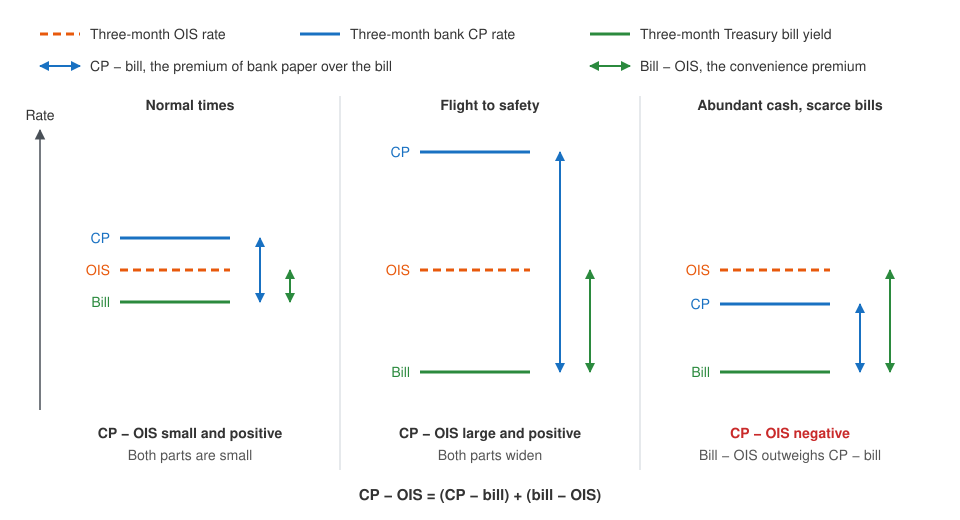

# Convenience Premium

The CP–OIS spread measures the liquidity and credit risk of lending to banks (see [Money Market Spreads](10-money-market-spreads.md)). Yet it can turn negative, which seems to say that an unsecured loan to a bank costs less than the risk-free rate. The three-month Treasury bill explains this puzzle, because it splits the spread into two parts.

## Splitting the CP–OIS Spread

Subtract and add the yield of the three-month Treasury bill, which has the same maturity as the other two rates.

$$\text{CP} - \text{OIS} = (\text{CP} - \text{bill}) + (\text{bill} - \text{OIS})$$

This is an identity, not an approximation, so the two parts always add up exactly to the whole spread. The first part compares private paper with public paper. The second part compares the safest short-term security with a swap, which needs no cash.

## The Modern TED Spread

The Treasury is assumed to have no credit risk, so CP minus the bill should show what a lender charges to lend to a bank instead of to the Treasury. Until LIBOR ended, this was the role of the TED spread, three-month LIBOR minus the three-month bill yield. Its name joins T-bill and ED, the ticker of the Eurodollar futures contract. With the rate of three-month AA financial CP in place of LIBOR, the same idea gives a modern TED spread.

Since 2001 the median of this spread has been 15 bp. In August and September 2007 it rose to a median of about 120 bp, and in October 2008 its monthly median reached 239 bp, the highest of the series, when the financial system was close to collapse. The spread had thus warned of danger for more than a year. It also jumped in later episodes of stress, for example to 257 bp on 25 March 2020, but like any single indicator it can mislead, and it is best read together with others.

In a panic the spread widens from both sides, because the rate of bank paper rises and the yield of the bill falls. On 20 August 2007, for example, AA financial CP paid 5.23%, close to the target of the Fed of 5.25%, while the bill yielded 3.08%. Most of the spread of 215 bp on that day came from the fall of the bill yield, not from the banks. The second part of the identity measures this fall.

## Treasury Bill Minus OIS

The OIS rate contains no liquidity premium, so the spread between the bill and OIS might seem to measure the liquidity premium of the bill. Yet this spread is usually negative, which would mean a negative liquidity premium. The reason is that the bill is the asset of choice for liquidity in the money market. It is the safest short-term asset, and Treasury securities are the main collateral in repo (see [Money Market Funds, Dealers and Repo](06-money-market-funds-dealers-and-repo.md)). Investors accept a yield below the expected overnight rate for the convenience of holding the bill, so the spread measures the price of safety, which is the convenience premium.

When the policy rate is at its floor and no change is expected, the OIS rate is about equal to the overnight rate, and the gap between the bill and the overnight rate shows the premium directly. From 2009 to 2015, the three-month bill yielded a median of 5 bp less than the effective federal funds rate (EFFR).

The bill–OIS spread changes the point of view. The other spreads measure what lenders charge to lend to a private borrower, and this one measures what investors pay to avoid it. It is the same fear, seen from the other side of the balance sheet.

### Flight to Safety

The convenience premium jumps in a panic, as investors run to the bill. On 20 August 2007, the three-month bill yielded 3.08%, down from 4.67% on 9 August, while the target of the Fed was still 5.25%. On 17 September 2008, in the week that Lehman Brothers failed, the yield fell to 0.03%, with the target at 2%. A very negative spread thus shows a flight to safety and possible trouble in the banks.

### Too Many Bills

The spread can also be positive. A positive spread does not show fear, but too little cash to absorb the bills on offer. Since 2009, bill yields have often risen above OIS rates when dealers could not easily absorb the new bills that the Treasury sold. In 2020, to meet unprecedented borrowing needs in the pandemic, the Treasury doubled the stock of bills in about three months. From April to June 2020, with rates at the floor and no change expected, the three-month bill yielded 7 to 8 bp more than the EFFR, in monthly medians. A shortage of cash of the same kind caused the repo spike of September 2019 (see [Matched Book and the September 2019 Repo Spike](07-matched-book-and-the-september-2019-repo-spike.md)). A positive spread thus shows more debt than the available cash can absorb.

## Why the CP–OIS Spread Turns Negative

The identity solves the puzzle. The CP–OIS spread is the premium of bank paper over the bill plus the bill–OIS spread, which is usually negative. When the convenience premium is larger than the premium of bank paper over the bill, the CP–OIS spread turns negative. This tends to happen when cash is abundant and safe assets are scarce, so that investors accept low yields on all short-term paper, as in yen in 2023 (see [Money Market Spreads](10-money-market-spreads.md)).

The CP–OIS spread is widely followed, but its two parts say more than their sum. It is best to split it and to follow each part on its own.

## Liquidity Premium at Long Maturities

At three months, the bill–OIS spread measures the convenience premium. At longer maturities, the spread between Treasury bonds and OIS rates of the same maturity shows a premium for term liquidity. Before 2008, swap rates were generally above government bond yields. After 2008 the US swap spread, the swap rate minus the bond yield, turned negative at long maturities, and it has become persistent even at 10 years (see [From LIBOR to SOFR and OIS](09-from-libor-to-sofr-and-ois.md)). In recent years, the yields of 10-year and 30-year Treasuries have thus been above the OIS rates of the same maturity.

A bond needs cash or repo funding for its whole life, and it uses space on the balance sheet of the dealer that holds it, while a swap needs neither. Investors therefore demand a premium for term liquidity to hold long Treasuries. The premium grows when private investors must absorb more government debt, as with large deficits and the end of central bank purchases. In March 2020, when investors sold Treasuries that dealers could not absorb, Treasury yields rose well above OIS rates.

SOFR has existed only since 2018, so the history of this spread is short, and other indicators must measure the liquidity premium in earlier crises.

## A Map of the Spreads

| Spread | Measures | Usual sign | Under stress |
| --- | --- | --- | --- |
| OIS minus overnight rate | Expected change in the policy rate | About zero | Negative before cuts and positive before hikes |
| CP minus OIS | Liquidity and credit risk of banks | Small | Widens in bank stress, and can turn negative when cash is abundant |
| CP minus bill, the modern TED spread | Premium of bank paper over the safest paper | Positive, median of 15 bp | Widens from both sides in a panic |
| Bill minus OIS, three months | Convenience premium, the price of safety | Negative | Much more negative in a flight to safety, and positive when there are too many bills |
| Treasury bond minus OIS, 10 and 30 years | Premium for term liquidity | Positive in recent years | Grows when investors must absorb more government debt |

## References

- Aquilina, Matteo, Andreas Schrimpf, Vladyslav Sushko, and Dora Xia. 2024. "Negative Interest Rate Swap Spreads Signal Pressure in Government Debt Absorption." Box in *BIS Quarterly Review*, December 2024. [Online](https://www.bis.org/publ/qtrpdf/r_qt2412y.htm).
- Bank for International Settlements. 2023. "Bank CP Rates amid Asymmetric Funding-Liquidity Conditions across Currencies." Box in *BIS Quarterly Review*, September 2023. [Online](https://www.bis.org/publ/qtrpdf/r_qt2309y.htm).
- Bank for International Settlements. 2025. "Compressed Credit Spreads and the Quest for a Risk-Free Rate." Box in *BIS Quarterly Review*, December 2025. [Online](https://www.bis.org/publ/qtrpdf/r_qt2512s.htm).
- Board of Governors of the Federal Reserve System. "Commercial Paper Rates and Outstanding Summary." Daily rates of 90-day AA financial paper, 1997 to November 2026. [Online](https://www.federalreserve.gov/releases/cp/).
- Board of Governors of the Federal Reserve System. "Open Market Operations." Changes in the target for the federal funds rate. [Online](https://www.federalreserve.gov/monetarypolicy/openmarket.htm).
- Board of Governors of the Federal Reserve System. "Selected Interest Rates (Daily) – H.15." Three-month Treasury bill rate in the secondary market and effective federal funds rate, 1997 to November 2026. [Online](https://www.federalreserve.gov/releases/h15/).
- He, Zhiguo, Stefan Nagel, and Zhaogang Song. 2020. "Treasury Inconvenience Yields during the COVID-19 Crisis." NBER Working Paper 27416. [DOI](https://doi.org/10.3386/w27416).
- Klingler, Sven, and Suresh Sundaresan. 2023. "Diminishing Treasury Convenience Premiums: Effects of Dealers' Excess Demand and Balance Sheet Constraints." *Journal of Monetary Economics* 135: 55–69. [DOI](https://doi.org/10.1016/j.jmoneco.2023.01.002).
- Treasury Borrowing Advisory Committee. 2020. "Treasury Bills Supply and Demand Dynamics and Issuance Recommendations." November 2020. [PDF](https://home.treasury.gov/system/files/221/TBACCharge1Q42020.pdf).
- Wikipedia. "TED Spread." [Online](https://en.wikipedia.org/wiki/TED_spread).
