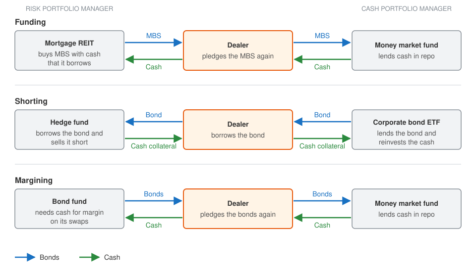

# Collateral Chains and Liquidity Puts

Cash pools want to keep their cash safe (see [Cash Pools and Shadow Money](15-cash-pools-and-shadow-money.md)). Zoltan Pozsar calls their managers cash portfolio managers, and their mandate is "do not lose". On the other side of the market are risk portfolio managers, whose mandate is to "beat the benchmark". They may be hedge funds, mortgage real estate investment trusts (REITs), or any investment vehicle that may use leverage, such as an absolute return or unconstrained bond fund. One side has cash and wants safety, and the other wants to borrow cash to raise its returns.

The two sides used to meet in banks. Today they usually meet through a dealer, which lends cash to the risk portfolio manager in a reverse repo and borrows it from the cash portfolio manager in a repo (see [Money Market Funds, Dealers and Repo](06-money-market-funds-dealers-and-repo.md)). The cash portfolio manager gets safety from the collateral, and the risk portfolio manager gets leverage from the cash.

## Three Uses of Cash

For Pozsar, leverage "involves the use of borrowed cash for three ends: funding, shorting, and derivatives margining".

- **Funding.** A mortgage REIT, which is a fund that invests in mortgages and mortgage-backed securities (MBS), wants to buy agency MBS with only 10% of its own capital. It delivers the MBS to a dealer in a repo, receives cash and pays for the MBS with it. The dealer pledges the same MBS to a cash portfolio manager in a repo to raise the cash.
- **Shorting.** A hedge fund expects a company to do badly, perhaps to default, so it sells the bonds of the company short. It borrows a bond, sells it in the market and must later buy it back to return it. It owns no bond and owes one, so its net position is minus one bond, which is why the position is called short. The hedge fund gives cash as collateral for the bond. If the dealer does not hold the bond, it borrows it from a securities lender, for example a corporate bond ETF, which reinvests the cash in repos and money market funds. Here the bond is what the borrower wants, and the cash is only collateral.
- **Margining.** A bond fund hedges some of its risks with interest rate swaps, foreign exchange swaps or credit default swaps. If the market moves against it, it must pay margin in cash. The fund holds bonds, not cash, so it delivers some bonds to a dealer in a repo to raise the cash for the margin.

In funding and margining, bonds go from the risk portfolio managers to the cash portfolio managers, and cash goes the other way. In shorting, the flows reverse, because the risk portfolio manager wants the bond and gives cash. In all three cases the dealer stands in the middle.

## Collateral Chains

A collateral chain is a sequence of loans that use the same bond as collateral. A bond can go from a REIT to one dealer, from that dealer to a second dealer, and from there to a money market fund. Each party that receives collateral can pledge it again to borrow cash itself, which is called re-use or rehypothecation.

The chains make collateral go further. At the end of 2007, large dealers received about $10 trillion of pledged collateral that they could re-use, from about $3.3 trillion of collateral at its original sources, so each security was pledged about three times. At the end of 2010 the ratio was about 2.4, with $5.8 trillion from $2.45 trillion. The chains are efficient, but they make the system more fragile. If one link fails, all the parties behind it are at risk, and a panic spreads very fast through the losses that one balance sheet passes to the next.

## Haircuts

The cash portfolio manager has two protections. The first is the collateral, which it keeps if the borrower does not pay. The second is the haircut, the discount on the value of the collateral. With a haircut of 2%, a lender pays $98 for $100 of bonds, so the borrower must fund $2 with its own capital. The haircut $h$ therefore sets the maximum leverage.

$$\text{Maximum leverage} = \frac{1}{h} = \frac{1}{0.02} = 50$$

In calm markets, competition between dealers pushes haircuts down and leverage up. Under stress, haircuts jump, and every borrower must deleverage at the same time. In the 2008 crisis, an index of repo haircuts on nine classes of collateral other than Treasuries rose from zero in early 2007 to nearly 50% in late 2008, with a class that no longer traded counted as 100%. On the $2.5 trillion of so-called toxic mortgage securities, average leverage was about 16 to 1 in 2006, so their buyers paid only about $150 billion of their own money. By the second quarter of 2009 it had fallen to about 1.2 to 1.

### Mortgage REITs in March 2020

In March 2020, as the pandemic hit the markets, the prices of mortgage-linked assets fell sharply, and the lenders of mortgage REITs made margin calls, with some higher haircuts. The REITs were highly leveraged and held little cash, so they had to sell MBS into a market with few buyers. Prices fell further and caused new margin calls, a feedback loop between asset sales and margin calls. The FTSE Nareit Mortgage REITs index returned −24.87% in the week to 13 March and −37.77% in the week to 20 March, a loss of about 53% in two weeks.

Even agency MBS, which are presumed free of credit risk, fell in price and were sold. Ginnie Mae MBS carry the full faith and credit of the United States. Fannie Mae and Freddie Mac MBS do not, but the two companies have been in government conservatorship since 6 September 2008. The agency MBS of mortgage REITs fell by about a third in the first quarter of 2020, from $335 billion to $211 billion. The REITs that failed to meet their margin calls, such as MFA Financial, Invesco Mortgage Capital, New York Mortgage Trust and AG Mortgage Investment Trust, also held MBS without an agency guarantee, commercial MBS and whole loans. Those that could not pay entered forbearance agreements with their lenders in March and April.

The Fed stopped the spiral. On 15 March it announced purchases of at least $500 billion of Treasuries and at least $200 billion of agency MBS, starting on 16 March, and on 23 March it changed the amounts to whatever was needed. In March and April it bought almost $600 billion of agency MBS.

## Liquidity Puts

A put option is the right to sell an asset at a price fixed in advance. A liquidity put is a commitment by someone to give cash for an asset when its holder needs it, either by buying the asset or by lending against it. Pozsar ranks the issuers of money claims by the strength of their liquidity puts.

| Rank | Issuer | Where it gets cash under stress | Put |
| --- | --- | --- | --- |
| 1, top | The sovereign | Its central bank, as a monetary backstop | Public |
| 2 | Banks | The central bank, which lends against their assets through the discount window | Public |
| 3 | Dealers | Private lenders against their assets, if any lender is willing. If not, they must sell | Private |
| 4, bottom | Money market funds | Only limited amounts, by lending securities or through credit lines from banks. Otherwise they must sell | Private |

The private puts depend on the willingness of banks and dealers to lend or buy. When no one is willing, forced sales follow, as in March 2020, and they can end in failures. The public puts depend on the central bank and on politics.

## Credit Puts

A credit put is a commitment to cover the losses of a holder if the issuer becomes insolvent or defaults. A liquidity put solves a problem of liquidity, and a credit put solves a problem of solvency.

| Rank | Claim | Protection against loss |
| --- | --- | --- |
| 1, top | Treasury bills | The full faith and credit of the government and its power to tax |
| 2 | Insured deposits | Deposit insurance, up to $250,000 in the US |
| 3 | Repos | The collateral |
| 4 | Money market fund shares | The diversification of the fund and the implicit support of its sponsor, often a bank, which is weak because no contract requires it |
| 5, bottom | Uninsured deposits | None |

Pozsar also ranks repos backed by Treasuries above money market fund shares, and repos backed by private securities below them.

## The Puts of 2007

The terms liquidity put and credit put became famous in 2007. Banks had set up conduits and structured investment vehicles (SIVs), kept them off their balance sheets, and given them guarantees, which the conduits used to fund long-term assets with asset-backed commercial paper (ABCP) (see [Money Market Spreads](10-money-market-spreads.md)). ABCP outstanding grew from $650 billion in January 2004 to $1.3 trillion in July 2007. On 1 January 2007, 74% of ABCP had full guarantees from the sponsor, 61% with liquidity guarantees and 13% with credit guarantees.

When the ABCP market closed in August 2007, the puts were exercised. The banks took the assets of their conduits back, and ABCP outstanding fell to $833 billion in December 2007. No conduit with a credit or liquidity guarantee defaulted by December 2008, and 97.5% of the outside investors in ABCP were repaid in full, so the losses stayed with the banks. Citigroup was the largest US sponsor, with $93 billion of conduits against $91 billion of Tier 1 capital. On 13 December 2007 it also brought its SIVs, with $49 billion of assets, onto its balance sheet, which went beyond what its contracts required. The banks had not transferred the risk that they seemed to have moved off their balance sheets. They had only hidden it.

## References

- Acharya, Viral V., Philipp Schnabl, and Gustavo Suarez. 2013. "Securitization without Risk Transfer." *Journal of Financial Economics* 107 (3): 515–536. [DOI](https://doi.org/10.1016/j.jfineco.2012.09.004).
- Board of Governors of the Federal Reserve System. 2020. "Federal Reserve Issues FOMC Statement." Press release, 15 March 2020. [Online](https://www.federalreserve.gov/newsevents/pressreleases/monetary20200315a.htm).
- Board of Governors of the Federal Reserve System. 2020. "Federal Reserve Announces Extensive New Measures to Support the Economy." Press release, 23 March 2020. [Online](https://www.federalreserve.gov/newsevents/pressreleases/monetary20200323b.htm).
- Board of Governors of the Federal Reserve System. 2020. *Financial Stability Report*, May 2020. [PDF](https://www.federalreserve.gov/publications/files/financial-stability-report-20200515.pdf).
- Citigroup. 2007. "Citi Commits Support Facility for Citi-Advised SIVs." Press release, 13 December 2007. [Online](https://www.sec.gov/Archives/edgar/data/0000831001/000114420407067635/v097312_ex99-1.htm).
- Fannie Mae. 2018. "Single-Family MBS Prospectus." 1 May 2018. [PDF](https://capitalmarkets.fanniemae.com/syndicated/documents/mbs/mbspros/SF_May_1_2018.pdf).
- Federal Housing Finance Agency. "Conservatorship." [Online](https://www.fhfa.gov/conservatorship).
- Federal Reserve Bank of New York. 2020. "Statement Regarding Treasury Securities, Agency Mortgage-Backed Securities, and Repurchase Agreement Operations." 15 March 2020. [Online](https://www.newyorkfed.org/markets/opolicy/operating_policy_200315).
- Frame, W. Scott, Brendan McCartney, and Eva Steiner. 2021. "COVID-19 Exposes Mortgage Market Vulnerabilities That Led to Volatility, Fed Intervention." *Dallas Fed Economics*, Federal Reserve Bank of Dallas, 2 February 2021. [Online](https://www.dallasfed.org/research/economics/2021/0202).
- Geanakoplos, John. 2010. "The Leverage Cycle." *NBER Macroeconomics Annual 2009* 24: 1–65. [DOI](https://doi.org/10.1086/648285).
- Ginnie Mae. "Overview of Ginnie Mae Guaranty Agreement Key Components." [PDF](https://www.ginniemae.gov/issuers/issuer_training/Documents/overview_ginnie_mae_guaranty_agreement_key_components.pdf).
- Gorton, Gary, and Andrew Metrick. 2012. "Securitized Banking and the Run on Repo." *Journal of Financial Economics* 104 (3): 425–451. [DOI](https://doi.org/10.1016/j.jfineco.2011.03.016).
- Invesco Mortgage Capital. 2020. Press release, 24 March 2020. Form 8-K, Exhibit 99.1. [Online](https://www.sec.gov/Archives/edgar/data/1437071/000119312520083158/d890700dex991.htm).
- Nareit. 2020. "Media Fact Sheet." 31 March 2020. [PDF](https://www.reit.com/sites/default/files/media/PDFs/MediaFactSheet_Mar-2020.pdf).
- Nareit Staff. 2020. "mREIT Executives Shed Light on Recent Market Volatility." 3 April 2020. [Online](https://www.reit.com/news/articles/mreit-executives-shed-light-on-recent-market-volatility).
- Pence, Karen M. 2022. "Liquidity in the Mortgage Market: How Does the COVID-19 Crisis Compare with the Global Financial Crisis?" Finance and Economics Discussion Series 2022-039, Board of Governors of the Federal Reserve System. [DOI](https://doi.org/10.17016/FEDS.2022.039).
- Pozsar, Zoltan. 2014. "Shadow Banking: The Money View." Office of Financial Research Working Paper 14-04, 2 July 2014. [PDF](https://www.financialresearch.gov/working-papers/files/OFRwp2014-04_Pozsar_ShadowBankingTheMoneyView.pdf).
- Sengupta, Rajdeep, and Fei Xue. 2020. "The Global Pandemic and Run on Shadow Banks." *Economic Bulletin*, Federal Reserve Bank of Kansas City, 11 May 2020. [Online](https://www.kansascityfed.org/research/economic-bulletin/global-pandemic-run-shadow-banks-2020/).
- Singh, Manmohan. 2011. "Velocity of Pledged Collateral: Analysis and Implications." IMF Working Paper WP/11/256. [PDF](https://www.imf.org/-/media/websites/imf/imported-full-text-pdf/external/pubs/ft/wp/2011/_wp11256.pdf).
- Singh, Manmohan, and James Aitken. 2010. "The (Sizable) Role of Rehypothecation in the Shadow Banking System." IMF Working Paper WP/10/172. [PDF](https://www.imf.org/-/media/websites/imf/imported-full-text-pdf/external/pubs/ft/wp/2010/_wp10172.pdf).
