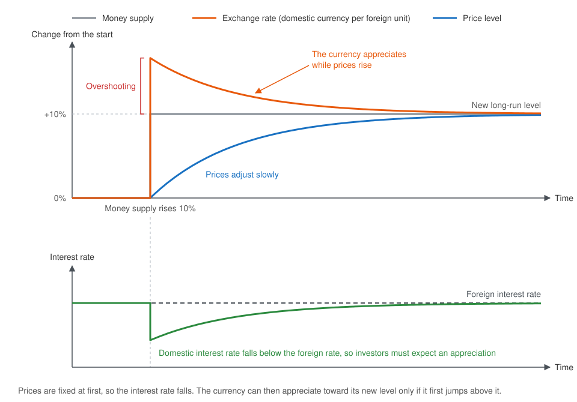

# Interest Rate Parity and Overshooting

Goods (see [Exchange Rates and Purchasing Power Parity](19-exchange-rates-and-purchasing-power-parity.md)) and money (see [Balance of Payments and the Monetary Approach](20-balance-of-payments-and-the-monetary-approach.md)) explain the exchange rate, but almost nothing that the foreign exchange market trades is for imports or exports. In April 2025 the market traded about $9.5 trillion a day, and non-financial customers, the group that includes exporters and importers, made up only about 5% of it. World exports of goods and services in the whole of 2025, $34.65 trillion, equal less than four days of trading. Investors move exchange rates, at least in the short and very short run, and they compare the returns of investments in different currencies. Interest rate parity describes this comparison.

## Uncovered Interest Rate Parity

A currency is the vehicle of every investment in it, so the exchange rate and the interest rate must be connected. Arbitrage appears again. If an investment in one currency pays more than in another, investors leave the currency that pays less for the one that pays more. In equilibrium the returns are equal once the expected change in the exchange rate is counted.

$$i - i^\ast \approx \frac{E_t[e_{t+1}] - e_t}{e_t}$$

Here $i$ is the domestic interest rate, $i^\ast$ the foreign rate and $e$ the exchange rate in units of domestic currency per unit of foreign currency. If the dollar pays 4% and the euro 2% for one year, an investor is indifferent between the two only if the market expects the dollar to depreciate by about 2% against the euro during the year. What the investor gains in the interest rate, it loses in the exchange rate.

The theory has limits.

- **Capital controls.** If capital cannot move, nobody can exploit the difference.
- **Transaction costs.** They can eat the gain before the returns become equal.
- **Risk and liquidity.** The theory assumes that the bonds of the two countries have the same risk and liquidity, which is rarely true. Political risk, or only the expectation of future capital controls, can move the exchange rate against the arbitrageur.
- **Taxes.** Different tax systems change the relative returns after tax.

Tests reject uncovered parity at horizons of up to one year, but they are much more favorable at horizons of five to twenty years.

## Interest Rates and the Exchange Rate of Today

Interest rate parity does not explain the long-run exchange rate, which comes from outside, from the theories of goods and money. Given that long-run level, the exchange rate of today moves. If a central bank raises its rate, its currency must appreciate today by enough that the depreciation expected afterward offsets the higher rate. This is why a central bank whose currency is collapsing often raises its rates abruptly. On 16 September 1992, after several rises in one week, the Swedish central bank raised its marginal rate to 500% to stop the outflow of capital, but on 19 November it let the krona float.

This is the opposite of the monetary approach, in which a higher interest rate depreciates the currency (see [Balance of Payments and the Monetary Approach](20-balance-of-payments-and-the-monetary-approach.md)). The difference is the reason for the rise. In the monetary approach the rate rises because markets expect more inflation, and here it rises to attract capital. The two theories are therefore compatible, although at first they do not seem so.

## Real Interest Rate Parity

Uncovered interest parity combined with relative PPP gives real interest rate parity. What becomes equal across countries is the expected real interest rate, not the nominal one.

$$r = i - \pi^e = i^\ast - \pi^{e\ast} = r^\ast$$

The difference between nominal rates then only reflects the difference in expected inflation, and in the end the exchange rate moves with the difference in prices. This adds little that is new, because it is PPP again, reached by a short detour.

## Covered Interest Rate Parity

Uncovered parity compares returns with the exchange rate that the market expects. A forward contract removes this risk, because it fixes today the rate of an exchange of currencies on a future date. Covered interest rate parity then says that the forward rate $F$ and the spot rate $S$, both in domestic currency per unit of foreign currency, differ by exactly the interest differential of the same maturity.

$$\frac{F}{S} = \frac{1 + i}{1 + i^\ast}$$

No expectations and no risk enter, apart from the counterparty risk of the contract, so this is pure arbitrage. For decades covered parity was the closest thing to a physical law in international finance. Before the global financial crisis of 2008 its deviations were very close to zero. Since then they have been large and persistent, and neither credit risk nor transaction costs explain them. They are largest for contracts that appear on the balance sheets of banks at the end of a quarter, which points to an effect of banking regulation.

## The Dornbusch Model

The overshooting model of Rudiger Dornbusch (1976) joins these pieces.

1. **Capital mobility.** Capital moves freely, so uncovered interest parity holds at all times.
2. **Money demand.** The demand for money depends on income and on the interest rate, as in the monetary approach.
3. **Long-run neutrality.** In the long run, a rise in money raises prices and the exchange rate in the same proportion.
4. **Sticky prices.** Goods prices adjust slowly, while asset markets, and with them the exchange rate, adjust at once.

The fourth assumption is the new one, and it is realistic. Investors also know how the economy adjusts, so their expectations are consistent with the model.

Suppose that the central bank raises the money supply by 10% for good. In the long run, prices rise by 10% and the exchange rate rises by 10%, which is a depreciation of 10%, so the real exchange rate returns to its starting level. In the short run, prices do not move. With the same prices and more money, people hold more real money balances than they want, the excess goes into bonds, and the interest rate falls. With the domestic rate below the foreign rate, interest rate parity requires that the market expect the domestic currency to appreciate. But in the long run the currency must have depreciated by 10%. Both conditions hold only if the exchange rate jumps today by more than 10%. The exchange rate overshoots, and then it appreciates slowly as prices rise.

In the words of Dornbusch, during the adjustment "rising prices are accompanied by an appreciating exchange rate". The currency appreciates while there is inflation, which looks odd until the first jump is seen as excessive.

The model matters because it explains why exchange rates are much more volatile than prices without the assumption that markets are irrational or follow the herd. The volatility is the equilibrium response to prices that adjust slowly.

## The PPP Puzzle

Studies of purchasing power parity agree on two facts.

- **Slow convergence.** Deviations from PPP die out, but slowly, at roughly 15% a year, so their half-life is three to five years.
- **Large short-run deviations.** In the short run deviations are huge, and the monthly volatility of real exchange rates is of the same order of magnitude as that of nominal exchange rates.

From January 1972 to May 1995, the exchange rate between the Deutsche Mark and the dollar rose and fell a lot from one month to the next, while the ratio of German to US consumer prices hardly moved. The variance of the nominal exchange rate was an order of magnitude greater than that of relative prices. In the short run the real exchange rate thus moved almost exactly like the nominal one.

This supports the Dornbusch model, because only monetary and financial shocks with sticky prices seem able to explain such short-run volatility. But these shocks should fade once prices adjust, while half of each deviation is still there after three to five years. With annual data for two centuries, the half-life is about six years for the dollar against the pound and a little under three years for the French franc against the pound. The PPP puzzle is how to reconcile "the enormous short-term volatility of real exchange rates with the extremely slow rate at which shocks appear to damp out".

The usual answer is that goods markets remain segmented. International goods markets are highly integrated, but not nearly as integrated as domestic ones. Transport costs, actual or threatened tariffs, non-tariff barriers, information costs and the low mobility of labor leave much room for the nominal exchange rate to move without prices following it.

## Limits to Arbitrage

Almost every theory of the exchange rate assumes that someone arbitrages without limit, buying where a good or a currency is cheap, selling where it is dear and holding the position as long as needed. In reality almost all arbitrage needs capital and carries risk. To arbitrage currencies, a trader must buy one currency, fund it in another and hold the position on a balance sheet, and the balance sheet of a dealer has limits (see [Matched Book and the September 2019 Repo Spike](07-matched-book-and-the-september-2019-repo-spike.md)). Arbitrage happens, but it uses resources, and the price of these resources limits arbitrage itself. The movements of exchange rates can therefore also be traced in the balance sheets of banks and dealers.

## References

- Bank for International Settlements. 2024. "Triennial Central Bank Survey of Foreign Exchange and OTC Derivatives Markets: Reporting Guidelines for Turnover in April 2025." Version of 8 April 2024. Section 5.1. [PDF](https://www.bis.org/publications/triennial-survey/2025survey-guidelinesturnover.pdf).
- Bank for International Settlements. 2025. "OTC Foreign Exchange Turnover in April 2025." Triennial Central Bank Survey, 30 September 2025. [Online](https://www.bis.org/statistics/rpfx25_fx.htm).
- Borio, Claudio, Robert N. McCauley, Patrick McGuire, and Vladyslav Sushko. 2016. "Covered Interest Parity Lost: Understanding the Cross-Currency Basis." *BIS Quarterly Review*, September 2016, 45–64. [Online](https://www.bis.org/publ/qtrpdf/r_qt1609e.htm).
- Dornbusch, Rudiger. 1976. "Expectations and Exchange Rate Dynamics." *Journal of Political Economy* 84 (6): 1161–1176. [DOI](https://doi.org/10.1086/260506).
- Du, Wenxin, Alexander Tepper, and Adrien Verdelhan. 2018. "Deviations from Covered Interest Rate Parity." *Journal of Finance* 73 (3): 915–957. [DOI](https://doi.org/10.1111/jofi.12620).
- Gruen, David W. R., and Gordon D. Menzies. 1991. "The Failure of Uncovered Interest Parity: Is It Near-Rationality in the Foreign Exchange Market?" Reserve Bank of Australia Research Discussion Paper 9103. [Online](https://www.rba.gov.au/publications/rdp/1991/9103/introduction.html).
- Huang, Wenqian, Ingomar Krohn, and Vladyslav Sushko. 2025. "Global FX Markets When Hedging Takes Centre Stage." *BIS Quarterly Review*, December 2025. [Online](https://www.bis.org/publ/qtrpdf/r_qt2512b.htm).
- Isard, Peter. 2006. "Uncovered Interest Parity." IMF Working Paper 06/96. [DOI](https://doi.org/10.5089/9781451863567.001).
- Krugman, Paul R., and Maurice Obstfeld. 2009. *International Economics: Theory and Policy*. 8th ed. Boston: Pearson Addison-Wesley. Chapter 13 and its appendix.
- Lothian, James R., and Mark P. Taylor. 1996. "Real Exchange Rate Behavior: The Recent Float from the Perspective of the Past Two Centuries." *Journal of Political Economy* 104 (3): 488–509. [DOI](https://doi.org/10.1086/262031).
- Mishkin, Frederic S. 1984. "Are Real Interest Rates Equal Across Countries? An Empirical Investigation of International Parity Conditions." *Journal of Finance* 39 (5): 1345–1357. [DOI](https://doi.org/10.1111/j.1540-6261.1984.tb04911.x).
- Rogoff, Kenneth. 1996. "The Purchasing Power Parity Puzzle." *Journal of Economic Literature* 34 (2): 647–668. [PDF](https://web.williams.edu/Economics/macro/rogoff.pdf).
- Rogoff, Kenneth. 2002. "Dornbusch's Overshooting Model After Twenty-Five Years." *IMF Staff Papers* 49 (Special Issue): 1–34. [DOI](https://doi.org/10.2307/3872469).
- Shleifer, Andrei, and Robert W. Vishny. 1997. "The Limits of Arbitrage." *Journal of Finance* 52 (1): 35–55. [DOI](https://doi.org/10.1111/j.1540-6261.1997.tb03807.x).
- Sveriges Riksbank. "1992 – Interest Rate 500% – the Krona Floats." [Online](https://www.riksbank.se/en-gb/about-the-riksbank/history/historical-timeline/1900-1999/interest-rate-500--the-krona-floats/).
- World Trade Organization. 2026. *Global Trade Outlook and Statistics*. March 2026. [PDF](https://www.wto.org/english/res_e/booksp_e/gtos0326_e.pdf).
