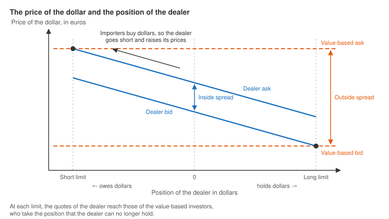

# Foreign Exchange as a Funding Market

Almost every theory of the exchange rate assumes that someone arbitrages without limit and holds the position as long as needed (see [Interest Rate Parity and Overshooting](21-interest-rate-parity-and-overshooting.md)). This is not free. To arbitrage currencies, a trader must buy one currency, fund it in another and hold the position on a balance sheet. This note looks at the market where this happens and at the dealer at its center.

## The Size of the Market

Every three years the Bank for International Settlements (BIS) surveys central banks to measure the foreign exchange market. In April 2025 the market traded $9.5 trillion a day on average, almost five times the GDP of Spain in the whole of 2025, which was $1.91 trillion. The dollar was on one side of 89% of all trades. Pairs of other currencies are mostly not exchanged directly but through the dollar. A bank that wants to exchange Chilean pesos for Korean won sells the pesos for dollars and then the dollars for won. By some estimates, this role as a vehicle explains just under 40% of the turnover of the dollar. Most of the volume of the market has nothing to do with imports or exports of goods and services (see [Interest Rate Parity and Overshooting](21-interest-rate-parity-and-overshooting.md)).

## The Foreign Exchange Swap

The most traded instrument is not the purchase of a currency on the spot market but the foreign exchange swap. In April 2025 swaps were $4.0 trillion a day, 42% of the market, and spot trades $3.0 trillion, or 31%. A swap joins two exchanges of currencies in opposite directions, one today at the spot rate and the reverse one on a later date at a forward rate fixed today. For example, a European bank lends euros to a US bank and borrows dollars from it, and in one year the two banks reverse the trade.

| Date | European bank | US bank |
| --- | --- | --- |
| Today, at 0.90 euros per dollar | Pays €900,000 and receives $1,000,000 | Pays $1,000,000 and receives €900,000 |
| In one year, at 0.8827 euros per dollar | Pays $1,040,000 and receives €918,000 | Pays €918,000 and receives $1,040,000 |

The European bank borrows dollars at 4% and lends euros at 2%. The rate of the second exchange, the ratio of €918,000 to $1,040,000, is about 0.8827 euros per dollar, which is the forward rate that covered interest parity gives for these interest rates (see [Interest Rate Parity and Overshooting](21-interest-rate-parity-and-overshooting.md)).

$$F = S \frac{1 + i}{1 + i^\ast} = 0.90 \times \frac{1.02}{1.04} \approx 0.8827$$

Here $S$ and $F$ are the spot and forward rates in euros per dollar, $i$ is the euro rate and $i^\ast$ the dollar rate. Each currency is collateral for the other, so a swap is a secured loan, like a repo whose collateral is a currency instead of a security (see [Money Market Funds, Dealers and Repo](06-money-market-funds-dealers-and-repo.md)).

The foreign exchange market is therefore above all a funding market. It is one more branch of the money market, in which the lender and the borrower deal in different currencies. As in every money market, some clients need liquidity, others have too much of it, and a dealer stands between them and serves both (see [Collateral Chains and Liquidity Puts](16-collateral-chains-and-liquidity-puts.md)).

## Who Supplies the Dollars

Suppose that a country must pay abroad more than it receives, for example because of a deficit in its current account (see [Balance of Payments and the Monetary Approach](20-balance-of-payments-and-the-monetary-approach.md)). The foreign currency comes from a hierarchy of sources.

1. **The market.** Dealers and banks lend the currency.
2. **The central bank.** If the imbalance is large, it sells part of its reserves.
3. **The International Monetary Fund (IMF).** When everything else fails, as in a currency crisis, the IMF lends.

At first a country with a deficit does not pay with its own reserves, the dollars that it already holds, but with borrowed reserves, the dollars that someone else lends it.

## The Balance Sheet of the Dealer

A Spanish company imports machinery from the United States and must pay $1,000,000. It buys the dollars spot from its bank, which acts as a dealer or puts it in contact with one. At 0.90 euros per dollar, the company pays €900,000 and receives the $1,000,000 that it then pays to its supplier. The dealer now holds €900,000 and owes $1,000,000, which it usually borrows for a very short term in the eurodollar market (see [Eurodollars and Central Bank Swap Lines](17-eurodollars-and-central-bank-swap-lines.md)).

| Assets | Liabilities |
| --- | --- |
| €900,000 | $1,000,000, borrowed for a very short term |

The balance sheet of the dealer has grown on both sides, which brings two risks.

- **Exchange rate risk.** If the dollar appreciates to 0.95 euros, the debt is worth €950,000, while the assets are still worth €900,000.
- **Liquidity risk.** The dealer must roll over the dollar debt every day or every week.

The dealer can hedge the exchange rate risk with a forward, which is a commitment made today to buy dollars in one year at a price fixed today, here the 0.8827 euros per dollar of covered parity. With the forward, the dealer has a matched book in currencies (see [Matched Book and the September 2019 Repo Spike](07-matched-book-and-the-september-2019-repo-spike.md)). The liquidity risk remains, because until the forward matures, the dealer must find someone every day who lends it dollars again.

## The Other Side of the Forward

If the dealer buys dollars forward, someone must sell them to it. That someone may have no exporter behind it and may simply take the exchange rate risk that the dealer does not want. It does so because it expects a gain, which it makes if the spot rate at maturity differs from the forward rate in its favor. For a speculator to take the other side, the forward rate therefore cannot equal the expected spot rate exactly, which contradicts uncovered interest parity (see [Carry Trade and the Global Financial Cycle](25-carry-trade-and-the-global-financial-cycle.md)). The matched book of a dealer can thus rest on the unmatched, speculative position of someone else.

## The Dealer Sets the Price

In the dealer model of Jack Treynor (1987), a dealer quotes a bid and an ask price that depend on its inventory, that is, on how far its position is from a matched book. Value-based investors, who have their own estimate of what the asset is worth, also trade, but at a wider spread between bid and ask. When the position of the dealer reaches its limit, the dealer passes it on to them. Perry Mehrling calls the spread of the dealer the inside spread and that of the value-based investors the outside spread. The quotes of the dealer move inside the outside spread.

Suppose that many European importers ask for dollars at once. The dollar debt of the dealer grows and approaches its limit. To get rid of the risk, the dealer raises the price at which it sells dollars, so the exchange rate $S$ rises and the euro depreciates. It raises the price until someone appears who is willing to take the position. If that someone is slow to appear, because nobody wants to risk its balance sheet, the exchange rate can move a lot.

In the short run the exchange rate therefore depends not on the price of a Big Mac (see [Exchange Rates and Purchasing Power Parity](19-exchange-rates-and-purchasing-power-parity.md)) but on the balance sheet capacity of the dealers in the foreign exchange market and of those willing to bear the risk that the dealers do not want. This explains why the mark–dollar rate moved so much while the ratio of consumer prices hardly moved (see [Interest Rate Parity and Overshooting](21-interest-rate-parity-and-overshooting.md)). In the short run, the financial mechanism explains the swings of the exchange rate much better than the market for goods.

## References

- Bank for International Settlements. 2022. "Revisiting the International Role of the US Dollar." Box A, *BIS Quarterly Review*, December 2022. [Online](https://www.bis.org/publ/qtrpdf/r_qt2212x.htm).
- Bank for International Settlements. 2025. "OTC Foreign Exchange Turnover in April 2025." Triennial Central Bank Survey, 30 September 2025. [Online](https://www.bis.org/statistics/rpfx25_fx.htm).
- Bank for International Settlements. 2026. *2025 Triennial Central Bank Survey. OTC Foreign Exchange Market Turnover in April 2025: Detailed Tables*. Table 1. [PDF](https://www.bis.org/publications/commentary-otc-derivatives/statistics-rpfx25-fx-annex.pdf).
- Borio, Claudio, Robert N. McCauley, and Patrick McGuire. 2017. "FX Swaps and Forwards: Missing Global Debt?" *BIS Quarterly Review*, September 2017, 37–54. [Online](https://www.bis.org/publ/qtrpdf/r_qt1709e.htm).
- International Monetary Fund. 2026. "GDP, Current Prices: Spain." World Economic Outlook DataMapper, October 2026. [Online](https://www.imf.org/external/datamapper/NGDPD@WEO/ESP).
- McGuire, Patrick, Andreas Schrimpf, and Goetz von Peter. 2025. "Foreword: Shifting Currents in FX and Interest Rate Derivatives: Highlights from the 2025 Triennial Survey." *BIS Quarterly Review*, December 2025. [Online](https://www.bis.org/publ/qtrpdf/r_qt2512_foreword.htm).
- Mehrling, Perry. 2022. "'Where's My Swap Line?' A Money View of International Lender of Last Resort." *Jahrbuch für Wirtschaftsgeschichte* 63 (2): 559–574. [DOI](https://doi.org/10.1515/jbwg-2022-0019).
- Treynor, Jack L. 1987. "The Economics of the Dealer Function." *Financial Analysts Journal* 43 (6): 27–34. [DOI](https://doi.org/10.2469/faj.v43.n6.27).
