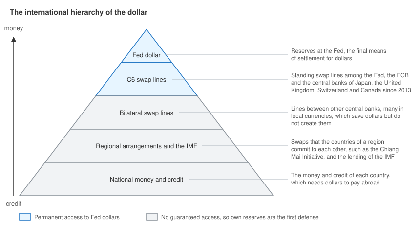

# International Hierarchy of Money

To pay abroad, neither a country nor an importer uses its own dollars, but dollars that someone else lends it (see [Foreign Exchange as a Funding Market](22-foreign-exchange-as-a-funding-market.md)). A Spanish bank looks for dollars in the eurodollar market, and not for yen, because the hierarchy of money (see [Credit and Currency](03-credit-and-currency.md)) also exists between countries. For historical reasons, and because the largest economy in the world stands behind it, the dollar is at its top.

## The Dollar as World Money

Money has three usual roles (see [Credit and Currency](03-credit-and-currency.md)), and the dollar plays all three at a world scale.

- **Medium of exchange.** The dollar was on one side of 89% of all foreign exchange trades in April 2025.
- **Unit of account.** About 40% of world exports are invoiced in dollars, although the United States accounts for just over a tenth of world trade. Most commodities are priced in dollars, including the benchmark crude oils West Texas Intermediate, Brent and Dubai.
- **Store of value.** The dollar was 56.7% of the foreign exchange reserves of central banks in the second quarter of 2026, and the euro, the second currency, 20.6%.

The share of the dollar in reserves has fallen a lot, from about 71% in 1999 and 2001. Its share in foreign exchange trading, however, has hardly moved, and it stayed between 85% and 90% in every survey from 2001 to 2025. There is much talk of de-dollarization, but the market in which exchange rates form shows nothing like it.

## A Hierarchy on Top of a Hierarchy

The dollar that dominates the world in quantity is mostly not the dollar of the Fed but the eurodollar, a private liability of global banks (see [Eurodollars and Central Bank Swap Lines](17-eurodollars-and-central-bank-swap-lines.md)). Eurodollars are dollar deposits at banks outside the United States. These banks settle through US banks, which settle in reserves at the Fed. One hierarchy of money thus stands on top of another.

The international hierarchy of the dollar has five layers.

1. **The Fed dollar.** Reserves at the Fed are the final means of settlement for dollars.
2. **The C6.** The Fed, the ECB and the central banks of Japan, the United Kingdom, Switzerland and Canada have formed a network of standing swap lines since 31 October 2013. The lines of the Fed with the other five have no set limit of size.
3. **Bilateral swap lines.** Many other central banks sign swap lines with each other. Many of them are in local currencies, so they do not create dollars but reduce the need for them. At the end of June 2025, for example, the People's Bank of China had 32 such agreements in force, for more than 4.5 trillion renminbi.
4. **Regional arrangements and the IMF.** In the Chiang Mai Initiative Multilateralisation, the ASEAN+3 countries commit $240 billion to support each other, and the IMF lends to countries in crisis.
5. **National money and credit.** At the base are the money and credit of each country.

## Par and Elasticity

Inside a country, par is the fixed price of a bank deposit in the currency of the central bank (see [Credit and Currency](03-credit-and-currency.md)). The same idea applies between countries. In a swap line, the forward rate of the contract is usually the same as the spot rate on the day that the swap starts, so the two central banks reverse the exchange at the rate at which they made it (see [Eurodollars and Central Bank Swap Lines](17-eurodollars-and-central-bank-swap-lines.md)). While the swap lasts, the Fed and the ECB therefore exchange their currencies at a fixed rate. Within the C6, the swap works as a par between currencies, although the exchange rate floats for every other participant in the market.

Elasticity is the capacity of the monetary system to create liquidity when it is needed (see [Credit and Currency](03-credit-and-currency.md)). A drawing on a swap line between central banks creates new international reserves, instead of moving existing ones, in the same way as a bank creates a deposit when it lends (see [Modern Money Creation](04-modern-money-creation.md)). In the crisis of 2008, the swap lines of the Fed reached about $583 billion.

## Discipline

Elasticity without discipline does not work well. One way to discipline swap lines is the rule of Bagehot, which is to lend freely at a high rate against collateral that would be good in normal times (see [Role of Central Banks](02-role-of-central-banks.md)). The central bank that draws on a swap line usually pays a penalty rate, so if the Fed receives many requests for dollars, it can set a high price for them. The Fed has charged the overnight index swap (OIS) rate plus 100 basis points from May 2010, plus 50 from December 2011 and plus 25 since March 2020 (see [From LIBOR to SOFR and OIS](09-from-libor-to-sofr-and-ois.md)).

## The Dealer of Last Resort

Perry Mehrling sees the central bank today as a dealer of last resort rather than a lender of last resort. In the dealer model of Treynor, dealers quote prices inside the outside spread of value-based investors (see [Foreign Exchange as a Funding Market](22-foreign-exchange-as-a-funding-market.md)). For Mehrling, the swap lines of central banks are this outside spread. In normal times, private dealers set the price of dollars in the swap market within these limits. When the private market breaks down, as in the panic of 2008, the price reaches the limit. In his words, "the central bank moves from backstop to market-maker, and the outside spread price becomes the market price".

## Outside the Club

Only the other five members of the C6 have standing swap lines with the Fed. Other central banks have no such access to the outside spread. In a crisis they may get a temporary line, and otherwise they can borrow dollars from the Fed only against the Treasuries that they already hold, through the FIMA repo facility (see [Eurodollars and Central Bank Swap Lines](17-eurodollars-and-central-bank-swap-lines.md)).

This is why many emerging economies accumulate huge foreign exchange reserves, while the members of the club do not need to. For a country outside the club, reserves secure the dollars that nobody guarantees it in the future, and they are the first layer of what the IMF calls the global financial safety net, before bilateral swaps, regional arrangements and the IMF itself. Reserves are a form of discipline, and an expensive one, because they earn a low return. In the mid-2000s the reserves of developing countries reached almost 30% of their GDP, and Dani Rodrik put their cost at close to 1% of their GDP a year.

## References

- ASEAN+3 Macroeconomic Research Office. "Supporting the Implementation of the CMIM." [Online](https://www.amro-asia.org/about-us/supporting-the-implementation-of-the-cmim).
- ASEAN+3 Macroeconomic Research Office. 2026. "The Amended Chiang Mai Initiative Multilateralisation (CMIM) Agreement Introducing the Rapid Financing Facility Enters into Force." Press release, 11 November 2026. [Online](https://www.amro-asia.org/the-amended-chiang-mai-initiative-multilateralisation-cmim-agreement-introducing-the-rapid-financing-facility-enters-into-force).
- Bank for International Settlements. 2022. "Revisiting the International Role of the US Dollar." Box A, *BIS Quarterly Review*, December 2022. [Online](https://www.bis.org/publ/qtrpdf/r_qt2212x.htm).
- Bank for International Settlements. 2026. *2025 Triennial Central Bank Survey. OTC Foreign Exchange Market Turnover in April 2025: Detailed Tables*. Table 25. [PDF](https://www.bis.org/publications/commentary-otc-derivatives/statistics-rpfx25-fx-annex.pdf).
- Bernes, Thomas A., Paul Jenkins, Perry Mehrling, and Daniel H. Neilson. 2014. "China's Engagement with an Evolving International Monetary System: A Payments Perspective." Special Report, Centre for International Governance Innovation and Institute for New Economic Thinking. [Online](https://www.cigionline.org/publications/chinas-engagement-evolving-international-monetary-system-payments-perspective/).
- Board of Governors of the Federal Reserve System. 2011. "Coordinated Central Bank Action to Address Pressures in Global Money Markets." Press release, 30 November 2011. [Online](https://www.federalreserve.gov/newsevents/pressreleases/monetary20111130a.htm).
- Board of Governors of the Federal Reserve System. 2013. "Federal Reserve and Other Central Banks Convert Temporary Bilateral Liquidity Swap Arrangements to Standing Arrangements." Press release, 31 October 2013. [Online](https://www.federalreserve.gov/newsevents/pressreleases/monetary20131031a.htm).
- Board of Governors of the Federal Reserve System. 2020. "Coordinated Central Bank Action to Enhance the Provision of U.S. Dollar Liquidity." Press release, 15 March 2020. [Online](https://www.federalreserve.gov/newsevents/pressreleases/monetary20200315c.htm).
- Brüggen, Anja, Georgios Georgiadis, and Arnaud Mehl. 2025. "Global Trade Invoicing Patterns: New Insights and the Influence of Geopolitics." In *The International Role of the Euro*, European Central Bank, June 2025. [Online](https://www.ecb.europa.eu/press/other-publications/ire/article/html/ecb.ireart202506_02~a8e66f5ea3.en.html).
- Eichengreen, Barry, Livia Chiţu, and Arnaud Mehl. 2016. "Network Effects, Homogeneous Goods and International Currency Choice: New Evidence on Oil Markets from an Older Era." *Canadian Journal of Economics* 49 (1): 173–206. [DOI](https://doi.org/10.1111/caje.12194).
- Hofmann, Boris, Deniz Igan, and Daniel Rees. 2023. "The Changing Nexus between Commodity Prices and the Dollar: Causes and Implications." BIS Bulletin 74, 13 April 2023. [Online](https://www.bis.org/publ/bisbull74.htm).
- International Monetary Fund. "Currency Composition of Official Foreign Exchange Reserves (COFER)." IMF Data. [Online](https://data.imf.org/en/datasets/IMF.STA:COFER).
- International Monetary Fund. 2025. "The Global Financial Safety Net—A Stocktaking." Policy Paper 2025/035, October 2025. [DOI](https://doi.org/10.5089/9798229028905.007).
- International Monetary Fund. 2026. "IMF Data Brief: Currency Composition of Official Foreign Exchange Reserves." 30 September 2026. [Online](https://data.imf.org/en/news/imf-data-brief-september-30).
- Mehrling, Perry. 2011. *The New Lombard Street: How the Fed Became the Dealer of Last Resort*. Princeton University Press. [DOI](https://doi.org/10.1515/9781400836260).
- Mehrling, Perry. 2015. "Elasticity and Discipline in the Global Swap Network." *International Journal of Political Economy* 44 (4): 311–324. [DOI](https://doi.org/10.1080/08911916.2015.1129848).
- Mehrling, Perry. 2022. "'Where's My Swap Line?' A Money View of International Lender of Last Resort." *Jahrbuch für Wirtschaftsgeschichte* 63 (2): 559–574. [DOI](https://doi.org/10.1515/jbwg-2022-0019).
- People's Bank of China. 2025. *RMB Internationalization Report (2025)*. [PDF](https://nanjing.pbc.gov.cn/en/3688241/3688636/3828468/5624529/2025123116494089198/2025123116480428858.pdf).
- Rodrik, Dani. 2006. "The Social Cost of Foreign Exchange Reserves." *International Economic Journal* 20 (3): 253–266. [DOI](https://doi.org/10.1080/10168730600879331).
