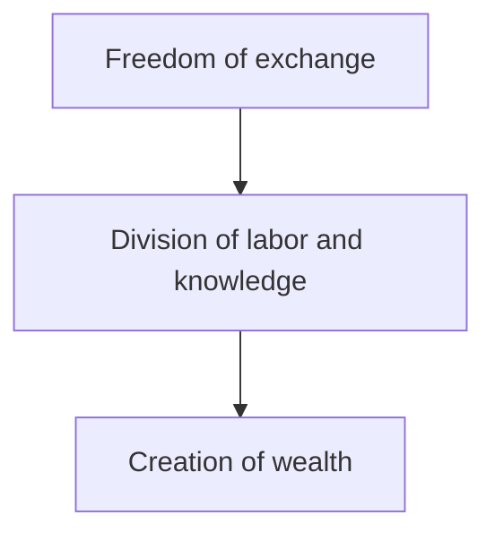

# Trade and Division of Labor

> The fundamental facts that brought about cooperation, society, and civilization and transformed the animal man into a human being are the facts that work performed under the division of labor is more productive than isolated work and that man's reason is capable of recognizing this truth.
>
> — Ludwig von Mises, *Human Action* (1949), ch. VIII, §1

Human beings are social animals. In a group, we reach our ends better than alone. A group also spreads risks, because if one member is sick or loses his harvest, the others can help him. Most of all, a group produces more goods and services than its members produce alone.

## Why Groups Produce More

Imagine three people, A, B, and C. If they cooperate as a group, they produce more goods in total than the sum of what each of them produces alone. Why?

Trade lets each person focus his time on one activity, the one that he does well or that he likes. At the end of the day, he trades the goods that he does not consume, his surplus, for the goods that other people produce. This is specialization. Each specialist produces much more, and with less effort, than a person who must produce everything for himself. Thus, the economy as a whole becomes much more productive.

Adam Smith gives a famous example in *The Wealth of Nations* (1776). One worker alone could make perhaps one pin in a day, and certainly not twenty. In a small factory, ten workers divided the work into about eighteen separate operations, and they made more than 48,000 pins in a day, or 4,800 pins for each worker.

The division of labor also applies to knowledge. Leonard Read showed in his essay "I, Pencil" (1958) that nobody knows how to make a simple pencil from the beginning to the end. Each person knows only a small part of the process. Hayek calls this the division of knowledge. Through trade, each person uses the knowledge of millions of people whom he never meets.

The chain of consequences is simple:

## Absolute Advantage

People usually specialize in the work that they like most, and this is often also the work that they do best. A person has an absolute advantage in a good if he can produce it with less time or resources than others. Smith applies this idea to families and to countries:

> It is the maxim of every prudent master of a family, never to attempt to make at home what it will cost him more to make than to buy.
>
> — Adam Smith, *The Wealth of Nations* (1776), bk. IV, ch. II

A tailor does not make his own shoes, and a shoemaker does not make his own clothes. Each buys from the other, because this costs him less.

## Comparative Advantage

Do people and countries always specialize in what they do best? Not necessarily. They specialize in the goods that they produce with the lowest opportunity cost, compared with other producers. This is comparative advantage. A person can be worse than others at everything, and still gain from trade.

David Ricardo explained this idea in 1817 with England and Portugal. Portugal produced both wine and cloth with less labor than England. But Portugal had a larger advantage in wine, and England had a smaller disadvantage in cloth. Thus, both countries gained when Portugal produced wine, England produced cloth, and they traded.

Mises generalizes Ricardo's idea as the law of association. It applies to all cooperation, not only to trade between countries:

> Collaboration of the more talented, more able, and more industrious with the less talented, less able, and less industrious results in benefit for both. The gains derived from the division of labor are always mutual.
>
> — Ludwig von Mises, *Human Action* (1949), ch. VIII, §4

## Consequences

Absolute and comparative advantages have three consequences.

- **Cooperation increases wealth.** The division of labor and trade increase total production, and thus our well-being.
- **A larger market gives larger advantages.** When more people take part in the division of labor, each person can specialize more. The title of a chapter of Smith says that "the division of labour is limited by the extent of the market."
- **Each person gains from trade.** Everyone is better off when he takes part in trade than when he acts alone. This is true even for the least productive person, because of comparative advantage.

## Problems and Solutions

The division of labor and trade have two main problems.

- **Trade has transaction costs.** Without money, a person can trade only with someone who wants exactly what he offers, and who offers exactly what he wants. Money solves this problem, because each person can sell to anyone and buy from anyone.
- **Production needs complex coordination.** Millions of people must produce the right goods, in the right quantities, at the right time. Nobody can plan this. The price system solves this problem. Prices tell each person what others value and which uses of resources are profitable, so each person can coordinate his plans with the plans of others.

## References

Links last checked: 11 October 2026.

- Hayek, Friedrich A. 1937. "Economics and Knowledge." *Economica* 4 (13): 33–54. [DOI](https://doi.org/10.2307/2548786).
- Mises, Ludwig von. 1949. *Human Action: A Treatise on Economics*. Yale University Press. [Free online edition](https://mises.org/library/book/human-action).
- Read, Leonard E. 1958. "I, Pencil: My Family Tree as Told to Leonard E. Read." *The Freeman*. [Free online edition](https://fee.org/resources/i-pencil/).
- Ricardo, David. 1817. *On the Principles of Political Economy and Taxation*. John Murray. [Free online edition](https://www.econlib.org/library/Ricardo/ricP.html).
- Smith, Adam. 1776. *An Inquiry into the Nature and Causes of the Wealth of Nations*. W. Strahan and T. Cadell. [Free online edition](https://www.gutenberg.org/ebooks/3300).
