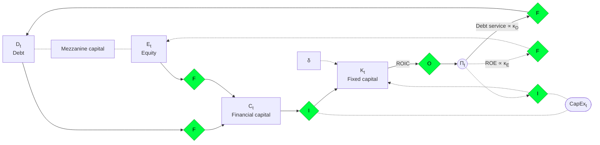

# Companies and Corporate Finance

## Project and company

A **project** is a **planned** set of actions aimed at obtaining an **economic profit** within a **defined time horizon**. A project typically has 3 phases:

- **Investment:** schedule, budget and financing.
- **Operation:** running the business and generating *cash flow*.
- **Divestment:** liquidation, sale, dismantling.

A **company** is a coherent set of projects whose goal is to **create value** in the **long term**.

## Corporate finance

**Corporate finance** is the discipline whose goal is to **quantify** the **value** created by a **company**, in order to guide the business **decisions** that **maximize** it.

From the point of view of corporate finance, business decisions can be classified into:

- **Operating** decisions.
- **Investment** (and divestment) decisions.
- **Financing** decisions, i.e. raising funds and returning them to the creditors and the shareholders.

A similar classification divides corporate finance into three main areas: working capital management (how to manage the day-to-day financial activities), capital budgeting (which long-term investments to make) and capital structure (how to finance them).

## Value creation as an optimization problem

The goal of the company, to create value, can be written as an optimization problem. The company chooses its operating, investment and financing decisions to maximize the present value of all its future cash flows:

$$\max_{p,q,I,f} \sum_{t=0}^{\infty} \frac{\Pi_t}{(1+\kappa_t)^t}$$

- $p, q, I, f$ are the decision variables, one for each type of decision. The prices $p$ and the quantities $q$ are the operating decisions, the investment $I$ is the investment decision, and the funds $f$ are the financing decisions.
- $t$ is the period (e.g. the year), from today ($t=0$) to an infinite horizon ($t=\infty$), because a company aims to create value in the long term and has no defined end. The note [Why Value Value?](05-why-value-value.md) explains why the goal is long term.
- $\Pi_t$ is the free cash flow of the company in period $t$: the cash available to all the providers of funds (creditors and shareholders), after the operating costs and the investments.
- $\kappa_t$ is the discount rate in period $t$, i.e. the cost of capital: the return that the providers of funds require. When the cash flow is available to all the providers of funds, this rate is the **weighted average cost of capital** (WACC), the average of the cost of debt and the cost of equity, weighted by the share of each in the funding of the company.
- $\frac{\Pi_t}{(1+\kappa_t)^t}$ is the present value of the cash flow of period $t$, and the sum of all of them is the value of the company.

> [!NOTE]
> The term $(1+\kappa_t)^t$ is exact only when the rate is the same in all periods, i.e. $\kappa_t = \kappa$. If the rate changes from period to period, the exact discount factor of period $t$ is the product of the factors $(1+\kappa_s)$ of all the periods from $1$ to $t$: $\prod_{s=1}^{t} (1+\kappa_s)$.

The free cash flow of each period is:

$$\Pi_t = \left((p_t - v_t) q_t - F_t\right) - \Delta K_t^W - I_t$$

- $p_t$ is the unit price of the products sold in period $t$.
- $v_t$ is the unit variable cost, so $p_t - v_t$ is the unit contribution margin.
- $q_t$ is the quantity sold.
- $F_t$ are the fixed costs, which do not depend on the quantity sold.
- $(p_t - v_t) q_t - F_t$ is the operating result: the cash that the operation generates.
- $\Delta K_t^W$ is the change in the working capital $K^W$ (e.g. inventories plus receivables minus payables). An increase in the working capital ties up cash, so it reduces the cash flow.
- $I_t$ is the investment in fixed capital in period $t$ (e.g. machines, buildings), which also reduces the cash flow of the period.

> [!NOTE]
> This is a simplified model with no taxes. The usual formula of the free cash flow to the firm (FCFF) also deducts the taxes on the operating profit: $FCFF = EBIT (1-\tau) + D\&A - CapEx - \Delta WC$, where $EBIT$ is the operating profit, $\tau$ is the tax rate, $D\&A$ is the depreciation and amortization (added back because it is not a cash cost), $CapEx$ is the investment $I_t$ and $\Delta WC$ is the change in the working capital $\Delta K_t^W$. With no taxes, $EBIT + D\&A$ is the operating result $(p_t - v_t) q_t - F_t$ of the model, and the two formulas are the same.

The maximization is subject to two constraints. The first is the accumulation of the capital:

$$K_{t+1} = K_t + I_t - \delta_t K_t$$

- $K_t$ is the stock of fixed capital at the start of period $t$.
- $I_t$ is the investment of period $t$, which adds to the capital.
- $\delta_t$ is the depreciation rate, so $\delta_t K_t$ is the part of the capital that is used up (it wears out or becomes obsolete) during period $t$.
- $K_{t+1}$ is the capital available at the start of the next period. Without new investment the capital decreases, so the investment decisions of today set the capacity of production of tomorrow.

This is the standard law of motion of the capital, often written as $K_{t+1} = (1-\delta_t) K_t + I_t$.

The second constraint is the financing constraint:

$$\Pi_t \geq \kappa_t^{\mathcal{D}} \sum_{j \in \mathcal{D}} f_{j,t} - \sum_{j \in \mathcal{C}} f_{j,t}$$

- $f_{j,t}$ is the amount of funds from the source $j$ in period $t$.
- $\mathcal{D}$ is the set of the debt sources (e.g. bank loans, bonds), so $\sum_{j \in \mathcal{D}} f_{j,t}$ is the total debt.
- $\kappa_t^{\mathcal{D}}$ is the cost of debt (the interest rate), so $\kappa_t^{\mathcal{D}} \sum_{j \in \mathcal{D}} f_{j,t}$ is the interest that the company must pay in period $t$.
- $\mathcal{C}$ is the set of the equity (capital) sources (e.g. contributions of the shareholders), so $\sum_{j \in \mathcal{C}} f_{j,t}$ is the total equity contributed. Do not confuse the set $\mathcal{C}$ with the financial capital $C_t$ of the diagram below.

The constraint can also be written as $\Pi_t + \sum_{j \in \mathcal{C}} f_{j,t} \geq \kappa_t^{\mathcal{D}} \sum_{j \in \mathcal{D}} f_{j,t}$. This means that the cash flow of the company, plus the funds of the shareholders, must be sufficient to pay the interest on the debt. If this is not true, the company cannot meet its obligations to its creditors.

## The company from a financial point of view

The diagram shows the cycle of the funds in a company. The diamonds mark the decisions, with **F** for financing, **I** for investment and **O** for operating. These letters are types of decision, not the symbols of the formulas above (e.g. the diamond **F** is not the fixed costs $F_t$).

- The company raises funds as **debt** $D_t$ and **equity** $E_t$, or as **mezzanine capital**. Mezzanine capital is a hybrid between the two, because its claim on the company ranks below the senior debt and above the common equity (e.g. subordinated debt, preferred stock with warrants or conversion rights). These are financing decisions.
- $C_t$: the funds raised form the **financial capital** of the company.
- $K_t$: with investment decisions, the company turns the financial capital into **fixed capital** $K_t$ (e.g. machines, buildings). This investment is the **capital expenditure** $\text{CapEx}_t$, i.e. the investment $I_t$ of the formulas above.
- $\delta$: the fixed capital loses value over time through **depreciation**, at the rate $\delta$.
- $\Pi_t$: with operating decisions, the company uses the fixed capital to generate the **cash flow** $\Pi_t$. The **return on invested capital** (ROIC) measures how much return the capital generates. It is the operating profit after taxes (NOPAT) divided by the capital invested by the creditors and the shareholders.
- **Debt service**: part of the cash flow goes back to the creditors as interest and principal repayments. The interest part depends on ($\propto$) the cost of debt $\kappa_D$, which is the $\kappa_t^{\mathcal{D}}$ of the financing constraint.
- **ROE**: part of the cash flow goes back to the shareholders (e.g. dividends, share buybacks). The **cost of equity** $\kappa_E$ is the return that the shareholders require. The **return on equity** (ROE), the net income divided by the equity, measures the return that the company actually generates for them. The shareholders are satisfied when the ROE is at least equal to $\kappa_E$.
- **Reinvestment**: the company can also reinvest part of the cash flow directly in the fixed capital (more $\text{CapEx}_t$), with no new external funds. In the formula of the free cash flow, this investment is already deducted from $\Pi_t$ as $I_t$. The diagram shows it as a separate loop.

The company creates value when the ROIC is higher than the cost of the funds that it uses, i.e. the WACC, which combines $\kappa_D$ and $\kappa_E$. If the ROIC is lower than the WACC, the company destroys value: the funds earn less than they cost.

## References

Links last checked: 15 October 2026.

- Dahlquist, Julie, and Rainford Knight. 2022. *Principles of Finance*. OpenStax. Section 17.3, "Calculating the Weighted Average Cost of Capital." [Free online edition](https://openstax.org/books/principles-finance/pages/17-3-calculating-the-weighted-average-cost-of-capital).
- Wikipedia. "Capital Expenditure." [Online article](https://en.wikipedia.org/wiki/Capital_expenditure).
- Wikipedia. "Contribution Margin." [Online article](https://en.wikipedia.org/wiki/Contribution_margin).
- Wikipedia. "Corporate Finance." [Online article](https://en.wikipedia.org/wiki/Corporate_finance).
- Wikipedia. "Cost of Equity." [Online article](https://en.wikipedia.org/wiki/Cost_of_equity).
- Wikipedia. "Debt Service Coverage Ratio." [Online article](https://en.wikipedia.org/wiki/Debt_service_coverage_ratio).
- Wikipedia. "Depreciation." [Online article](https://en.wikipedia.org/wiki/Depreciation).
- Wikipedia. "Free Cash Flow." [Online article](https://en.wikipedia.org/wiki/Free_cash_flow).
- Wikipedia. "Mezzanine Capital." [Online article](https://en.wikipedia.org/wiki/Mezzanine_capital).
- Wikipedia. "Return on Equity." [Online article](https://en.wikipedia.org/wiki/Return_on_equity).
- Wikipedia. "Return on Invested Capital." [Online article](https://en.wikipedia.org/wiki/Return_on_invested_capital).
- Wikipedia. "Valuation Using Discounted Cash Flows." [Online article](https://en.wikipedia.org/wiki/Valuation_using_discounted_cash_flows).
- Wikipedia. "Weighted Average Cost of Capital." [Online article](https://en.wikipedia.org/wiki/Weighted_average_cost_of_capital).
- Wikipedia. "Working Capital." [Online article](https://en.wikipedia.org/wiki/Working_capital).
