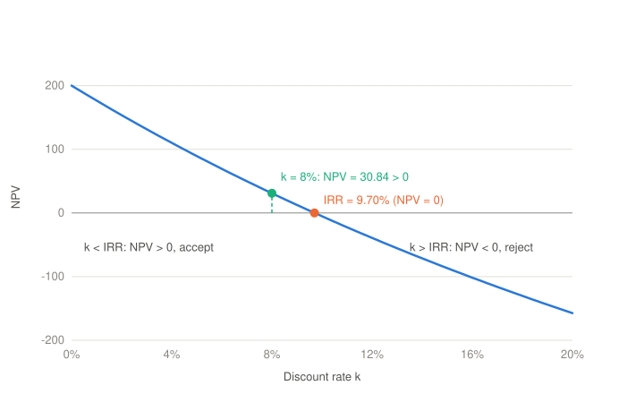

# Investment Decisions

## Definition

**Investment decisions** are the decisions related to the **projects that increase the value** of the company. They allocate resources in the **long term** (CapEx), and they are **structural** decisions on the **capital stock** $K_t$. Examples: the purchase of machinery, new products, new markets, mergers and acquisitions (M&A), the sale of a division (*carve-out*).

The resources (*sources*) can be **internal**, generated by the operations, or **external**, i.e. financial capital. Their destination (*uses*) is capital goods, or capital in general ($K_t$).

The fundamental criterion is that the **internal rate of return** (IRR) of the project is **higher than the cost of capital**. The investment decisions are different from the [operating decisions](01-operating-decisions.md). The operating decisions use a given capital in the short to medium term. The investment decisions change the capital itself, in the long term, and they are often difficult to reverse.

## Investment and the Capital Stock

In the model of [Companies and Corporate Finance](00-companies-and-corporate-finance.md), the investment $I_t$ (the CapEx) changes the capital stock:

$$K_{t+1} = K_t + I_t - \delta_t K_t$$

Each period the depreciation $\delta_t K_t$ uses up a part of the capital. The investment has two parts:

- **Maintenance CapEx** replaces the capital used up. If $I_t = \delta_t K_t$, the capital stays constant.
- **Growth CapEx** increases the capital. Only an investment above the depreciation, $I_t > \delta_t K_t$, increases the capacity of the company.

The examples above act on $K_t$ in different ways:

| Example | Effect on $K_t$ |
| --- | --- |
| Purchase of machinery | Increases $K_t$ with new capital goods (organic growth). |
| New products, new markets | Increase $K_t$ with the capital (and the working capital) that the new activity needs. |
| M&A | Increases $K_t$ with the capital of another company, bought as a whole (external growth). |
| Sale of a division (*carve-out*) | Decreases $K_t$: a **divestment**, the opposite of an investment. |

A divestment creates value when the price received is higher than the present value of the free cash flows that the division would generate inside the company.

> [!NOTE]
> In a strict sense, an **equity carve-out** is the sale to the public (an IPO) of a part of the shares of a subsidiary, while the parent company keeps the control. This note uses the term in a wider sense, for the sale of a division in general (a **divestiture**).

## Sources and Uses

Each investment needs funds. The *sources* tell where the funds come from, and the *uses* tell where they go:

| Sources | Uses |
| --- | --- |
| **Internal:** the free cash flow that the operations generate and the company keeps (reinvestment). | **Capital goods:** fixed capital such as machines and buildings ($K_t$). |
| **External:** financial capital $C_t$ from debt $D_t$, equity $E_t$ or mezzanine capital. | **Capital in general:** working capital, or a whole company in an acquisition. |

The total of the sources is always equal to the total of the uses. In the diagram of [Companies and Corporate Finance](00-companies-and-corporate-finance.md), the internal source is the reinvestment loop from $\Pi_t$ to $K_t$, and the external source is the path from $D_t$ and $E_t$ through $C_t$ to $K_t$.

The choice between the sources is a financing decision. The **pecking order theory** says that companies prefer internal funds first, then debt, and equity last, because the managers know more about the company than the outside investors. The empirical tests of this theory give mixed results.

## The Decision Criterion: NPV and IRR

An investment project is a series of cash flows: a negative cash flow $CF_0$ at the start (the investment), and then the free cash flows $CF_t$ that the project generates.

The **net present value** (NPV) is the sum of all the cash flows, discounted at the cost of capital $k$ of the project:

$$NPV = \sum_{t=0}^{T} \frac{CF_t}{(1+k)^t}$$

The NPV is the value that the project creates for the company. The rule is: **accept the project if $NPV > 0$**. This is the objective of [Companies and Corporate Finance](00-companies-and-corporate-finance.md), the maximization of the present value of the cash flows, applied to one project.

The **internal rate of return** (IRR) is the discount rate that makes the NPV equal to zero:

$$\sum_{t=0}^{T} \frac{CF_t}{(1+IRR)^t} = 0$$

The IRR is the return of the project. The rule is: **accept the project if $IRR > k$**, i.e. if the project earns more than its funds cost. This is the same idea as the rule $ROIC > WACC$ for the whole company.

For a **conventional project**, with one negative cash flow at the start and then only positive cash flows, the NPV decreases when the discount rate increases. The NPV is zero exactly at the IRR, so the two rules give the same decision:

$$IRR > k \iff NPV(k) > 0$$

**Example**

A project needs an investment of $1{,}000$ today and generates $400$ at the end of each of the next 3 years. The cost of capital is $k = 8\%$.

| $t$ | $CF_t$ | $\frac{CF_t}{(1.08)^t}$ |
| --- | --- | --- |
| 0 | $-1{,}000$ | $-1{,}000.00$ |
| 1 | $400$ | $370.37$ |
| 2 | $400$ | $342.94$ |
| 3 | $400$ | $317.53$ |
| **NPV** | | $30.84$ |

- $NPV = 30.84 > 0$: the project creates value, so the company accepts it.
- The IRR is the rate that solves $-1{,}000 + \frac{400}{1+IRR} + \frac{400}{(1+IRR)^2} + \frac{400}{(1+IRR)^3} = 0$, i.e. $IRR \approx 9.70\%$. Because $9.70\% > 8\%$, the IRR rule gives the same decision.
- If the cost of capital were $10\%$, the NPV would be $-5.26 < 0$ and the IRR would be below $k$. The company would reject the project.

The **NPV profile** shows the NPV of the example for each discount rate. The curve crosses zero at the IRR. Each cost of capital to the left of the IRR gives a positive NPV, and each cost of capital to the right gives a negative NPV.

## Limits of the IRR

The rule $IRR > k$ is simple to explain, and surveys show that managers prefer it to the NPV. But the IRR has three limits:

1. **Multiple IRRs.** If the sign of the cash flows changes more than once, the equation of the IRR can have more than one solution. This happens, for example, when a project has a large cost at the end, such as the dismantling of a plant in the divestment phase.
2. **Mutually exclusive projects.** When the company can accept only one of two projects, the project with the higher IRR is not always the project with the higher NPV. The IRR is a percentage, so it ignores the size of the project, and it is sensitive to the timing of the cash flows. To choose between such projects, use the NPV.
3. **Reinvestment rate.** The IRR assumes that the intermediate cash flows are reinvested at the IRR itself. The NPV assumes that they are reinvested at the cost of capital, which is more realistic. The **modified IRR** (MIRR) corrects this: it reinvests the cash flows at the cost of capital, and it always has a single solution.

For this reason, the NPV is the main criterion. The rule $IRR > k$ gives the same decision only for conventional and independent projects.

## Which Cash Flows and Which Rate

The analysis is correct only if the cash flows and the rate are correct:

- **Incremental cash flows:** count only the cash flows that change because of the project. These are the free cash flows of [Operating Decisions](01-operating-decisions.md), with the investment and the working capital that the project needs.
- **Sunk costs:** do not count the costs already paid that the company cannot recover (e.g. a feasibility study already done). They do not change with the decision.
- **Opportunity costs:** count the value of the best alternative use of the resources that the project uses (e.g. the rent of a building that the company owns and could let).
- **Side effects:** count the effects on the other activities of the company, e.g. the sales that a new product takes from the existing products (cannibalization).
- **No financing flows:** do not deduct the interest or the dividends from the cash flows. The cost of the funds is already in the rate $k$.
- **The rate:** the cost of capital $k$ must reflect the risk of the project. The WACC of the company is correct only for a project with the same risk as the average of the company. A riskier project needs a higher rate.

## References

Links last checked: 15 October 2026.

- Dahlquist, Julie, and Rainford Knight. *Principles of Finance*. 2nd ed. OpenStax. Section 16.2, "Net Present Value (NPV) Method." [Free online edition](https://openstax.org/books/principles-finance-2e/pages/16-2-net-present-value-npv-method).
- Dahlquist, Julie, and Rainford Knight. *Principles of Finance*. 2nd ed. OpenStax. Section 16.3, "Internal Rate of Return (IRR) Method." [Free online edition](https://openstax.org/books/principles-finance-2e/pages/16-3-internal-rate-of-return-irr-method).
- Dahlquist, Julie, and Rainford Knight. *Principles of Finance*. 2nd ed. OpenStax. Section 16.4, "Alternative Methods." [Free online edition](https://openstax.org/books/principles-finance-2e/pages/16-4-alternative-methods).
- Dahlquist, Julie, and Rainford Knight. *Principles of Finance*. 2nd ed. OpenStax. Section 16.5, "Choosing between Projects." [Free online edition](https://openstax.org/books/principles-finance-2e/pages/16-5-choosing-between-projects).
- Wikipedia. "Capital Budgeting." [Online article](https://en.wikipedia.org/wiki/Capital_budgeting).
- Wikipedia. "Capital Expenditure." [Online article](https://en.wikipedia.org/wiki/Capital_expenditure).
- Wikipedia. "Cost of Capital." [Online article](https://en.wikipedia.org/wiki/Cost_of_capital).
- Wikipedia. "Divestment." [Online article](https://en.wikipedia.org/wiki/Divestment).
- Wikipedia. "Equity Carve-Out." [Online article](https://en.wikipedia.org/wiki/Equity_carve-out).
- Wikipedia. "Internal Rate of Return." [Online article](https://en.wikipedia.org/wiki/Internal_rate_of_return).
- Wikipedia. "Modified Internal Rate of Return." [Online article](https://en.wikipedia.org/wiki/Modified_internal_rate_of_return).
- Wikipedia. "Net Present Value." [Online article](https://en.wikipedia.org/wiki/Net_present_value).
- Wikipedia. "Opportunity Cost." [Online article](https://en.wikipedia.org/wiki/Opportunity_cost).
- Wikipedia. "Pecking Order Theory." [Online article](https://en.wikipedia.org/wiki/Pecking_order_theory).
- Wikipedia. "Sunk Cost." [Online article](https://en.wikipedia.org/wiki/Sunk_cost).
