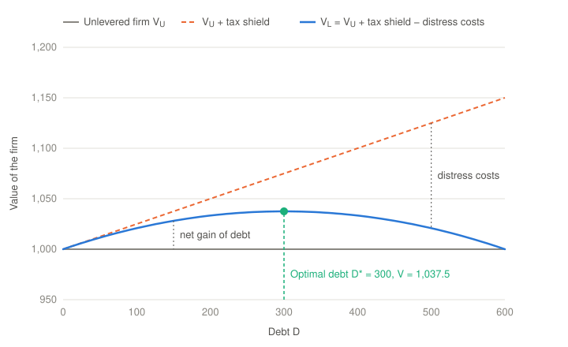

# Financing Decisions

## Definition

**Financing decisions** are the decisions related to the **optimal composition of the funds** used for the investment. The optimal composition is the one that **minimizes the cost of capital**. Examples: an initial public offering (IPO), a capital increase, a bond issue, raising debt.

The financing decisions concern the **external resources** (financial capital), to ensure the **solvency** of the company in the long term, but also its **liquidity** in the short term.

The three types of decisions work together. The [investment decisions](02-investment-decisions.md) choose the uses of the funds, and the financing decisions choose their sources. The [operating decisions](01-operating-decisions.md) generate the cash flow that pays the providers of the funds.

> [!NOTE]
> The definition above links the financing decisions to the external resources, but the internal resources are also a financing decision. The profit that the company keeps (retained earnings) belongs to the shareholders and is a part of the equity. For this reason the **payout policy**, i.e. how much cash to pay as dividends or share buybacks and how much to keep, is also a financing decision.

## The optimal composition of the funds

The composition of the funds (debt, equity, and hybrids such as mezzanine capital) is the **capital structure** of the company. Its cost is the **weighted average cost of capital** (WACC):

$$WACC = \frac{E}{V} k_E + \frac{D}{V} k_D (1-\tau)$$

- $E$ is the market value of the equity, and $D$ is the market value of the debt.
- $V = D + E$ is the total value of the funds, so $\frac{E}{V}$ and $\frac{D}{V}$ are the weights of the equity and the debt.
- $k_E$ is the cost of equity, the return that the shareholders require.
- $k_D$ is the cost of debt, the interest rate that the creditors require.
- $\tau$ is the tax rate. The interest is deductible from the taxable profit, so the cost of debt after taxes is $k_D (1-\tau)$. This is the **interest tax shield**.

If the company also uses other sources, e.g. preferred stock, each source adds a term with its weight and its cost. The weights of all the sources add up to 100%.

**Why minimize the cost of capital?** In [Companies and Corporate Finance](00-companies-and-corporate-finance.md), the value of the company is the sum of its free cash flows, discounted at the cost of capital. If the financing does not change the free cash flows, the lowest WACC gives the highest value. The goal of the financing decision is the same as the goal of the company, which is to maximize its value.

> [!NOTE]
> "Minimize the cost of capital" and "maximize the value" give the same result only if the financing does not change the free cash flows. Too much debt can reduce the free cash flows too, e.g. when customers and suppliers leave a company in financial distress. The exact goal is the maximization of the value. The trade-off theory below includes these costs.

**Example**

A company has equity with a market value of $600$ and debt with a market value of $400$. The cost of equity is $k_E = 12\%$, the cost of debt is $k_D = 5\%$ and the tax rate is $\tau = 25\%$:

$$WACC = \frac{600}{1{,}000} \times 12\% + \frac{400}{1{,}000} \times 5\% \times (1 - 0.25) = 7.2\% + 1.5\% = 8.7\%$$

Without the interest tax shield, the cost of the debt would add $2.0\%$ instead of $1.5\%$, and the WACC would be $9.2\%$.

## Capital structure theories

Debt is cheaper than equity ($k_D < k_E$), because the creditors are paid before the shareholders and the interest is deductible. Then why do companies not use only debt? Three theories answer this question.

### Modigliani–Miller

**Without taxes.** In a perfect market (no taxes, no costs of bankruptcy, perfect information), the capital structure does not change the value of the company:

- **Proposition I:** $V_L = V_U$. The value of a company with debt (levered, $V_L$) is equal to the value of the same company without debt (unlevered, $V_U$).
- **Proposition II:** $k_E = k_0 + \frac{D}{E} (k_0 - k_D)$, where $k_0$ is the cost of capital of the company without debt. When the debt increases, the shareholders take more risk, so the cost of equity increases. This increase cancels exactly the advantage of the cheaper debt, and the WACC stays equal to $k_0$.

For example, with $k_0 = 10\%$, $k_D = 5\%$ and $\frac{D}{E} = 0.5$, the cost of equity is $k_E = 10\% + 0.5 \times (10\% - 5\%) = 12.5\%$. The WACC is $\frac{2}{3} \times 12.5\% + \frac{1}{3} \times 5\% = 10\%$, the same as without debt.

**With taxes.** If the interest is deductible, each unit of debt reduces the taxes. With a permanent debt $D$, the present value of the tax shield is $\tau D$, so:

$$V_L = V_U + \tau D$$

In this case more debt always gives more value, and the optimal company would use only debt. This is not what happens in reality, because the model ignores the costs of financial distress.

### Trade-off theory

The **trade-off theory** adds the costs of **financial distress**: the direct costs of a bankruptcy (lawyers, consultants, courts), and the indirect costs (the loss of customers, suppliers and employees, and the investments that the company can no longer make). These costs increase with the debt:

$$V_L = V_U + PV(\text{tax shield}) - PV(\text{costs of financial distress})$$

With little debt, the tax shield is larger than the costs of distress, and the value increases. With a lot of debt, the costs of distress grow faster, and the value decreases. The **optimal capital structure** is the level of debt $D^*$ at which the value is at its maximum, and the WACC is at its minimum.

The chart shows an illustrative example, with $V_U = 1{,}000$, $\tau = 25\%$ and costs of financial distress that increase with the square of the debt ($\frac{D^2}{2{,}400}$). The optimal debt is $D^* = 300$, with a value of $1{,}037.5$.

In practice it is difficult to measure the costs of financial distress, so the trade-off theory gives a target range, not an exact number.

### Pecking order theory

The **pecking order theory** (see [Investment Decisions](02-investment-decisions.md)) explains the choice of the source with the asymmetric information between the managers and the investors. Companies prefer the internal funds first, then debt, and equity last, because an issue of new shares can tell the market that the managers think the shares are overvalued.

## The instruments

The examples in the definition are the main ways to raise external funds:

| Instrument | Type | Description |
| --- | --- | --- |
| **IPO** (*initial public offering*) | Equity | The company sells its shares to the public for the first time, and its shares start to trade on a stock exchange. |
| **Capital increase** | Equity | The company issues new shares. For a listed company, this is a **seasoned equity offering** (SEO). In a **rights issue**, the existing shareholders have the right to buy the new shares first. |
| **Bond issue** | Debt | The company sells bonds to many investors in the market. See [Fixed Income Securities Fundamentals](../financial-instruments-and-derivatives/00-fixed-income-securities-fundamentals.md). |
| **Raising debt** | Debt | The company borrows from banks or other lenders, e.g. loans and credit lines. |

The equity does not have to be repaid and does not have a fixed cost, but it is the most expensive source and it dilutes the control of the existing shareholders. The debt is cheaper and keeps the control, but it creates fixed payments that the company must make in all conditions.

## Solvency and liquidity

The financing decisions must ensure that the company can always pay its obligations:

- **Solvency** is the ability of the company to meet its **long-term** obligations, i.e. to pay its debt and stay in business. It depends mainly on the capital structure: how much debt the company has, compared with its equity and its capacity to generate cash.
- **Liquidity** is the ability of the company to pay its **short-term** obligations as they fall due. It depends mainly on the current assets that the company can quickly turn into cash, and on the [cash conversion cycle](01-operating-decisions.md).

A company can be solvent but illiquid: it has enough value in the long term, but not enough cash today. For this reason the financing decisions must also match the maturity of the funds with the maturity of the uses. Long-term investments need long-term funds, and short-term funds can finance the working capital.

The usual ratios are:

| Ratio | Formula | Measures |
| --- | --- | --- |
| **Current ratio** | $\frac{\text{Current assets}}{\text{Current liabilities}}$ | Liquidity: a value above 1 gives a buffer to pay the short-term obligations. |
| **Quick ratio** (acid test) | $\frac{\text{Cash} + \text{Short-term investments} + \text{Receivables}}{\text{Current liabilities}}$ | Liquidity, without the inventories, which can take more time to turn into cash. A value of at least 1 is preferred. |
| **Cash ratio** | $\frac{\text{Cash} + \text{Marketable securities}}{\text{Current liabilities}}$ | Liquidity, with only the most liquid assets. It is the most conservative of the three. |
| **Debt-to-equity ratio** | $\frac{\text{Total liabilities}}{\text{Total equity}}$ | Solvency: the funds from the lenders for each unit of funds from the shareholders. |
| **Times interest earned** (TIE) | $\frac{EBIT}{\text{Interest expense}}$ | Solvency: how many times the operating profit covers the interest. |

The TIE ratio is related to the financing constraint of [Companies and Corporate Finance](00-companies-and-corporate-finance.md): the cash flow of the company must be sufficient to pay the interest on the debt. A TIE close to 1 means that the company is near the limit of this constraint.

The good values of these ratios depend on the industry. Compare them with the history of the company and with similar companies, not with a fixed number.

## References

Links last checked: 15 October 2026.

- Dahlquist, Julie, and Rainford Knight. *Principles of Finance*. 2nd ed. OpenStax. Section 6.3, "Liquidity Ratios." [Free online edition](https://openstax.org/books/principles-finance-2e/pages/6-3-liquidity-ratios).
- Dahlquist, Julie, and Rainford Knight. *Principles of Finance*. 2nd ed. OpenStax. Section 6.4, "Solvency Ratios." [Free online edition](https://openstax.org/books/principles-finance-2e/pages/6-4-solvency-ratios).
- Dahlquist, Julie, and Rainford Knight. *Principles of Finance*. 2nd ed. OpenStax. Section 17.1, "The Concept of Capital Structure." [Free online edition](https://openstax.org/books/principles-finance-2e/pages/17-1-the-concept-of-capital-structure).
- Dahlquist, Julie, and Rainford Knight. *Principles of Finance*. 2nd ed. OpenStax. Section 17.3, "Calculating the Weighted Average Cost of Capital." [Free online edition](https://openstax.org/books/principles-finance-2e/pages/17-3-calculating-the-weighted-average-cost-of-capital).
- Dahlquist, Julie, and Rainford Knight. *Principles of Finance*. 2nd ed. OpenStax. Section 17.4, "Capital Structure Choices." [Free online edition](https://openstax.org/books/principles-finance-2e/pages/17-4-capital-structure-choices).
- Dahlquist, Julie, and Rainford Knight. *Principles of Finance*. 2nd ed. OpenStax. Section 17.5, "Optimal Capital Structure." [Free online edition](https://openstax.org/books/principles-finance-2e/pages/17-5-optimal-capital-structure).
- Dahlquist, Julie, and Rainford Knight. *Principles of Finance*. 2nd ed. OpenStax. Section 17.6, "Alternative Sources of Funds." [Free online edition](https://openstax.org/books/principles-finance-2e/pages/17-6-alternative-sources-of-funds).
- Wikipedia. "Accounting Liquidity." [Online article](https://en.wikipedia.org/wiki/Accounting_liquidity).
- Wikipedia. "Capital Structure." [Online article](https://en.wikipedia.org/wiki/Capital_structure).
- Wikipedia. "Dividend Policy." [Online article](https://en.wikipedia.org/wiki/Dividend_policy).
- Wikipedia. "Financial Distress." [Online article](https://en.wikipedia.org/wiki/Financial_distress).
- Wikipedia. "Initial Public Offering." [Online article](https://en.wikipedia.org/wiki/Initial_public_offering).
- Wikipedia. "Modigliani–Miller Theorem." [Online article](https://en.wikipedia.org/wiki/Modigliani%E2%80%93Miller_theorem).
- Wikipedia. "Pecking Order Theory." [Online article](https://en.wikipedia.org/wiki/Pecking_order_theory).
- Wikipedia. "Rights Issue." [Online article](https://en.wikipedia.org/wiki/Rights_issue).
- Wikipedia. "Seasoned Equity Offering." [Online article](https://en.wikipedia.org/wiki/Seasoned_equity_offering).
- Wikipedia. "Solvency." [Online article](https://en.wikipedia.org/wiki/Solvency).
- Wikipedia. "Tax Shield." [Online article](https://en.wikipedia.org/wiki/Tax_shield).
- Wikipedia. "Trade-Off Theory of Capital Structure." [Online article](https://en.wikipedia.org/wiki/Trade-off_theory_of_capital_structure).
- Wikipedia. "Weighted Average Cost of Capital." [Online article](https://en.wikipedia.org/wiki/Weighted_average_cost_of_capital).
