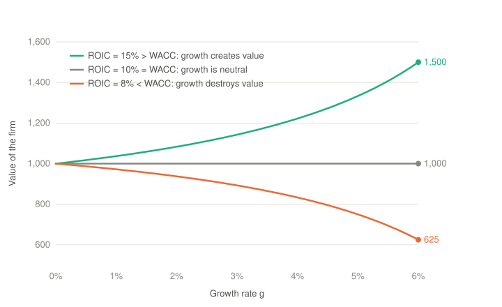

# Value Creation

## Definition

A company **creates value** when it generates cash flows for the capital that are higher than the cash flows of a financial asset with **equivalent risk**.

What is an asset with *equivalent* risk? This question is the same as the question of which return we must **require** from a company to say that it is **creating value**. The answer is that the company creates value when it generates cash flows **in excess of all its costs, including the cost of capital**.

There is **no** financial asset that is a **perfect comparable** for each company. For this reason we build a "**synthetic asset**". Each investment is compared with a baseline, the **risk-free rate**, which is **adjusted** to reflect the risk of the asset. This is the **CAPM** model.

From this definition it follows that:

- A company can be **profitable** and **destroy value**.
- A company that **grows** can **destroy value faster**.

## The required return: the opportunity cost of capital

The investors who give their funds to a company give up the alternative, which is an investment in a financial asset with the same risk. The return of this alternative is the **opportunity cost of capital**, and it is the minimum return that the investors require from the company. This is the cost of capital $\kappa$ of [Companies and Corporate Finance](00-companies-and-corporate-finance.md), the rate $k$ of [Investment Decisions](02-investment-decisions.md), and the costs $k_E$ and $k_D$ of the WACC in [Financing Decisions](03-financing-decisions.md).

The cost of debt $k_D$ is easy to observe, because it is the interest rate of the debt of the company. The cost of equity $k_E$ is not observable, because the shareholders have no contractual return. The CAPM estimates it.

## The synthetic asset: the CAPM

The **capital asset pricing model** (CAPM) gives the required return of an asset $i$:

$$E(R_i) = R_f + \beta_i \left( E(R_m) - R_f \right)$$

- $R_f$ is the **risk-free rate**, the baseline: the return of an asset with no risk, usually the yield of a government bond in the same currency.
- $E(R_m)$ is the expected return of the **market portfolio**, i.e. of all the risky assets. The difference $E(R_m) - R_f$ is the **market risk premium**, the extra return that the investors require to hold the market instead of the risk-free asset.
- $\beta_i$ is the **beta** of the asset, the measure of its risk: how much the return of the asset moves with the return of the market, $\beta_i = \frac{\text{Cov}(R_i, R_m)}{\text{Var}(R_m)}$. An asset with $\beta = 1$ moves with the market. An asset with $\beta > 1$ is riskier than the market, and an asset with $\beta < 1$ is less risky.

**Why "synthetic"?** A portfolio with a weight $\beta_i$ in the market portfolio and a weight $1 - \beta_i$ in the risk-free asset has the same beta as the asset $i$. Its expected return is:

$$\beta_i E(R_m) + (1 - \beta_i) R_f = R_f + \beta_i \left( E(R_m) - R_f \right)$$

This is exactly the CAPM. The synthetic asset is this portfolio, a combination of the risk-free asset and the market, with the same risk as the company. Its return is the return that the company must beat. The line of the required returns for each beta is the **security market line** (SML).

> [!NOTE]
> The CAPM does not adjust for the risk that is specific to the asset. The beta measures only the **systematic** (market) risk. The **specific** (idiosyncratic) risk of a company, e.g. the loss of a large customer, can be removed with diversification, so the market does not pay a premium for it and it does not enter the required return. The adjustment is specific to the asset only in the sense that each asset has its own beta.

**Example**

The risk-free rate is $R_f = 3\%$, the market risk premium is $5.5\%$, and the beta of the shares of the company is $\beta = 1.2$:

$$k_E = 3\% + 1.2 \times 5.5\% = 9.6\%$$

The synthetic asset is a portfolio with $120\%$ in the market, financed with a loan of $20\%$ at the risk-free rate. Its expected return is $1.2 \times 8.5\% - 0.2 \times 3\% = 9.6\%$, the same value.

> [!NOTE]
> The CAPM gives the cost of equity $k_E$. The cost of capital of the whole company is the WACC, which combines $k_E$ with the cost of debt (see [Financing Decisions](03-financing-decisions.md)). The CAPM is the standard model, but the empirical tests do not support it fully: e.g. the portfolios of small companies earn more than the CAPM predicts. Other models, such as the Fama–French three-factor model, add more factors of risk.

## Cash flows in excess of all the costs: the economic profit

The **economic value added** (EVA), or **economic profit**, measures the value that the company creates in a period. It deducts from the operating profit the cost of all the capital, debt and equity:

$$EVA = NOPAT - WACC \times IC = (ROIC - WACC) \times IC$$

- $NOPAT$ is the operating profit after taxes (see [Operating Decisions](01-operating-decisions.md)).
- $IC$ is the **invested capital**, the funds of the creditors and the shareholders.
- $WACC \times IC$ is the **capital charge**, the cost of all the capital.
- $ROIC = \frac{NOPAT}{IC}$ is the return on invested capital.

The company creates value when $EVA > 0$, i.e. when $ROIC > WACC$. This is the rule of [Companies and Corporate Finance](00-companies-and-corporate-finance.md) for the whole company, and the rule $NPV > 0$ (or $IRR > k$) of [Investment Decisions](02-investment-decisions.md) for one project.

## A profitable company can destroy value

The accounting profit (the net income) deducts the interest on the debt, but it does not deduct the cost of equity. A company can have a positive net income and a return that is lower than the return that its shareholders require.

**Example**

Use the company of [Financing Decisions](03-financing-decisions.md): equity of $600$, debt of $400$, $k_E = 12\%$, $k_D = 5\%$, $\tau = 25\%$ and $WACC = 8.7\%$. Assume that the book values are equal to the market values, and that the EBIT is $80$:

| Item | Value |
| --- | --- |
| EBIT | $80$ |
| − Interest ($5\% \times 400$) | $-20$ |
| = Profit before taxes | $60$ |
| − Taxes ($25\%$) | $-15$ |
| = **Net income** | $45$ |

The company is **profitable**: its net income is positive. But:

- $NOPAT = 80 \times (1 - 0.25) = 60$, so $ROIC = \frac{60}{1{,}000} = 6\%$, which is lower than the $WACC$ of $8.7\%$.
- $EVA = 60 - 8.7\% \times 1{,}000 = -27$: the company **destroys value**.
- From the point of view of the shareholders, the return on equity is $ROE = \frac{45}{600} = 7.5\%$, lower than the $12\%$ that they require.

The shareholders would earn more with an investment of the same risk in the financial markets.

## A growing company can destroy value faster

The growth needs investment. When the company reinvests a part of its $NOPAT$ at a return $ROIC$, the $NOPAT$ grows at the rate:

$$g = \text{reinvestment rate} \times ROIC \quad \Rightarrow \quad \text{reinvestment rate} = \frac{g}{ROIC}$$

The free cash flow is the part of the $NOPAT$ that the company does not reinvest, $FCF = NOPAT \left(1 - \frac{g}{ROIC}\right)$. With a constant growth, the value of the company is the value of a growing perpetuity:

$$V = \frac{NOPAT_1 \left(1 - \frac{g}{ROIC}\right)}{WACC - g}$$

- If $ROIC > WACC$, the value **increases** with the growth: each new investment creates value.
- If $ROIC = WACC$, the value is $\frac{NOPAT_1}{WACC}$ for each $g$: the growth is neutral.
- If $ROIC < WACC$, the value **decreases** with the growth: each new investment destroys value, so the faster the company grows, the faster it destroys value.

**Example**

A company has $NOPAT_1 = 100$ and $WACC = 10\%$:

| Growth $g$ | $ROIC = 8\%$ | $ROIC = 10\%$ | $ROIC = 15\%$ |
| --- | --- | --- | --- |
| $0\%$ | $1{,}000$ | $1{,}000$ | $1{,}000$ |
| $2\%$ | $937.5$ | $1{,}000$ | $1{,}083.3$ |
| $4\%$ | $833.3$ | $1{,}000$ | $1{,}222.2$ |
| $6\%$ | $625.0$ | $1{,}000$ | $1{,}500.0$ |

For example, with $ROIC = 8\%$ and $g = 4\%$, the company reinvests $\frac{4\%}{8\%} = 50\%$ of its $NOPAT$, so $FCF = 50$ and $V = \frac{50}{10\% - 4\%} = 833.3$.

Growth is not a goal in itself. The company must first earn a return above its cost of capital, and only then grow. The note [Why Value Value?](05-why-value-value.md) compares the long-term value with the other possible goals of a company (the share price today, the accounting profit and the growth).

## References

Links last checked: 15 October 2026.

- Damodaran, Aswath. "Session 25: Valuation." Corporate Finance course, Spring 2024. NYU Stern School of Business. [Free online PDF](https://pages.stern.nyu.edu/~adamodar/podcasts/cfspr24/session25slides.pdf).
- Dahlquist, Julie, and Rainford Knight. *Principles of Finance*. 2nd ed. OpenStax. Section 15.3, "The Capital Asset Pricing Model (CAPM)." [Free online edition](https://openstax.org/books/principles-finance-2e/pages/15-3-the-capital-asset-pricing-model-capm).
- Wikipedia. "Beta (Finance)." [Online article](https://en.wikipedia.org/wiki/Beta_(finance)).
- Wikipedia. "Capital Asset Pricing Model." [Online article](https://en.wikipedia.org/wiki/Capital_asset_pricing_model).
- Wikipedia. "Economic Profit." [Online article](https://en.wikipedia.org/wiki/Economic_profit).
- Wikipedia. "Economic Value Added." [Online article](https://en.wikipedia.org/wiki/Economic_value_added).
- Wikipedia. "Equity Risk Premium." [Online article](https://en.wikipedia.org/wiki/Equity_risk_premium).
- Wikipedia. "Risk-Free Rate." [Online article](https://en.wikipedia.org/wiki/Risk-free_rate).
- Wikipedia. "Security Market Line." [Online article](https://en.wikipedia.org/wiki/Security_market_line).
- Wikipedia. "Systematic Risk." [Online article](https://en.wikipedia.org/wiki/Systematic_risk).
- Wikipedia. "Terminal Value (Finance)." [Online article](https://en.wikipedia.org/wiki/Terminal_value_(finance)).
