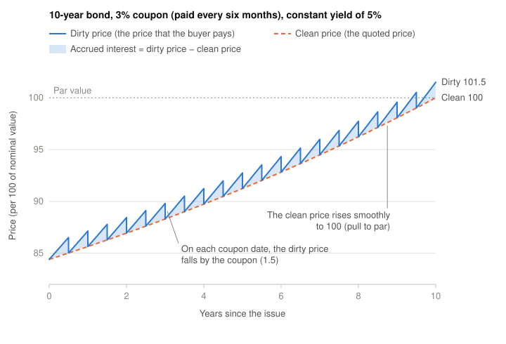
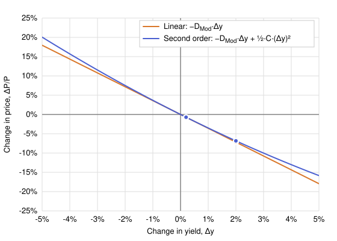

# Fixed Income Securities

## Core fixed-income instruments

### Bonds

- A time to maturity of more than 1 year (more than 10 years for US Treasury bonds)
- Periodic interest payments (coupons)
- Principal repaid at maturity (the loaned amount)
- For example, a government bond with a 5% coupon and a 30-year maturity

A bond is a loan that an investor gives to a bond issuer (e.g. a government or a company). The issuer receives the principal today and promises to repay it on the maturity date. In exchange, the issuer pays a fixed interest amount, the coupon, at regular intervals (e.g. every 3 months, 6 months, or 1 year) until maturity. The coupon rate and the maturity date are fixed when the bond is issued. The market price of the bond can change if interest rates or the credit quality of the issuer change. The investor knows the future cash flows in advance, and this is why a bond is a fixed-income security.

Bonds can also be traded publicly. Some of them are very liquid and change hands every day in the open market. The underlying idea is that the investor lends money to the issuer, but does not have to hold the loan until maturity. The investor can sell the bond to another investor, who then receives the remaining coupons and the principal at maturity.

### Notes

Notes are bonds with a time to maturity between 1 and 10 years. The term is mostly used for government debt (e.g. US Treasury notes). In the US Treasury market, the name "bond" is only for maturities of more than 10 years. The mechanics of a note are the same as for a bond, with periodic coupon payments and the repayment of the principal at maturity.

### Bills

Bills have a short time to maturity (1 year or less). Because the maturity is so short, periodic coupon payments make little sense, so bills pay no coupons. Instead, the investor buys the bill at a discount to its face value and receives the full face value at maturity. The difference between the two amounts is the interest. For this reason, we can value a bill directly with a discount factor. The price is the face value discounted from the maturity date to today.

Bills with very short maturities (e.g. 1 month or 90 days) are very common.

### CDs (Certificates of Deposit)

Deposits are normally payable on demand, which means that the client can withdraw the money at any time, without notice. Because the money can be withdrawn at any moment, a demand deposit has a very short duration, close to zero, and its value is not sensitive to changes in interest rates.

A certificate of deposit (CD) is different. The client agrees to leave a fixed amount in the bank until a maturity date (e.g. 3 months, 6 months, or 1 year). In exchange, the bank pays a fixed interest rate, usually higher than the rate on a demand deposit. If the client withdraws the money before maturity, the bank applies a penalty. Because the cash flows are fixed in advance, a CD is a fixed-income instrument, like a bond or a bill.

The main problem of a CD is its limited liquidity. Unlike bonds and bills, a CD is a contract between the client and one bank, and there is no market where the client can easily resell this debt to another investor. The only way to recover the money before maturity is to pay the penalty to the bank. Only large CDs issued to institutions (negotiable CDs) can be sold in a secondary market.

## Pricing of a Fixed-Income Security

The price of a fixed-income security is the present value of all the cash flows that the security pays in the future. We must discount each cash flow back to today, and the size of the discount depends on two things, the yield and the time at which the cash flow arrives. The price is the sum of all these discounted cash flows.

$$P=\sum_{t=1}^{n} \frac{CF_t}{(1+y)^t}$$

- $P$ is the price of the security today.
- $t$ is the time of each cash flow, in years.
- $n$ is the number of cash flows.
- $CF_t$ is the cash flow paid at time $t$ (a coupon, or the last coupon plus the principal at maturity).
- $y$ is the yield to maturity, that is the discount rate that the market applies to the security.

The term $1/(1+y)^t$ is the discount factor. It converts one unit of money paid at time $t$ into money of today. Two effects control its size.

- The yield. A high yield gives a small discount factor, so the price is low. A low yield gives a large discount factor, so the price is high. This is why the price of a fixed-income security moves in the opposite direction to the yield.
- The time. The exponent $t$ grows with the time to the cash flow, so a distant cash flow receives a stronger discount than a near cash flow of the same size. A cash flow at year 10 contributes much less to the price than the same cash flow at year 1.

The yield $y$ is the single rate that makes the sum of the discounted cash flows equal to the market price. It is therefore the internal rate of return of the security. If the investor buys at the price $P$, holds the security to maturity, and reinvests each coupon at the rate $y$, the investor earns exactly $y$ per year.

With continuous compounding, the discount factor of each cash flow is $e^{-y t}$, and the price is

$$P=\sum_{t=1}^{n} CF_t e^{-y t}$$

### Yield

The yield of a fixed-income security is the single discount rate that gives a price equal to the market price, when it is applied to all the cash flows of the security.

**Example**

A bond has a principal of 100 and a maturity of 2 years. It pays a coupon of 5% per year in two parts of 2.5 every six months. The market price of the bond is 97.50. If $y$ is the yield of the bond with continuous compounding, the same rate $y$ discounts all the cash flows.

$$2.5 e^{-y \cdot 0.5} + 2.5 e^{-y \cdot 1.0} + 2.5 e^{-y \cdot 1.5} + 102.5 e^{-y \cdot 2.0} = 97.50$$

There is no closed formula for $y$, so we must solve the equation with a numerical method, such as trial and error or Newton-Raphson. A rate of 6% gives a price of 97.97, which is too high, and a rate of 7% gives a price of 96.11, which is too low. Thus $y$ is between 6% and 7%, and the numerical method gives

$$y = 0.0625 \quad (6.25\%)$$

### Clean and Dirty Prices

For a fixed-income security that pays coupons, we define the **dirty price**, or **full price**, as the price $P_{dirty}$. It is the **cash that the buyer of the bond pays**. Between two coupon dates the times $t$ are not whole years, e.g. 3 months after the last coupon of an annual bond the cash flows arrive at $t = 0.75, 1.75, \dots$

The **clean price** is the dirty price minus the **accrued interest** ($AI$), the part of the next coupon that the seller earned from the last coupon date to the date of the sale. Thus the accrued interest grows with the time. The buyer pays the clean price plus the accrued interest, i.e. the dirty price, because the buyer receives the full next coupon.

$$P_{clean} = P_{dirty} - AI$$

$$AI = \frac{\text{annual coupon}}{f} \times \frac{\text{time since the last coupon}}{\text{time between two coupons}} = \text{annual coupon} \times \text{years since the last coupon}$$

Here $f$ is the frequency of payment (1, 2 or 4 coupons in one year), so the annual coupon divided by $f$ is one coupon. In years, the frequency cancels, because one coupon accrues in $\frac{1}{f}$ years. The day count convention of the security sets how to count the time (see [Day Count Conventions](#day-count-conventions)).

For an annual bond ($f = 1$) with a coupon of 5, the accrued interest 3 months after the last coupon is $AI = 5 \times \frac{3}{12} = 1.25$. The other 9 months, until the next coupon, belong to the buyer.

The chart shows a 10-year bond with a 3% coupon, paid in two parts of 1.5 every six months, and a constant yield of 5%.

- The dirty price draws a **saw-tooth**. It rises with the accrued interest and falls by the coupon on each coupon date. This fall is **not a loss**, because the money moves from the price to the cash of the holder.
- The clean price rises **smoothly** to par. It stays below 100, because the 3% coupon is lower than the 5% yield. Its change is **not the return**, because it does not include the accrued interest.

**Why the market quotes the clean price**

The accrued interest grows linearly and goes back to zero on the coupon date, so it absorbs the jump of the dirty price. The clean price stays continuous, so it lets you compare the prices of different fixed-income securities, also when their coupon calendars are different. Screens, trading desks and futures quote the clean price. The settlement and the return always use the dirty price.

### Day Count Conventions

The interest of a fixed-income security accrues day by day. To calculate the interest between two dates, we must change the number of days into a fraction of a year. The **day count convention** of the security sets this rule.

$$\text{interest} = \text{face value} \times \text{annual rate} \times \frac{\text{days in the period}}{\text{days in the year}}$$

Each convention sets how to count the days in the period and the days in the year. In the United States, the market uses three conventions.

**1. Actual/Actual**

The days in the period are the actual calendar days. With $f$ coupons per year, the days in the year are $f$ times the actual days in the coupon period. Thus the interest is

$$\text{interest} = \frac{\text{annual coupon}}{f} \times \frac{\text{actual days since the last coupon}}{\text{actual days between the two coupons}}$$

U.S. Treasury bonds and notes use this convention. Leap years and months of different lengths are included automatically, because the convention counts the real days.

**2. 30/360**

Each month has 30 days and the year has 360 days. Between the date $D_1/M_1/Y_1$ and the date $D_2/M_2/Y_2$ (day, month, year), the number of days is

$$\text{days} = 360 (Y_2 - Y_1) + 30 (M_2 - M_1) + (D_2 - D_1)$$

If $D_1$ is the 31st, it becomes the 30th. If $D_2$ is the 31st and $D_1$ is the 30th or the 31st, $D_2$ also becomes the 30th. Some U.S. variants also have special cases for the last day of February. U.S. corporate bonds, municipal bonds and agency bonds use this convention. The calculation is easy, because each full month gives the same interest.

**3. Actual/360**

The days in the period are the actual calendar days, but the year has 360 days. U.S. Treasury bills and most money market instruments use this convention, for example commercial paper, deposits and overnight rates. A full year of 365 days gives the interest of $\frac{365}{360}$ years, so the interest is slightly higher than the annual rate. The [Discount Rate](#discount-rate) of a bill uses this convention.

### Discount Rate

Some instruments, such as [bills](#bills), pay no coupons. They pay only the face value at maturity. The interest earned is the face value minus the price. The market often quotes these instruments with a **discount rate**. The discount rate is the interest earned as a percentage of the **final face value**, not as a percentage of the initial price paid for the instrument. It also uses a year of 360 days.

For example, if the quote of a 91-day Treasury bill is 8, the interest earned is 8% of the face value per 360 days. With a face value of 100, the interest earned over the 91-day life of the bill is

$$100 \times 0.08 \times \frac{91}{360} = 2.022$$

Thus the cash price of the bill is $100 - 2.022 = 97.978$.

In general, for a face value of 100, the relation between the quoted price and the cash price of a Treasury bill in the United States is

$$P = \frac{360}{n}(100 - Y)$$

- $P$ is the quoted price, that is the discount rate in percent.
- $Y$ is the cash price, the price that the buyer pays for a face value of 100.
- $n$ is the remaining life of the bill, in calendar days.

The term $100 - Y$ is the interest that the holder earns until maturity. The factor $\frac{360}{n}$ converts this interest for $n$ days into an interest for 360 days.

**Example**

A Treasury bill has a face value of 100 and a remaining life of 90 days. The buyer pays a cash price of 99.

1. The holder pays 99 today and receives 100 in 90 days. The interest earned over the 90 days is $100 - 99 = 1$, that is 1% of the face value.
2. A period of 360 days contains $\frac{360}{90} = 4$ periods of 90 days.
3. The interest for 360 days is therefore $1\% \times 4 = 4\%$ of the face value.

The formula does the same steps in one line.

$$P = \frac{360}{90}(100 - 99) = 4 \times 1 = 4$$

Thus the market quotes the bill at 4, but the buyer pays 99. The calculation also works in the opposite direction. From a quote of 4, the interest for 90 days is $4 \times \frac{90}{360} = 1$, so the cash price is $Y = 100 - 1 = 99$.

**Why the quote is annualized**

The discount $100 - Y$ depends on two things, the interest rate and the remaining life of the bill. A long bill has a large discount, and a short bill has a small discount, also when the two bills pay the same rate. The table shows two bills that pay the same rate.

|   Bill   | Cash price $Y$ | Discount $100 - Y$ | Quoted price $P$ |
| :------: | :------------: | :----------------: | :--------------: |
| 30 days  |     99.667     |       0.333        |        4         |
| 180 days |     98.000     |       2.000        |        4         |

The discounts of 0.333 and 2 do not show that the two bills pay the same rate. The quoted prices are both 4, so the comparison is immediate. The annualization gives two more advantages.

- The quote stays stable over time. The discount of a bill decreases each day, because the bill comes nearer to maturity. If the rates do not change, the annualized quote does not change.
- The quote is comparable with other rates. Deposits, loans and the other money market rates are also annual rates, so a trader can compare a bill with these instruments.

**Why 360 days and not 365**

The year of 360 days is an old convention of the money market. The number 360 has many divisors (2, 3, 4, 5, 6, 8, 9, 10, 12 and more), so it divides easily into months and quarters. This made the calculations by hand easier before computers. U.S. Treasury bills and many other money market instruments still use this convention.

## Macaulay Duration

The Macaulay duration is the weighted average time, in years, at which an investor receives the cash flows of a fixed-income security. Each cash flow is weighted by its present value. The intuition is that it is the average time in which you recover the money that you invested. Each time counts in proportion to the money, in value of today, that arrives at that time. For a security with $m$ cash flows per year, the formula is

$$D_{Mac}=\frac{1}{P}\sum_{k=1}^{N} t_k \cdot \frac{CF_{t_k}}{\left(1+\frac{y}{m}\right)^{m t_k}}$$

- $m$ is the compounding frequency, the number of cash flows per year (e.g. $m = 2$ for semiannual coupons).
- $t_k = k/m$ is the time of the $k$-th cash flow, in years.
- $N = m T$ is the number of cash flows, and $T$ is the maturity in years.
- $CF_{t_k}$ is the cash flow paid at time $t_k$ (coupon, or coupon plus principal at maturity).
- $P$ is the price of the security.
- $y$ is the yield to maturity, quoted as a nominal annual rate with $m$ compounding periods per year. It is the discount rate that makes the sum of the discounted cash flows equal to $P$.

In the particular case of one cash flow per year ($m = 1$), the times are whole years ($t_k = k$), and the formula becomes

$$D_{Mac}=\frac{1}{P}\sum_{t=1}^{n} t \cdot \frac{CF_t}{(1+y)^t}$$

The formula sums all the cash flows, each multiplied by the time at which it is paid and discounted at the yield to maturity with compound interest. The sum is then divided by the price of the security. The division by $P$ is what turns the sum into an average. A weighted average of the times $t$ is the sum of each $t$ multiplied by a weight, where all the weights add up to 1. In the formula, the weight of each time $t$ is its discounted cash flow divided by $P$. The yield $y$ is the rate that makes the discounted cash flows add up to the price.

$$\sum_{t=1}^{n} \frac{CF_t}{(1+y)^t} = P$$

Thus the weights add up to exactly 1, and $D_{Mac}$ is a true average of the times $t$. Each time $t$ counts in proportion to the share of the price that its cash flow represents. A cash flow that is large or paid soon has a large present value and pulls the average towards its time. A cash flow that is small or paid late has a small present value and pulls the average less.

A zero-coupon bond is the simplest check. It has one cash flow at maturity, so that cash flow is the whole price, its weight is 1, and the Macaulay duration equals the maturity. A security with coupons pays part of the price before maturity, so its Macaulay duration is shorter than the maturity.

The times $t_k$ are always in years, so the Macaulay duration is a time in years for all compounding frequencies. With continuous compounding ($m \to \infty$), the discount factor becomes $e^{-y t_k}$, and the Macaulay duration is

$$D_{Mac}=\frac{1}{P}\sum_{k=1}^{N} t_k \cdot CF_{t_k} e^{-y t_k}$$

**Example**

A bond has a face value of 100 and a maturity of 4 years. It pays an annual coupon of 5%. The yield to maturity (YTM) is 4%.

| Year ($t$) | Cash flow ($CF_t$) | Present value of the cash flow ($PV_t$) | $t \times PV_t$ |
| :--------: | :----------------: | :-------------------------------------: | :--------------: |
|     1      |         5          |                  4.808                  |      4.808       |
|     2      |         5          |                  4.623                  |      9.246       |
|     3      |         5          |                  4.445                  |      13.335      |
|     4      |        105         |                 89.754                  |     359.016      |
| **Total**  |                    |                 103.630                 |     386.405      |

With annual compounding ($m = 1$), the Macaulay duration is

$$D_{Mac}=\frac{1}{103.630}\left[1 \cdot \frac{5}{1.04} + 2 \cdot \frac{5}{1.04^2} + 3 \cdot \frac{5}{1.04^3} + 4 \cdot \frac{105}{1.04^4}\right]=\frac{386.405}{103.630}=3.73$$

If the yield of 4% uses continuous compounding, the price is 103.329, and the Macaulay duration is

$$D_{Mac}=\frac{1}{103.329}\left[1 \cdot 5 e^{-0.04} + 2 \cdot 5 e^{-0.08} + 3 \cdot 5 e^{-0.12} + 4 \cdot 105 e^{-0.16}\right]=\frac{385.239}{103.329}=3.73$$

**Example with semiannual cash flows**

The same bond pays its 5% coupon in two parts of 2.5 every six months ($m = 2$). The yield to maturity is 4% with semiannual compounding, so each period has a rate of 2%.

| Time ($t_k$) | Cash flow ($CF_{t_k}$) | Present value ($PV_{t_k}$) | $t_k \times PV_{t_k}$ |
| :----------: | :--------------------: | :------------------------: | :-------------------: |
|     0.5      |          2.5           |           2.451            |         1.225         |
|     1.0      |          2.5           |           2.403            |         2.403         |
|     1.5      |          2.5           |           2.356            |         3.534         |
|     2.0      |          2.5           |           2.310            |         4.619         |
|     2.5      |          2.5           |           2.264            |         5.661         |
|     3.0      |          2.5           |           2.220            |         6.660         |
|     3.5      |          2.5           |           2.176            |         7.617         |
|     4.0      |         102.5          |           87.483           |        349.931        |
|  **Total**   |                        |          103.663           |        381.650        |

With semiannual compounding ($m = 2$), the Macaulay duration is

$$D_{Mac}=\frac{1}{103.663}\left[\sum_{k=1}^{7} \frac{k}{2} \cdot \frac{2.5}{1.02^{k}} + 4 \cdot \frac{102.5}{1.02^{8}}\right]=\frac{381.650}{103.663}=3.68$$

If the yield of 4% uses continuous compounding, the price is 103.512, and the Macaulay duration is

$$D_{Mac}=\frac{1}{103.512}\left[\sum_{k=1}^{7} \frac{k}{2} \cdot 2.5 e^{-0.04 \cdot \frac{k}{2}} + 4 \cdot 102.5 e^{-0.16}\right]=\frac{381.067}{103.512}=3.68$$

The Macaulay duration is shorter than the 3.73 years of the annual bond, because half of each coupon arrives six months earlier.

## Modified Duration

The Modified Duration measures the sensitivity of the price of the security when there are changes in the interest rates. When the yield rises, the price of a fixed-income security falls. The modified duration measures how much the price falls. For example, a modified duration of 3.59 means that the price falls by approximately 3.59% when the yield rises by 1 percentage point (e.g. from 4% to 5%). For a security with $m$ cash flows per year, it is the Macaulay duration divided by $\left(1 + \frac{y}{m}\right)$

$$D_{Mod}=\frac{D_{Mac}}{1+\frac{y}{m}}$$

- $D_{Mac}$ is the Macaulay duration, in years.
- $m$ is the compounding frequency, the number of cash flows per year.
- $y$ is the yield to maturity, quoted as a nominal annual rate with $m$ compounding periods per year.

In the particular case of one cash flow per year ($m = 1$), the formula becomes

$$D_{Mod}=\frac{D_{Mac}}{1+y}$$

With continuous compounding ($m \to \infty$), the term $\frac{y}{m}$ goes to zero, and the modified duration is equal to the Macaulay duration

$$D_{Mod}=D_{Mac}$$

With the modified duration, the percentage change in price for a small change in yield is

$$\frac{\Delta P}{P}\approx -D_{Mod}\times\Delta y$$

- $\Delta y$ is the change in the yield (e.g. $0.01$ for a rise from 4% to 5%).
- $\Delta P / P$ is the percentage change in the price.
- The minus sign shows that the price moves in the opposite direction to the yield.

The two durations measure different things. The Macaulay duration is a time, in years. The modified duration is a sensitivity of the price to the yield. The division by $\left(1 + \frac{y}{m}\right)$ converts the time into the sensitivity. With continuous compounding, the time and the sensitivity have the same value.

> [!NOTE]
> **Why is this an approximation?**
>
> The derivation below gives an exact result, $\frac{1}{P}\frac{\mathrm{d}P}{\mathrm{d}y} = -D_{Mod}$, but only for an infinitely small change in yield. This is the slope of the price curve at the current yield. The formula above replaces the infinitely small change $\mathrm{d}y$ with a finite change $\Delta y$, so it follows the straight line with that slope instead of the curve. The price curve is convex (it bends upwards), and the line is below the curve everywhere except at the current yield. For a small $\Delta y$ the gap is negligible. For a large $\Delta y$ the gap grows, and the true fall in price is smaller than the formula predicts. In Taylor expansion terms, the formula keeps only the first-order term and drops the convexity term. See [Appendix 1](#appendix-1-taylor-polynomial-and-the-relative-price-change) for how the Taylor polynomial gives this approximation and its error.

**Example**

The bond above has $D_{Mac}=3.73$ and $y=4$%, so $D_{Mod}=3.73/1.04=3.59$. If the yield rises by 1% (from 4% to 5%), the price falls by approximately $\Delta P/P \approx -D_{Mod} \times \Delta y = -3.59 \times 0.01 = -3.59$%. The approximation is a first-order one. For large changes in yield, the convexity of the price curve makes the true fall smaller and the true rise larger.

With semiannual cash flows ($m = 2$), the same bond has $D_{Mac}=3.68$, so $D_{Mod}=3.68/1.02=3.61$. If the yield of 4% uses continuous compounding, $D_{Mod}=D_{Mac}=3.73$ for the annual bond and $D_{Mod}=D_{Mac}=3.68$ for the semiannual bond.

**Derivation**

To derive the modified duration, we start from the price of the security discounted with compound interest.

$$P = \sum_{t=1}^{n} \frac{CF_t}{(1+y)^t}$$

We then differentiate with respect to the yield to maturity $y$.

$$\frac{\mathrm{d} P }{\mathrm{d} y} = \frac{\mathrm{d}}{\mathrm{d} y} \sum_{t=1}^{n} \frac{CF_t}{(1+y)^t} = \frac{\mathrm{d}}{\mathrm{d} y} \sum_{t=1}^{n} CF_t (1+y)^{-t} $$

We apply the chain rule.

$$\frac{\mathrm{d} f(g(x))}{\mathrm{d} x} = \frac{\mathrm{d} f(g(x))}{\mathrm{d} g(x)} \frac{\mathrm{d} g(x)}{\mathrm{d} x} $$

We substitute $u = 1 + y$.

$$\frac{\mathrm{d}}{\mathrm{d} y} \sum_{t=1}^{n} CF_t (1+y)^{-t} = \left[\frac{\mathrm{d}}{\mathrm{d} u} \sum_{t=1}^{n} CF_t u^{-t}\right] \frac{\mathrm{d} u}{\mathrm{d} y}$$

We use the derivative of a sum rule, the constant multiple rule, the derivative of a constant rule, and the derivative of the variable rule. In these rules, $\alpha$ is any constant.

$$\frac{\mathrm{d} (f(x) + g(x))}{\mathrm{d} x} = \frac{\mathrm{d} f(x)}{\mathrm{d} x} + \frac{\mathrm{d} g(x)}{\mathrm{d} x}$$

$$\frac{\mathrm{d} (\alpha f(x))}{\mathrm{d} x} = \alpha \frac{\mathrm{d} f(x)}{\mathrm{d} x}$$

$$\frac{\mathrm{d}\alpha}{\mathrm{d} x} = 0$$

$$\frac{\mathrm{d}x}{\mathrm{d} x} = 1$$

With these rules, the derivative of $u$ with respect to $y$ is 1, so the chain rule factor disappears.

$$\frac{\mathrm{d} u}{\mathrm{d} y} = \frac{\mathrm{d} 1}{\mathrm{d} y} + \frac{\mathrm{d} y}{\mathrm{d} y} = 1$$

$$\left[\frac{\mathrm{d}}{\mathrm{d} u} \sum_{t=1}^{n} CF_t u^{-t}\right] \frac{\mathrm{d} u}{\mathrm{d} y} = \frac{\mathrm{d}}{\mathrm{d} u} \sum_{t=1}^{n} CF_t u^{-t}$$

We apply the power rule.

$$\frac{\mathrm{d} x^n}{\mathrm{d} x} = n x ^{n-1}$$

$$\frac{\mathrm{d}}{\mathrm{d} u} \sum_{t=1}^{n} CF_t u^{-t} = \sum_{t=1}^{n} - t CF_t u^{-t - 1} = \sum_{t=1}^{n} -t \frac{CF_t}{u^{t + 1}} =  \sum_{t=1}^{n} -t \frac{CF_t}{(1+y)^{t + 1}} = - \frac{1}{1 + y} \sum_{t=1}^{n} t \cdot \frac{CF_t}{(1+y)^t}$$

We divide the two sides by $P$.

$$\frac{1}{P} \frac{\mathrm{d} P }{\mathrm{d} y} = - \frac{1}{1 + y} \frac{1}{P} \sum_{t=1}^{n} t \cdot \frac{CF_t}{(1+y)^t} = - \frac{D_{Mac}}{1+y} = -D_{Mod}$$

With $m$ cash flows per year, the same steps with $u = 1 + \frac{y}{m}$ give $\frac{\mathrm{d} u}{\mathrm{d} y} = \frac{1}{m}$. This factor cancels the $m$ of the exponent $-m t_k$.

$$\frac{1}{P} \frac{\mathrm{d} P }{\mathrm{d} y} = \frac{1}{P} \sum_{k=1}^{N} CF_{t_k} \left(-m t_k\right) \left(1+\frac{y}{m}\right)^{-m t_k - 1} \frac{1}{m} = - \frac{1}{1 + \frac{y}{m}} \frac{1}{P} \sum_{k=1}^{N} t_k \cdot \frac{CF_{t_k}}{\left(1+\frac{y}{m}\right)^{m t_k}} = - \frac{D_{Mac}}{1+\frac{y}{m}} = -D_{Mod}$$

With continuous compounding, the derivative of $e^{-y t_k}$ is $-t_k e^{-y t_k}$, so no factor remains.

$$\frac{1}{P} \frac{\mathrm{d} P }{\mathrm{d} y} = \frac{1}{P} \sum_{k=1}^{N} -t_k \cdot CF_{t_k} e^{-y t_k} = -D_{Mac} = -D_{Mod}$$

## Money Duration or Dollar Duration

The money duration, or dollar duration, is the modified duration multiplied by the price of the security. The modified duration gives the sensitivity as a percentage of the price. The money duration gives the same sensitivity as an amount of currency.

$$D_{Money} = D_{Mod} \times P$$

The change in price for a change in yield is then

$$\Delta P \approx -D_{Money} \times \Delta y$$

## Convexity

As we saw, the modified duration is a linear approximation. If the change in the yield is large, this approximation becomes unreliable, because the price curve is convex, not a straight line. Convexity is the second-order term that corrects this error.

The convexity measures the curvature of the price-yield curve. It improves the approximation by adding a second-order term to the formula. The convexity is the second derivative of the price with respect to the yield, divided by the price.

$$C=\frac{1}{P}\frac{d^2P}{dy^2}=\frac{1}{P}\sum_{t=1}^{n} \frac{t(t+1) \cdot CF_t}{(1+y)^{t+2}}$$

With this term, the second-order approximation of the price change is

$$\frac{\Delta P}{P} \approx -D_{Mod} \cdot \Delta y + \frac{1}{2} C \cdot (\Delta y)^2$$

> [!NOTE]
> This formula is a second-order Taylor polynomial of the price around the current yield. The first-order term is the duration. The second-order term is the convexity. The formula ignores the terms of order three and higher, so it is still an approximation. See [Appendix 1](#appendix-1-taylor-polynomial-and-the-relative-price-change) for the rationale of the Taylor polynomial and how each term maps to duration and convexity.

For a fixed-income security with fixed cash flows, the convexity is always positive. Negative convexity can appear only when the cash flows depend on the yield, for example in callable bonds or mortgage-backed securities. The formula above does not apply to those securities, because it treats the $CF_t$ as constants. With a positive convexity, the real result for the holder is always better than the linear approximation predicts, whatever the interest rates do. If the interest rates rise, the convexity term reduces the fall in price that the linear approximation computes. If the interest rates fall, the convexity term increases the rise in price that the linear approximation computes.

The effect of the convexity is small for small changes in the interest rates. It becomes important for large changes, for example when a long period of time has passed and the interest rates have moved far from their initial level.

**Example**

We continue with the bond above, with $D_{Mod}=3.59$ and $y=4$%. With annual compounding, the convexity of the bond is

$$C=\frac{1}{103.630}\left[\frac{1 \cdot 2 \cdot 5}{1.04^{3}} + \frac{2 \cdot 3 \cdot 5}{1.04^{4}} + \frac{3 \cdot 4 \cdot 5}{1.04^{5}} + \frac{4 \cdot 5 \cdot 105}{1.04^{6}}\right]=\frac{1743.510}{103.630}=16.82$$

The exact change is the price of the bond at the new yield divided by the price of 103.630, minus 1.

The first case is a small change, $\Delta y=0.002$.

- **Linear:** $-D_{Mod}\cdot\Delta y = -3.59\times0.002 = -0.718$%
- **Convexity term:** $\tfrac{1}{2}C\cdot(\Delta y)^2 = \tfrac{1}{2}\times16.82\times0.002^2 = +0.003$%
- **Second order:** $-0.718 + 0.003 = -0.715$%
- **Exact:** $\frac{102.890}{103.630} - 1 = -0.714$%

The second case is a large change, $\Delta y=0.02$.

- **Linear:** $-D_{Mod}\cdot\Delta y = -3.59\times0.02 = -7.180$%
- **Convexity term:** $\tfrac{1}{2}C\cdot(\Delta y)^2 = \tfrac{1}{2}\times16.82\times0.02^2 = +0.336$%
- **Second order:** $-7.180 + 0.336 = -6.844$%
- **Exact:** $\frac{96.535}{103.630} - 1 = -6.846$%

| Change in yield | Linear approximation | Convexity term | Second-order approximation | Exact change |
| :-------------: | :------------------: | :------------: | :------------------------: | :----------: |
|     +0.2%       |       -0.718%        |    +0.003%     |          -0.715%           |   -0.714%    |
|     +2%         |       -7.180%        |    +0.336%     |          -6.844%           |   -6.846%    |

The linear term grows in proportion to $\Delta y$. The convexity term grows in proportion to $(\Delta y)^2$. The change in yield is 10 times larger, so the linear term is 10 times larger, but the convexity term is 100 times larger. For the small change, the correction is 0.003% on a fall of 0.718%, and the two approximations are almost equal. For the large change, the correction is 0.336% on a fall of 7.180%, about 5% of the linear result. The linear approximation overstates the fall in price by 0.334%, but the second-order approximation is almost exact, with -6.844% against an exact change of -6.846%. This is the reason why the convexity can be ignored for small changes but not for large ones.

The graph below shows the two approximations for the same bond ($D_{Mod}=3.59$, $C=16.82$). The orange line is the linear approximation. The blue curve is the second-order approximation. The dots mark the two examples above. At these two changes in yield, the dots of the two approximations almost overlap. Near $\Delta y=0$ the line and the curve are almost equal. As $\Delta y$ grows, the curve bends up and moves away from the line. The gap between them is the convexity term.

**Derivation**

The second derivative is the derivative of the first derivative that we computed above.

$$\frac{\mathrm{d}^2P}{\mathrm{d}y^2}=\frac{\mathrm{d}}{\mathrm{d}y}\sum_{t=1}^{n} -t \frac{CF_t}{(1+y)^{t + 1}}$$

We use the same substitution $u = 1 + y$. The first derivative in terms of $u$ is

$$\frac{\mathrm{d}P}{\mathrm{d}y} = \sum_{t=1}^{n} -t  CF_t  u^{-(t+1)}$$

By the chain rule, and because $\frac{\mathrm{d}u}{\mathrm{d}y}=1$, the second derivative is

$$\frac{\mathrm{d}^2P}{\mathrm{d}y^2} = \left[\frac{\mathrm{d}}{\mathrm{d}u}\sum_{t=1}^{n} -t  CF_t  u^{-(t+1)}\right]\frac{\mathrm{d}u}{\mathrm{d}y} = \frac{\mathrm{d}}{\mathrm{d}u}\sum_{t=1}^{n} -t  CF_t  u^{-(t+1)}$$

We apply the power rule.

$$\frac{\mathrm{d}}{\mathrm{d}u}\sum_{t=1}^{n} -t  CF_t  u^{-(t+1)} = \sum_{t=1}^{n} (-t) CF_t  \big(-(t+1)\big) u^{-(t+2)} = \sum_{t=1}^{n} t(t+1) CF_t  u^{-(t+2)}$$

We substitute back $u = 1 + y$.

$$\frac{\mathrm{d}^2P}{\mathrm{d}y^2} = \sum_{t=1}^{n} \frac{t(t+1) CF_t}{(1+y)^{t+2}}$$

Therefore, the convexity is

$$C = \frac{1}{P}\frac{\mathrm{d}^2P}{\mathrm{d}y^2} = \frac{1}{P}\sum_{t=1}^{n} \frac{t(t+1) CF_t}{(1+y)^{t+2}}$$

Every term of the sum is positive, because $t$, $CF_t$, and $(1+y)$ are positive. This is the reason why the convexity of a fixed-income security with fixed positive cash flows is always positive.

## Duration and Convexity of a Portfolio

A portfolio of fixed-income securities is a set of cash flows at different times, so the methods above apply to it as to a single asset, with its cash flow yield (the internal rate of return of all its cash flows) as the yield. In practice, its duration and convexity are computed as the value-weighted averages of those of its securities, which gives a close result, and its money duration is the simple sum of their money durations.

$$D_P = \sum_i w_i D_i \qquad C_P = \sum_i w_i C_i \qquad w_i = \frac{P_i}{\sum_j P_j}$$

The weighted average assumes that the yields of all the securities change by about the same amount. When their maturities differ widely, this holds only for a parallel shift of the yield curve.

A financial institution whose assets and liabilities have the same present value and the same duration (**immunization**) removes its exposure to small parallel shifts of the yield curve. If the present values differ, it must match the money durations instead. It is still exposed to large shifts, which it covers by keeping the convexity of its assets above that of its liabilities, and to non-parallel shifts, which the key rate duration below measures.

## Practical Interpretation of Durations and Convexity

The modified duration and the convexity are widely used to evaluate the profit and loss (PnL) of a portfolio of fixed-income securities against changes in the interest rates. They approximate how the price of the portfolio changes when the interest rates move. The duration and the convexity of the portfolio are the value-weighted averages of the durations and convexities of its assets. With these two numbers, the two-term formula gives the change in the price of the whole portfolio, without the need to recompute the discounted value of all the cash flows of all the assets. The result is an approximation, and it assumes that all yields move by the same amount (a parallel shift of the yield curve).

**Sensitivity factors**

Three characteristics of a fixed-income security determine how sensitive its price is to changes in the interest rates.

- **Maturity:** a longer maturity gives a more sensitive price. The cash flows are further away, so a change in the yield discounts them more.
- **Coupon:** a lower coupon gives a more sensitive price. A larger part of the price comes from the final payment, so the duration is longer. A zero-coupon bond is the most sensitive for a given maturity.
- **Yield:** a lower yield gives a more sensitive price. At a low yield, the discount factors decrease more slowly with time, so the late cash flows carry more weight.

## Key Rate Duration

The duration and the convexity give us a way to estimate the sensitivity of our fixed-income securities to a change in the interest rates. However, we did not define which interest rate changes. The interest rates are not a single number. They form a curve, with one rate for each maturity (the yield curve). The rates at different points of this curve can move in different ways. For example, the rate at 10 years can rise while the rate at 1 year falls. The duration and the convexity assume a parallel shift, where all the rates move by the same amount. The key rate duration removes this assumption.

The key rate duration measures the sensitivity of the price of a fixed-income security to a change in the rate at one specific maturity, while all the other rates of the curve stay constant. This is a theoretical construction. In the market, the rates at nearby maturities rarely move in isolation.

**Calculation**

The key rate duration for the maturity $i$ is

$$KRD_i=-\frac{\Delta P/P}{\Delta y_i}$$

- $\Delta y_i$ is the change in the rate at the maturity $i$, while all the other rates of the curve stay constant.
- $\Delta P/P$ is the percentage change in the price of the security that this change in the rate produces.

The key rate durations of a security add up to its modified duration. If all the rates move by the same amount $\Delta y$, the sum of the effects of each key rate is the effect of a parallel shift, so

$$\sum_{i} KRD_i = D_{Mod}$$

> [!NOTE]
> **Why the key rate durations add up to the duration**
>
> The equality is approximate for two reasons. First, each key rate duration is computed with a finite shift, so the second-order terms (convexity) do not cancel exactly. Second, the key rate durations measure shifts of the spot curve, while the modified duration measures a shift of the yield to maturity of the fixed-income security. The sum is therefore the effective duration for a parallel shift. For a plain fixed-income security, this number is very close to the modified duration, and most texts treat them as equal.

**Why it is important**

- **Non-parallel curve:** the yields do not move by the same amount at all maturities. The curve can steepen, flatten, or twist. The modified duration cannot capture these movements.
- **Specific risk:** the key rate durations show the exposure of the portfolio by segment of the curve. A manager can see, for example, that the portfolio is exposed to the 10-year rate but not to the 2-year rate.
- **Precise hedging:** with the exposure by segment, a manager can hedge each segment with an instrument of the same maturity. The hedge is more effective than a hedge based on the total duration only.

**Example**

The table gives the key rate durations of a 10-year bond at three points of the yield curve.

| Maturity | $KRD_i$ |
| :------: | :-----: |
| 2 years  |   0.3   |
| 5 years  |   2.1   |
| 10 years |   5.2   |

The bond is most sensitive to changes in the 10-year rate ($KRD=5.2$) and moderately sensitive to changes in the 5-year rate ($KRD=2.1$). It is almost insensitive to the 2-year rate ($KRD=0.3$). The sum of the three key rate durations, 7.6, is the modified duration of the bond.

If the 10-year rate rises by 0.5% ($\Delta y_{10}=0.005$) and the other rates stay constant, the relative change in price is approximately

$\Delta P/P \approx -KRD_{10}\cdot\Delta y_{10} = -5.2\times0.005 = -0.026$, that is a fall of 2.6%.

For a non-parallel movement, we add the effect of each key rate. If the 2-year rate rises by 1%, the 5-year rate rises by 0.5%, and the 10-year rate falls by 0.2%, the relative change in price is approximately

$\Delta P/P \approx -(0.3\times0.01) - (2.1\times0.005) - (5.2\times(-0.002)) = -0.0030 - 0.0105 + 0.0104 = -0.0031$, that is a fall of 0.31%.

The modified duration alone cannot compute this result, because the rates did not move by the same amount.

## Appendix 1: Taylor Polynomial and the Relative Price Change

A Taylor polynomial replaces a complicated function with a simple polynomial that behaves like the function near one chosen point. At that point, the polynomial has the same value, the same slope, the same curvature, and so on, up to the degree that we choose. The more derivatives that match, the further from the point the polynomial stays close to the function.

**Why we need it for the price of a fixed-income security**

The price of any fixed-income security with fixed cash flows is $P(y)=\sum_{t} CF_t (1+y)^{-t}$. The formula can be computed exactly for any yield. The difficulty is the price change. Note that the derivatives give us infinitesimal changes. Nonetheless, the exact relative change for a finite yield move needs two points of the price curve, which are the current price at $y_0$ and the new price at $y_0+\Delta y$. Therefore, the relative price variation for a specific yield variation is

$$
\begin{aligned}
\frac{\Delta P}{P}
&= \frac{P(y_1)-P(y_0)}{P(y_0)} \\
&= \frac{\displaystyle\sum_{t} CF_t (1+y_1)^{-t} - \displaystyle\sum_{t} CF_t (1+y_0)^{-t}}{\displaystyle\sum_{t} CF_t (1+y_0)^{-t}} \\
&= \frac{\displaystyle\sum_{t} CF_t (1+y_1)^{-t}}{\displaystyle\sum_{t} CF_t (1+y_0)^{-t}} - 1
\end{aligned}
$$

The yield change is $\Delta y = y_1 - y_0$, so $y_1 = y_0 + \Delta y$, and the relative price variation is

$$
\frac{\Delta P}{P} = \frac{\displaystyle\sum_{t} CF_t (1+y_0+\Delta y)^{-t}}{\displaystyle\sum_{t} CF_t (1+y_0)^{-t}} - 1
$$

This expression is exact, but it has three practical problems.

- **No simple form in $\Delta y$.** The numerator is a sum of $n$ terms, each with a different power of $(1+y_0+\Delta y)$. No factorization removes the sum, so the expression does not reduce to a short polynomial like $a + b \Delta y + c \Delta y^2$. The denominator is also a sum of powers, but it does not contain $\Delta y$, because it is the current price $P(y_0)$, a single constant.
- **No separation between the security and the shock.** The cash flows $CF_t$, the yield $y_0$, and the shock $\Delta y$ are mixed inside the same powers. It is not possible to compute a number that describes the security once, and then apply any $\Delta y$ to it later. Each new $\Delta y$ requires a full repricing of every cash flow.
- **No portfolio summary.** The change of a portfolio is the sum of the changes of its securities, so it is additive. But there is no single number that describes the sensitivity of the whole portfolio. Each security must be repriced on its own, and the results added.

The differential $\mathrm{d}P = P'(y) \mathrm{d}y$ is exact and simple, but only for an infinitely small $\mathrm{d}y$. The Taylor polynomial connects the two. The expansion point is the current yield $y_0$, so the polynomial is built around the price $P(y_0)$ before the interest rate changes. It expresses the finite change with a few numbers ($D_{Mod}$, $C$) that are computed once at the current yield, are simple functions of $\Delta y$, and aggregate across a portfolio as weighted averages.

The $n$-th degree Taylor polynomial of a function $f(x)$ centered at $x=a$ is

$$P_{n}(x)=\sum _{k=0}^{n}\frac{f^{(k)}(a)}{k!}(x-a)^{k}$$

The factor $1/k!$ appears because the $k$-th derivative of $(x-a)^k$ is $k!$. It cancels, so the $k$-th derivative of $P_n$ at $a$ equals $f^{(k)}(a)$. If we stop at degree $n$, the error is proportional to $(x-a)^{n+1}$, which is small when $x$ is close to $a$.

**Application to the price of a fixed-income security**

Here the function is the price $P(y)$ of the security, the point is the current yield $y_0$, and the distance from the point is the yield change $\Delta y = y - y_0$. The second-degree Taylor polynomial gives

$$P(y_0+\Delta y) = P(y_1) \approx P(y_0) + P'(y_0) \Delta y + \frac{1}{2}P''(y_0) (\Delta y)^2$$

We want the relative variation of the price, not the new price. We move $P(y_0)$ to the left side and divide by $P(y_0)$.

$$\frac{\Delta P}{P} = \frac{P(y_1)-P(y_0)}{P(y_0)} \approx \frac{P'(y_0)}{P(y_0)} \Delta y + \frac{1}{2} \frac{P''(y_0)}{P(y_0)} (\Delta y)^2$$

The two ratios are the modified duration and the convexity.

$$D_{Mod} = -\frac{P'(y_0)}{P(y_0)} \qquad C = \frac{P''(y_0)}{P(y_0)}$$

So the relative price change is

$$\frac{\Delta P}{P} \approx -D_{Mod} \Delta y + \frac{1}{2} C (\Delta y)^2$$

The [Modified Duration](#modified-duration) formula keeps only the first-degree term. It follows the tangent line. The [Convexity](#convexity) formula adds the second-degree term. It follows a parabola that bends like the price curve. The dropped terms are proportional to $(\Delta y)^3$ and higher. For a yield move of 100 bp, $(\Delta y)^3 = 10^{-6}$, so two terms are enough for normal market moves.