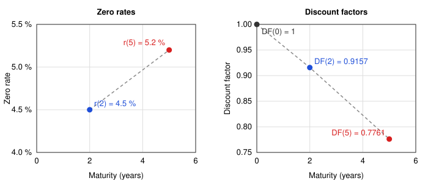
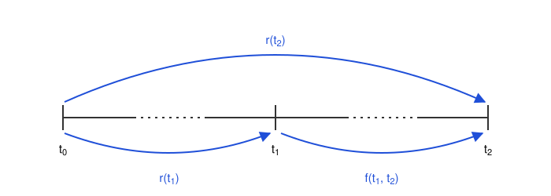

# Interest Rate Curves Fundamentals

## Structure of interest rates

The **structure of interest rates** describes the relation between interest rates and their **tenors**. The tenor is the time to maturity of a fixed income instrument. Each instrument has its own interest rate, and this rate could depend on the tenor of the instrument. For example, in normal market conditions a longer instrument usually pays a higher interest rate. The main reasons are:

- **Term premium (liquidity preference):** the lender locks the capital for a longer time and is exposed to more uncertainty, so the lender asks for a compensation.
- **Expectations of future short rates:** the long rate reflects the expected path of the short rates. If the market expects rate cuts, the long rate can be lower than the short rate.
- **Inflation risk:** the purchasing power of a fixed payment far in the future is more uncertain, so the lender asks for a higher rate.
- **Credit risk:** for the same borrower, the probability of a default grows with the time horizon, so the long rate includes a larger credit spread.
- **Interest rate risk (price sensitivity):** the price of a long instrument moves more when the rates change, so the investor asks for a compensation for this volatility.
- **Market segmentation (preferred habitat):** different investors prefer different tenors, for example banks prefer short tenors and pension funds prefer long tenors. Supply and demand in each segment set the rate of that tenor.

The **curve** is the graph of this structure. It shows the tenor on the horizontal axis and the interest rate on the vertical axis. Each point is the rate of one tenor. The curve is not always upward sloping. It can be flat or inverted when the market expects lower rates in the future, as in the US Treasury market in 2022 and 2023.

## Yield Curve

The **yield curve** is usually the curve of the yields of a set of bonds of the same issuer and the same credit quality, plotted against their tenors. The yield of a bond is its **yield to maturity(YTM)** the single rate that makes the present value of all the coupons and of the principal equal to the market price of the bond.

The market gives this curve almost directly. The market data are prices and quoted yields. A quoted yield already includes the market conventions of the instrument: the day-count rule and the compounding frequency. For example, the US Treasury market and the swap market use a semi-annual compounding. 

The yield curve has two limits:

- **The yield is an average.** One single rate discounts all the cash flows of the bond. The yield mixes the rates of all the tenors up to the maturity.
- **The yield depends on the coupon.** Two bonds with the same maturity but different coupons have different yields. This effect is the **coupon effect**.

For these two reasons you cannot use a yield to discount one single cash flow. To discount cash flows you must use the zero curve of the next section. The **bootstrap** procedure extracts the zero curve from the market instruments.

## Zero rates

The zero rate for maturity $T$ is the interest rate of a zero-coupon bond that matures at $T$. The bond pays no coupon, the only cash flow is the principal at maturity. There is one zero rate for each maturity, and together they form the zero curve.

The discount factor $DF(T)$ is the value today of one unit of money paid at $T$. For a zero rate with $m$ compounding periods per year, the discount factor is

$$DF(T) = \frac{1}{\left(1 + \frac{r(T)}{m}\right)^{m T}}$$

- $m$ is the compounding frequency, the number of compounding periods per year.
- $T$ is the maturity, in years.
- $r(T)$ is the zero rate for the maturity $T$, quoted as a nominal annual rate with $m$ compounding periods per year.

In the particular case of annual compounding ($m = 1$), the formula becomes

$$DF(T) = \frac{1}{(1 + r(T))^{T}}$$

With continuous compounding ($m \to \infty$), the discount factor is

$$DF(T) = e^{-r(T) T}$$

**Example**

Zero rates:

- Zero rate at 2 years: $r(2) = 0.045$ (4.5 %)
- Zero rate at 5 years: $r(5) = 0.052$ (5.2 %)

Discount factors with annual compounding:

- $DF(2) = \frac{1}{(1.045)^2} = 0.9157$
- $DF(5) = \frac{1}{(1.052)^5} = 0.7761$

Discount factors with continuous compounding:

- $DF(2) = e^{-0.045 \cdot 2} = 0.9139$
- $DF(5) = e^{-0.052 \cdot 5} = 0.7711$

For the same zero rate, continuous compounding gives a lower discount factor, because the interest accrues on the interest at each instant.

The chart shows the two points of the example. The left panel gives the zero rates. The right panel gives the discount factors.

Usually the zero rate grows with the maturity, but the discount factor falls.

## Par Rates

The par rate for the maturity $T$ is the coupon rate that makes the price of a fixed-income security equal to its par value. The par value is the nominal or issue value of the security, usually 100. There is one par rate for each maturity, and together they form the par rate curve.

For a fixed-income security with a par value of 100 and $m$ coupons per year, on a coupon date, the annual coupon that gives the par price is

$$C = \frac{100 m \left[ 1 - DF(T) \right]}{\sum_{k=1}^{N} DF(t_k)}$$

- $C$ is the annual coupon, in currency. Each coupon payment is $\frac{C}{m}$.
- $m$ is the number of coupons per year (e.g. $m = 2$ for semiannual coupons).
- $t_k = k/m$ is the time of the $k$-th coupon, in years.
- $N = m T$ is the number of coupons, and $T$ is the maturity in years.
- $DF(t_k)$ is the discount factor of the time $t_k$, from the zero curve.

The par rate is the annual coupon divided by the par value, $c = \frac{C}{100}$, quoted as a nominal annual rate with $m$ compounding periods per year. The par value cancels in this division, so the par rate depends only on the discount factors, i.e. on the zero curve.

In the particular case of one coupon per year ($m = 1$), the coupons arrive at the whole years $t_k = k = 1, \dots, T$, and the formula becomes

$$C = \frac{100 \left[ 1 - DF(T) \right]}{\sum_{k=1}^{T} DF(k)}$$

The discount factors can come from zero rates with any compounding, and this compounding can be different from the $m$ of the coupons. If the zero rates use continuous compounding, the discount factors are $DF(t_k) = e^{-r(t_k) t_k}$, and the formula for $C$ does not change.

**Derivation**

Each coupon payment is $\frac{C}{m}$, and the last cash flow also includes the principal of 100. The security is quoted at par when the present value of its cash flows is equal to 100.

$$100 = \sum_{k=1}^{N} \frac{C}{m} DF(t_k) + 100 \times DF(T)$$

The first term is the present value of the coupons, and the second term is the present value of the principal. Move the principal to the left side.

$$100 \left[ 1 - DF(T) \right] = \frac{C}{m} \sum_{k=1}^{N} DF(t_k)$$

Multiply the two sides by $m$, and divide them by the sum of the discount factors. The result is the formula of the annual coupon.

**Example**

A bond has a par value of 100, annual coupons ($m = 1$), and a maturity of 3 years. The zero rates are $r(1) = 3.0\%$, $r(2) = 4.0\%$ and $r(3) = 4.5\%$.

With annual compounding, the discount factors are $DF(1) = 0.9709$, $DF(2) = 0.9246$ and $DF(3) = 0.8763$.

$$C = \frac{100 \left[ 1 - 0.8763 \right]}{0.9709 + 0.9246 + 0.8763} = \frac{12.37}{2.7717} = 4.46$$

The annual coupon is 4.46, so the 3-year par rate is $c = \frac{4.46}{100} = 4.46$ %. It is lower than the 3-year zero rate of 4.5 %, because the bond also pays coupons at the earlier dates, where the zero rates are lower.

If the same zero rates use continuous compounding, the discount factors are $DF(1) = e^{-0.03} = 0.9704$, $DF(2) = e^{-0.08} = 0.9231$ and $DF(3) = e^{-0.135} = 0.8737$.

$$C = \frac{100 \left[ 1 - 0.8737 \right]}{0.9704 + 0.9231 + 0.8737} = \frac{12.63}{2.7673} = 4.56$$

The annual coupon is 4.56, so the 3-year par rate is 4.56 %. It is higher than with annual compounding, because the discount factors are lower. This par rate uses annual compounding ($m = 1$), so it is not directly comparable with the continuous zero rate of 4.5 %.

The bootstrapping below uses the same relation in the other direction. It starts from the par rates of the market and finds the zero rates.

## Forward Rates

A forward rate $f(t_1, t_2)$ is the interest rate for a future period that starts at $t_1$ and ends at $t_2$. The market does not quote this rate directly. It is implicit in the current spot curve, and you deduce it from the zero rates.

A spot rate is agreed today for a loan that starts today. A forward rate is also agreed today, but for a loan that starts in the future. The forward rate is implied by the spot curve of today, not by a forecast of future spot rates.

$$f(t_1, t_2) = \left( \frac{(1 + r(t_2))^{t_2}}{(1 + r(t_1))^{t_1}} \right)^{\frac{1}{t_2 - t_1}} - 1$$

**Example** 

We define different interest rates for different tenors:

 - r(1): 3.0%
 - r(2): 4.0%
 - r(3): 4.5%

Forward 1y1y: $f(1,2) = \frac{(1 + 0.04)^{2}}{(1 + 0.03)} - 1 = 0.0501$ (5.01 %)

Forward 2y1y: $f(2,3) = \frac{(1 + 0.045)^{3}}{(1 + 0.04)^2}  - 1 = 0.0551$ (5.51 %)

**Derivation**

The no-arbitrage condition gives the relation. Let $t_0 = 0$ be today. An investment from $t_0$ to $t_2$ must give the same result as an investment from $t_0$ to $t_1$ and then from $t_1$ to $t_2$ at the forward rate. Consider the spot curve represented by the following timeline:

Applying the no-arbitrage condition:

$$C_0(1+r(t_2))^{t_2} = C_0(1+r(t_1))^{t_1}(1+f(t_1,t_2))^{t_2-t_1}$$

Therefore:

$$(1+r(t_2))^{t_2} = (1+r(t_1))^{t_1}(1+f(t_1,t_2))^{t_2-t_1}$$

We can isolate $f(t_1,t_2)$:

$$f(t_1,t_2) = \left [ \frac{(1+r(t_2))^{t_2}}{(1+r(t_1))^{t_1}} \right ]^{\frac{1}{t_2-t_1}} - 1$$

**Chain of forward rates**

The same no-arbitrage condition applies to each year of the curve. If you chain one year after the other, the zero rate at $T$ is the product of all the annual forward rates up to $T$:

$$(1 + r(T))^{T} = \prod_{i=1}^{T} (1 + f(i-1, i))$$

The term $f(0,1)$ is the spot rate of the first year, because a loan that starts today is a forward that starts at $t = 0$. The relation operates in the two directions. You get the forward rates from the zero rates if you divide. You get the zero rates from the forward rates if you multiply.

## Bootstrapping 

In the market we cannot observe directly the interest rates curves, what we see are different fixed income instruments that are quoted in the market at different prices. Bootstrapping is the process of building a zero curve from the market prices of such instruments. 

The method is sequential. You sort the instruments by maturity, from the shortest to the longest. For each instrument, you use the zero rates that you already know to solve for the one unknown zero rate at its maturity. A coupon bond with maturity $T$ gives the zero rate at $T$, because the zero rates of its earlier coupon dates are already known.

The no-arbitrage condition requires that the theoretical price equals the market price. The same condition also fixes the rate that discounts each cash flow, a cash flow at time $t_i$ must be discounted with the zero rate of that date, $r(t_i)$.

For an instrument with price $P$ and cash flows $C_i$ at times $t_i$:

$$P = \sum_{i=1}^{n} \frac{C_i}{(1 + r(t_i))^{t_i}}$$

Only $r(t_n)$ is unknown in this equation. The procedure is:

1. **Shortest maturity:** Compute the zero rate directly from the instrument that pays $C_1 + P_1$ at $t_1$ and costs $P_0$ today:

   $$r(t_1) = \frac{C_1 + P_1}{P_0} - 1$$

2. **Next maturities:** Write the price equation of the next instrument with the known zero rates.
3. **Iteration:** Solve the price equation for the unknown $r(T)$ and repeat for the next maturity.
4. **Verification:** Check that the zero curve reproduces the market prices of all the instruments.

**Example**

The market quotes three instruments. The deposit gives the first zero rate directly. The two swaps are quoted at par, so the price of each swap equals its notional.

| Instrument | Maturity | Coupon | Price | Zero Rate |
| ---------- | -------- | ------ | ----- | --------- |
| Deposit    | 1Y       | -      | -     | 3.00 %    |
| Bond 1     | 2Y       | 4.20 % | par   | ?         |
| Bond 2     | 3Y       | 4.60 % | par   | ?         |

- For the Deposit we already know the Zero Rate

- For the Bond 1 we have to compute the YTM for the instrument quoted at par (100 USD):

$$100 = \frac{4.2}{(1+0.03)} + \frac{104.2}{(1+r(2Y))^2}$$

  We isolate $r(2Y)$:

$$(1+r(2Y))^2 = \frac{104.2}{100 - \frac{4.2}{1.03}} \quad \Rightarrow \quad r(2Y) = \sqrt{\frac{104.2}{100 - \frac{4.2}{1.03}}} - 1 \approx 0.042255$$

  The zero rate at 2 years is 4.21 %.

- For the Bond 2 we have to compute the YTM for the instrument quoted at par (100 USD):

$$100 = \frac{4.6}{(1+0.03)} + \frac{4.6}{(1+0.0421)^2} + \frac{104.6}{(1+r(3Y))^3}$$

  We isolate $r(3Y)$:

$$(1+r(3Y))^3 = \frac{104.6}{100 - \frac{4.6}{1.03} - \frac{4.6}{(1.0421)^2}} \quad \Rightarrow \quad r(3Y) = \sqrt[3]{\frac{104.6}{100 - \frac{4.6}{1.03} - \frac{4.6}{(1.0421)^2}}} - 1 \approx 0.046381$$

  The zero rate at 3 years is 4.64 %.

## Carry and Roll-Down

The **Carry** is the yield obtained by keeping a position with the yield to maturity of the instrument unchanged. It comes from the coupon income and from the "pull to par" effect: as time passes, an instrument price moves toward its par value, apart from any move in the yield curve.

The **Roll-Down** is the extra profit or loss that an instrument accrues, on an unchanged yield curve, because a different point of the curve applies to it as time passes. As an instrument moves toward maturity, it has less time to maturity, so a different point of the same yield curve applies to it. If this new yield is lower, the instrument price rises and the investor gains.

**Carry**:

$$Carry = \frac{Coupon + Amortization}{P_{initial}}$$

The Amortization is the price change that comes only from the passage of time, with the yield of the instrument unchanged. It is the yearly part of the "pull to par", positive for a bond bought below par (discount) and negative for a bond bought above par (premium).

**Roll-Down**:

$$Roll\text{-}Down = \frac{P_{new} - P_{initial} - Amortization}{P_{initial}}$$

The Roll-Down formula subtracts the Amortization because the Carry already contains the "pull to par". It measures only the extra price change from the new, lower point of the curve, so Carry + Roll-Down is the total return on a static curve.

**Total Return**:

$$Total = Carry + Roll\text{-}Down = \frac{P_{new} - P_{initial} + Coupon}{P_{initial}}$$

**Example**

Situation: a 5-year bond, coupon 5.0 %, price 102.19 USD, yield 4.5 %.

Initial data ($t=0$):

- Price: 102.19 USD
- Yield: 4.5 %
- Annual coupon: 5%
- Maturity: 5 years

After 1 year ($t=1$):

- New maturity: 4 years
- Yield 4Y (static curve): 4.3 %
- New price: 102.52 USD
- Coupon received: 5.0

Carry:

$$Amortization = \frac{5}{(1+0.045)} + \frac{5}{(1+0.045)^2} + \frac{5}{(1+0.045)^3} + \frac{105}{(1+0.045)^4} - 102.19 = 101.79 - 102.19 = -0.40$$

The Amortization is -0.40 USD.

$$Carry = \frac{5 - 0.40}{102.19} = 0.0450$$

The Carry is 4.50 %.

Roll-Down:

$$Roll\text{-}Down = \frac{102.52 - 102.19 - (-0.40)}{102.19} = \frac{102.52 - 101.79}{102.19} = 0.0071$$

The Roll-Down is 0.71 %.

Total Return:

$$Total = Carry + Roll\text{-}Down = 0.0450 + 0.0071 = 0.0521$$

The total return is 5.21 %.

Of the total return, 4.50 % comes from the coupon and the "pull to par" (Carry), and 0.71 % comes from the move to the lower 4-year point of the static curve (Roll-Down).

## Real Applications Caveat

The bootstrap of the previous sections assumes a clean set of instruments, one for each maturity, with a single price. The real market is not so clean. The practical construction of a curve must solve some problems that the theory does not show.

**Practical challenges**

- **Gaps in maturities:** the market does not quote an instrument for every maturity. You need an interpolation to fill the gaps between the quoted points.
- **Variable liquidity:** not all the instruments are equally liquid. A liquid instrument gives a more reliable price than an illiquid one.
- **Bid-Offer spreads:** each instrument has a bid price and an offer price. The usual choice is the mid price, but the mid is not always representative. If the spread is wide, if the market is one-sided, or if the last trades are all on one side, the mid does not reflect the price where you can trade.

**Interpolation methods**

- **Linear:** simple, but it can create arbitrage between the quoted points, because the implied forward rates jump at each node.
- **Log-linear on discount factors:** interpolate the logarithm of the discount factors. This is equivalent to a constant forward rate between two nodes.
- **Cubic spline:** a smooth approximation of the curve. It gives smooth forward rates, but a move in one quote can change the whole curve.

**Hierarchy of instruments**

1. **Most reliable:** OIS, EUR swaps.
2. **Reliable:** government bonds, bills.
3. **Less reliable:** corporate bonds.

**Best practices**

- Use the most liquid instruments.
- Check the coherence across asset classes (cross-asset).
- Monitor the daily outliers.
- Document the methodology clearly.

**Real example**

The ECB publishes daily OIS curves. It builds them with OIS swaps up to 30Y and uses a log-linear interpolation on the discount factors.

## Trading Strategies Based on Curve Analysis

The concepts of the previous sections (zero rates, forward rates, carry and roll-down) are the base of several trading strategies. Each strategy takes a view on a different part of the curve.

**1. Carry trades**

- Buy the bonds with a high positive carry.
- Finance the position with short instruments.
- Gain the roll-down on a normal (upward sloping) curve.

**2. Curve steepening / flattening**

- Compare the implied forward rates with your own expectations of the future rates.
- For a steepening view, go long the short tenor and short the long tenor. For a flattening view, do the opposite.
- Use the key rate duration to size each leg with precision.

**3. Forward rate arbitrage**

- Compare the implied forward rates with the forwards quoted in the market.
- Detect inconsistencies between tenors.
- Trade them with calendar spread strategies.

**Example: carry analysis**

| Bond | Yield | Carry | Roll-Down |
| ---- | ----- | ----- | --------- |
| 2Y   | 3.2 % | 3.1 % | -0.1 %    |
| 5Y   | 4.1 % | 4.0 % | +0.3 %    |
| 10Y  | 4.8 % | 4.7 % | +0.5 %    |
| 30Y  | 5.2 % | 5.1 % | +0.2 %    |

The 10Y bond gives the best total of carry plus roll-down (5.2 %). It is the most attractive position for a carry strategy.

**Risks to consider**

- Changes in the shape of the curve.
- Volatility of the rates.
