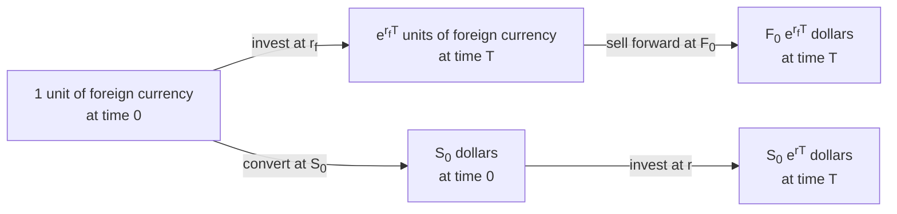

# Futures and Forwards Pricing

Arbitrage arguments give the forward and futures prices of an investment asset from its spot price and other observable market variables. This is not possible for consumption assets, for reasons explained later.

The pricing equations below assume that some market participants:

1. Pay no transaction costs when they trade.
2. Pay the same tax rate on all net trading profits.
3. Borrow and lend at the same risk-free rate.
4. Take advantage of arbitrage opportunities as they occur.

These assumptions do not need to hold for all market participants, only for a few key ones such as large derivatives dealers. The trading of these key participants, and their eagerness to exploit arbitrage, sets the relationship between forward and spot prices.

## Short Selling

**Short selling** is the sale of an asset that the investor does not own. The broker borrows the asset from another client and sells it in the market. To close the position, the investor buys the asset back and returns it to the lender. The investor gains if the price falls and loses if it rises, with no upper limit on the loss.

While the position is open, the investor pays the lender any income from the asset, such as dividends or coupons. The broker holds a **margin account** as collateral, charges a fee to borrow the asset, and can force the position to close if the lender recalls the asset.

Some arbitrage strategies start with the sale of an asset, so they require the arbitrageur to hold the asset beforehand. Short selling usually removes this requirement, at the cost of the **borrowing fee**.

Short selling is not always available, but investors who hold the asset purely for investment can still do these trades. They sell the asset instead of borrowing it, and at the end of the strategy they hold the same asset plus the profit.

## Investment Assets

In the case of investment assets we consider three different situations, the asset provides no income, the asset provides known dollar income, the asset provides known yield.

The pricing equations use the following notation.

- $T$ is the time to the delivery date of the contract, in years.
- $S_0$ is the price of the underlying asset today.
- $F_0$ is the forward or futures price today.
- $r$ is the risk-free zero rate for the maturity $T$, per annum with continuous compounding.

### No-Income Assets

The simplest forward contract to price is one on an investment asset that provides no income and has no storage costs, such as a non-dividend-paying stock or a zero-coupon bond.

Under no arbitrage, the forward price is

$$F_0 = S_0 e^{rT}$$

If $F_0 > S_0 e^{rT}$, the forward is overpriced. An arbitrageur borrows $S_0$ at $r$, buys the asset, and takes a short forward position. At $T$, the arbitrageur delivers the asset for $F_0$ and repays $S_0 e^{rT}$, for a profit of

$$F_0 - S_0 e^{rT} > 0$$

If $F_0 < S_0 e^{rT}$, the forward is underpriced. An arbitrageur short sells the asset, invests $S_0$ at $r$, and takes a long forward position. At $T$, the arbitrageur receives $S_0 e^{rT}$, buys the asset for $F_0$, and returns it to the lender, for a profit of

$$S_0 e^{rT} - F_0 > 0$$

Arbitrageurs exploit either gap until the trades push $F_0$ back to $S_0 e^{rT}$.

### Known-Income Assets

If the asset provides an income with a known present value $I$ during the life of the contract, the no-arbitrage forward price is

$$F_0 = (S_0 - I) e^{rT}$$

Coupon-bearing bonds and stocks with known dividends are examples of such assets. $I$ is the sum of the income payments, each discounted at the risk-free rate.

The income lowers the forward price, because the holder of the asset receives it and the holder of the forward does not.

If $F_0 > (S_0 - I) e^{rT}$, the forward is overpriced. An arbitrageur borrows $S_0$ at $r$, buys the asset, and takes a short forward position. The income repays part of the loan when it arrives. At $T$, the arbitrageur delivers the asset for $F_0$ and repays the remaining $(S_0 - I) e^{rT}$, for a profit of

$$F_0 - (S_0 - I) e^{rT} > 0$$

If $F_0 < (S_0 - I) e^{rT}$, the forward is underpriced. An arbitrageur short sells the asset, invests $S_0$ at $r$, and takes a long forward position. Part of the investment pays the income owed to the lender of the asset. At $T$, the arbitrageur receives the remaining $(S_0 - I) e^{rT}$, buys the asset for $F_0$, and returns it to the lender, for a profit of

$$(S_0 - I) e^{rT} - F_0 > 0$$

Arbitrageurs exploit either gap until the trades push $F_0$ back to $(S_0 - I) e^{rT}$.

### Known-Yield Assets

If the asset provides an income equal to a known yield $q$ of its price, the no-arbitrage forward price is

$$F_0 = S_0 e^{(r - q)T}$$

A stock index with its dividend yield and a foreign currency with its interest rate are examples of such assets. $q$ is the average yield per annum during the life of the contract, with continuous compounding.

The yield lowers the forward price for the same reason as a known income.

If the income is reinvested in the asset, $e^{-qT}$ units today grow to one unit at $T$. The arbitrage trades use this fact.

If $F_0 > S_0 e^{(r - q)T}$, the forward is overpriced. An arbitrageur borrows $S_0 e^{-qT}$ at $r$, buys $e^{-qT}$ units of the asset, reinvests the income in the asset, and takes a short forward position on one unit. At $T$, the arbitrageur delivers one unit for $F_0$ and repays $S_0 e^{(r - q)T}$, for a profit of

$$F_0 - S_0 e^{(r - q)T} > 0$$

If $F_0 < S_0 e^{(r - q)T}$, the forward is underpriced. An arbitrageur short sells $e^{-qT}$ units of the asset, invests $S_0 e^{-qT}$ at $r$, and takes a long forward position on one unit. The arbitrageur pays the income owed to the lender by short selling more of the asset, so the short position grows to one unit at $T$. At $T$, the arbitrageur receives $S_0 e^{(r - q)T}$, buys one unit for $F_0$, and returns it to the lender, for a profit of

$$S_0 e^{(r - q)T} - F_0 > 0$$

Arbitrageurs exploit either gap until the trades push $F_0$ back to $S_0 e^{(r - q)T}$.

## Forward Contract Valuation

At the start of a forward contract no money changes hands, so the delivery price $K$ equals the forward price of that day and the contract is worth zero. Later, $K$ stays fixed while the forward price $F_0$ for the same delivery date changes, so the contract gains or loses value. Here $T$ is the time left to delivery.

To find the value $f$ of a long forward with delivery price $K$, consider a portfolio of this contract and a new short forward at today's forward price $F_0$. The new short forward costs nothing to enter. With $S_T$ the spot price at $T$, the payoffs are the following.

| Position | Value today | Payoff at $T$ |
| --- | --- | --- |
| Long forward at $K$ | $f$ | $S_T - K$ |
| Short forward at $F_0$ | $0$ | $F_0 - S_T$ |
| Portfolio | $f$ | $F_0 - K$ |

The portfolio pays $F_0 - K$ whatever $S_T$ is, so under no arbitrage it is worth the present value of that amount. Thus the value of a long forward is

$$f_{\text{long}} = (F_0 - K) e^{-rT}$$

and, with the opposite positions, the value of a short forward is

$$f_{\text{short}} = (K - F_0) e^{-rT}$$

At the start $K = F_0$, so both values are zero. These formulas hold for all three types of investment asset. The table below substitutes $F_0$ from each case and gives the values for assets with no income, known income, and known yield.

| Asset | $f_{\text{long}}$ | $f_{\text{short}}$ |
| --- | --- | --- |
| No income | $S_0 - K e^{-rT}$ | $K e^{-rT} - S_0$ |
| Known income $I$ | $S_0 - I - K e^{-rT}$ | $K e^{-rT} - S_0 + I$ |
| Known yield $q$ | $S_0 e^{-qT} - K e^{-rT}$ | $K e^{-rT} - S_0 e^{-qT}$ |

A forward has no value only when $K = F_0$, as at the start. Later, $F_0$ drifts from $K$ as the spot price, interest rates, expected income or yield, and time to delivery change. In real markets, bid-ask spreads, transaction costs, funding costs above $r$, and counterparty default risk can give even a new contract a small value.

## Forward vs. Futures Prices

With a constant risk-free rate, forward and futures prices for the same delivery date can be considered equal. Daily settlement only changes the timing of the cash flows. With a known rate, an investor can scale the futures position each day so that the settled gains, plus interest, match the payoff of a forward at maturity. Both strategies cost nothing to enter and pay the same, so the two prices must be equal.

With unpredictable interest rates, the timing matters and the two prices differ. Suppose the asset price correlates positively with interest rates. When the price rises, a long futures position receives cash at once and invests it at a rate that is likely high. When the price falls, it pays cash at once and finances the loss at a rate that is likely low. A forward has no cash flows before maturity, so it gets neither benefit. Investors prefer the long futures position, and the futures price is higher than the forward price. With a negative correlation, as for bond futures, the futures price is lower.

For contracts of a few months the difference is negligible, so this note treats the two prices as equal. For long-dated contracts the interest on the daily cash flows compounds and the difference can become large. Taxes, transaction costs, margin treatment, and the lower default risk of futures can also make the prices differ.

## Currencies

A foreign currency is an asset that earns the foreign risk-free rate $r_f$, with continuous compounding. Here $S_0$ and $F_0$ are the spot and forward prices, in dollars, of one unit of the foreign currency.

An investor can convert one unit of the foreign currency into dollars at $T$ in two risk-free ways.

Under no arbitrage, both ways give the same dollar amount at $T$.

$$F_0 e^{r_f T} = S_0 e^{rT} \quad \Rightarrow \quad F_0 = S_0 e^{(r - r_f)T}$$

This is the forward price of a known-yield asset with $q = r_f$, and it is known as interest rate parity.

## Commodities

Storage costs act as negative income, because the holder of the commodity pays them and the holder of the forward does not.

### Investment Commodities

For an investment commodity such as gold or silver, with storage costs of known present value $U$ during the life of the contract, the no-arbitrage forward price is

$$F_0 = (S_0 + U) e^{rT}$$

If the storage costs are a constant fraction $u$ of the price per annum, they act as a negative yield, and

$$F_0 = S_0 e^{(r + u)T}$$

If $F_0 > (S_0 + U) e^{rT}$, an arbitrageur borrows $S_0 + U$, buys the commodity, pays the storage costs, and takes a short forward position, for a profit of $F_0 - (S_0 + U) e^{rT}$ at $T$. If $F_0 < (S_0 + U) e^{rT}$, an investor who holds the commodity sells it, saves the storage costs, invests the proceeds, and takes a long forward position, for a profit of $(S_0 + U) e^{rT} - F_0$ at $T$.

> [!NOTE]
> **Gold hedging and the gold lease rate**
>
> A gold mining company hedges its future production with a short forward contract with a bank, which fixes the price it will receive. The bank hedges its long forward by borrowing gold from a central bank, selling it spot, and investing the proceeds at $r$. At $T$, the bank buys the gold from the mining company for $F_0$ and returns it to the central bank. The central bank charges interest on the loan in gold, called the gold lease rate $\ell$. Since holders of gold can earn $\ell$ by lending it, gold acts as an asset with yield $\ell$, and, ignoring storage costs,
>
> $$F_0 = S_0 e^{(r - \ell)T}$$

### Consumption Commodities

For a consumption commodity such as oil or copper, only the first trade works. That trade only requires borrowing, buying and storing the commodity, and delivering it at $T$, so anyone can do it and $F_0$ cannot stay above $(S_0 + U) e^{rT}$. The second trade fails. Holders keep the commodity because they plan to use it in some way, not as an investment, so they are very reluctant to sell it and take a long forward position. A forward delivers the commodity only at $T$ and cannot be used before, while a lack of inventory today can stop production. Arbitrage therefore gives only an upper bound.

$$F_0 \le (S_0 + U) e^{rT} \qquad F_0 \le S_0 e^{(r + u)T}$$

The gap is the convenience yield $y$, the benefit of holding the physical commodity, for example to keep a factory running. It is defined by

$$F_0 e^{yT} = (S_0 + U) e^{rT} \qquad F_0 = S_0 e^{(r + u - y)T}$$

A high $y$ means that users expect shortages and value the commodity in hand. For investment assets $y = 0$.

## Cost of Carry

The cost of carry $c$ is the storage cost plus the interest paid to finance the asset, minus the income earned on it, all per annum with continuous compounding. It summarizes all the previous cases in two formulas. For an investment asset

$$F_0 = S_0 e^{cT}$$

and for a consumption asset

$$F_0 = S_0 e^{(c - y)T}$$

| Asset | $c$ |
| --- | --- |
| No-income asset | $r$ |
| Known-yield asset, such as a stock index | $r - q$ |
| Currency | $r - r_f$ |
| Commodity with income yield $q$ and storage cost $u$ | $r - q + u$ |

## Futures Prices vs. Expected Spot Prices

We refer to the market's average opinion about what the spot price of an asset will be at a certain future time as the expected spot price of the asset at that time.

The higher the risk of an investment, the higher the expected return that an investor demands. The capital asset pricing model (CAPM) shows that only one of the two types of risk earns this extra return.

- **Nonsystematic risk** is specific to the investment. A well-diversified portfolio almost eliminates it, so an investor requires no extra return for it.
- **Systematic risk** comes from the correlation between the returns of the investment and the returns of the whole stock market. Diversification cannot eliminate it, so it alone sets the expected return.
  - With positive systematic risk, the investor requires an expected return above the risk-free rate.
  - With negative systematic risk, the investor accepts an expected return below the risk-free rate, because the investment tends to gain when the market falls and so reduces the risk of the portfolio.

Consider a speculator who takes a long position in a futures contract. Ignore daily settlement, so the futures contract can be treated as a forward contract. The speculator puts the present value of the futures price into a risk-free investment and, at the same time, takes the long futures position. On the delivery date, the proceeds of the risk-free investment buy the asset, which is then immediately sold at its market price. The cash flows to the speculator are

| Time | Cash flow |
| --- | --- |
| Today | $-F_0 e^{-rT}$ |
| End of the futures contract | $+S_T$ |

where $F_0$ is the futures price today, $S_T$ is the price of the asset at time $T$, and $r$ is the risk-free interest rate for an investment lasting time $T$.

The discount rate for the expected cash flow at time $T$ equals the required return $k$ of the investor on the investment. The present value of this investment is

$$-F_0 e^{-rT} + E(S_T) e^{-kT}$$

where $E(S_T)$ is the expected spot price at time $T$.

In a competitive market, the price of every investment adjusts until its present value is zero. If the present value were positive, investors would take long futures positions and push $F_0$ up. If it were negative, investors would take short positions and push $F_0$ down. Thus

$$-F_0 e^{-rT} + E(S_T) e^{-kT} = 0$$

and

$$F_0 = E(S_T) e^{(r - k)T}$$

The sign of $r - k$ depends on the systematic risk of the asset.

| Systematic risk of the asset | Required return | Futures price |
| --- | --- | --- |
| Positive | $k > r$ | $F_0 < E(S_T)$ |
| Zero | $k = r$ | $F_0 = E(S_T)$ |
| Negative | $k < r$ | $F_0 > E(S_T)$ |

With positive systematic risk, the long speculator bears a risk that diversification cannot eliminate. The futures price is thus below the expected spot price, so the expected gain $E(S_T) - F_0$ pays the speculator for this risk. The short hedgers pay this premium to transfer their risk.

The situation $F_0 < E(S_T)$ is called **normal backwardation**, and $F_0 > E(S_T)$ is called **contango**. Here the two terms compare the futures price with the expected spot price, not with today's spot price as in [Hedging Strategies Using Futures](06-hedging-strategies-using-futures.md).