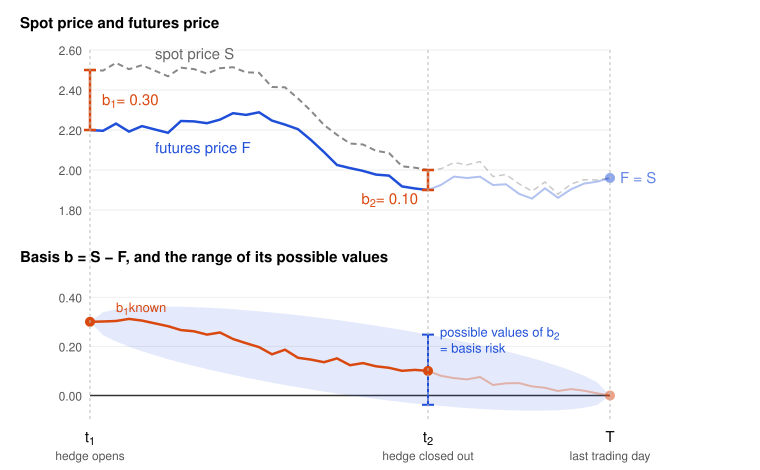

# Hedging Strategies Using Futures

Hedging using futures means taking a position in futures contracts to offset an exposure to the price of an asset. The goal of hedging is to reduce risk.

## Short/Long Hedges

If the exposure is such that the company gains when the price of the asset increases and loses when the price of the asset decreases, a **short hedge** is appropriate. An example is a producer who owns the asset or will sell it in the future.

If the exposure is the other way round, so that the company gains when the price of the asset decreases and loses when the price of the asset increases, a **long hedge** is appropriate. An example is a company that will need to buy the asset in the future.

As a rule of thumb, the futures position is the opposite of the exposure. A hedger who is effectively long the asset, such as a farmer who will sell wheat at harvest or a company that will receive foreign currency, goes short futures. A hedger who is effectively short the asset, such as an airline that will buy jet fuel or a company that has sold an asset it does not own yet, goes long futures. The gain on the futures position offsets the loss on the exposure when the price moves the wrong way. The hedge also gives up the gain when the price moves the right way, because its goal is to reduce risk, not to increase the expected profit.

A **perfect hedge** completely eliminates risk, because the gain or loss on the futures position exactly offsets the loss or gain on the exposure, so the outcome is fixed and known in advance. This requires the hedge to match the asset, the quantity, and the timing exactly. An **imperfect hedge** reduces risk but does not remove it, usually because of basis risk (see [Risks](#risks)), mismatched quantities, or timing differences. A perfect hedge gives certainty, not necessarily a better result. Because it removes the downside and the upside together, an imperfect hedge can turn out better when prices move in the hedger's favor, and worse when they move against it.

A perfect hedge does not lock in the current spot price $S_0$. It locks in the futures price $F_0$, which generally differs from $S_0$ because of the cost of carry (see [Futures and Forwards Pricing](05-futures-and-forwards-pricing.md)).

$$
F_0 = S_0 e^{(c - y)T}
$$

Here $T$ is the time to maturity, $c = r + u - q$ is the cost of carry (the risk-free rate $r$, plus the storage cost $u$, minus the income yield $q$ of the asset), and $y$ is the convenience yield of holding a physical commodity. Interest and storage costs push the futures price above the spot price, while income from the asset and the convenience yield push it below. A perfect hedge therefore guarantees a known price for the future transaction, but that price is $F_0$, not $S_0$.

## Why hedge? Why not?

In a perfect market, hedging adds no value, because shareholders can hedge on their own. Real frictions, such as the costs of financial distress, change this.

**Reasons to hedge**

- **Focus on the core business.** Most companies have no skill in forecasting exchange rates, interest rates, or commodity prices. Hedging removes these risks and lets the company focus on what it does well.
- **Predictable cash flows.** A fixed price for a key input or a foreign currency payment makes budgets, pricing, and investment plans easier, and protects the cash needed for investment.
- **Lower risk of financial distress.** Hedging protects against the extreme price moves that could make the company unable to pay its debts. This reassures creditors, suppliers, and employees, and lets the company carry more debt.

**Reasons not to hedge**

- **Hedging is hard to explain.** If the hedge loses while the exposure gains, the net result is the same, but the board may see only the loss on the hedge and blame the treasurer.
- **Competitors do not hedge.** If no company in the industry hedges, prices tend to follow costs, so margins stay stable. A company that hedges alone breaks from this pattern and can end up with more risk, not less.
- **Shareholders can diversify.** Well-diversified shareholders may already offset the risk in their portfolios, so hedging adds cost without much benefit. The company, however, usually has better information on the risk and lower hedging costs than a single shareholder.

## Risks

**Basis risk**

The **basis** is the difference between the spot price of an asset and its futures price.

$$
\text{Basis} = \text{Spot price} - \text{Futures price}
$$

**Basis risk** is the risk that a hedge does not fully offset price changes, because the basis changes unpredictably over the life of the hedge. Futures prices converge to spot prices at delivery, but hedgers often close out their positions before that date, when the basis is uncertain. As a result, the gain or loss on the futures position does not exactly match the loss or gain on the asset. Basis risk also arises when the asset being hedged differs from the asset underlying the futures contract (see [Cross hedging](#cross-hedging)), or when the date of buying or selling the asset is uncertain.

**Strengthening and weakening of the basis**

The basis **strengthens** when it increases and **weakens** when it decreases. With a negative basis, which is common when the cost of carry is positive (see [Short/Long Hedges](#shortlong-hedges)), a move from −5 to −2 strengthens it and a move from −5 to −8 weakens it, so strengthening brings the two prices closer. With a positive basis, a move from +3 to +6 strengthens it and a move from +3 to +1 weakens it, so strengthening pushes the two prices apart. In both cases, the basis strengthens when the spot price gains relative to the futures price.

| Hedger       | Position                   | Gains when the basis | Loses when the basis |
| ------------ | -------------------------- | -------------------- | -------------------- |
| Short hedger | Long spot, short futures   | Strengthens          | Weakens              |
| Long hedger  | Short spot, long futures   | Weakens              | Strengthens          |

**Contango, backwardation, and the effective price**

The market is in **contango** when the futures price is above the spot price (negative basis), usually because of interest and storage costs. It is in **backwardation** when the futures price is below the spot price (positive basis), usually because of a high income or convenience yield (see the cost of carry in [Short/Long Hedges](#shortlong-hedges)). Some authors define both terms against the expected future spot price instead of the current spot price.

A hedge set up at time 1 and closed out at time 2 gives the following effective price, which is the selling price for a short hedger and the purchase price for a long hedger.

$$
\text{Effective price} = S_2 - (F_2 - F_1) = F_1 + b_2
$$

$F_1$ is known when the hedge starts, so the only uncertainty is the final basis $b_2$, which is the basis risk. If the hedge is closed out at maturity, $b_2 = 0$ and the effective price is $F_1$. A higher $b_2$ helps the short hedger and a lower $b_2$ helps the long hedger, as in the table above. For example, with $S_1 = 2.50$, $F_1 = 2.20$, $S_2 = 2.00$, and $F_2 = 1.90$, the basis weakens from 0.30 to 0.10 and the effective price is $2.20 + 0.10 = 2.30$.

The chart shows this example. The basis is known at $t_1$ and converges to zero at $T$, but a hedge closed out at $t_2$ before the last trading day gets one value from a range of possible values of $b_2$.

Backwardation does not by itself favor a long hedger. The hedger locks in a price near $F_1$, which is below today's spot price $S_1$, but the alternative to the hedge is to buy at $S_2$, not at $S_1$. The result depends on how the basis changes, not on its sign at the start.

## Cross hedging

**Cross hedging** uses futures on a different but correlated asset, because no liquid futures exist on the hedged asset. For example, an airline hedges jet fuel with heating oil futures. The two prices do not move exactly together, which adds basis risk.

The **hedge ratio** is the size of the futures position divided by the size of the exposure. A ratio of 1.0 suits a hedge on the same asset. In a cross hedge, a ratio of 1.0 is not always optimal, because the two prices can change by different amounts. The hedger should instead choose the hedge ratio that minimizes the variance of the value of the hedged position.

### Minimum Variance Hedge Ratio

The goal of a hedge is to reduce risk, not to increase the expected profit, and the variance of the hedged position measures how uncertain the final result is, so the best hedge ratio is the one with the smallest variance.

Suppose the hedger is long one unit of the asset and short $h$ units of futures. Over the life of the hedge, $\Delta S$ is the change in the spot price and $\Delta F$ is the change in the futures price, with standard deviations $\sigma_S$ and $\sigma_F$ and correlation $\rho$. The change in the value of the hedged position is

$$
\Delta V = \Delta S - h \Delta F
$$

For two random variables, $\text{Var}(X - hY) = \text{Var}(X) + h^2 \text{Var}(Y) - 2h \text{Cov}(X, Y)$, and $\text{Cov}(\Delta S, \Delta F) = \rho \sigma_S \sigma_F$. The variance of the hedged position is therefore

$$
\sigma_V^2 = \sigma_S^2 + h^2 \sigma_F^2 - 2 h \rho \sigma_S \sigma_F
$$

This is a parabola in $h$ that opens upward, so its minimum is where the derivative is zero.

$$
\frac{d \sigma_V^2}{d h} = 2 h \sigma_F^2 - 2 \rho \sigma_S \sigma_F = 0
\quad \Rightarrow \quad
h^* = \rho \frac{\sigma_S}{\sigma_F}
$$

The second derivative $2 \sigma_F^2$ is positive, which confirms a minimum. The optimal hedge ratio is the correlation scaled by the relative volatility of the two prices. It equals 1.0 only if $\rho = 1$ and $\sigma_S = \sigma_F$, which is the case of a hedge on the same asset with no basis risk. A low correlation or a futures price that is more volatile than the spot price lowers $h^*$.

Because $\rho \sigma_S \sigma_F = \text{Cov}(\Delta S, \Delta F)$, the ratio can also be written as $h^* = \text{Cov}(\Delta S, \Delta F) / \text{Var}(\Delta F)$. This is the slope of the best-fit line when $\Delta S$ is regressed on $\Delta F$, so in practice $h^*$ is estimated from historical data with a linear regression.

Substituting $h^*$ into $\sigma_V^2$ gives the variance that remains after the hedge.

$$
\sigma_V^2 = \sigma_S^2 (1 - \rho^2)
$$

The **hedge effectiveness** is the share of the variance that the hedge removes, $1 - \sigma_V^2 / \sigma_S^2 = \rho^2$, which is the $R^2$ of the regression. A correlation of 0.9 removes 81% of the variance, while a correlation of 0.5 removes only 25%.

> [!NOTE]
> **Estimating the regression in practice**
>
> The trader regresses one to three years of historical spot price changes on futures price changes, measured over non-overlapping periods as long as the hedge and without the jumps at contract rolls. The slope gives $h^*$ and the $R^2$ the hedge effectiveness (`SLOPE` and `RSQ` in a spreadsheet). The trader re-estimates both regularly, because the relation between the prices changes over time.

### Optimal Number of Contracts

If $Q_A$ is the size of the position being hedged and $Q_F$ is the size of one futures contract, both in units of the asset, the futures position should cover $h^* Q_A$ units. The optimal number of contracts is

$$
N^* = \frac{h^* Q_A}{Q_F}
$$

For example, an airline will buy 2 million gallons of jet fuel in one month and hedges with heating oil futures of 42,000 gallons each. Monthly price changes give $\sigma_S = 0.0263$, $\sigma_F = 0.0313$, and $\rho = 0.928$. Then $h^* = 0.928 \times 0.0263 / 0.0313 = 0.78$ and $N^* = 0.78 \times 2{,}000{,}000 / 42{,}000 = 37.1$, so the airline buys 37 contracts.

### Impact of Daily Settlement

Futures gains and losses are settled daily, so the hedge must offset daily changes in value, not changes in price per unit. This adjustment is called **tailing the hedge**. Let $V_A$ be the value of the hedged position (spot price times $Q_A$), $V_F$ the value of one contract (futures price times $Q_F$), and $r_S$, $r_F$ the one-day percentage price changes, with standard deviations $\hat\sigma_S$, $\hat\sigma_F$ and correlation $\hat\rho$. With $N$ contracts, the daily change in value is

$$
\Delta V = V_A r_S - N V_F r_F
$$

The same minimization as above, with $V_A r_S$ for $\Delta S$ and $N V_F r_F$ for $h \Delta F$, gives

$$
N^* = \hat\rho \frac{\hat\sigma_S}{\hat\sigma_F} \frac{V_A}{V_F} = \hat h \frac{V_A}{V_F}
$$

Since $V_A$ and $V_F$ move with prices, the hedger adjusts $N^*$ over time. In the airline example, with a spot price of 1.94 and a futures price of 1.99, $V_A = 3{,}880{,}000$ and $V_F = 83{,}580$. If $\hat h \approx 0.78$, then $N^* = 36.2$, so the tailed hedge uses 36 contracts instead of 37.

## Stack and Roll

When no liquid futures contract matures later than the expiration of the hedge, a strategy known as **stack and roll** may be appropriate. It involves entering into a sequence of futures contracts.

1. When the first futures contract is near expiration, the hedger closes it out and enters into a second contract with a later delivery month.
2. When the second contract is near expiration, the hedger closes it out and enters into a third contract with a later delivery month.
3. The hedger continues in the same way until the end of the hedge.

The result is a long-dated futures contract created by trading a series of short-dated contracts.

### TODO ADD DURATION BASE HEDGING STRATEGIES HUll 6.4

### TODO ADD HEDGING PROTFILIOS OF ASSETS AND LIABILITIES 6.5