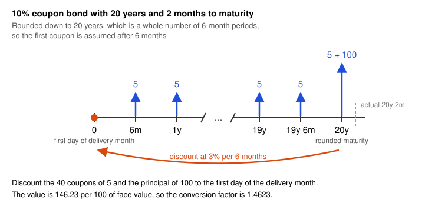
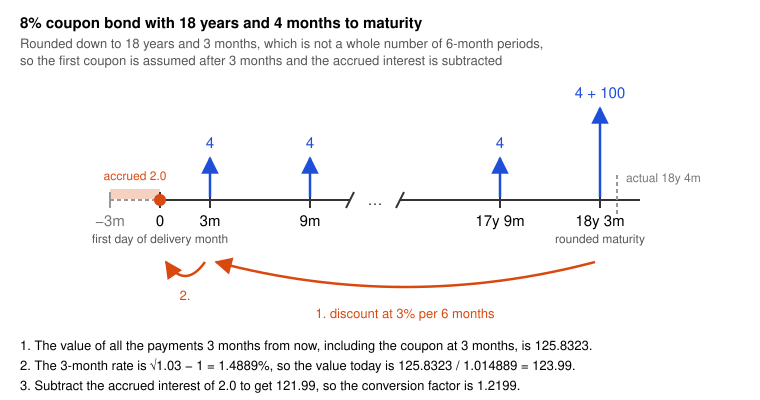
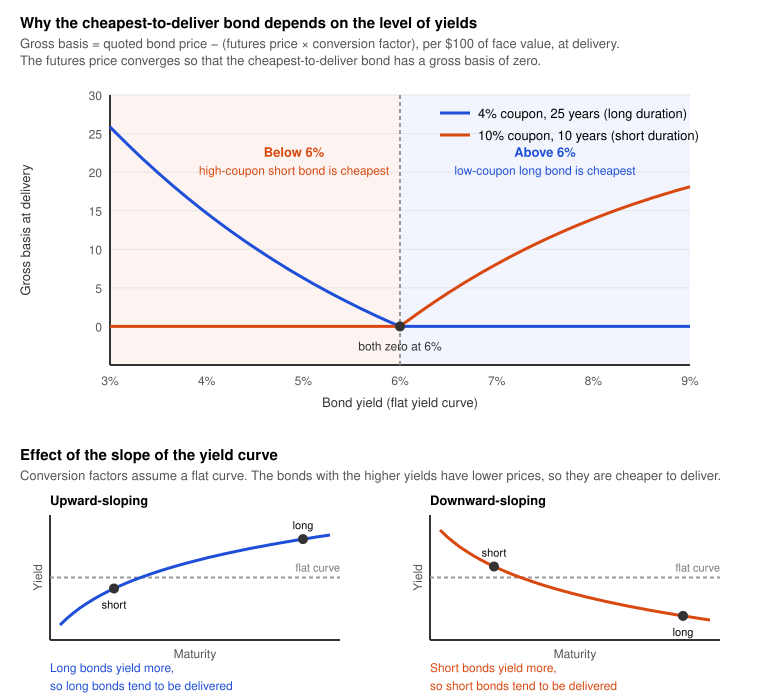
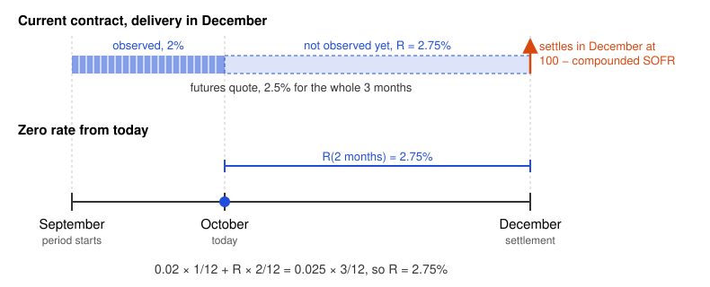

# FRAs and Interest Rate Futures

## Forward Rate Agreements

A forward rate agreement (FRA) is an over-the-counter agreement to exchange a fixed rate $R_K$ for a reference rate that the market will observe in the future. Both rates apply to a principal $L$ for the period from $t_1$ to $t_2$, of $\tau = t_2 - t_1$ years, but the principal is not exchanged. The reference rate was usually LIBOR. After its phase-out, FRAs use rates such as SOFR or SONIA compounded over the period (see [Interest Rates](01-interest-rates.md)).

An FRA locks in a future rate. A trader who will receive SOFR on a principal in a future period receives a fixed rate and pays SOFR in an FRA. A trader who will pay SOFR does the opposite.

As OTC contracts, FRAs can have any notional, dates, and reference rate. Most use standard periods such as $3 \times 6$ and $6 \times 12$ and standard documentation (FRABBA terms, ISDA definitions), because standard contracts are easier to price, hedge, and close.

### Payoff

If $R_M$ is the reference rate that the market observes for the period, the party that receives the fixed rate gets the following amount at $t_2$. A negative amount goes to the other party.

$$\text{Payoff}_{\text{receive fixed}} = L \tau (R_K - R_M)$$

**Example.** An FRA exchanges 3% for three-month LIBOR from year 2 to year 2.25 on a principal of \$100 million, with quarterly compounding. LIBOR proves to be 3.5%, so the party that pays 3% and receives LIBOR gets

$$100{,}000{,}000 \times (0.035 - 0.030) \times 0.25 = \$125{,}000$$

at 2.25 years. In practice, LIBOR is known at year 2, so the payment is made at 2 years and is $125{,}000 / (1 + 0.035 \times 0.25) = \$123{,}916$.

### Valuation

When an FRA is set up, $R_K$ is normally the forward rate $R_F$ of the reference rate for the period (see [Interest Rate Curves](02-interest-rates-curves.md)), so the FRA is worth zero. Later $R_F$ changes. A new FRA at $R_F$ is worth zero, and for the party that receives the fixed rate it differs from the old FRA only by $L \tau (R_K - R_F)$ at $t_2$. The old FRA is thus worth the present value of this amount.

$$V_{\text{receive fixed}} = L \tau (R_K - R_F) DF(t_2) \qquad V_{\text{pay fixed}} = L \tau (R_F - R_K) DF(t_2)$$

An FRA can thus be valued if we assume that the reference rate will equal today's forward rate $R_F$. $R_K$ and $R_F$ use the compounding of the period.

### Backward Looking vs Forward Looking

A forward-looking rate is fixed at the start of its period. LIBOR, now phased out (see [Interest Rates](01-interest-rates.md)), was such a rate, and EURIBOR still is. In an FRA on LIBOR, $R_M$ was known at $t_1$, so the FRA settled at $t_1$ with the payoff discounted from $t_2$ to $t_1$ at $R_M$.

A backward-looking rate is known only at the end of its period. SOFR is an overnight rate, so the FRA uses SOFR compounded day by day over the period, from actual overnight repo transactions. $R_M$ is thus known only at $t_2$, and the FRA pays the payoff at $t_2$ with no discount.

## Interest Rates Futures

Futures of interest rates are standarized contracts that allow to fix interest rates today for a specific future period. They trade on organized exchanges, and investors buy and sell them through brokers.

Like all futures, they settle daily at the settlement price, through a margin account with an initial and a maintenance margin (see [Futures and Forwards](04-futures-and-forwards.md)), while a forward pays only at maturity. With constant interest rates this timing has no effect, and futures and forward prices are equal. For interest rate futures, the daily flows depend on the same rates at which they are invested or financed. The long side of a futures quoted at 100 minus the rate loses when rates rise, so it finances losses at high rates and invests gains at low rates, which makes the futures rate a little higher than the forward rate. The gap is negligible for short maturities but not for long ones, which need a convexity adjustment (see [Convexity Adjustment](#convexity-adjustment)). Until then, we price interest rate futures like forwards.

In this section we describe contracts that are traded in the United States. Nonetheless, many of the other interest rate futures contracts throughout the world have been modeled on these contracts.

### Treasury Bond Futures

Treasury bond and Treasury note futures settle by the delivery of a Treasury security. The party with the short position chooses which security to deliver from a basket of eligible bonds or notes. The remaining maturity of a security is measured from the first day of the delivery month.

*Ultra T-Bond Futures*

Under the terms of this contract, which started in 2010, the party with the short position can deliver any government bond with a remaining maturity of at least 25 years. The face value of one contract is \$100,000.

*T-Bond Futures*

In the T-bond futures contract, any government bond that has a remaining maturity of at least 15 years and less than 25 years can be delivered. The face value of one contract is \$100,000.

*10-, 5- and 2-Year Treasury Note Futures*

| Contract | Face value | Remaining maturity of the note | Original maturity of the note |
| -------- | ---------- | ------------------------------ | ----------------------------- |
| 10-year  | \$100,000  | 6.5 to 10 years                | Any                           |
| 5-year   | \$100,000  | At least 4 years 2 months      | At most 5 years 3 months      |
| 2-year   | \$200,000  | 1 year 9 months to 2 years     | At most 5 years 3 months      |

For the 2-year contract, the upper limit of 2 years is measured from the last day of the delivery month. The exchange also lists 3-year and Ultra 10-year Treasury note futures.

**Fed Funds Futures**

The 30-day Fed Funds futures contract has a settlement price equal to 100 minus the arithmetic average of the daily effective federal funds rate during the contract month. The contract settles in cash on the first business day after the end of the month. Its notional is \$5 million for one month, so one basis point is worth $5{,}000{,}000 \times 0.0001 / 12 = \$41.67$. The market uses these futures to infer the expected path of the policy rate of the Federal Reserve.

**Quotes**

Ultra T-bond futures and Treasury bond futures contracts are quoted in dollars and thirty-seconds of a dollar per \$100 of face value, in the same way as the bonds in the spot market. For example, 179-20 means 179 20/32, or 179.625.

The 10-year Treasury note futures contract is quoted to the nearest half of a thirty-second, so the last digit gives the fraction of a thirty-second. Thus a settlement price of 139-025 means 139 2.5/32, or 139.078125. The 5-year and 2-year Treasury note contracts are quoted even more precisely, to the nearest quarter (5-year) and eighth (2-year) of a thirty-second. Thus an opening price of 125-132 means 125 13.25/32, or 125.4140625.

**Conversion Factors**

When a particular bond is delivered in a CME Group bond futures contract, a parameter known as its conversion factor defines the price that the party with the short position receives for the bond. The applicable quoted price for the bond delivered is the product of the conversion factor and the most recent settlement price of the futures contract. Taking accrued interest into account, the cash received for each \$100 face value of the bond delivered is

$$(\text{Most recent settlement price} \times \text{Conversion factor}) + \text{Accrued interest}$$

Let's illustrate this with the following example. Each contract is for the delivery of \$100,000 face value of bonds. Suppose that the most recent settlement price is 120-00, the conversion factor for the bond delivered is 1.38, and the accrued interest on this bond at the time of delivery is \$3 per \$100 face value. The cash received by the party with the short position (and paid by the party with the long position) is then

$$(1.3800 \times 120.00) + 3.00 = \$168.60$$

per \$100 face value. A party with the short position in one contract would deliver bonds with a face value of \$100,000 and receive \$168,600.

The conversion factor for a bond is set equal to the quoted price the bond would have per dollar of principal on the first day of the delivery month on the assumption that the interest rate for all maturities equals 6% per annum (with semiannual compounding). If needed, the bond maturity and the times to the coupon payment dates are rounded down to the nearest 3 months for the purposes of the calculation. This practice enables the exchange to produce comprehensive tables. If, after rounding, the bond lasts for an exact number of 6-month periods, the first coupon is assumed to be paid in 6 months. If, after rounding, the bond does not last for an exact number of 6-month periods, the first coupon is assumed to be paid after 3 months and accrued interest is subtracted. In the case of the 2-year and 5-year note futures contracts, a similar calculation is used to determine the conversion factor, except that the time to maturity is rounded down to the nearest month.

**Example 1, a whole number of 6-month periods.** Consider a 10% coupon bond with 20 years and 2 months to maturity that is deliverable in the T-bond futures contract. For the calculation of the conversion factor, the bond is assumed to have exactly 20 years to maturity, which is a whole number of 6-month periods. The first coupon payment is thus assumed to be made after 6 months, and the next ones at 6-month intervals until the end of the 20 years, when the principal is paid. With a face value of \$100 and a discount rate of 6% per annum with semiannual compounding (3% per 6 months), the value of the bond is

$$\sum_{i=1}^{40} \frac{5}{1.03^i} + \frac{100}{1.03^{40}} = \$146.23$$

Dividing by the face value gives a conversion factor of 1.4623.

**Example 2, not a whole number of 6-month periods.** Consider an 8% coupon bond with 18 years and 4 months to maturity. For the calculation of the conversion factor, the bond is assumed to have exactly 18 years and 3 months to maturity, which is not a whole number of 6-month periods, so the first coupon is assumed to be paid after 3 months. Discounting all the payments back to a point 3 months from the first day of the delivery month, at 6% per annum with semiannual compounding, gives

$$4 + \sum_{i=1}^{36} \frac{4}{1.03^i} + \frac{100}{1.03^{36}} = \$125.8323$$

The interest rate for a 3-month period is $\sqrt{1.03} - 1$, or 1.4889%, so discounting back to the first day of the delivery month gives $125.8323 / 1.014889 = \$123.99$. The bond is 3 months into a 6-month coupon period, so the accrued interest is half of the coupon of 4, which is 2.0. Subtracting it gives \$121.99, and the conversion factor is therefore 1.2199.

**Cheapest-to-Deliver Bond**

During the delivery month, many bonds with different coupons and maturities are deliverable, and the party with the short position chooses which one to deliver. For each bond, it receives

$$(\text{Most recent settlement price} \times \text{Conversion factor}) + \text{Accrued interest}$$

and pays the following amount to buy the bond.

$$\text{Quoted bond price} + \text{Accrued interest}$$

The accrued interest cancels, so the cheapest-to-deliver bond is the one with the lowest value of

$$\text{Quoted bond price} - (\text{Most recent settlement price} \times \text{Conversion factor})$$

The party with the short position finds it by computing this value for each deliverable bond.

**Basis**

This value is the **gross basis** of the bond, which is the bond futures version of the basis (see [Hedging Strategies Using Futures](06-hedging-strategies-using-futures.md)). Before delivery it uses the current futures price, which becomes the most recent settlement price at delivery. The conversion factor puts the futures price on the scale of each bond.

$$\text{Gross basis} = \text{Quoted bond price} - (\text{Futures price} \times \text{Conversion factor})$$

At delivery, arbitrage pushes the gross basis of the cheapest-to-deliver bond to about zero, so the futures price converges to its quoted price divided by its conversion factor. The other deliverable bonds keep a positive gross basis.

Before delivery, the gross basis also contains the carry until delivery, which is the coupon income minus the repo cost to finance the bond. The **net basis** removes it.

$$\text{Net basis} = \text{Gross basis} - (\text{Coupon income} - \text{Repo financing cost})$$

The cheapest-to-deliver bond is usually the one with the lowest net basis.

When yields are above 6%, the conversion factors favor the delivery of low-coupon long-maturity bonds. When yields are below 6%, they favor high-coupon short-maturity bonds. An upward-sloping yield curve favors bonds with a long time to maturity, and a downward-sloping one favors bonds with a short time to maturity.

**Wild Card Play**

In addition to the cheapest-to-deliver bond option, the party with the short position has an option known as the wild card play. Treasury futures settle at 2:00 p.m. Chicago time, but Treasury bonds keep trading in the spot market after that. The party with the short position can give its notice of intention to deliver until 6:00 p.m. (8:00 p.m. in older rules), and the invoice still uses the 2:00 p.m. settlement price of that day.

If bond prices fall after 2:00 p.m., the party with the short position gives notice, buys the cheapest-to-deliver bond at the lower price, and delivers it at the higher invoice price. If they do not fall, it waits and can play again on a later day of the delivery month. For example, with a settlement price of 120 and a conversion factor of 1, a fall of the bond price to 119 by 5:00 p.m. gives a profit of 1 per \$100 of face value.

This option has value only for the party with the short position, so the futures price is lower than it would be without it.

**Determining the Futures Price**

An exact theoretical futures price for the Treasury bond contract is difficult to determine, because the options of the party with the short position on the timing of delivery and on the choice of the bond that it delivers cannot easily be valued. However, if we assume that both the cheapest-to-deliver bond and the delivery date are known, the Treasury bond futures is a futures contract on a traded security that provides known income, so the no-arbitrage price of an asset with known income applies (see [Futures and Forwards Pricing](05-futures-and-forwards-pricing.md)).

$$F_0 = (S_0 - I) e^{rT}$$

### Eurodollar and SOFR Futures

**Eurodollar**

A eurodollar is a U.S. dollar deposit in a bank outside the United States. Eurodollar futures were on three-month (90-day) USD LIBOR, the interbank rate on these deposits, with a principal of \$1 million and a quote of 100 minus the rate, so one basis point is worth \$25 ($1000000 \times 0.0001 \times 0.25$). They settled in cash at 100 minus the LIBOR fixing of the last trading day, the second London business day before the third Wednesday of the contract month.

They no longer trade. Before USD LIBOR ended on June 30, 2023, CME converted the open Eurodollar futures and options with an expiry from September 2023, about 7.5 million contracts at the close of April 14, 2023, into 3-month SOFR futures and options. The May and June 2023 contracts traded until expiry, and the June contract, settled on the LIBOR fixing of June 19, 2023, was the last.

**SOFR Futures**

The 1-month SOFR futures contract is designed to be as similar as possible to the federal funds rate futures contract. It settles at the end of the contract month at 100 minus the arithmetic average of the 1-day SOFR rates during the month, and trades for the 14 months that follow the current month. Like the federal funds rate contract, it hedges a \$5000000 position, so a change of 1 basis point in the implied rate gives a gain or loss per contract of

$$5000000 \times 0.0001 \times \frac{1}{12} = \$41.67$$

The 3-month SOFR futures contract is designed to be as similar as possible to the Eurodollar futures contract, with a \$1 million position, \$25 per basis point, and contract months of March, June, September, and December. The reference period starts on the third Wednesday of the contract month and ends on the third Wednesday 3 months later, when the contract settles at $100 - R$, where $R$ is the rate obtained by compounding the 1-day SOFR rates over the period. The main difference is that the Eurodollar futures settled on a LIBOR fixing known at the start of the period (forward-looking), whereas the 3-month SOFR futures settles on a rate known only at its end (backward-looking) (see [Backward Looking vs Forward Looking](#backward-looking-vs-forward-looking)).

### Convexity Adjustment

While previously we supposed that forward and futures pricing are very similar, when contracts last longer (as a rule of thumb, 2 years) the convexity effect makes the difference between futures and FRAs distinguishable. The convexity adjustment $c$ is made so that

$$\text{Forward rate} = \text{Futures rate} - c$$

One reason for the convexity adjustment is the daily settlement, which favors the short side of a futures compared to the same contract in an FRA. The futures price is 100 minus the rate, so the short side gains when rates increase and the long side gains when rates decrease.

- When rates increase, the short side gains and invests the profits at higher interest, which is a positive effect, and the long side loses and finances the debt at higher interest, which is a negative effect.
- When rates decrease, the long side gains but invests the profits at lower interest, which is a negative effect, and the short side loses but finances the debt at lower interest, which is a positive effect.

In both cases the effect is positive for the short side and negative for the long side. Traders in FRAs are not affected, because an FRA pays once and does not have day-to-day flows. The long side of a futures accepts its disadvantage only at a lower futures price, so the futures rate is higher than the forward rate and $c$ is positive.

### Zero Curves

Futures contracts give estimates of the forward rates, after the convexity adjustment and the conversion to continuous compounding. With the forward rate equation for continuous compounding (see [Interest Rate Curves](02-interest-rates-curves.md#forward-rates)), each forward rate $F$ from $T_1$ to $T_2$ extends a known zero rate $R_1$ at $T_1$ to the zero rate $R_2$ at $T_2$.

$$R_2 = \frac{F (T_2 - T_1) + R_1 T_1}{T_2}$$

The same equation bootstraps LIBOR or SOFR zero curves, one futures contract after the other.

**Example, LIBOR.** The 300-day LIBOR zero rate, interpolated between the 6-month and 12-month rates, is 3.10% with continuous compounding. Eurodollar futures quotes give a forward rate of 3.60% with continuous compounding for the 90-day period that starts in 300 days, which extends the zero curve to the next contract maturity in 391 days.

$$R_{391} = \frac{0.036 \times 91 + 0.031 \times 300}{391} = 0.03216 = 3.216\%$$

Each further forward rate extends the curve for a further three months. The rate of the Eurodollar futures is a 90-day rate, but the bootstrap applies it to the 91 days between the maturities of the contracts, so that the periods join without gaps.

**Example, SOFR.** In October, the current 3-month SOFR futures has 2 months to its December delivery date, so 1 month of its reference period has passed. The overnight rates of that month, already observed, compound to 2% per year, and the futures quote gives 2.5% per year for the whole 3-month period, both with continuous compounding. The zero rate $R$ for the next 2 months must combine with the observed month to give the rate of the whole period.

$$0.02 \times \frac{1}{12} + R \times \frac{2}{12} = 0.025 \times \frac{3}{12}$$

$$R = \frac{0.025 \times 3 - 0.02 \times 1}{2} = 0.0275 = 2.75\%$$

## Liquidity Preference Theory

**Expectations theory:** Investors care only about expected returns, so the forward rate equals the expected future spot rate. Forward rates are unbiased predictors, and the yield curve's slope reflects only expected rate changes. An upward slope means rates are expected to rise.

**Liquidity preference theory:** Investors demand a premium for holding riskier long-term bonds, so the forward rate equals the expected future spot rate plus a liquidity premium. Forward rates therefore overstate expected future spot rates. This is why the curve usually slopes upward even when rates are expected to stay flat.

**Example:** With a 1-year spot of 4% and a 2-year spot of 5%, the forward rate is about 6%. Expectations theory says the market expects next year's rate to be 6%. Liquidity preference theory, with a 1% premium, says it expects about 5%.
