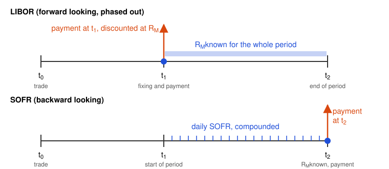

# FRAs and Interest Rate Futures

## Forward Rate Agreements

A forward rate agreement (FRA) is an over-the-counter agreement to exchange a fixed rate $R_K$ for a reference rate that the market will observe in the future. Both rates apply to a principal $L$ for the period from $t_1$ to $t_2$, of $\tau = t_2 - t_1$ years, but the principal is not exchanged. The reference rate was usually LIBOR. After its phase-out, FRAs use rates such as SOFR or SONIA compounded over the period (see [Interest Rates](01-interest-rates.md)).

An FRA locks in a future rate. A trader who will receive SOFR on a principal in a future period receives a fixed rate and pays SOFR in an FRA. A trader who will pay SOFR does the opposite.

As OTC contracts, FRAs can have any notional, dates, and reference rate. Most use standard periods such as $3 \times 6$ and $6 \times 12$ and standard documentation (FRABBA terms, ISDA definitions), because standard contracts are easier to price, hedge, and close.

### Payoff

If $R_M$ is the reference rate that the market observes for the period, the party that receives the fixed rate gets the following amount at $t_2$. A negative amount goes to the other party.

$$\text{Payoff}_{\text{receive fixed}} = L \tau (R_K - R_M)$$

**Example.** An FRA exchanges 3% for three-month LIBOR from year 2 to year 2.25 on a principal of \$100 million, with quarterly compounding. LIBOR proves to be 3.5%, so the party that pays 3% and receives LIBOR gets

$$100{,}000{,}000 \times (0.035 - 0.030) \times 0.25 = \$125{,}000$$

at 2.25 years. In practice, LIBOR is known at year 2, so the payment is made at 2 years and is $125{,}000 / (1 + 0.035 \times 0.25) = \$123{,}916$.

### Valuation

When an FRA is set up, $R_K$ is normally the forward rate $R_F$ of the reference rate for the period (see [Interest Rate Curves](02-interest-rates-curves.md)), so the FRA is worth zero. Later $R_F$ changes. A new FRA at $R_F$ is worth zero, and for the party that receives the fixed rate it differs from the old FRA only by $L \tau (R_K - R_F)$ at $t_2$. The old FRA is thus worth the present value of this amount.

$$V_{\text{receive fixed}} = L \tau (R_K - R_F) DF(t_2) \qquad V_{\text{pay fixed}} = L \tau (R_F - R_K) DF(t_2)$$

An FRA can thus be valued if we assume that the reference rate will equal today's forward rate $R_F$. $R_K$ and $R_F$ use the compounding of the period.

### Backward Looking vs Forward Looking

A forward-looking rate is fixed at the start of its period. LIBOR, now phased out (see [Interest Rates](01-interest-rates.md)), was such a rate, and EURIBOR still is. In an FRA on LIBOR, $R_M$ was known at $t_1$, so the FRA settled at $t_1$ with the payoff discounted from $t_2$ to $t_1$ at $R_M$.

A backward-looking rate is known only at the end of its period. SOFR is an overnight rate, so the FRA uses SOFR compounded day by day over the period, from actual overnight repo transactions. $R_M$ is thus known only at $t_2$, and the FRA pays the payoff at $t_2$ with no discount.

## Interest Rates Futures

Futures of interest rates are standarized contracts that allow to fix interest rates today for a specific future period. They trade on organized exchanges, and investors buy and sell them through brokers.

In this section we describe contracts that are traded in the United States. Nonetheless, many of the other interest rate futures contracts throughout the world have been modeled on these contracts.

### Treasury Bond Futures

Treasury bond and Treasury note futures settle by the delivery of a Treasury security. The party with the short position chooses which security to deliver from a basket of eligible bonds or notes. The remaining maturity of a security is measured from the first day of the delivery month.

*Ultra T-Bond Futures*

Under the terms of this contract, which started in 2010, the party with the short position can deliver any government bond with a remaining maturity of at least 25 years. The face value of one contract is \$100,000.

*T-Bond Futures*

In the T-bond futures contract, any government bond that has a remaining maturity of at least 15 years and less than 25 years can be delivered. The face value of one contract is \$100,000.

*10-, 5- and 2-Year Treasury Note Futures*

| Contract | Face value | Remaining maturity of the note | Original maturity of the note |
| -------- | ---------- | ------------------------------ | ----------------------------- |
| 10-year  | \$100,000  | 6.5 to 10 years                | Any                           |
| 5-year   | \$100,000  | At least 4 years 2 months      | At most 5 years 3 months      |
| 2-year   | \$200,000  | 1 year 9 months to 2 years     | At most 5 years 3 months      |

For the 2-year contract, the upper limit of 2 years is measured from the last day of the delivery month. The exchange also lists 3-year and Ultra 10-year Treasury note futures.

**Fed Funds Futures**

The 30-day Fed Funds futures contract has a settlement price equal to 100 minus the arithmetic average of the daily effective federal funds rate during the contract month. The contract settles in cash on the first business day after the end of the month. Its notional is \$5 million for one month, so one basis point is worth $5{,}000{,}000 \times 0.0001 / 12 = \$41.67$. The market uses these futures to infer the expected path of the policy rate of the Federal Reserve.

**Quotes**

Ultra T-bond futures and Treasury bond futures contracts are quoted in dollars and thirty-seconds of a dollar per \$100 of face value, in the same way as the bonds in the spot market. For example, 179-20 means 179 20/32, or 179.625.

The 10-year Treasury note futures contract is quoted to the nearest half of a thirty-second, so the last digit gives the fraction of a thirty-second. Thus a settlement price of 139-025 means 139 2.5/32, or 139.078125. The 5-year and 2-year Treasury note contracts are quoted even more precisely, to the nearest quarter (5-year) and eighth (2-year) of a thirty-second. Thus an opening price of 125-132 means 125 13.25/32, or 125.4140625.

**Conversion Factors**

TODO

**Cheapest-to-Deliver Bond**

TODO

**Determining the Futures Price**

TODO

### Eurodollar and SOFR Futures

TODO

## Liquidity Preference Theory

Explain what liquidity preference theory and expectations theory imply about forward rates and expected future rates.

**Expectations theory:** Investors care only about expected returns, so the forward rate equals the expected future spot rate. Forward rates are unbiased predictors, and the yield curve's slope reflects only expected rate changes. An upward slope means rates are expected to rise.

**Liquidity preference theory:** Investors demand a premium for holding riskier long-term bonds, so the forward rate equals the expected future spot rate plus a liquidity premium. Forward rates therefore overstate expected future spot rates. This is why the curve usually slopes upward even when rates are expected to stay flat.

**Example:** With a 1-year spot of 4% and a 2-year spot of 5%, the forward rate is about 6%. Expectations theory says the market expects next year's rate to be 6%. Liquidity preference theory, with a 1% premium, says it expects about 5%.
