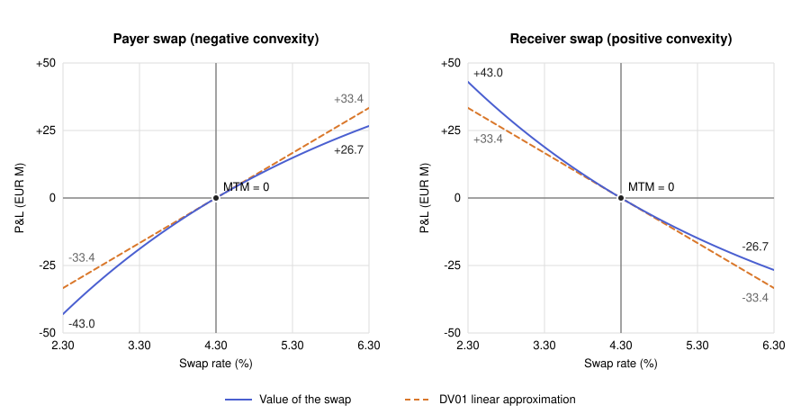
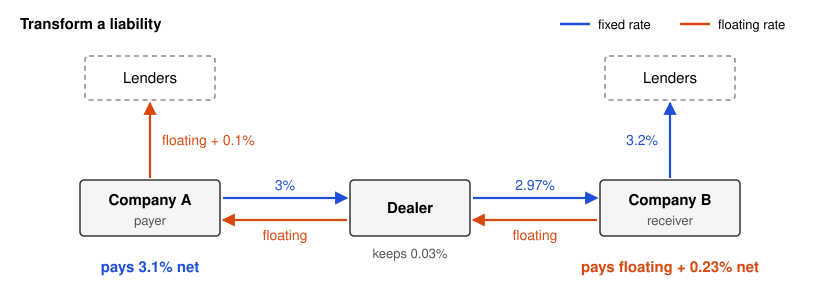
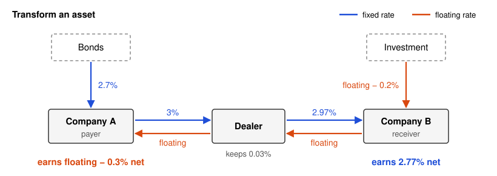
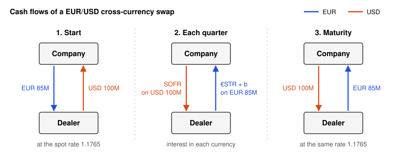

# Swaps

A swap is an OTC agreement between two companies to exchange future cash flows. It defines the payment dates and how each cash flow is calculated, usually from the future value of an interest rate, an exchange rate, or another market variable. A forward contract can be viewed as a simple swap.

## Vanilla Interest Rate Swaps (IRS)

An interest rate swap is a swap where interest at a predetermined fixed rate, applied to a certain principal, is exchanged for interest at a floating reference rate, applied to the same principal, with regular exchanges begin made for an agreed period of time. An IRS has two legs, and each leg is one side’s stream of payments.

For example, a swap negotiated in the past might exchange 3% interest on a $100 million principal for three-month LIBOR on the same principal, every three months for five years.

As LIBOR is phased out, swaps on overnight rates, called **overnight indexed swaps (OIS)**, are becoming more popular. An OIS longer than one year is typically divided into three-month subperiods. At the end of each subperiod, the fixed rate, called the **OIS rate**, is exchanged for a three-month reference rate compounded from that subperiod's one-day rates. OISs of ten years or longer now trade. Unlike forward-looking LIBOR, which was fixed at the start of each period, this compounded rate is backward-looking and known only at the end of the period (see [FRAs and Interest Rate Futures](07-fras-and-interest-rate-futures.md)).

The principal of an IRS is never exchanged, which is why it is called notional. An exchange would change nothing, because at the start and at maturity each side would pay and receive the same amount in the same currency, so the net cash flows stay the same.

Each side is named after the fixed leg. The **payer** pays fixed and receives floating, gains when rates rise, and lets a floating-rate borrower fix its cost. The **receiver** receives fixed and pays floating, gains when rates fall, and lets a fixed-rate borrower float its debt.

### Valuation of IRS

An IRS is equivalent to a portfolio of FRAs, one for each payment date, where each FRA exchanges the fixed rate $R_K$ for the floating rate of its period (see [FRAs and Interest Rate Futures](07-fras-and-interest-rate-futures.md)). Each FRA is valued by assuming that its forward rate $R_{F,i}$ is realized and by discounting the resulting cash flow, so the swap value is the sum of the FRA values.

$$V_{\text{payer}} = \sum_{i=1}^{n} L \tau_i (R_{F,i} - R_K) DF(t_i)$$

Splitting this sum into its floating and fixed terms gives the two legs. To find the present value of a swap, we therefore discount the future cash flows of each leg separately and then aggregate them.

#### Fixed Leg

The **annuity** $A$ is the present value of receiving a rate of one unit at each payment date, per unit of notional. Here $\tau_i$ is the year fraction of period $i$ and $DF(t_i)$ is the discount factor for date $t_i$.

$$A = \sum_{i=1}^{n} \tau_i DF(t_i)$$

$$PV_{\text{fixed}} = L R_K A$$

The fixed leg is only a series of coupons, so the annuity gives the present value of all of them. $R_K$ is the fixed rate, which is the same for all periods, and $L$ is the notional.

#### Floating Leg

We can value the floating leg with the forward rates $R_{F,i}$ that today's curve implies.

$$PV_{\text{float}} = \sum_{i=1}^{n} L \tau_i R_{F,i} DF(t_i)$$

The forward rate of period $i$ is defined so that an investment until $t_{i-1}$, reinvested at $R_{F,i}$ until $t_i$, gives the same result as an investment until $t_i$ (see [Interest Rate Curves](02-interest-rates-curves.md)).

$$1 + \tau_i R_{F,i} = \frac{DF(t_{i-1})}{DF(t_i)} \implies \tau_i R_{F,i} DF(t_i) = DF(t_{i-1}) - DF(t_i)$$

If we substitute this equality into $PV_{\text{float}}$, the sum telescopes.

$$PV_{\text{float}} = L \sum_{i=1}^{n} \left[ DF(t_{i-1}) - DF(t_i) \right]$$

Each term cancels part of the next one, and only the first and the last terms remain. Because $t_0$ is today, $DF(t_0) = 1$.

$$PV_{\text{float}} = L \left[ DF(t_0) - DF(t_n) \right] = L \left[ 1 - DF(t_n) \right]$$

To receive the floating rate on $L$ until $t_n$ thus has the same present value as to receive $L$ today and repay it at $t_n$. No forward rate appears in the result, because all of them cancel. This result holds when the same curve gives the forward rates and the discount factors, and when the first period starts today.

> [!NOTE]
> **Where the telescoping sum applies**
>
> The sum telescopes for any swap whose forward rates and discount factors come from the same curve. The type of floating rate alone does not decide it.
>
> - **OIS (€STR, SOFR).** The sum is exact when the swap is discounted on the curve of its own overnight rate, which is the market standard for collateralized swaps.
> - **LIBOR swaps before 2008.** The sum was exact, because one LIBOR curve gave both the forward rates and the discount factors.
> - **EURIBOR swaps today.** The sum does not telescope. The forward rates come from the EURIBOR curve and the discount factors from the €STR curve, so $1 + \tau_i R_{F,i} \neq DF(t_{i-1}) / DF(t_i)$ and each term of $PV_{\text{float}}$ must be calculated separately.
> - **Other breaks.** A spread $s$ on the floating leg does not telescope and adds $L s A$. A payment lag, or a payment date different from the end of the accrual period, also makes the result approximate.

#### Swap Value

The payer receives the floating leg and pays the fixed leg, so the value of the swap is the difference of the two legs.

$$V_{\text{payer}} = PV_{\text{float}} - PV_{\text{fixed}} = L \left[ 1 - DF(t_n) \right] - L R_K A$$

If we take $L A$ out as a common factor, the first term becomes the par swap rate $R_{\text{par}} = \left[ 1 - DF(t_n) \right] / A$ (see Par Swap Rate below).

$$V_{\text{payer}} = L A \left[ \frac{1 - DF(t_n)}{A} - R_K \right] = L A (R_{\text{par}} - R_K) \qquad V_{\text{receiver}} = L A (R_K - R_{\text{par}})$$

The swap is thus a **rate difference** $R_{\text{par}} - R_K$ on $L$, received at each payment date and discounted.

### Par Swap Rate

The **par swap rate** $R_{\text{par}}$ is the value of $R_K$ that makes the swap worth zero. It is the **swap rate** that the market quotes for each maturity. A new swap is usually set at this rate, so it is worth zero at the start.

$$R_{\text{par}} = \frac{1 - DF(t_n)}{A} = \frac{1 - DF(t_n)}{\sum_{i=1}^{n} \tau_i DF(t_i)}$$

This is the same formula as the par yield of a bond (see [Interest Rate Curves](02-interest-rates-curves.md)). The par swap rate is thus the coupon of a fixed-rate bond that is worth its principal. After the start, $R_{\text{par}}$ changes with the curve while $R_K$ stays fixed. The payer gains when $R_{\text{par}}$ rises above $R_K$, and the receiver gains when it falls below $R_K$.

### Zero Curve

The discount factors $DF(t_i)$ in the formulas above come from the zero curve (see [Interest Rate Curves](02-interest-rates-curves.md)). The market does not quote zero rates directly. It quotes instruments such as OIS rates and swap rates, and the zero curve is **bootstrapped** from these quotes.

An OIS at the quoted rate is worth zero. When it is discounted with the curve of its own overnight rate, its floating leg plus the principal at $t_n$ is worth par, so its fixed leg plus the principal is also a bond worth par. Each quote thus gives the equation $R_{\text{par}} A = 1 - DF(t_n)$. For a swap on a term rate such as EURIBOR, this is true only if the same curve gives the forward rates and the discount factors. If the discount factors until $t_n$ are known, the quoted swap rate $R_{\text{par}}(t_{n+1})$ for the next maturity has only one unknown, $DF(t_{n+1})$. We write its par condition with the annuity divided into the known terms and the last term.

$$R_{\text{par}}(t_{n+1}) \left[ \sum_{i=1}^{n} \tau_i DF(t_i) + \tau_{n+1} DF(t_{n+1}) \right] = 1 - DF(t_{n+1})$$

$DF(t_{n+1})$ is in the last coupon and in the principal, so we move both terms to the left side.

$$DF(t_{n+1}) \left[ 1 + R_{\text{par}}(t_{n+1}) \tau_{n+1} \right] = 1 - R_{\text{par}}(t_{n+1}) \sum_{i=1}^{n} \tau_i DF(t_i)$$

The factor $1 + R_{\text{par}}(t_{n+1}) \tau_{n+1}$ is the last cash flow of the par bond. If we divide by it, we get the bootstrap formula. The formula needs all the earlier discount factors and not only $DF(t_n)$, because a par rate is an average of the forward rates and does not compound period by period like them.

$$DF(t_{n+1}) = \frac{1 - R_{\text{par}}(t_{n+1}) \sum_{i=1}^{n} \tau_i DF(t_i)}{1 + R_{\text{par}}(t_{n+1}) \tau_{n+1}}$$

The bootstrap goes from the shortest maturity to the longest.

1. An OIS of one year or less usually has only one payment at maturity, so $DF(t) = 1 / (1 + R \tau)$ directly.
2. Each longer quote gives one new $DF$ from the ones already known.
3. Quotes do not cover every payment date (e.g. only 2-year and 5-year swaps with quarterly payments). Between quoted maturities, assume a shape such as linear zero rates and solve iteratively for the zero rate that prices each bond at par.
4. Each $DF$ gives the zero rate $r(t) = -\ln DF(t) / t$ (continuous compounding).

### IRS as Two Bonds

If we add and subtract the notional at $t_n$ to each leg, the two extra terms cancel, and each leg becomes a bond.

$$V_{\text{payer}} = \underbrace{\left[ PV_{\text{float}} + L DF(t_n) \right]}_{\text{floating-rate bond} = L} - \underbrace{\left[ PV_{\text{fixed}} + L DF(t_n) \right]}_{\text{bond with coupon } R_K}$$

The payer is thus long a floating-rate bond and short a fixed-rate bond with coupon $R_K$, both with the principal $L$ and the maturity $t_n$. The receiver has the opposite position.

#### Floating-Rate Bond

On a reset date, the telescoping sum above gives $L \left[ 1 - DF(t_n) \right] + L DF(t_n) = L$. The floating-rate bond is thus worth its principal at all levels of rates, because its next coupon rises and falls with the market rate.

This result is exact only on a reset date. If today is between the reset dates $t_{i-1}$ and $t_i$, the rate $R_i$ of period $i$ was already fixed on $t_{i-1}$. On $t_i$, the bond pays the coupon $L \tau_i R_i$, and the remaining bond is worth $L$ because $t_i$ is a reset date. Today the bond is worth that total discounted from $t_i$.

$$PV_{\text{float}} + L DF(t_n) = L (1 + \tau_i R_i) DF(t_i)$$

The bond thus behaves like a zero-coupon bond that matures on the next reset date $t_i$. Its duration is the time to $t_i$, which is a few months and not years. Its DV01 is small but not zero, and it goes back to zero on each reset date.

The direct consequence is that $DV01_{\text{float}} \approx 0$. All the rate sensitivity of the swap comes from the fixed-rate bond, and the payer has it with the opposite sign because the payer is short that bond. The payer thus has a **short duration position**, close to the short sale of a fixed-rate bond with the same maturity.

#### Value Through Time

1. **At the start.** $R_K$ is set at the par swap rate, so the fixed-rate bond is a par bond worth $L$, and the swap is worth zero.
2. **After the start.** The floating-rate bond returns to $L$ on each reset date, but the price of the fixed-rate bond moves with rates. If rates rise, the fixed-rate bond falls below $L$, and the payer gains because the payer is short that bond. If rates fall, the fixed-rate bond rises above $L$, and the payer loses.
3. **Toward maturity.** Each payment date removes one period from the annuity $A$, so fewer periods remain to multiply the rate difference $R_{\text{par}} - R_K$. The same move of rates thus has less effect on a shorter swap, and each net payment converts part of the value into cash.
4. **At maturity.** The two bonds repay $L$, and the value of the swap is zero again.

### Greeks

The Greeks measure how the value of a swap changes when one market factor (such as the level or the volatility of rates) changes and the others stay constant. They are the base of risk management, because a desk adds them over all its positions to know its net exposure, size its hedges, and set risk limits. For an IRS, the two main Greeks are the DV01 and the convexity.

#### DV01

$$DV01 = \Delta V \text{ for a move of } +1 \text{ bp in the curve}$$

The DV01 is the **change in value** of the position in currency, with its sign, as for a bond (see [Fixed Income Securities](00-fixed-income-securities.md#dv01)). A **payer swap** gains when rates rise, so its DV01 is **positive**. A receiver swap has a negative DV01, like a long fixed-rate bond.

From $V_{\text{payer}} = L A (R_{\text{par}} - R_K)$, a move of $R_{\text{par}}$ changes the value through the rate difference and the annuity.

$$\frac{dV_{\text{payer}}}{dR_{\text{par}}} = L A + L (R_{\text{par}} - R_K) \frac{dA}{dR_{\text{par}}}$$

At par ($R_{\text{par}} = R_K$) the second term is zero, so $DV01 \approx L A \times 0.0001$. For a 30-year swap with annual payments, a notional of EUR 100 million, and a flat curve at 4.30%, $A = 16.68$ and the DV01 is about EUR 166,800 per bp. To hedge a fixed-rate bond portfolio, an investor enters a payer swap whose DV01 has the same size as that of the portfolio and the opposite sign.

#### Convexity

The DV01 is a linear approximation, accurate only for small moves of rates. The **convexity** is the curvature of the value that the DV01 line does not capture. With the second-order term, the change in value for a move of $\Delta y$ basis points is

$$\Delta V \approx DV01 \times \Delta y + \frac{1}{2} \Gamma (\Delta y)^2$$

where $\Gamma$ is the change of the DV01 for a move of 1 bp.

A fixed-rate bond has a positive convexity, so its price falls by less when rates rise than it rises when rates fall by the same amount (see [Fixed Income Securities](00-fixed-income-securities.md#convexity)). The floating-rate bond has almost zero convexity, for the same reason as its DV01. The **receiver** is long the fixed-rate bond and thus has a positive convexity, and the **payer** is short it and has a negative convexity. The swap formula shows the same result. In $L A (R_{\text{par}} - R_K)$, the annuity $A$ falls when rates rise, so the gains of the payer are multiplied by a smaller annuity and its losses by a larger one.

For the payer, the difference from the DV01 line is thus **negative in the two directions**. It **loses more** than the line when rates fall and **gains less** when they rise. If rates can move up or down by the same amount, the average result is about $\frac{1}{2} \Gamma (\Delta y)^2$, negative for the payer and larger for larger moves. A rise in volatility thus hurts the payer and helps the receiver. The convexity increases quickly with maturity, so it is large for long swaps and small for short ones.

The chart uses the same swap, with a fixed rate of 4.30%. It starts at par, so its value at 4.30% is zero.

| Rate move | DV01 line | Value of the payer | Effect of the convexity |
|---|---|---|---|
| +200 bp (6.30%) | +EUR 33.4 million | +EUR 26.7 million | −EUR 6.7 million |
| −200 bp (2.30%) | −EUR 33.4 million | −EUR 43.0 million | −EUR 9.6 million |

The annuity falls to 13.33 at 6.30% and rises to 21.50 at 2.30%, which explains the difference. Although the average move of rates is zero, the average result for the payer is −EUR 8.2 million. The receiver has the same values with the opposite sign, so the curvature helps it in the two directions.

### Use Cases

Swaps are popular because they have many uses. The uses below apply to any floating reference rate, which the examples call floating. In the examples, company A is the payer of a 3% swap and company B the receiver of a 2.97% swap, both with the same dealer, which keeps the 0.03% difference. Each loan and asset is $100 million, the notional of the swaps, and the loans and the bonds last two years.

#### Transform Liability

- **Floating to fixed.** Company A pays floating + 0.1% (10 bp) on its loan and, in the swap, receives floating and pays 3%, so its loan costs a fixed 3.1%.
- **Fixed to floating.** Company B pays 3.2% on its loan and, in the swap, pays floating and receives 2.97%, so its loan costs floating + 0.23%.

#### Transform Asset

The same swaps also change the type of rate that an asset earns.

- **Fixed to floating.** Company A earns 2.7% on its bonds and, in the swap, receives floating and pays 3%, so its bonds earn floating − 0.3%.
- **Floating to fixed.** Company B earns floating − 0.2% on its investment and, in the swap, pays floating and receives 2.97%, so its investment earns a fixed 2.77%.

## Basis Swaps

A basis swap is an interest rate swap in which both legs pay a floating rate, each pegged to a different index or tenor. The swap reduces basis risk, which occurs when cash flows depend on factors that are not perfectly correlated, for example floating-rate assets and liabilities that are pegged to different indexes.

**Example**

A bank has a floating-rate asset indexed to 12-month EURIBOR and a floating-rate liability indexed to 3-month EURIBOR. Both sides float, but the two indexes do not move by the same amount.

| | Asset (12M EURIBOR) | Liability (3M EURIBOR) | Margin |
|---|---|---|---|
| Today | 2.20% | 2.00% | 0.20% |
| Later | 2.30% | 2.25% | 0.05% |

The 3-month rate rises by 25 bp and the 12-month rate by only 10 bp, so the net interest income of the bank falls. To reduce this risk, the bank enters a basis swap in which it receives 3-month EURIBOR plus the basis $b$ and pays 12-month EURIBOR. The swap cancels the two indexes, and the bank keeps a margin equal to $b$.

> [!NOTE]
> **Why EURIBOR tenors have basis risk and €STR tenors do not**
>
> EURIBOR is the rate at which banks lend to each other without collateral for a fixed term. A lender that commits for 12 months carries the credit and liquidity risk of the borrower for longer than a lender that renews a 3-month loan each quarter and can stop. The 12-month EURIBOR thus includes a larger premium than the 3-month EURIBOR, and the gap between them changes with the stress in the interbank market. €STR is an overnight rate with almost no credit risk, and the 3-month and 12-month €STR rates only compound the same daily fixings. Over the same year, four consecutive 3-month periods give the same interest as one 12-month period, so the two tenors have almost no basis.

### Valuation of Basis Swaps

The basis $b$ appears in the formula as a fixed term of the contract. The basis risk appears through the two different forward curves, one for each leg. As in an IRS, the payer pays the leg with the fixed term, here 3M EURIBOR $+ b$, and receives 12M EURIBOR. The value of the swap for the payer is

$$V_{\text{payer}} = L \sum_{j} \tau_j F^{12M}_j DF(t_j) - L \sum_{i} \tau_i (F^{3M}_i + b) DF(t_i)$$

- $F^{3M}_i$ comes from the 3M EURIBOR forward curve. The sum has one term for each quarter.
- $F^{12M}_j$ comes from the 12M EURIBOR forward curve. The sum has one term for each year.
- $DF$ comes from the €STR curve for both legs.

The par basis $b^*$ is the basis that gives a new swap a value of zero, and $A_{3M} = \sum_i \tau_i DF(t_i)$ is the annuity of the 3M leg.

$$b^* = \frac{\sum_j \tau_j F^{12M}_j DF(t_j) - \sum_i \tau_i F^{3M}_i DF(t_i)}{A_{3M}}$$

$$V_{\text{payer}} = L A_{3M} (b^* - b) \qquad V_{\text{receiver}} = L A_{3M} (b - b^*)$$

On the trade date, $b = b^*$ and the swap is worth zero. After that date, $b$ stays fixed, but the forward curves move and change $b^*$, so the value of the swap changes. The values have the same form as $V_{\text{payer}} = L A (R_{\text{par}} - R_K)$ for an IRS, with $b$ in place of $R_K$.

### Basis DV01

Both legs float, so a 1 bp rise of all rates changes them by almost the same amount and the DV01 of the swap is close to zero, far below the $L A \times 0.0001$ of an IRS with the same notional. It is not zero, because each leg behaves like a zero-coupon bond to its next reset date, at most 3 months away for the 3M leg and up to 12 months for the 12M leg. The main risk is thus the basis DV01, the change in value for a move of +1 bp in $b^*$, positive for the payer.

From $V_{\text{payer}} = L A_{3M} (b^* - b)$, a move of $b^*$ changes the value through the basis difference and the annuity.

$$\frac{dV_{\text{payer}}}{db^*} = L A_{3M} + L (b^* - b) \frac{dA_{3M}}{db^*}$$

At par ($b^* = b$) the second term is zero. It is also zero if only $b^*$ moves, because the €STR curve, and thus $A_{3M}$, stays fixed.

$$DV01_{\text{basis}} \approx L A_{3M} \times 0.0001$$

It is an approximation, because in practice the €STR curve can move with the basis. If instead the 12M forward curve moves by 1 bp, the change is $L A_{12M} \times 0.0001$, with $A_{12M} = \sum_j \tau_j DF(t_j)$, a little smaller because the annual payments come later.

## Cross Currency Swaps (CCS)

A cross-currency swap (CCS) exchanges interest in one currency for interest in another, usually every quarter and for more than one year. Unlike in an IRS, the two principals are in different currencies and do not cancel, so they are exchanged at the start at the spot rate and exchanged back at maturity. A CCS thus converts a loan or an asset from one currency into another. A foreign exchange (FX) swap also exchanges and repays two principals, but it is short-term, has no periodic interest payments, and repays at the forward rate.

The types differ by the rate of each leg.

- **Floating for floating (basis).** This is the cross-currency basis swap, the interbank standard. The USD leg usually pays SOFR flat, and the other leg pays its own floating rate plus the basis. A negative basis means that dollars borrowed through the swap cost more than in the cash market.
- **Fixed for floating and fixed for fixed.** The first is a common variant and the second a less common one. A dealer replicates them with a basis swap and one IRS for each fixed leg.

### Risks of a Floating-for-Floating CCS

- **FX delta.** The largest risk. The principals are exchanged back at maturity at the initial spot rate, so their value moves with the spot rate.
- **Basis DV01.** The risk that the market basis moves away from the contract basis $b$, as for a basis swap.
- **Rate DV01.** Small but not zero, because both legs float and each one behaves like a zero-coupon bond to its next reset date.

### Valuation of CCS

Each leg is valued in its own currency, and a single conversion at the spot rate gives the value of the swap. The payer pays the domestic leg and receives the foreign leg, and the receiver has the opposite position. In the domestic currency, their values are

$$V_{\text{payer}} = S_0 V_{\text{For}} - V_{\text{Dom}} \qquad V_{\text{receiver}} = V_{\text{Dom}} - S_0 V_{\text{For}}$$

where $V_{\text{Dom}}$ is the present value of the domestic leg in the domestic currency, $V_{\text{For}}$ is the present value of the foreign leg in the foreign currency, and $S_0$ is the spot rate in units of domestic currency per unit of foreign currency. Each present value is the sum of the coupons and the final principal of the leg, discounted to today.

The spot rate **multiplies** the foreign leg to convert it into the domestic currency. Each leg is discounted with the curve of **its own** currency. In a swap with EUR as the domestic currency and USD as the foreign currency, the EUR leg uses the €STR curve, the USD leg uses the SOFR curve, and $S_0$ is the number of euros per dollar, the inverse of the EUR/USD quote.

#### Standard Convention for the Basis

By market convention, the **USD leg pays its overnight rate flat**, with no spread. The full spread goes on the **non-USD leg**, which pays its own floating rate $+ b$. Here $b$ is the *cross-currency basis*. The spread is never split between the two legs.

For example, in a EUR/USD CCS, the USD leg pays SOFR flat and the EUR leg pays €STR $+ b$. The basis $b$ is usually negative for the euro, so with $b = -25$ bp the EUR leg pays €STR $- 0.25\%$.

#### Valuation of the Two Legs

We present an example of a CCS in which the USD leg pays SOFR flat and the EUR leg pays €STR $+ b$. In the formulas, $R_{\text{USD},i}$ is the SOFR rate of period $i$, $R_{\text{EUR},i}$ is the €STR rate of period $i$, and $\tau_i$ is the year fraction of the period.

**USD leg**

$$PV_{\text{USD}} = \sum_{i=1}^{n} L_{\text{USD}} \tau_i R_{\text{USD},i} DF_{\text{USD}}(t_i) + L_{\text{USD}} DF_{\text{USD}}(t_n)$$

The sum telescopes as in the IRS and is worth $L_{\text{USD}} \left[ 1 - DF_{\text{USD}}(t_n) \right]$. With the principal added, the leg is worth its notional.

$$PV_{\text{USD}} = L_{\text{USD}}$$

**EUR leg**

$$PV_{\text{EUR}} = \sum_{i=1}^{n} L_{\text{EUR}} \tau_i (R_{\text{EUR},i} + b) DF_{\text{EUR}}(t_i) + L_{\text{EUR}} DF_{\text{EUR}}(t_n)$$

The sum splits into a €STR part and a spread part.

$$PV_{\text{EUR}} = \underbrace{\sum_{i=1}^{n} L_{\text{EUR}} \tau_i R_{\text{EUR},i} DF_{\text{EUR}}(t_i)}_{L_{\text{EUR}} \left[ 1 - DF_{\text{EUR}}(t_n) \right]} + \underbrace{L_{\text{EUR}} b \sum_{i=1}^{n} \tau_i DF_{\text{EUR}}(t_i)}_{L_{\text{EUR}} b A_{\text{EUR}}} + L_{\text{EUR}} DF_{\text{EUR}}(t_n)$$

The €STR part telescopes as in the USD leg. The spread part does not, because $b$ is a constant and not a forward rate, so it stays as $b$ times the annuity $A_{\text{EUR}}$ of the EUR leg. The principal then cancels the $- L_{\text{EUR}} DF_{\text{EUR}}(t_n)$ of the €STR part.

$$PV_{\text{EUR}} = L_{\text{EUR}} \left[ 1 - DF_{\text{EUR}}(t_n) \right] + L_{\text{EUR}} b A_{\text{EUR}} + L_{\text{EUR}} DF_{\text{EUR}}(t_n) = L_{\text{EUR}} (1 + b A_{\text{EUR}})$$

**Final Value**

In this example the EUR leg is the domestic leg and the USD leg is the foreign leg, so $V_{\text{Dom}} = PV_{\text{EUR}}$ and $V_{\text{For}} = PV_{\text{USD}}$. The payer pays the EUR leg and receives the USD leg. With the two leg values in the formula of $V_{\text{payer}}$, the value of the swap is

$$V_{\text{payer}} = S_0 PV_{\text{USD}} - PV_{\text{EUR}} = S_0 L_{\text{USD}} - L_{\text{EUR}} (1 + b A_{\text{EUR}})$$

The value then splits into an exchange rate part and a basis part.

$$V_{\text{payer}} = \underbrace{S_0 L_{\text{USD}} - L_{\text{EUR}}}_{\text{exchange rate}} - \underbrace{L_{\text{EUR}} b A_{\text{EUR}}}_{\text{basis}} \qquad V_{\text{receiver}} = - V_{\text{payer}}$$

- **Exchange rate.** The difference between the two principals at today's spot rate. It is zero on the trade date, because the principals are exchanged at the spot rate, and then it moves with $S_0$.
- **Basis.** The present value of the spread $b$ that the payer pays on the EUR leg. With $b$ negative, the payer pays less than €STR, so this part is positive for the payer.

### P&L from Exchange Rate

The payer receives the USD leg, worth $L_{\text{USD}}$, and pays the EUR leg, worth about $L_{\text{EUR}}$, so it is **long $L_{\text{USD}}$ and short $L_{\text{EUR}}$**, like a forward purchase of dollars against euros. In euros, the USD leg is worth $S_0 L_{\text{USD}}$.

- If the euro depreciates ($S_0$ rises), the value rises.
- If the euro appreciates ($S_0$ falls), the value falls.

The principals are exchanged at the spot rate of the trade date $S_K$, so $L_{\text{EUR}} = S_K L_{\text{USD}}$, and the same principals are exchanged back at maturity. The exchange rate part of the value is then:

$$P\&L_{FX} = S_0 L_{\text{USD}} - L_{\text{EUR}} = L_{\text{USD}} (S_0 - S_K) = L_{\text{EUR}} \left( \frac{S_0}{S_K} - 1 \right)$$

It is the EUR notional times the relative move of the spot rate since the trade date, and most of the value of the swap.

In $V_{\text{payer}} = S_0 L_{\text{USD}} - L_{\text{EUR}} (1 + b A_{\text{EUR}})$, only the first term depends on $S_0$. The derivative gives the sensitivity, $dV_{\text{payer}} / dS_0 = L_{\text{USD}}$, and the change of value $\Delta V_{\text{payer}} \approx L_{\text{USD}} \Delta S_0$. In general this is an approximation around the current point, because the derivative is the slope for an infinitesimal move. Here the value is linear in $S_0$, so the change is exact.

### Effect of Each Risk

The table gives the approximate sensitivity of $V_{\text{payer}}$ to each risk, with $b^*$ as the market basis.

| Change | Effect on $V_{\text{payer}}$ |
|---|---|
| $S_0$ changes by $\Delta S_0$ | $L_{\text{USD}} \Delta S_0$ |
| The rate curves move and $A_{\text{EUR}}$ changes by $\Delta A_{\text{EUR}}$ | $L_{\text{EUR}} (b^* - b) \Delta A_{\text{EUR}}$ |
| The market basis changes by $\Delta b^*$ | $L_{\text{EUR}} A_{\text{EUR}} \Delta b^*$ |

- **Exchange rate.** The main risk, because of the principals.
- **Rates.** Close to zero, because both legs float. The USD leg stays at its notional, and the EUR leg moves only through the annuity times the small spread $b^* - b$.
- **Basis.** The basis DV01, $L_{\text{EUR}} A_{\text{EUR}} \times 0.0001$ for $\Delta b^* = +1$ bp. If the basis becomes more negative, the payer, who still pays $b$, loses and the receiver gains.

### Constant vs Resettable Notional CCS

The two forms differ in what happens to the principals between the start and maturity.

- **Constant notional (non-MTM).** The principals are exchanged at $S_K$ at the start and exchanged back in the same amounts at maturity, as in the example above. The FX part $L_{\text{USD}} (S_0 - S_K)$ thus grows with the move of the spot rate since the trade date and is settled only at maturity. End users who hedge a loan or a bond use this form, because the principals match the cash flows of the debt, and hedge accounting usually needs it.
- **Mark-to-market (resettable) notional.** The EUR notional stays constant and the USD notional resets at the start of each period to $L_{\text{EUR}} / S_i$, with $S_i$ the FX rate fixed two business days before. The difference from the previous USD notional is paid in USD on the reset date. The FX part is thus settled at each reset, so the FX exposure covers one period only and the value stays close to zero. This keeps the counterparty credit exposure small, so the interbank market trades and quotes the cross-currency basis on this form.

## Asset Swaps (ASW)

An asset swap is a strategy that combines the purchase of a fixed-coupon security with the entry into an Interest Rate Swap (IRS). The investor pays the fixed coupons to the swap counterparty and receives floating payments in exchange. The swap transforms the fixed cash flows of the security into floating cash flows. 

When we buy a fixed-income security, it usually has a fixed coupon (e.g. 5% every year). Sometimes, instead of a fixed coupon rate, we want exposure to the floating interest rate paid at that moment.

Asset swaps are widely used in fixed income trading strategies to hedge interest rate risk. The swap removes most of the sensitivity of the position to changes in interest rates, but the investor keeps the credit risk of the issuer. For this reason, the asset swap spread is a common measure of the credit risk of a fixed-income security.

### Mechanics of the Asset Swap

A dealer sells the security and the swap together as one package. In the swap, the investor passes the fixed coupons of the security to the dealer and receives the floating rate (EURIBOR/SOFR) plus the ASW spread, as from a floating-rate note of the issuer.

The two forms differ in the price that the investor pays.

- **Par asset swap (standard).** The investor pays 100, whatever the market price $P$ of the security is, and gets 100 back at maturity. The difference $P - 100$ is a loan between the two parties, repaid during the life of the swap through the spread.
- **Market value asset swap.** The investor pays $P$, so no value moves at the start. The floating leg has notional $P$ instead of 100.

### Asset Swap Spread

The ASW spread $s$ is the spread that gives the swap a value of $P - 100$ for the dealer, which offsets the price difference that the investor gets at the start. The investor is the payer of the swap, because it pays the fixed rate, which is the coupon $C$ of the security. The value of the swap for the investor is thus the payer value of an IRS with $R_K = C$ and $L = 100$, plus the value of the spread that the investor receives.

$$V_{\text{payer}} = \underbrace{100 \left[ 1 - DF(t_n) \right] - 100 C A}_{\text{payer swap at } C} + \underbrace{100 s A}_{\text{spread}}$$

The investor pays 100 for a security worth $P$, so it gets $P - 100$ for free at the start. The spread part balances the value of the swap to $100 - P$, which takes this amount back. This condition gives the spread.

$$100 \left[ 1 - DF(t_n) \right] - 100 C A + 100 s A = 100 - P$$

The 100 on each side cancels, and the coupons plus the principal discounted on the swap curve give $P_{\text{swap}}$.

$$100 s A = \underbrace{100 C A + 100 DF(t_n)}_{P_{\text{swap}}} - P \implies s = \frac{P_{\text{swap}} - P}{100 A}$$

To split the spread, compare the security with a bond that pays the par swap rate $R_{\text{par}}$, which is the market swap rate today. On the swap curve, this bond is worth exactly its principal of 100, because $R_{\text{par}} = \left[ 1 - DF(t_n) \right] / A$.

$$100 R_{\text{par}} A + 100 DF(t_n) = 100$$

The security pays the same principal but the coupon $C$ instead of $R_{\text{par}}$. It is thus worth 100 plus the extra coupon $C - R_{\text{par}}$, discounted at each date.

$$P_{\text{swap}} = 100 + 100 (C - R_{\text{par}}) A$$

With this $P_{\text{swap}}$ in the formula for $s$, the spread splits into two parts.

$$s = (C - R_{\text{par}}) - \frac{P - 100}{100 A}$$

The first part is the coupon advantage over the swap rate. The second part spreads the premium (or the discount) of the price over the life of the swap, because the investor gets back only 100 at maturity. In a market value asset swap, the floating leg has notional $P$, so its spread is $s \times 100 / P$.

### Asset Swap Applications

**Why this is interesting**

A fixed-rate security carries interest rate risk and credit risk. The asset swap passes the rate risk to the swap counterparty and leaves the investor with the credit risk of the issuer, so the position behaves like a floating-rate note of the same issuer.

- **Pure credit view.** The investor takes a view only on the credit of the issuer. Rate moves have little effect while the issuer pays. At default the coupons stop but the swap continues, so the investor also carries its mark-to-market.
- **Comparable numbers.** The ASW spread puts every fixed-rate bond on one scale, the spread over the swap curve. The formula adjusts for price and coupon, so a 3-year bond at 98 compares with a 7-year bond at 105. For a bond far from par, the par and the market value forms give different spreads, so the comparison must use one form only.
- **Access to fixed-rate supply.** Most corporate bonds are fixed-rate, but many investors need floating cash flows. The asset swap converts one into the other.
- **Floating-rate funding.** A bank with floating funding locks the margin between "floating + ASW spread" and its funding cost.

**When this is not interesting**

- **The investor wants duration.** The swap removes the price gain from a fall in rates.
- **High costs.** The swap bid-offer, collateral, and counterparty risk can consume a small ASW spread.
- **Embedded options.** A callable or puttable bond has uncertain cash flows, which a standard asset swap does not hedge. The swap must then be cancellable on the same dates, and the extra option changes the spread.

**Practical applications**

- **Relative value.** Among issuers with similar credit quality and the same maturity, a wider ASW spread marks the cheaper bond.
- **Negative basis trade.** The basis is the CDS spread minus the ASW spread. If it is negative, buy the security, swap it, and buy CDS protection to earn the difference with little net credit risk. The trade is not risk-free. The bond needs funding, the basis can go more negative and cause mark-to-market losses, and the bond and the CDS are not perfect substitutes.
- **Sector rotation.** Compare the average ASW spread of each sector with its history to find cheap or expensive sectors.
- **Portfolio construction.** Asset-swapped securities give a duration-neutral portfolio whose main exposure is credit.

## Market Conventions

### Day Count Issues

Each leg has its own day count convention (see [Day Count Conventions](00-fixed-income-securities.md#day-count-conventions)), which sets its payments. The earlier examples ignore it, so their numbers are only approximate.

Floating rates such as SOFR, €STR and EURIBOR use ACT/360, so a payment is $L R n / 360$, where $L$ is the principal, $R$ the rate and $n$ the actual days in the accrual period. At 2.2% on USD 100 million over the 92 days from 8 March to 8 June 2022, the floating payment is

$$100{,}000{,}000 \times 0.022 \times \frac{92}{360} = \$562{,}222$$

Fixed legs usually use 30/360, ACT/365 or ACT/360. USD SOFR swaps pay both legs annually on ACT/360. Legacy USD LIBOR swaps paid the fixed leg semi-annually on 30/360 against quarterly 3M LIBOR on ACT/360.

- **Rates are not directly comparable.** If one leg uses a 360-day year and the other a 365-day year, the ACT/360 rate pays 365/360 times its quoted rate over a full year.
- **Fixed payments can change.** Under 30/360, each regular period pays the same fixed amount. Under ACT/365 or ACT/360, the amount changes with the days in the period.

The valuations in this note ignore day counts for simplicity.

### Confirmations

In a bilateral swap, the two parties sign a **confirmation**, which records the terms of the trade, such as dates, notional, rates, day counts and business day convention. The standard documents of the International Swaps and Derivatives Association (ISDA) keep it short.

- **ISDA Master Agreement.** A preprinted form (1992 or 2002 version) for all OTC derivatives between two parties. It defines events of default, termination events and close-out netting, which terminates all trades after a default and nets their values into one amount.
- **Schedule.** The elections and amendments of the parties. It prevails over the printed form.
- **Confirmation.** One for each trade. It states that the Master Agreement applies, and it prevails over the Master Agreement for that trade.
- **Credit Support Annex (CSA).** Optional collateral terms, such as eligible assets, thresholds and haircuts.

The Master Agreement and all confirmations form a single agreement, which supports close-out netting. Since 2013 in the U.S. and June 2016 in the EU, most standard IRS between financial firms (fixed-for-floating, basis and OIS in the major currencies, and FRAs) must clear through a central counterparty (CCP) such as LCH SwapClear, which becomes the counterparty of each side.

The confirmation also names a holiday calendar, for example the U.S. calendar for USD or TARGET for EUR. If a payment date is not a business day, the business day convention moves it.

| Convention | Payment date |
| --- | --- |
| Following | Next business day. |
| Modified following | Next business day, unless it falls in the next month, then the previous business day. |
| Preceding | Previous business day. |
| Modified preceding | Previous business day, unless it falls in the previous month, then the next business day. |

Modified following is the usual default for interest rate products, because it keeps each payment in its scheduled month for month-end accounting.