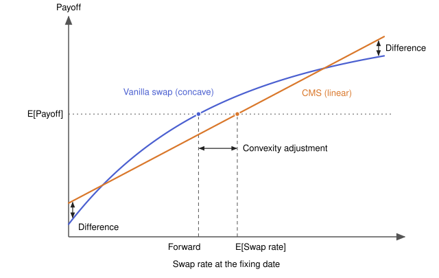

# Non-standard Swaps

## European Swaptions

Swap options, or swaptions, are popular interest rate options that give the holder the right to enter a specified interest rate swap at a specified future date. The swaptions below are European, so the holder can exercise them only on the expiry date.

A swap is equivalent to the exchange of a fixed-rate bond for a floating-rate bond, which is worth its principal at the start of the swap. A swaption is therefore an option on the fixed-rate bond, with a coupon equal to the strike swap rate and a strike price equal to the principal.

| Swaption | Right of the holder | Option on the swap rate | Option on the fixed-rate bond | Gains when rates |
|---|---|---|---|---|
| Payer | Pay fixed, receive floating | Call | Put | Rise |
| Receiver | Receive fixed, pay floating | Put | Call | Fall |

The market names a swaption by the expiry of the option followed by the tenor of the swap. For example, a 2Y5Y payer is a 2-year option to enter a 5-year payer swap that starts in 2 years.

A company that will take a floating-rate loan and swap it to fixed can buy a payer swaption to set a maximum on that fixed rate. A forward swap locks in the fixed rate with no up-front cost, but it obliges the company to enter the swap. The swaption costs a premium, but if rates fall, the company lets it expire and enters a swap at the lower market rate.

Compared with a new swap at the market rate, which has the same floating leg, the payoff of a swaption on each payment date of the swap is

$$\text{Payer payoff} = \frac{L}{m} \max(s_T - s_K, 0) \qquad \text{Receiver payoff} = \frac{L}{m} \max(s_K - s_T, 0)$$

where

- $L$ is the principal (notional) of the swap.
- $m$ is the number of payments per year, so $L/m$ is the principal times the accrual fraction of one period when day counts are ignored.
- $s_T$ is the swap rate at the expiry $T$, which is the fixed rate of a new swap with the same tenor at that date.
- $s_K$ is the strike swap rate, which is the fixed rate that the holder pays (payer) or receives (receiver) after exercise.

For an $n$-year swap, the holder gets this payoff on the $mn$ payment dates $T_1, \dots, T_{mn}$, in years from today, with $T_i \approx T + i/m$. A swaption is a single option on the swap rate with repeated payoffs.

At the expiry, the $mn$ payoffs are worth $L A_T \max(s_T - s_K, 0)$ (payer) or $L A_T \max(s_K - s_T, 0)$ (receiver). Here $A_t = \frac{1}{m} \sum_{i=1}^{mn} P(t, T_i)$ is the annuity of the swap per unit of principal at time $t$, and $P(t, T_i)$ is the discount factor from $t$ to $T_i$.

Black's model, the standard market model, assumes that $s_T$ is lognormal and gives the values today as

$$V_{\text{payer}} = L A_0 [s_F N(d_1) - s_K N(d_2)] \qquad V_{\text{receiver}} = L A_0 [s_K N(-d_2) - s_F N(-d_1)]$$

$$d_1 = \frac{\ln(s_F/s_K) + \sigma^2 T/2}{\sigma \sqrt{T}} \qquad d_2 = d_1 - \sigma \sqrt{T}$$

where

- $s_F$ is the forward swap rate, which is the fixed rate that gives a zero value today to the swap that starts at $T$.
- $\sigma$ is the volatility of the forward swap rate, so $\sigma \sqrt{T}$ is the standard deviation of $\ln s_T$.
- $N(\cdot)$ is the cumulative distribution function of the standard normal distribution.

Black's model needs positive rates. For rates near or below zero, the market uses the normal (Bachelier) model, with volatilities in basis points, or a shifted lognormal model.

## Interest Rate Caps and Floors

### Caps

An interest rate cap is a series of call options on interest rates, called caplets. It can be understood by considering a floating-rate note where the interest rate is reset every three months. The interest rate of each three-month period is based on a three-month reference interest rate, applicable to the period, that is observed in the market.

Interest rate caps provide protection against rises in the interest rate above a strike rate, called the cap rate $R_K$. A borrower that pays interest on the note and holds a cap pays at most $R_K$ in each period.

For example, a company borrows USD 10 million for five years with the floating-rate note and enters into a cap with a notional principal of USD 10 million and a cap rate of 3% per annum. The effective reference interest rate that determines the loan interest payments is then never more than 3% per annum. If the reference interest rate for a quarter is less than 3%, the cap gives no payoff for that quarter. If the rate is more than 3%, the payoff brings the effective reference interest rate down to 3% per annum. For example, if the reference interest rate for a quarter is 3.5% per annum, the cap gives a payoff at the end of the quarter of

$$10{,}000{,}000 \times 0.25 \times (0.035 - 0.03) = 12{,}500$$

to reduce the effective reference interest rate for the quarter to 3% per annum.

### Floors

An interest rate floor is a series of put options on interest rates, called floorlets. It can be understood by considering the same floating-rate note, but from the side of the investor that holds the note and receives its interest.

Interest rate floors provide protection against falls in the interest rate below a strike rate, called the floor rate $R_K$. An investor that receives interest on the note and holds a floor receives at least $R_K$ in each period.

For example, an investor buys a five-year floating-rate note with a principal of USD 10 million and enters into a floor with a notional principal of USD 10 million and a floor rate of 2% per annum. The effective reference interest rate that determines the interest that the investor receives is then never less than 2% per annum. If the reference interest rate for a quarter is more than 2%, the floor gives no payoff for that quarter. If the rate is less than 2%, the payoff brings the effective reference interest rate up to 2% per annum. For example, if the reference interest rate for a quarter is 1.5% per annum, the floor gives a payoff at the end of the quarter of

$$10{,}000{,}000 \times 0.25 \times (0.02 - 0.015) = 12{,}500$$

to increase the effective reference interest rate for the quarter to 2% per annum.

### Collar

A collar guarantees that the interest rate on an underlying floating-rate note always lies between two levels. It combines a long cap and a short floor, usually with the price of the cap initially equal to the price of the floor, so the collar costs nothing to enter.

This collar suits a borrower that pays the floating rate and wants to hedge the loan at no initial cost, but, unlike with a payer swap, still pay the market rate between the two levels. The long cap protects against rises in rates and the premium of the short floor pays for it, but the borrower gives up the gain from rates below the floor rate. With a reference rate $R$, a cap rate $R_C$, and a floor rate $R_F < R_C$, the effective rate in each period always lies between $R_F$ and $R_C$

$$R_{\text{eff}} = R - \max(R - R_C, 0) + \max(R_F - R, 0)$$

For example, a loan of USD 10 million with quarterly resets has a cap rate of 3% and a floor rate of 2%.

| Reference rate | Cap payoff to the borrower | Floor payoff by the borrower to the floor holder | Effective rate |
|---|---|---|---|
| 3.5% | 12,500 | 0 | 3% (cap rate) |
| 2.5% | 0 | 0 | 2.5% (market rate) |
| 1.5% | 0 | 12,500 | 2% (floor rate) |

An investor that receives the floating rate uses the opposite collar, which is a long floor and a short cap.

### Put-Call Parity for Caps and Floors

The put-call parity relationship between the prices of caps and floors is

$$V_{\text{cap}} = V_{\text{floor}} + V_{\text{swap}}$$

In this relationship, the cap and the floor have the same strike rate $R_K$. The swap is an agreement to receive a floating rate $R$ and pay a fixed rate $R_K$, with no exchange of payments on the first reset date. All three instruments have the same life and the same frequency of payments.

To see that the result is true, consider a long position in the cap combined with a short position in the floor. The cap provides a cash flow of $R - R_K$ for periods when $R$ is greater than $R_K$. The short floor provides a cash flow of $-(R_K - R) = R - R_K$ for periods when $R$ is less than $R_K$. There is therefore a cash flow of $R - R_K$ in all circumstances. This is the cash flow on the swap. It follows that the value of the cap minus the value of the floor must equal the value of the swap.

### Valuation of Caps and Floors

Each caplet and floorlet covers one period from $t_k$ to $t_{k+1}$. The reference interest rate of the period is observed at $t_k$, and the payoff is paid at $t_{k+1}$

$$\text{Caplet payoff} = L \delta_k \max(R_k - R_K, 0) \qquad \text{Floorlet payoff} = L \delta_k \max(R_K - R_k, 0)$$

where

- $L$ is the notional principal.
- $\delta_k = t_{k+1} - t_k$ is the accrual fraction of the period, in years.
- $R_k$ is the reference interest rate for the period, observed at $t_k$.
- $R_K$ is the cap rate or the floor rate.

The rate of the first period is known when the cap or floor starts, so there is usually no caplet or floorlet for that period.

Black's model assumes that each $R_k$ is lognormal and gives the values today as

$$V_{\text{caplet}} = L \delta_k P(0, t_{k+1}) [F_k N(d_1) - R_K N(d_2)] \qquad V_{\text{floorlet}} = L \delta_k P(0, t_{k+1}) [R_K N(-d_2) - F_k N(-d_1)]$$

$$d_1 = \frac{\ln(F_k/R_K) + \sigma_k^2 t_k/2}{\sigma_k \sqrt{t_k}} \qquad d_2 = d_1 - \sigma_k \sqrt{t_k}$$

where

- $F_k$ is the forward rate today for the period from $t_k$ to $t_{k+1}$.
- $\sigma_k$ is the volatility of $F_k$, so $\sigma_k \sqrt{t_k}$ is the standard deviation of $\ln R_k$.
- $P(0, t_{k+1})$ is the discount factor to the payment date $t_{k+1}$, not to the expiry $t_k$.

The value of a cap or a floor is the sum of the values of its caplets or floorlets. The market quotes a cap or a floor with one flat volatility, which is the single $\sigma$ that gives its price when it is used for all of its caplets or floorlets. As for swaptions, the market uses the normal or the shifted lognormal model when rates are near or below zero.

Because $\max(R_k - R_K, 0) - \max(R_K - R_k, 0) = R_k - R_K$, a long cap and a short floor with the same strike rate $R_K$ are equal to a payer swap with the fixed rate $R_K$. So a collar with $R_C = R_F$ is a payer swap, and the cap and the floor have the same price only when $R_K$ is equal to the forward swap rate.

## SABR model

Black's model uses one volatility $\sigma$ for all strikes, but the market prices of swaptions and caps give implied volatilities that change with the strike, which is the volatility smile. The SABR (stochastic alpha, beta, rho) model gives the forward rate a stochastic volatility, so it can fit the smile

$$dF = \alpha F^\beta dW_1 \qquad d\alpha = \nu \alpha dW_2 \qquad dW_1 dW_2 = \rho dt$$

where

- $F$ is the forward rate of the underlying instrument, which is the forward swap rate for a swaption or the forward rate of the period for a caplet.
- $\alpha$ is the volatility of the forward rate, and its initial value $\alpha_0$ sets the level of the volatility.
- $\beta$, from 0 to 1, sets the distribution of the forward rate, which is normal for $\beta = 0$ and lognormal for $\beta = 1$.
- $\nu$ is the volatility of the volatility.
- $\rho$ is the correlation between the interest rate and its volatility.
- $W_1$ and $W_2$ are Brownian motions.

$\beta$ and $\rho$ set the slope (skew) of the smile, and $\nu$ sets its curvature. In practice, $\beta$ is fixed near 0.5, and $\alpha_0$, $\rho$, and $\nu$ are calibrated to the smile of each expiry and tenor. The model gives an approximate formula for the implied Black (or normal) volatility at each strike, and Black's model then gives the price. SABR is the market standard to build the volatility surface of swaptions.

## Constant Maturity Swaps

A constant maturity swap (CMS) exchanges on each payment date a swap rate with a fixed tenor (for example 10 years) for a fixed rate or a floating rate such as SOFR. On each reset date $t_k$, the CMS leg takes the swap rate $s_{t_k}$ of a new standard swap with the same tenor, hence the name constant maturity, and pays $L \delta_k s_{t_k}$ at $t_{k+1}$, where $L$ is the principal and $\delta_k = t_{k+1} - t_k$. For a CMS that receives the swap rate and pays a fixed rate $K$, the net payment of each period is

$$\text{CMS payoff} = L \delta_k (s_{t_k} - K)$$

On a reset date $T$, the swap rate $s_T$ is the par rate $K_{par}$ of the new swap (see [Swaps](08-swaps.md)). Before $T$, only the forward swap rate is known, which is the par rate today of the swap that starts at $T$. With the annuity $A_0$ and the payment dates $T_1, \dots, T_{mn}$ defined for swaptions (see [European Swaptions](#european-swaptions)), it is

$$s_F = \frac{P(0,T) - P(0,T_{mn})}{A_0}$$

For $T = 0$, $P(0,0) = 1$ and $s_F = K_{par}$. For a swap on EURIBOR, the numerator is the value of the floating leg, with the forward rates from the EURIBOR curve and the discount factors from the €STR curve. For an OIS swap on SOFR or €STR, the same curve gives both, so the formula applies.

The value of a CMS payment fixed at $T = t_k$ and paid at $T_p = t_{k+1}$ depends on the expected swap rate under the forward measure of $T_p$, which is not $s_F$. A vanilla swap pays each floating rate at the end of its period, its natural payment date, so under the forward measure of that date the expected rate is the forward rate. The natural payment of a swap rate is an annuity on all the payment dates of the fixed leg, so $s_F$ is the expected value under the annuity measure, with $A_t$ as the numeraire. A CMS pays the swap rate only once, and the change of measure gives

$$E^{T_p}[s_T] = \frac{A_0}{P(0,T_p)} E^{A}\left[s_T \frac{P(T,T_p)}{A_T}\right]$$

When the swap rate rises, $A_T$ falls and the ratio $P(T,T_p)/A_T$ rises, so the expected swap rate is higher than $s_F$, and the difference is the convexity adjustment. Bond convexity gives the same result. If the swap rate is the yield of a bond, the expected bond price under the forward measure is the forward bond price, and because the price is a convex function of the yield, the expected yield is higher than the forward yield (Jensen's inequality).

With the modified duration $D_{mod}$ and the convexity $C$ of this bond at the yield $s_F$, and the volatility $\sigma$ of the forward swap rate, the expected swap rate for a payment on the fixing date is approximately

$$E^{T}[s_T] \approx s_F + \frac{1}{2} s_F^2 \sigma^2 T \frac{C}{D_{mod}}$$

The ratio $C/D_{mod}$ is close to $D_{mod}$ (10.2 against 8.5 for a 10-year par bond at 3%), so with the normal volatility $\sigma_N = s_F \sigma$, a simpler approximation is $E^{T}[s_T] \approx s_F + \frac{1}{2} \sigma_N^2 T D_{mod}$. The adjustment increases with the volatility, the time to the reset date, and the tenor of the swap rate. A payment at $T_p$ after $T$ needs an additional timing adjustment, which is usually small and negative.

The payoffs at the fixing date show the same result. A payer swap that starts on the fixing date has a payoff that is a concave function of the swap rate, because its annuity falls when the rate rises, and a CMS that receives the swap rate and pays a fixed rate has a linear payoff. When each contract has the fixed rate that gives it a zero value today, both have an expected payoff of zero under the forward measure of the fixing date. The swap payoff is zero at the forward swap rate, and the CMS payoff is zero at the expected swap rate, which is higher because the swap payoff is concave. The CMS payoff is higher than the swap payoff when the rate moves far from the forward in either direction, and the higher fixed rate of the CMS offsets these larger payoffs.

The curves come from a 30-year swap with annual payments on a flat curve, and the CMS has the same slope as the swap at the forward and pays on the fixing date.

## Quanto (Differential) Swaps

A quanto swap applies a rate or an index of one currency to a principal in another currency. A differential (diff) swap is the floating-for-floating case. For example, one party pays a USD floating rate and the other a GBP floating rate, both on GBP 10 million and both in GBP, so each period settles the net amount

$$\text{Diff swap payoff} = L \delta_k (R^{f}_{t_k} - R^{d}_{t_k} - s)$$

where $L$ is the domestic principal, $R^{f}$ the foreign rate, $R^{d}$ the domestic rate and $s$ a fixed spread. Unlike a cross-currency swap (see [Swaps](08-swaps.md)), all payments are in one currency, so there is no exchange of principals and no FX risk on the cash flows. A quanto equity swap replaces the foreign rate with the return of a foreign index, for example the Nikkei paid in USD.

End users take a view on the spread between two countries' rates, or get foreign rate or equity exposure, without FX risk, also when a mandate allows only domestic-currency assets. For the dealer, the foreign leg is a foreign-currency principal that changes with the exchange rate, so the risks of the rate and of the FX cannot be hedged separately and the hedge depends on their correlation.

To value the swap, discount on the domestic curve, but replace each foreign forward rate $F_k$ with its quanto-adjusted value. With lognormal rate and FX, the drift of the foreign rate under the domestic measure changes by $-\rho \sigma_F \sigma_X$, which gives

$$\hat F_k = F_k e^{-\rho \sigma_F \sigma_X t_k} \approx F_k (1 - \rho \sigma_F \sigma_X t_k)$$

where

- $X$ is the exchange rate in units of domestic currency for one unit of foreign currency.
- $\sigma_F$ and $\sigma_X$ are the volatilities of the forward rate and of $X$.
- $\rho$ is the correlation between the forward rate and $X$.
- $t_k$ is the fixing time.

If $\rho > 0$, a high foreign rate comes with a strong foreign currency. A payment on a foreign principal gains from both, but the quanto payment does not, so its forward rate is lower. With $F_k = 4\%$, $\sigma_F = 20\%$, $\sigma_X = 10\%$, $\rho = 0.3$ and $t_k = 5$, the adjustment is $4\% \times 0.3 \times 0.2 \times 0.1 \times 5 = 0.12\%$, or 12 bp.

## Commodity Swaps

A commodity swap exchanges a fixed price for the market (floating) price of a commodity on a notional quantity $Q_k$ in each period, for example 100,000 barrels of crude oil per month. It is OTC and cash-settled, so there is no physical delivery, and each period settles the net amount. For the payer of the fixed price $K$, which is the buyer of the commodity, the payment at $t_k$ is

$$\text{Payoff} = Q_k (\bar S_k - K)$$

where $\bar S_k$ is usually the arithmetic average of the daily prices in the period, for example the front-month WTI futures settlements of each business day in the calendar month. The average matches a consumer that buys every day.

- **Consumers** (airlines, shipping, utilities) pay fixed to lock in a purchase price.
- **Producers** (oil and mining companies, farmers) receive fixed to lock in a selling price.
- **Investors** take commodity exposure in a commodity-for-interest swap, which pays the return of a commodity or an index against SOFR or a fixed rate on a cash notional.

The hedge has two costs. The consumer loses the gain from a fall in prices, because the swap payment offsets the cheaper purchase. If the swap index differs from the price that the hedger pays, for example a heating oil swap for jet fuel, the gap is basis risk, which a basis swap on the difference can remove.

A commodity swap is a strip of forward contracts with one delivery price $K$. Each leg is valued with the forward price $F_k$ of the average from the futures curve and the discount factor $P(0,t_k)$, so the swap price that gives a zero value at the start is

$$K = \frac{\sum_k Q_k P(0,t_k) F_k}{\sum_k Q_k P(0,t_k)}$$

It is the average of the forward prices weighted by quantity and discount factor, so the curve shape sets it. With equal quantities, forwards of USD 80, 78 and 76 per barrel, and discount factors 0.996, 0.992 and 0.988, the 3-month swap price is USD 78.01. In this backwardated curve, the consumer pays less than the forward in the first month and more in the last. At a later date $t$, with the new forward prices, the payer of the fixed price has the value $\sum_k Q_k P(t,t_k) (F_k - K)$.

## Volatility and Variance Swaps

A volatility swap is a forward contract on the realized volatility $\sigma_R$ of an asset, and a variance swap is a forward contract on the realized variance $\sigma_R^2$. Nothing is paid at the start and no notional is exchanged. At expiry, the buyer, who is long volatility, receives

$$\text{Vol swap} = N_{vol} (\sigma_R - K_{vol}) \qquad \text{Var swap} = N_{var} (\sigma_R^2 - K_{var})$$

where, from $n$ daily log returns $R_i = \ln(S_i / S_{i-1})$ annualized with $A = 252$, and without subtracting the mean,

$$\sigma_R^2 = \frac{A}{n} \sum_{i=1}^{n} R_i^2$$

The market quotes volatilities in points (20 for 20%). The vega notional $N_{vol}$ is the payment for one volatility point, and a variance swap with $N_{var} = N_{vol} / (2 K_{vol})$ pays about the same amount for one point near the strike, because $\text{d}(\sigma^2)/\text{d}\sigma = 2\sigma$. With $N_{vol} =$ USD 100,000 and a strike of 20, $N_{var} = 2{,}500$.

| Realized volatility | Volatility swap | Variance swap |
|---|---|---|
| 25 | $100{,}000 \times 5 = 500{,}000$ | $2{,}500 \times (625 - 400) = 562{,}500$ |
| 15 | $100{,}000 \times (-5) = -500{,}000$ | $2{,}500 \times (225 - 400) = -437{,}500$ |

The variance swap is convex in volatility, so its buyer gains more and loses less than the buyer of the volatility swap.

Both swaps give pure exposure to volatility, without the delta hedge that an option needs. Traders use them to bet on volatility, to trade realized against implied volatility, and to hedge volatility exposure. Implied variance has historically been higher than realized variance, so a short variance swap earns this variance risk premium most of the time and loses heavily in a crash.

A static strip of out-of-the-money puts and calls, with weights $1/K^2$, and a dynamic futures hedge replicate the variance swap. The weights make the variance exposure of the strip independent of the spot price, and the fair strike, which gives the swap a zero value, is

$$K_{var} = \frac{2 e^{rT}}{T} \left[ \int_0^{F_0} \frac{P(K)}{K^2} \text{d}K + \int_{F_0}^{\infty} \frac{C(K)}{K^2} \text{d}K \right]$$

where $P(K)$ and $C(K)$ are the put and call prices with strike $K$, $F_0$ is the forward price, $r$ the rate and $T$ the maturity. The VIX applies a discrete form of this formula to S&P 500 options with 23 to 37 days to expiry, interpolated to 30 days, so the VIX is approximately the square root of the 30-day variance swap strike.

A volatility swap has no static replication, because volatility is the square root of variance. By Jensen's inequality, its fair strike is below $\sqrt{K_{var}}$, and the difference is a convexity adjustment that increases with the volatility of volatility.

$$K_{vol} \approx \sqrt{K_{var}} - \frac{\text{Var}(\sigma_R^2)}{8 K_{var}^{3/2}}$$

The replication fails in extreme moves, because options at extreme strikes are illiquid and prices can jump. Before 2008, clients bought single-stock variance and sold index variance, so dealers were net short single-stock variance. They had large losses in the 2008 crisis, and the single-stock variance swap market disappeared in 2009. Since then, many variance swaps have a cap on the payoff, and index variance swaps remain the main market.

## Inflation Swaps

An inflation swap is an over-the-counter derivative that exchanges a fixed rate for the realized inflation of a price index, which is $I(T)/I(t) - 1$ from $t$ to $T$ with $I(t)$ the index at $t$. The inflation receiver, also called the buyer of inflation protection, pays the fixed rate and gains when inflation is higher than it, and the other party is the inflation payer. The fixed rate gives the swap a zero value at the start, so there is no payment at inception, and the parties never exchange the notional.

Each market uses a consumer price index (CPI) that is not seasonally adjusted. The index of a month is published some weeks later, so $I(t)$ is the index of an earlier month.

| Currency | Index | Usual lag |
|---|---|---|
| EUR | Euro area Harmonised Index of Consumer Prices excluding tobacco (HICPxT) | 3 months |
| USD | US Consumer Price Index for All Urban Consumers (CPI-U), which also indexes the Treasury Inflation-Protected Securities (TIPS) | 3 months |
| GBP | UK Retail Prices Index (RPI), for about 99% of swaps | 2 months |

### Zero-Coupon Inflation Swap

The most common inflation swap, the zero-coupon swap, has a single payment at the maturity $T$, in years

$$\text{Inflation leg} = L \left[ \frac{I(T)}{I(0)} - 1 \right] \qquad \text{Fixed leg} = L [(1 + K)^T - 1]$$

where $L$ is the notional and $K$ is the fixed rate, compounded annually. The inflation receiver gets the net payment $L [I(T)/I(0) - (1 + K)^T]$, which is zero when the index grows by $K$ per year and negative below it, so the quoted $K$, the inflation swap rate, is also called the breakeven inflation rate.

For example, a pension fund receives inflation on a 5-year swap with a notional of USD 10 million, a fixed rate of 2.5%, and an index of 300 at the start, so the fixed leg at maturity is $10{,}000{,}000 \times (1.025^5 - 1) = 1{,}314{,}082$.

| Index at maturity | Inflation per year | Inflation leg | Net payment to the inflation receiver |
|---|---|---|---|
| 345.00 | 2.83% | 1,500,000 | 185,918 |
| 339.42 | 2.50% (breakeven) | 1,314,082 | 0 |
| 330.00 | 1.92% | 1,000,000 | −314,082 |
| 297.00 | −0.20% | −100,000 | −1,414,082 |

With the forward CPI $I(t,T)$, the expected value at $t$ of $I(T)$ under the forward measure of $T$, the value of the swap for the inflation receiver at any date $t$ needs no model of rates or inflation

$$V = L P(t,T) \left[ \frac{I(t,T)}{I(0)} - (1 + K)^T \right]$$

A new swap has a zero value, so each quote $K_T$ gives the forward CPI and the real discount factor, which is the price today of a zero-coupon bond that pays $I(T)/I(0)$ at $T$, and the quotes of all maturities build the inflation curve

$$I(0,T) = I(0)(1 + K_T)^T \qquad P_R(0,T) = P(0,T)(1 + K_T)^T$$

With the annually compounded nominal and real zero rates $y_T$ and $r_T$, this is the Fisher equation $1 + y_T = (1 + r_T)(1 + K_T)$.

### Year-on-Year Inflation Swap

A year-on-year inflation swap pays the inflation of each period, usually one year, so on each payment date $t_k$ the legs are

$$\text{Inflation leg} = L \delta_k \left[ \frac{I(t_k)}{I(t_{k-1})} - 1 \right] \qquad \text{Fixed leg} = L \delta_k K$$

where $\delta_k$ is the accrual fraction from $t_{k-1}$ to $t_k$, and $t_0 = 0$. As for a vanilla swap, the fixed rate that gives a zero value is a weighted average of the forward rates, here the forward year-on-year inflation rates $Y_k$ under the forward measure $E^{t_k}$ of each payment date

$$K = \frac{\sum_k \delta_k P(0,t_k) Y_k}{\sum_k \delta_k P(0,t_k)} \qquad 1 + Y_k = E^{t_k}\left[ \frac{I(t_k)}{I(t_{k-1})} \right]$$

$1 + Y_k$ is not the ratio of the forward CPIs $I(0,t_k)/I(0,t_{k-1})$, because the forward CPI of $t_{k-1}$ is an expected value under the forward measure of $t_{k-1}$, not of $t_k$, and the expected value of a ratio is not the ratio of the expected values. When each forward CPI is lognormal under the forward measure of its date, a market model gives approximately

$$1 + Y_k \approx \frac{I(0,t_k)}{I(0,t_{k-1})} e^{D_k}$$

where the convexity adjustment $D_k$ depends on the volatilities of the two forward CPIs and of the nominal forward rate of the period, and on the correlations of the forward CPI of $t_{k-1}$ with the forward CPI of $t_k$ and with that nominal rate. $D_k$ is zero for the first period, where $I(t_0) = I(0)$ is known, and its size grows with $t_{k-1}$, so unlike a zero-coupon swap, a year-on-year swap needs a model, such as the Jarrow-Yildirim model or a market model, as a CMS does (see [Constant Maturity Swaps](#constant-maturity-swaps)).

A year-on-year cap or floor is a series of options on the inflation of each period, with a caplet payoff of $L \delta_k \max(I(t_k)/I(t_{k-1}) - 1 - \kappa, 0)$ for a strike $\kappa$ (see [Interest Rate Caps and Floors](#interest-rate-caps-and-floors)). Inflation-linked notes often floor the inflation of each period at zero to keep their coupons positive, which is a year-on-year floor with a zero strike.

### Breakeven Inflation

As a forward rate comes from zero rates, the forward inflation between two maturities comes from the zero-coupon swap rates. The 5y5y rate, the average inflation over the five years that start in five years, is

$$F_{5y5y} = \left[ \frac{(1 + K_{10})^{10}}{(1 + K_5)^5} \right]^{1/5} - 1$$

For example, $K_5 = 2.3\%$ and $K_{10} = 2.4\%$ give $F_{5y5y} = 2.50\%$. Because it excludes the inflation of the next five years, the 5y5y rate is a widely used measure of longer-term inflation expectations.

The breakeven inflation rate is not a pure forecast of inflation, because it also contains a liquidity premium and an inflation risk premium, which compensates for the uncertainty of future inflation and can be negative. Most of the fall of the euro area 5y5y rate from 2014 to 2016 came from the risk premium, not from lower expectations.

The bond breakeven is the yield of a nominal government bond minus the yield of an inflation-linked bond with the same maturity, and without frictions it is equal to the swap rate. In practice, the US swap rate is almost always higher than the TIPS breakeven, by more than 100 bp during the 2008 financial crisis. In the euro area, bond breakevens also contain liquidity effects that change over time and the risk premia of each country, so the swap rate is the cleaner measure.

### Uses of Inflation Swaps

- **Inflation hedge.** Pension funds and insurers, with liabilities that rise with inflation, receive inflation, and utilities and infrastructure companies, with revenues that rise with inflation, pay it. Unlike an inflation-linked bond, a swap can match the maturity and the notional of the exposure.
- **Trades on inflation expectations.** An investor that expects inflation higher than the breakeven rate receives inflation, and one that expects lower inflation pays it. Other trades take a position on the slope of the curve, such as 5-year against 10-year swaps. In the UK, hedge funds trade mostly maturities of three years or less.
- **Asset-liability management.** A pension fund that holds nominal bonds but pays pensions indexed to inflation receives inflation and pays the fixed rate, so the inflation sensitivity of its assets matches that of its liabilities without a sale of the bonds. In the UK, pension funds and liability-driven investment (LDI) funds are the main buyers of inflation protection, mostly for maturities of more than 10 years, and dealer banks are large net sellers.
