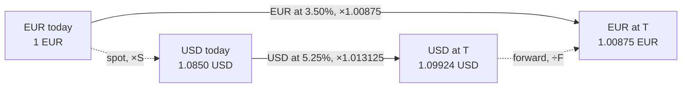

<!-- TODO Review this note  -->

# FX Trading

## The foreign exchange market

The **foreign exchange market** (FX or forex) is the market in which the currencies of different countries are exchanged. It is the largest and most liquid financial market in the world.

- **Daily volume.** More than $7.5 trillion per day in April 2022.
- **Trading hours.** The market is open 24 hours a day, 5 days a week.
- **Decentralized.** There is no central physical location.
- **Over-the-counter (OTC).** Participants trade directly with one another (see [Markets, Assets, and Types of Traders](03-markets-assets-and-type-of-traders.md)).

**Main functions**

- Facilitate international trade.
- Enable cross-border investment and financing.
- Manage exchange rate risk.

## Participants in the FX market

**Commercial banks and financial institutions**

Banks and other financial institutions are the main participants, with about 75% of the total volume.

- Large banks such as JP Morgan, Deutsche Bank, and UBS are the main market makers.
- They execute the orders of their clients.
- They do proprietary trading.
- They do arbitrage and market making.

**Other participants**

- **Corporations.** They hedge their exchange rate risk.
- **Hedge funds.** They trade to speculate.
- **Asset managers.** They diversify their portfolios.

## Structure and trading hours of the FX market

**Trading sessions**

| Session  | Hours (GMT)   |
| -------- | ------------- |
| Sydney   | 22:00–07:00   |
| Tokyo    | 00:00–09:00   |
| London   | 08:00–17:00   |
| New York | 13:00–22:00   |

London is the most active session.

**Important overlaps**

- **London–New York (13:00–17:00 GMT).** This overlap has the highest volume and volatility, with about 40% of the daily volume.
- **Tokyo–London (08:00–09:00 GMT).** This overlap is important for JPY pairs.

## Currency pairs

**Major pairs**

The major pairs have about 80% of the volume.

| Pair    | Nickname   | Share of volume |
| ------- | ---------- | --------------- |
| EUR/USD | Euro       | 24%             |
| USD/JPY | Dollar Yen | 13%             |
| GBP/USD | Cable      | 9%              |
| USD/CHF | Swissy     | 5%              |
| AUD/USD | Aussie     | 5%              |
| USD/CAD | Loonie     | 4%              |
| NZD/USD | Kiwi       | 2%              |

**Minor pairs**

The minor pairs are cross currencies without the USD, such as EUR/GBP, EUR/JPY, GBP/JPY, and GBP/CHF.

**Exotic pairs**

An exotic pair combines a major currency with a currency of an emerging market, such as USD/TRY, EUR/TRY, USD/ZAR, USD/MXN, USD/SGD, and EUR/PLN.

## Basic concepts

**Currency quotes**

A market maker quotes EUR/USD = 1.0850/1.0852.

- **Bid (1.0850).** The price at which the market maker buys EUR.
- **Ask or offer (1.0852).** The price at which the market maker sells EUR.
- **Spread.** 1.0852 − 1.0850 = 0.0002 = 2 pips.

**Pips**

A pip (percentage in point) is the smallest standard move of an exchange rate.

- For most major pairs, a pip is the fourth decimal. EUR/USD from 1.0850 to 1.0851 is 1 pip.
- For JPY pairs, a pip is the second decimal. USD/JPY from 110.25 to 110.26 is 1 pip.

**Pip value**

A standard lot of EUR/USD is 100,000 EUR. One pip on a standard lot is worth 0.0001 × 100,000 = 10 USD, because USD is the quote currency. In EUR, the value of the pip is

$$\text{Pip value} = \frac{0.0001 \times 100{,}000}{1.0850} = 9.22 \text{ EUR}$$

## Base currency and quote currency

**Structure of a currency pair**

In a currency pair XXX/YYY, there are two currencies.

- **Base currency (XXX).** The first currency of the pair. It is the currency that the trader buys or sells.
- **Quote currency or counter currency (YYY).** The second currency of the pair. It gives the price of one unit of the base currency.

**Example**

For EUR/USD = 1.0850, EUR is the base currency and USD is the quote currency. The quote means that 1 EUR = 1.0850 USD, so a trader needs 1.0850 USD to buy 1 EUR.

**Trades**

A long EUR/USD position buys EUR and sells USD. The trader expects EUR to become stronger against USD. A short EUR/USD position does the opposite, so it sells EUR, buys USD, and gains when EUR becomes weaker.

## Non-deliverable forwards (NDFs)

**Definition**

A **non-deliverable forward (NDF)** is a derivative contract on an exchange rate with the following properties.

- The two parties agree today on a future exchange rate.
- There is **no physical delivery** of the currencies at maturity.
- The contract is settled in cash for the difference (cash settlement).
- One of the currencies is typically not convertible or has restrictions.

Investors use NDFs to get synthetic exposure to currencies that they cannot access directly because of regulation, such as the Chinese yuan (CNY), whose onshore market is limited by capital controls. The NDF trades offshore and settles in USD, so the investor gets the profit or loss of the exchange rate without holding the currency.

**Main features**

The settlement is in a single currency, normally USD. The settlement formula is

$$\text{Payment} = \text{Notional} \times \frac{S_T - F}{S_T}$$

$S_T$ is the spot rate at maturity and $F$ is the agreed forward rate. Both rates are quoted as units of the non-deliverable currency per USD (for example USD/BRL), and the notional is in USD. The payment is in USD to the party that buys USD forward. If the payment is negative, this party pays the absolute value to the other party.

**Example of an NDF hedge**

A US company expects to receive 10 million CNY in 6 months. The current spot rate is USD/CNY = 7.2000.

The company enters into an NDF with the following terms.

| Term                | Value                |
| ------------------- | -------------------- |
| Notional            | 10 million CNY       |
| Forward rate        | 7.3500 (USD/CNY)     |
| Maturity            | 6 months             |
| Settlement currency | USD                  |

The company sells CNY and buys USD forward, so it locks in the USD value of its receivable at the forward rate.

$$\frac{10{,}000{,}000 \text{ CNY}}{7.3500} = 1{,}360{,}544 \text{ USD}$$

At maturity, the company converts the 10 million CNY at the spot rate $S_T$ and receives the NDF payment in USD. The two amounts always add up to 1,360,544 USD, whatever the value of $S_T$.

**Scenarios at maturity**

The notional in the settlement formula is in USD, so it is $N = 10{,}000{,}000 / 7.3500 = 1{,}360{,}544$ USD. With a notional of 10 million CNY, the equivalent formula is $10{,}000{,}000 \times (1/F - 1/S_T)$.

*Scenario 1, USD/CNY = 7.5000.* The CNY becomes weaker than the forward rate.

$$\text{Payment} = 1{,}360{,}544 \times \frac{7.5000 - 7.3500}{7.5000} = 27{,}211 \text{ USD}$$

The company receives 27,211 USD from the NDF. The 10 million CNY convert to 1,333,333 USD at the spot rate, so the total is 1,360,544 USD.

*Scenario 2, USD/CNY = 7.1000.* The CNY becomes stronger than the forward rate.

$$\text{Payment} = 1{,}360{,}544 \times \frac{7.1000 - 7.3500}{7.1000} = -47{,}906 \text{ USD}$$

The company pays 47,906 USD on the NDF. The 10 million CNY convert to 1,408,451 USD at the spot rate, so the total is again 1,360,544 USD.

**Result**

The company locks in an effective exchange rate of 7.3500, whatever the spot rate at maturity.

## The forward exchange rate

**Definition**

A **forward exchange rate** ($F$) is the price agreed **today** to exchange two currencies at a future date. There is no cash flow today, only a commitment.

**The case, EUR/USD at 3 months**

| Input           | Value               |
| --------------- | ------------------- |
| Spot $S$        | 1.0850              |
| EUR 3M rate     | 3.50%               |
| USD 3M rate     | 5.25%               |
| Term            | 90 days, $\tau = 90/360$ |

**The question**

The forward rate cannot take any value. An investor with EUR who wants USD in 90 days can buy the USD forward, or buy the USD today and leave them on deposit. Two risk-free paths to the same place must cost the same.

**Fair forward price**

Start with 1 EUR today and compare the USD that each path gives in 90 days.

1. **Deposit the EUR, then convert forward.** The EUR deposit grows to $1 + r_{EUR} \tau$ EUR, and the forward converts it into $(1 + r_{EUR} \tau) F$ USD.
2. **Convert at spot, then deposit the USD.** The spot converts 1 EUR into $S$ USD, and the USD deposit grows to $S (1 + r_{USD} \tau)$ USD.

No arbitrage makes the two amounts equal. This condition is **covered interest rate parity (CIP)**.

$$(1 + r_{EUR} \tau) F = S (1 + r_{USD} \tau)$$

CIP is the rule. The value of $F$ that solves it is the **CIP forward rate**, or **fair forward price**.

$$F = S \times \frac{1 + r_{USD} \tau}{1 + r_{EUR} \tau}$$

With the inputs of the case,

$$F = 1.0850 \times \frac{1 + 0.0525 \times 0.25}{1 + 0.0350 \times 0.25} = 1.0850 \times \frac{1.013125}{1.00875} = 1.0897$$

Both paths give 1.0992 USD for each EUR. The **forward points** (or swap points) are the difference $F - S$ in pips, and the market quotes the forward as the spot rate plus these points. Here $F - S = 1.0897 - 1.0850 = +47$ pips. The USD rate is higher than the EUR rate, so the EUR trades at a forward premium ($F > S$). The higher interest on the USD deposit is offset by a worse exchange rate at maturity.

**The no-arbitrage diagram**

The same result follows if both paths start from 1 EUR today and end in EUR at $T$. The direct path (top) deposits the EUR. The covered path (bottom) converts at spot, deposits the USD, and converts back with the forward.

Both paths are risk-free, so they must end with the same amount of EUR.

$$1.00875 = \frac{1.09924}{F} \quad \Rightarrow \quad F = 1.0850 \times \frac{1.013125}{1.00875} = 1.0897$$

If the market forward differs from the fair forward price of 1.0897, a trader can lock in a profit with zero cost today and no risk.

- **Market forward above 1.0897.** The direct path gives more EUR. The trader borrows USD, converts them to EUR at spot, deposits the EUR, and sells the EUR forward at $F$. At $T$, the USD from the forward are more than the USD loan to repay.
- **Market forward below 1.0897.** The covered path gives more EUR. The trader borrows EUR, converts them to USD at spot, deposits the USD, and sells the USD forward at $F$. At $T$, the EUR from the forward are more than the EUR loan to repay.

These trades push the market forward back to 1.0897, which is why the equality holds.

**The forward in general**

In a pair XXX/YYY, with XXX the base currency and YYY the quote currency, the same equality is

$$F = S \times \frac{1 + r_{quote} \tau}{1 + r_{base} \tau}$$

In EUR/USD the base currency is the EUR, so the USD rate goes in the numerator.

**Premium and discount**

With $F - S = +47$ pips, the EUR trades at a **premium** and the USD trades at a **discount**. This is the general rule. The currency with the higher interest rate is cheaper in the forward market, so the interest that an investor gains on it is given back in the exchange rate.

**What the forward is not**

The forward is **not a forecast of the spot rate**. The premium of the EUR does not mean that the market expects the EUR to become stronger, because the premium comes only from the interest rate differential. The forward does not predict the future spot rate. Two deposits and one spot exchange replicate it.

The continuous-compounding version of this result, $F_0 = S_0 e^{(r - r_f) T}$, is in [Futures and Forwards Pricing](05-futures-and-forwards-pricing.md).

## Carry trade

**Definition**

A **carry trade** takes long positions in currencies with high interest rates (target currencies) and short positions in currencies with low interest rates (funding currencies), to earn the interest rate differential.

The carry trade relies on the systematic failure of uncovered interest rate parity. Uncovered parity says that the expected future spot rate equals the forward rate, so the high-yield currency should depreciate by the interest rate differential. In practice, high-yield currencies do not depreciate enough to offset the differential. Covered parity still holds, because the forward is only a replication (see **The forward exchange rate**).

**Funding currencies (low rates)**

| Currency | Central bank | Policy rate range |
| -------- | ------------ | ----------------- |
| JPY      | BoJ          | 0–0.5%            |
| CHF      | SNB          | 0–1%              |
| EUR      | ECB          | 0–4%              |

**Target currencies (high rates)**

| Currency | Central bank | Policy rate range |
| -------- | ------------ | ----------------- |
| AUD      | RBA          | 4–5.5%            |
| NZD      | RBNZ         | 3.5–5%            |
| BRL      | BCB          | 10–13%            |
| TRY      | TCMB         | 15–50%            |

**Instruments of the carry trade**

*1. Spot FX with rollover (the simplest).* The trader holds a spot position that the broker rolls over every day.

- The broker calculates the rollover rate automatically.
- The account gets a daily credit or debit from the interest rate differential.
- Typical leverage is 10:1 to 50:1 for retail traders and 100:1 or more for institutional traders.

The carry over a number of days is the interest of the target currency minus the interest of the funding currency. Each rate uses the day count of its own currency, with a year of $B$ days.

$$\text{Carry} = \text{Notional} \times \left( \frac{r_{target} \times \text{Days}}{B_{target}} - \frac{r_{funding} \times \text{Days}}{B_{funding}} \right)$$

$B$ is 360 for most currencies, such as USD, EUR, and CHF, and 365 for some, such as GBP, AUD, NZD, CAD, and JPY. With Days = 1, this is the daily carry. Only if the two currencies use the same $B$ does the formula become $\text{Notional} \times (r_{target} - r_{funding}) \times \text{Days} / B$.

*2. FX forward outright.* The trader buys the target currency forward. The high-yield currency trades at a forward discount, so the forward rate already contains the carry. If the spot rate does not move, the trader gains the difference between the spot and the forward rate at maturity, which is the interest rate differential.

Advantages

- The forward rate contains the implicit carry.
- There is no daily rollover, so the carry is locked in.
- It is better for directional positions with a medium-term horizon.

Disadvantages

- If the interest rate differential changes, the position does not benefit.
- It gives less flexibility for active management.

*3. FX swaps.* An FX swap combines a spot trade and a forward trade in opposite directions.

- **Spot leg.** Sell the funding currency and buy the target currency.
- **Forward leg.** Do the opposite trade at a future date.
- **Result.** The two legs cancel the exchange rate risk.

The FX swap alone does not earn the carry. While the trader holds the target currency, the deposit earns the high rate, but the forward leg gives back the interest rate differential through the forward points. By covered interest rate parity, the two amounts cancel. The net gain is only the deviation from covered parity, which is the gap between the market forward and the fair forward price (the cross-currency basis). In practice, the FX swap is a funding tool. Brokers use tom-next FX swaps to roll over spot positions every day, and traders use FX swaps to fund or extend a carry position.

**Example of an AUD/JPY carry trade**

The market conditions in January 2024 were the following.

| Input                | Value  |
| -------------------- | ------ |
| RBA cash rate        | 4.35%  |
| BoJ policy rate      | −0.10% |
| AUD/JPY spot         | 97.50  |
| Initial differential | 4.45%  |

The trade buys AUD and sells JPY. It earns about 4.45% per year while AUD/JPY does not fall. The BoJ then raised its rate to 0–0.1% in March 2024, to 0.25% in July 2024, and to 0.50% in January 2025, so the differential became smaller.

**Realized risk**

In early August 2024, the global unwinding of yen carry trades, together with the BoJ hike of July 2024, made the yen much stronger. AUD/JPY fell from about 109 in mid-July to about 90 on 5 August 2024, a loss of about 17% in less than four weeks. At a differential of 4.45%, this loss is equal to almost four years of carry.

**Carry portfolio construction**

A single pair such as AUD/JPY concentrates the risk on two currencies and two central banks. A systematic carry portfolio spreads the trade over many currencies with fixed rules.

*G10 carry portfolio*

- **Universe.** The 10 major currencies, which are USD, EUR, JPY, GBP, AUD, NZD, CAD, CHF, SEK, and NOK.
- **Ranking.** Every month, rank the currencies by their overnight interest rate.
- **Long leg.** Buy the top 3 currencies, which have the highest rates.
- **Short leg.** Sell the bottom 3 currencies, which have the lowest rates.
- **Weights.** Each position has the same weight, 1/3 of the long leg or 1/3 of the short leg. The portfolio is rebalanced every month with the new ranking.

The expected carry of the portfolio is the average rate of the long leg minus the average rate of the short leg.

$$\text{Carry} \approx \frac{1}{3} \sum_{long} r_i - \frac{1}{3} \sum_{short} r_j$$

The portfolio is usually built with 1-month forwards that are rolled every month. By covered interest rate parity, the forward discount of each currency is equal to its rate differential, so a ranking by forward discount gives the same result as a ranking by interest rate.

The long and short legs have the same size, so the portfolio has no net exposure to the USD or to any single currency. Diversification reduces the risk of one central bank or one country. The common risk stays, because the high-yield currencies tend to fall together and the funding currencies (JPY, CHF) tend to rise together in a global risk-off event, as in August 2024. For this reason, carry returns have a negative skew, with many small gains and rare large losses.

*Historical performance (2000–2023)*

The figures below are approximate ranges for a G10 carry portfolio.

| Leg   | Typical currencies | Average rate |
| ----- | ------------------ | ------------ |
| Long  | AUD, NZD, NOK (commodity currencies) | 3–6% per year (carry) |
| Short | JPY (consistently the lowest rates), CHF and EUR (low rates since 2008) | 0–2% per year (funding cost) |

The commodity currencies are in the long leg because their rates are usually high. They also tend to fall in a global risk-off event, together with commodity prices, which is one source of the common risk of the portfolio.

| Risk metric             | Value         |
| ----------------------- | ------------- |
| Mean return             | 4–8% per year |
| Volatility              | 8–12% per year |
| Sharpe ratio            | 0.4–0.8       |

The main drawdowns were the following.

| Year | Drawdown | Event |
| ---- | -------- | ----- |
| 2008 | −25%     | Global financial crisis |
| 2015 | −15%     | Fall of commodity prices |
| 2020 | −10%     | COVID-19 crisis |
| 2024 | −12%     | Unwinding of yen carry trades |

**Timing and market conditions**

*When the carry trade works*

- **Low volatility.** The carry is small compared with the possible moves of the exchange rate, so it works only when these moves are small. The VIX is the volatility index of the S&P 500, not of FX, but a VIX below 20 is a common proxy for calm markets. Direct measures of FX volatility are the implied volatility of the pairs or FX volatility indices.
- **Risk-on sentiment.** Equity markets rise, and investors look for yield.
- **Wide and stable rate differentials.** A wide differential gives a large carry, and a stable one means that no central bank is about to close it.
- **No financial crisis.** In a crisis, investors sell the high-yield currencies and buy back the funding currencies at the same time.

The most successful periods were 2002–2007 and 2009–2019. In the second period, many G10 rates were near zero, so the G10 differentials and the carry were smaller than before 2008.

*When to open and when to close the trade*

A systematic portfolio stays in the market all the time and only changes the currencies at each monthly rebalance. A discretionary trader, or a filter on top of the portfolio, decides when to open, reduce, or close the position with signals such as the following.

| Signal | Open or increase | Reduce or close |
| ------ | ---------------- | --------------- |
| Rate differential | Wide, or wider because the target central bank raises rates or the funding central bank cuts them | Narrower, for example the BoJ hikes of 2024 |
| FX implied volatility | Low and stable or falling | Rises quickly |
| Risk sentiment | Equities rise, the VIX is low | Equities fall, the VIX jumps |
| Carry-to-risk ratio | High | Low |
| Trend of the pair | The target currency is stable or rises | The funding currency starts to rise against the target currency |
| Positioning | The trade is not crowded | The trade is crowded, so many traders must exit at the same time |

The **carry-to-risk ratio** divides the rate differential by the implied volatility of the pair. It measures how much carry the trader gets for each unit of exchange rate risk.

$$\text{Carry-to-risk} = \frac{r_{target} - r_{funding}}{\sigma_{implied}}$$

Many traders also scale the size of the position to a target volatility, so the position becomes smaller when volatility rises, and they set a stop-loss or a maximum drawdown. The exit must be fast, because carry losses come suddenly. When the unwinding starts, liquidity falls and the losses of several years of carry can come in a few days, as in August 2024.

*When the carry trade fails (carry crash)*

| Risk environment | Effect on the carry trade |
| ---------------- | ------------------------- |
| Financial crisis | Flight to quality, so investors sell the high-yield currencies |
| Risk-off period | The funding currencies (JPY, CHF) become stronger |
| Change of central bank policy | The rate differentials become narrower |
| Spike of volatility | Leveraged positions are liquidated, which pushes the exchange rate further against the trade |

These risks feed each other. A rise in volatility causes margin calls and stop-losses, the forced sales move the exchange rate further, and volatility rises again.

Examples of carry crashes

- **October 2008.** During the global financial crisis, AUD/JPY lost more than a third of its value in about three months.
- **January 2015.** On 15 January 2015, the SNB removed the floor of 1.20 on EUR/CHF. EUR/CHF fell to about 0.85 intraday and closed near 1.03, so the CHF gained about 40% at the intraday low and about 15–20% at the close. Traders who were long EUR and short CHF lost more than their margin, and some retail FX brokers became insolvent.
- **August 2024.** The yen became much stronger and carry trades were unwound globally (see **Example of an AUD/JPY carry trade**).

**Risk management**

*Position sizing*

- **Risk limit for each currency pair.** No single pair can cause a loss that is too large for the portfolio.
- **Moderate leverage.** Leverage of 5:1 to 20:1, lower than the 50:1 or 100:1 that brokers can give.
- **Diversification with uncorrelated positions.** Add strategies that do not lose at the same time as the carry, such as FX momentum, or buy out-of-the-money options that gain when the funding currency rises.

*Risk controls and signals*

- **Position reduction.** Reduce the positions when the exit signals of **When to open and when to close the trade** occur, for example a jump in volatility or a narrower differential.
- **Volatility targeting.** Reduce the exposure when volatility rises, so that the volatility of the portfolio stays near a target. The weight of the position is the target volatility divided by the forecast volatility.

$$w = \frac{\sigma_{target}}{\hat{\sigma}}$$

> [!NOTE]
> **Key takeaway**
>
> Carry strategies can give consistent returns, but they need good timing and good risk management to survive carry crashes.

