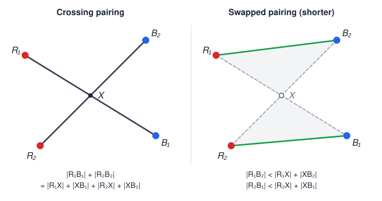

# 3 Combinatorics

## 3.1 Introduction

**Combinatorics** is the branch of mathematics that studies the enumeration, combination, and permutation of the elements of sets, and the relations that characterize their properties. Its most classical part, **enumerative combinatorics**, counts the elements of finite sets that satisfy given conditions, with an answer as a closed formula, a recurrence relation, a generating function, or an asymptotic estimate.

The boundaries of the field are not universally agreed upon. In a broader sense, the term also covers graph theory and other areas of discrete mathematics, and the counting part is then called **enumeration**.

In probability, combinatorics counts the outcomes of a finite sample space $\Omega$. If all the outcomes are equally likely, then $P(A) = |A| / |\Omega|$, where $|A|$ is the number of elements of $A$.

## 3.2 Pigeonhole Principle

### 3.2.1 Statement

If $n$ objects go into $m < n$ boxes, then at least one box contains at least two objects. The name comes from $n$ pigeons in $m$ pigeonholes. Dirichlet stated it in 1834 as the *Schubfachprinzip* (**drawer principle**), so it is also called **Dirichlet's box principle**, but the idea already appears in a book of 1624 attributed to Jean Leurechon.

In its simplest form, if $m + 1$ pigeons fly into $m$ pigeonholes, then at least two pigeons share a pigeonhole.

Equivalently, if $A$ and $B$ are finite sets with $|A| > |B|$, then no function $f : A \to B$ is injective, so $f(a_1) = f(a_2)$ for some $a_1 \neq a_2$.

**Proof**

If each box contains at most one object, then there are at most $m < n$ objects, which is a contradiction. $\blacksquare$

The principle proves that such a box exists, but it does not tell which one.

### 3.2.2 Generalized Pigeonhole Principle

If $n$ objects go into $m$ boxes, then at least one box contains at least $\lceil n/m \rceil$ objects, where $\lceil x \rceil$ is the smallest integer $\geq x$. For $n > m$, $\lceil n/m \rceil \geq 2$ gives the simple principle.

In its simplest form, if $km + 1$ pigeons fly into $m$ pigeonholes, then at least $k + 1$ pigeons share a pigeonhole, because $\lceil (km + 1)/m \rceil = k + 1$.

**Proof**

If each box contains at most $\lceil n/m \rceil - 1$ objects, then, because $\lceil x \rceil - 1 < x$ for every real $x$, the total number of objects is at most

$$
m \left( \left\lceil \frac{n}{m} \right\rceil - 1 \right) < m \cdot \frac{n}{m} = n
$$

which is a contradiction. $\blacksquare$

**Example:** with 12 birth months, at least $\lceil 100/12 \rceil = 9$ of 100 people share a birth month.

**Examples**

**Birthdays:** with 366 possible birthdays (February 29 included), at least two of 367 people share a birthday. This certainty needs 367 people, but the probability of a shared birthday is already above 50% with 23 people (the birthday problem).

**Socks:** among three socks taken without looking from a drawer of black and blue socks, at least two have the same color (three objects, two boxes).

**Hairs:** a human head has about 150,000 hairs on average, and we assume that no person has more than 1,000,000, so there are 1,000,001 possible numbers of hairs (0 to 1,000,000). London has more than 9,000,000 people, so at least $\lceil 9{,}000{,}000 / 1{,}000{,}001 \rceil = 9$ of them have exactly the same number of hairs.

**Handshakes:** in a group of $n > 1$ people who shake hands among themselves, at least two people have the same number of handshakes. Each person has between $0$ and $n - 1$ handshakes ($n$ values), but $0$ and $n - 1$ cannot both occur, because a person with $n - 1$ handshakes shakes hands with everyone. So the $n$ people go into at most $n - 1$ boxes.

## 3.3 Diophantine Approximation

**Diophantine approximation** studies how well rational numbers $p/q$ approximate a real number $a$. The name comes from Diophantus of Alexandria, who studied equations with integer solutions. For every $q \geq 1$, the nearest multiple of $1/q$ gives $|a - p/q| \leq 1/(2q)$, and the question is how much smaller the error can be for a small $q$.

### 3.3.1 Problem

**Problem:** given an irrational number $a \in \mathbb{I}$, for every $\varepsilon > 0$ there are $p \in \mathbb{Z}$ and $q \in \mathbb{N}$ with

$$
\left| a - \frac{p}{q} \right| \leq \varepsilon
$$

So we can approximate every irrational number by rational numbers as closely as we want. Decimal truncation already gives this, but the pigeonhole principle gives a much smaller error for the same denominator $q$.

### 3.3.2 Solution with the Pigeonhole Principle

**Step 1.** For any $n \geq 1$, consider the $n + 1$ multiples of $a$.

$$
0, \ a, \ 2a, \ 3a, \ \dots, \ na
$$

**Step 2.** Split each multiple into its integer part $\lfloor ka \rfloor$, the largest integer $\leq ka$, and its fractional part $\lbrace ka \rbrace$.

$$
\lfloor ka \rfloor + \lbrace ka \rbrace = ka \qquad k = 0, 1, \dots, n
$$

This gives $n + 1$ fractional parts in the interval $[0, 1)$.

**Step 3.** Divide $[0, 1)$ into $n$ subintervals of length $1/n$.

$$
I_j = \left[ \frac{j - 1}{n}, \frac{j}{n} \right) \qquad j = 1, \dots, n
$$

There are $n + 1$ fractional parts (the pigeons) and $n$ subintervals (the pigeonholes), so two of them, $\lbrace k_1 a \rbrace$ and $\lbrace k_2 a \rbrace$ with $k_1 < k_2$, are in the same subinterval $I_j$, and $|\lbrace k_2 a \rbrace - \lbrace k_1 a \rbrace| < 1/n$.

**Step 4.** Subtract the two multiples. With $q = k_2 - k_1$ and $p = \lfloor k_2 a \rfloor - \lfloor k_1 a \rfloor$, the integer parts cancel.

$$
|qa - p| = |\lbrace k_2 a \rbrace - \lbrace k_1 a \rbrace| < \frac{1}{n} \qquad 1 \leq q \leq n
$$

Each multiple is an integer plus a fractional part. When we subtract $k_1 a$ from $k_2 a$, the two integer parts give the integer $p$, and the two fractional parts give a small remainder. So $qa = p + (\lbrace k_2 a \rbrace - \lbrace k_1 a \rbrace)$, which means that $qa$ is less than $1/n$ from the integer $p$. Because $k_1 < k_2$ and both are between $0$ and $n$, $q$ is between $1$ and $n$.

**Step 5.** Divide by $q$.

$$
\left| a - \frac{p}{q} \right| < \frac{1}{qn} \leq \frac{1}{n}
$$

For a given $\varepsilon$, take $n \geq 1/\varepsilon$, and the error is less than $\varepsilon$. $\blacksquare$

**Example:** for $a = \sqrt{2}$ and $n = 5$, the subintervals have length $0.2$.

| $k$ | $k\sqrt{2}$ | $\lfloor k\sqrt{2} \rfloor$ | $\lbrace k\sqrt{2} \rbrace$ | Subinterval |
| --- | --- | --- | --- | --- |
| 0 | 0 | 0 | 0 | $I_1 = [0, 0.2)$ |
| 1 | 1.4142 | 1 | 0.4142 | $I_3 = [0.4, 0.6)$ |
| 2 | 2.8284 | 2 | 0.8284 | $I_5 = [0.8, 1)$ |
| 3 | 4.2426 | 4 | 0.2426 | $I_2 = [0.2, 0.4)$ |
| 4 | 5.6569 | 5 | 0.6569 | $I_4 = [0.6, 0.8)$ |
| 5 | 7.0711 | 7 | 0.0711 | $I_1 = [0, 0.2)$ |

The multiples for $k_1 = 0$ and $k_2 = 5$ share the subinterval $I_1$, so $q = 5$ and $p = 7$.

$$
|5\sqrt{2} - 7| \approx 0.0711 < \frac{1}{5} \qquad \left| \sqrt{2} - \frac{7}{5} \right| \approx 0.0142 < \frac{1}{25}
$$

## 3.4 Extremal Principle

### 3.4.1 Statement

The **extremal principle** looks at the objects with an extreme property, such as the smallest or the largest element of a set, the shortest total length, or the minimum area. It has two uses.

1. **Existence.** To prove that a mathematical structure with given properties exists, take the smallest or the largest possible structure and show that it has the properties.
2. **Non-existence.** To prove that a structure cannot exist, assume by contradiction that it exists and take the largest (or smallest) one. Then build from it a structure that is even larger (or smaller), which is a contradiction.

The extreme structure must exist before the proof can use it. A finite nonempty set of real numbers always has a minimum and a maximum, and the **well-ordering principle** states that every nonempty set of nonnegative integers has a least element. An infinite set of real numbers can have no extreme element, for example the interval $(0, 1)$ has no minimum and no maximum.

**Existence examples**

**Prime divisor:** every integer $n \geq 2$ has a prime divisor.

- **We want to prove** that a prime divisor of $n$ exists.
- **We suppose** that the smallest divisor $d > 1$ of $n$ is not prime.
- **The extreme** is the smallest divisor $d > 1$ of $n$.

The divisors of $n$ greater than $1$ form a nonempty set, because $n$ is one of them. The set can contain many divisors, but only one of them is the smallest, and we call it $d$. If $d$ is not prime, then $d$ has a divisor $e$ with $1 < e < d$, and $e$ also divides $n$. So $e$ is a divisor in the set that is smaller than $d$, which contradicts the choice of $d$ as the smallest. So $d$ is prime. $\blacksquare$

**Red and blue points:** the plane contains $n$ red points and $n$ blue points, with no three points on one line. Then $n$ segments that do not cross can join each red point to a different blue point.

- **We want to prove** that a pairing of the red and blue points without crossing segments exists.
- **We suppose** that two segments of the pairing with the smallest total length cross.
- **The extreme** is the pairing with the smallest total length.

There are $n!$ ways to pair the points, a finite number, so one pairing has the smallest total length. If two segments $R_1 B_1$ and $R_2 B_2$ of this pairing cross at a point $X$, the triangle inequality gives

$$
|R_1 B_2| + |R_2 B_1| < |R_1 X| + |X B_2| + |R_2 X| + |X B_1| = |R_1 B_1| + |R_2 B_2|
$$

The inequality is strict because no three of the points are on one line. So the pairing with $R_1 B_2$ and $R_2 B_1$ is shorter, which contradicts the choice of the shortest pairing. $\blacksquare$

In short, we want to prove that a way to pair the red and blue points without crossings always exists. There are only $n!$ pairings, so one pairing has the smallest total length. We suppose that this shortest pairing has two crossing segments. The swap of the partners of these two segments gives, by the triangle inequality, a pairing that is shorter than the shortest pairing, even if it has other crossings, and this is not possible. So the supposition is false, and the shortest pairing itself is the pairing without crossings.

**Non-existence examples**

**Irrationality of $\sqrt{2}$:** the number $\sqrt{2}$ is irrational.

- **We want to prove** that a fraction $p/q$ with positive integers $p$ and $q$ that is equal to $\sqrt{2}$ cannot exist.
- **We suppose** by contradiction that such a fraction exists.
- **The extreme** is the fraction $p/q$ equal to $\sqrt{2}$ with the smallest denominator $q$.

Take the fraction $\sqrt{2} = p/q$ with the smallest denominator $q$. Because $1 < \sqrt{2} < 2$, we have $q < p < 2q$, so $0 < p - q < q$. Because $p^2 = 2q^2$, we have $(2q - p) q = 2q^2 - pq = p^2 - pq = (p - q) p$, so

$$
\sqrt{2} = \frac{p}{q} = \frac{2q - p}{p - q}
$$

This fraction has the denominator $p - q < q$, which contradicts the choice of the smallest denominator. $\blacksquare$

**Midpoints:** let $S$ be a set of points in the plane such that each point of $S$ is the midpoint of two other points of $S$. Then $S$ is infinite.

- **We want to prove** that a finite nonempty set with this property cannot exist, which is the same as $S$ infinite.
- **We suppose** by contradiction that $S$ is finite and nonempty.
- **The extreme** is the longest segment $AB$ between two points of $S$.

There are finitely many pairs of points, so one segment $AB$ with $A, B \in S$ has the largest length. Because $B$ is in $S$, $B$ is the midpoint of a segment $CD$ with $C, D \in S$ and $C \neq D$. Apollonius's theorem for the median $AB$ of the triangle $ACD$ gives

$$
|AB|^2 = \frac{|AC|^2 + |AD|^2}{2} - |BC|^2 < \frac{|AC|^2 + |AD|^2}{2}
$$

because $|BC| = |CD|/2 > 0$. The formula also holds if $A$ is on the line $CD$, because it is the parallelogram law for the vectors $B - A$ and $C - B$. So $|AB|^2$ is less than the mean of $|AC|^2$ and $|AD|^2$, and the larger of the two is greater than $|AB|^2$. So $|AC| > |AB|$ or $|AD| > |AB|$, which contradicts the choice of $AB$ as the longest segment. $\blacksquare$

In short, we want to prove that a set of points where each point is the midpoint of two other points cannot be finite. We suppose that it is finite, so it has a longest segment $AB$. The point $B$ is the midpoint of a segment $CD$, so $C$ and $D$ are on opposite sides of $B$, and Apollonius's theorem shows that $AC$ or $AD$ is longer than $AB$. So $AB$ is not the longest segment, the supposition is false, and the set is infinite.
## 3.5 Invariance Principle

### 3.5.1 Statement

A process goes through the stages $S_1, S_2, \dots, S_k$, and at each stage it has a value, so the values form the sequence $V_1, V_2, \dots, V_k$. We want to know the final value $V_k$ in advance, or the values that $V_k$ can take, without a calculation of all the stages.

The **invariance principle** finds a quantity $Q$ that no step of the process changes, which is an **invariant**.

$$
Q_1 = Q_2 = \dots = Q_k
$$

The invariant gives information about $V_k$ in three common ways.

1. **Final value.** If $Q$ depends on the state in a known way, the value $Q_1$ at the start gives $V_k$ at the end.
2. **Possible values.** If $Q$ is a property of the state, such as a parity, then the final state has the same property as the start.
3. **Impossibility.** If a target state has a value of $Q$ different from $Q_1$, the process can never reach it.

The usual invariants are the parity of a number, a sum or a product, a remainder modulo $m$, and a count of colors. The proof checks one general step, because the invariant must not change for each allowed step. If the process allows several types of step, the invariant must not change for each type.

**Examples**

**Sum minus one:** the numbers $1, 2, \dots, 20$ are on a board. At each step, we erase two numbers $a$ and $b$ and write $a + b - 1$. After 19 steps, one number stays.

- **We want to find** the last number on the board.
- **The invariant** is $Q = (\text{sum of the numbers}) - (\text{count of the numbers})$, which is the sum of $x - 1$ over all the numbers $x$ on the board.

Each step decreases the sum by $1$ and the count by $1$, so $Q$ does not change. At the start, $Q = 210 - 20 = 190$. At the end, one number $x$ stays, so $Q = x - 1$. Thus $x - 1 = 190$, and the last number is $191$ for each order of the steps.

**Mutilated chessboard:** remove two opposite corners of an $8 \times 8$ chessboard. Then 31 dominoes cannot cover the 62 squares that stay. Max Black stated this problem in 1946.

- **We want to prove** that a cover of the 62 squares with 31 dominoes cannot exist.
- **The invariant** is the difference between the number of white squares and the number of black squares that the dominoes cover, as we put the dominoes one at a time.

Each domino covers one white square and one black square, so the difference stays $0$. Two opposite corners have the same color, so 32 squares of one color and 30 squares of the other color stay. A full cover needs a difference of $2$, which the invariant does not allow. $\blacksquare$

The converse is also true. If we remove two squares of different colors, the 62 squares that stay always have a cover with 31 dominoes (Gomory's theorem).

### 3.5.2 Monovariants

The quantity $Q$ can also change, but in one direction only, so it always increases or always decreases. Then $Q$ is a **monovariant**, also called a **semi-invariant**.

$$
Q_1 > Q_2 > \dots > Q_k \qquad \text{or} \qquad Q_1 < Q_2 < \dots < Q_k
$$

A monovariant gives information about the process in three common ways.

1. **No return.** A strict monovariant never takes the same value two times, so the process can never come back to an earlier state.
2. **End of the process.** If the monovariant is a positive integer that always decreases, the process stops after fewer than $Q_1$ steps. If the process has only finitely many states, it also stops.
3. **Impossibility.** If the monovariant always decreases, the process can never reach a state with a value of $Q$ larger than the current value.

In the red and blue points example, each swap decreases the total length, so a process of repeated swaps must stop at a pairing without crossings.

**Only 2 on the board:** let $n$ be odd, and write the numbers $1, 2, \dots, 2n$ on a board. At each step, we choose two numbers $x > y$, erase them, and write $|x - y| = x - y$. Can the process end with only the number $2$ on the board?

- **We want to prove** that the process can never end with only the number $2$.
- **The monovariant** is the sum $Q$ of the numbers on the board.
- **The invariant** is the parity of $Q$.

At the start, the board contains the first $2n$ positive integers. Gauss's formula gives the sum of the first $k$ positive integers.

$$
\sum_{i=1}^{k} i = \frac{k(k + 1)}{2}
$$

With $k = 2n$, the sum at the start is

$$
Q_1 = \sum_{i=1}^{2n} i = \frac{2n(2n + 1)}{2} = n(2n + 1)
$$

Both $n$ and $2n + 1$ are odd, so $Q_1$ is odd.

Each new number $x - y$ is at least $1$, so all the numbers stay positive and $y \geq 1$. Each step removes $x$ and $y$ and adds $x - y$, so the sum after the step is

$$
Q_{i+1} = Q_i - x - y + (x - y) = Q_i - 2y
$$

Thus $Q$ decreases by $2y \geq 2$ at each step, so $Q$ is a monovariant. It always decreases by an even number, so its parity is an invariant, and $Q$ stays odd. A board with only the number $2$ has $Q = 2$, which is even. So the process can never end with only $2$. $\blacksquare$

The same argument shows that, if one number stays at the end, it is odd. The process can also stop earlier with equal numbers only, because the rule needs $x > y$. For $n = 5$, the board starts with $1, 2, \dots, 10$ and $Q_1 = 55$.

## 3.6 Inclusion-Exclusion Principle

### 3.6.1 Statement

The **inclusion-exclusion principle** counts the elements of a union of finite sets that can overlap. The sum of the sizes of the sets counts each element of an intersection more than once, so the formula subtracts the intersections of two sets, adds the intersections of three sets, and continues with alternating signs. Abraham de Moivre knew the formula in 1718, it first appears in a paper of Daniel da Silva in 1854, and J. J. Sylvester gave its complement form in 1883.

**Two sets.** The elements of $A \cap B$ are in $A$ and in $B$, so $|A| + |B|$ counts them two times.

$$
|A \cup B| = |A| + |B| - |A \cap B|
$$

**Three sets.** An element of $A \cap B \cap C$ is counted $3$ times by the sets, subtracted $3$ times by the pairs, and added $1$ time by the triple, so it is counted $3 - 3 + 1 = 1$ time.

$$
|A \cup B \cup C| = |A| + |B| + |C| - |A \cap B| - |A \cap C| - |B \cap C| + |A \cap B \cap C|
$$

**Four sets.** The formula has $\binom{4}{1} = 4$ single sets, $\binom{4}{2} = 6$ pairs, $\binom{4}{3} = 4$ triples, and $\binom{4}{4} = 1$ intersection of all four sets. An element of $A \cap B \cap C \cap D$ is counted $4 - 6 + 4 - 1 = 1$ time.

$$
\begin{aligned}
|A \cup B \cup C \cup D| = {} & |A| + |B| + |C| + |D| \\
& - |A \cap B| - |A \cap C| - |A \cap D| - |B \cap C| - |B \cap D| - |C \cap D| \\
& + |A \cap B \cap C| + |A \cap B \cap D| + |A \cap C \cap D| + |B \cap C \cap D| \\
& - |A \cap B \cap C \cap D|
\end{aligned}
$$

**$n$ sets.** For the finite sets $A_1, \dots, A_n$,

$$
\left| \bigcup_{i=1}^{n} A_i \right| = \sum_{i} |A_i| - \sum_{i < j} |A_i \cap A_j| + \sum_{i < j < l} |A_i \cap A_j \cap A_l| - \dots + (-1)^{n+1} |A_1 \cap \dots \cap A_n|
$$

which is the sum over all the nonempty sets of indices $J \subseteq \lbrace 1, \dots, n \rbrace$.

$$
\left| \bigcup_{i=1}^{n} A_i \right| = \sum_{\emptyset \neq J \subseteq \lbrace 1, \dots, n \rbrace} (-1)^{|J| + 1} \left| \bigcap_{j \in J} A_j \right|
$$

**Complement form.** If all the sets are in a universe $U$, De Morgan's laws (see [1 Introduction to Probability and Set Theory](01-introduction-to-probability-and-set-theory.md)) give the number of elements in none of the sets.

$$
\left| \bigcap_{i=1}^{n} A_i^c \right| = |U| - \left| \bigcup_{i=1}^{n} A_i \right|
$$

**Probability form.** The formula is also true for probabilities, with $P$ in place of $|\cdot|$. For equally likely outcomes, it follows from the division of each term by $|\Omega|$.

$$
P(A \cup B) = P(A) + P(B) - P(A \cap B)
$$

For incompatible events, $P(A \cap B) = 0$, and the formula becomes the axiom $P(A \cup B) = P(A) + P(B)$.

**Examples**

**Divisible by 2, 3, or 5:** how many integers from $1$ to $100$ are divisible by $2$, $3$, or $5$?

- **We want to find** $|A_2 \cup A_3 \cup A_5|$.
- **The sets** are $A_d$, the multiples of $d$ from $1$ to $100$, with $|A_d| = \lfloor 100/d \rfloor$.

The numbers $2$, $3$, and $5$ have no common factor, so a number is a multiple of $2$ and of $3$ only if it is a multiple of $6$, and $A_2 \cap A_3 = A_6$. In the same way, $A_2 \cap A_5 = A_{10}$, $A_3 \cap A_5 = A_{15}$, and $A_2 \cap A_3 \cap A_5 = A_{30}$.

$$
|A_2 \cup A_3 \cup A_5| = 50 + 33 + 20 - 16 - 10 - 6 + 3 = 74
$$

So $74$ integers are divisible by $2$, $3$, or $5$, and $100 - 74 = 26$ are not divisible by any of them.

**Application letters:** a candidate sends five application letters to five investment banks, $B_1, \dots, B_5$, and each letter has a label with the name of its bank. The younger brother of the candidate changes the labels at random as a joke. What is the probability that all five letters go to the wrong banks?

- **We want to find** the probability that all five letters go to the wrong banks.
- **The sets** are the events $E_i$, which means that the letter for $B_i$ goes to $B_i$, for $i = 1, \dots, 5$.

$P\left( \bigcup E_i \right)$ is the probability that at least one letter goes to the correct bank, so $1 - P\left( \bigcup E_i \right)$ is the probability that all the letters go to the wrong banks. The probability form for five events gives

$$
\begin{aligned}
P\left( \bigcup_{i=1}^{5} E_i \right) = {} & \sum_{i} P(E_i) - \sum_{i < j} P(E_i \cap E_j) + \sum_{i < j < k} P(E_i \cap E_j \cap E_k) \\
& - \sum_{i < j < k < l} P(E_i \cap E_j \cap E_k \cap E_l) + P\left( \bigcap_{i=1}^{5} E_i \right)
\end{aligned}
$$

All the terms of one sum have the same probability, so each sum is the number of its terms multiplied by the probability of one term. The probability of one term comes from the labels that are still available. The number of terms with $r$ letters is $\binom{5}{r} = \frac{5!}{r! (5 - r)!}$, which is the number of ways to choose $r$ of the $5$ letters.

**One letter**

- **One term.** The label of $B_i$ goes to one of the $5$ letters, so $P(E_i) = \frac{1}{5} = \frac{4!}{5!}$.
- **Number of terms.** $\binom{5}{1} = 5$.
- **Sum.** $\sum_{i} P(E_i) = 5 \times \frac{1}{5} = 1 = \frac{1}{1!}$.

**Two letters**

- **One term.** If the letter for $B_i$ is correct, $4$ labels stay for the letter for $B_j$, so $P(E_i \cap E_j) = \frac{1}{5} \times \frac{1}{4} = \frac{1}{20} = \frac{3!}{5!}$.
- **Number of terms.** $\binom{5}{2} = 10$.
- **Sum.** The factors $5!$ and $3!$ cancel.

$$
\sum_{i < j} P(E_i \cap E_j) = \binom{5}{2} \times \frac{3!}{5!} = \frac{5!}{2! \times 3!} \times \frac{3!}{5!} = \frac{1}{2!} = \frac{1}{2}
$$

**Three letters**

- **One term.** After two correct letters, $3$ labels stay for the third letter, so $P(E_i \cap E_j \cap E_k) = \frac{1}{5} \times \frac{1}{4} \times \frac{1}{3} = \frac{1}{60} = \frac{2!}{5!}$.
- **Number of terms.** $\binom{5}{3} = 10$.
- **Sum.** $\sum_{i < j < k} P(E_i \cap E_j \cap E_k) = 10 \times \frac{1}{60} = \frac{1}{3!} = \frac{1}{6}$.

**Four letters**

- **One term.** After three correct letters, $2$ labels stay for the fourth letter, so $P(E_i \cap E_j \cap E_k \cap E_l) = \frac{1}{5} \times \frac{1}{4} \times \frac{1}{3} \times \frac{1}{2} = \frac{1}{120} = \frac{1!}{5!}$.
- **Number of terms.** $\binom{5}{4} = 5$.
- **Sum.** $\sum_{i < j < k < l} P(E_i \cap E_j \cap E_k \cap E_l) = 5 \times \frac{1}{120} = \frac{1}{4!} = \frac{1}{24}$.

**Five letters**

- **One term.** After four correct letters, only $1$ label stays, and it goes to the fifth letter, so $P\left( \bigcap_{i=1}^{5} E_i \right) = \frac{1}{5} \times \frac{1}{4} \times \frac{1}{3} \times \frac{1}{2} \times \frac{1}{1} = \frac{1}{120} = \frac{0!}{5!}$.
- **Number of terms.** $\binom{5}{5} = 1$.
- **Sum.** $P\left( \bigcap_{i=1}^{5} E_i \right) = \frac{1}{5!} = \frac{1}{120}$.

In general, the sum for $r$ letters is $\binom{5}{r} \frac{(5 - r)!}{5!} = \frac{1}{r!}$. So

$$
P\left( \bigcup_{i=1}^{5} E_i \right) = \frac{1}{1!} - \frac{1}{2!} + \frac{1}{3!} - \frac{1}{4!} + \frac{1}{5!} = 1 - \frac{1}{2} + \frac{1}{6} - \frac{1}{24} + \frac{1}{120} = \frac{19}{30}
$$

and the probability that all five letters go to the wrong banks is

$$
1 - P\left( \bigcup_{i=1}^{5} E_i \right) = 1 - \frac{19}{30} = \frac{11}{30} \approx 0.367
$$

So $44$ of the $5! = 120$ orders send each letter to a wrong bank. A permutation in which no element stays in its own position is a **derangement**. For $n$ letters, the probability is $\sum_{r=0}^{n} (-1)^r / r!$, which tends to $1/e \approx 0.3679$ as $n$ increases.

## 3.7 Counting Principle

### 3.7.1 Addition Principle

The **addition principle**, also called the **rule of sum**, counts the elements of a union of sets that do not overlap. Let $A_1, \dots, A_n$ be finite sets with the sizes $m_1, \dots, m_n$. If the sets are pairwise disjoint, which means that $A_i \cap A_j = \emptyset$ for all $i \neq j$, then

$$
|A_1 \cup \dots \cup A_n| = \sum_{j=1}^{n} m_j
$$

So if a task has $n$ types of option that exclude each other, and type $j$ has $m_j$ options, the task has $m_1 + \dots + m_n$ options. The principle is the "or" rule of counting.

The addition principle is the inclusion-exclusion principle with all the intersections empty, and the axiom $P(A \cup B) = P(A) + P(B)$ for incompatible events is the same rule for probabilities. If the sets overlap, the sum counts the elements of the intersections more than once, and the inclusion-exclusion principle is necessary.

### 3.7.2 Product Principle

If $n$ successive choices have $m_i$ possible results each, $i \in \lbrace 1, \dots, n \rbrace$, then the number of possible joint results is

$$
\prod_{i=1}^{n} m_i = m_1 \times m_2 \times \dots \times m_n
$$

The number $m_i$ must not depend on the earlier choices, but the options themselves can.

**Example:** what is the probability of a $6$ and heads when we throw a die and a coin at the same time? The product principle gives $6 \times 2 = 12$ equally likely joint results, and only heads with a $6$ is the result that we want, so

$$
P = \frac{1}{12}
$$

## 3.8 Variations

Let $X$ be a set with $n$ elements, and let $k \in \mathbb{N}$. A **variation** of size $k$, also called a **$k$-permutation**, is an ordered selection of $k$ elements of $X$, so the order in which we choose the elements is important.

**With repetition.** Each of the $k$ positions can take any of the $n$ elements, so the product principle gives

$$
n \times n \times \dots \times n = n^k
$$

**Without repetition.** Each position has one element fewer than the position before it, so for $k \leq n$ the product principle gives

$$
n \times (n - 1) \times \dots \times (n - k + 1) = \frac{n!}{(n - k)!}
$$

Here $n! = n \times (n - 1) \times \dots \times 1$ is the factorial of $n$, with $0! = 1$.

**Example:** how many four-digit numbers have four different digits? A number cannot start with $0$, so the first digit has $9$ options. The second digit can be $0$, but it cannot be the first digit, so it has $10 - 1 = 9$ options. The third digit has $8$ options and the fourth has $7$, so

$$
9 \times 9 \times 8 \times 7 = 4536
$$

**Example:** how many three-digit numbers can we make with the digits $1, 3, 5, 7, 9$ if a digit can repeat, and what is the sum of all these numbers? The digits can repeat, so there are $5 \times 5 \times 5 = 125$ numbers. To find the sum, take one position at a time.

- **Units.** If we fix the units digit, for example $9$, the other two positions give $5 \times 5 \times 1 = 25$ numbers. This is true for each of the $5$ digits, so the units digits add to $25 \times (9 + 7 + 5 + 3 + 1) = 25 \times 25 = 625$.
- **Tens.** The same argument gives $625$, but a tens digit has $10$ times its value, so the tens digits add $625 \times 10$.
- **Hundreds.** In the same way, the hundreds digits add $625 \times 100$.

$$
625 \times 100 + 625 \times 10 + 625 = 69375
$$

## 3.9 Permutations

Let $X$ be a set with $n$ elements, and let $k = n$. An **ordinary permutation** of $X$ is an order of all the $n$ elements of $X$, so the order of the elements is important. The number of ordinary permutations is

$$
n! = n \times (n - 1) \times (n - 2) \times \dots \times 2 \times 1
$$

This is the number of variations without repetition with $k = n$, because $\frac{n!}{(n - n)!} = \frac{n!}{0!} = n!$.

A **permutation with repetition**, or **multiset permutation**, is an order of $n$ elements in $k$ groups of sizes $n_1, n_2, \dots, n_k$, with $n = n_1 + \dots + n_k$, where all the copies in a group are identical. The number of these permutations is

$$
\binom{n}{n_1, n_2, \dots, n_k} = \frac{n!}{n_1! n_2! \cdots n_k!}
$$

The $n!$ orders count each permutation $n_1! n_2! \cdots n_k!$ times, because an exchange of identical copies gives the same order. The number $\binom{n}{n_1, n_2, \dots, n_k}$ is the **multinomial coefficient**. In an ordinary permutation, all the elements are different, so $n_1 = \dots = n_k = 1$ and the formula gives $n!$.

**Example:** how many words can we make with the letters of the word BANANA? The answer is not $6! = 720$, because the three letters A (in the positions 2, 4, and 6) are identical, and the two letters N (in the positions 3 and 5) are also identical. For example, $6!$ counts two different orders when the first A or the second A is in the first position, but the two orders give the same word, so not all the $720$ orders are different words. BANANA has $3$ A, $2$ N, and $1$ B, so the number of words is

$$
\binom{6}{3, 2, 1} = \frac{6!}{3! \times 2! \times 1!} = \frac{720}{12} = 60
$$

The formula discards $720 - 60 = 660$ orders.

## 3.10 Combinations

Let $X$ be a set with $n$ elements, and let $k \in \mathbb{N}$. A **combination** of size $k$ is a selection of $k$ elements of $X$, so the order of the elements is not important.

**Without repetition.** For $k \leq n$, the number of groups of $k$ different elements is the **binomial coefficient**

$$
\binom{n}{k} = \frac{n!}{k! (n - k)!}
$$

Each combination gives $k!$ variations without repetition, one for each order of its elements, so $\binom{n}{k}$ is the number of variations $\frac{n!}{(n - k)!}$ divided by $k!$.

**With repetition.** If an element can repeat, the number of groups of $k$ elements is

$$
\binom{n + k - 1}{k}
$$

A group is a row of $k$ stars, one for each chosen element, and $n - 1$ bars that separate the $n$ types of element, so we choose the positions of the $k$ stars in a row of $n + k - 1$ symbols.

**Poker hands:** in poker, each player gets $5$ of the $52$ cards. The cards have $13$ values, $2, 3, 4, 5, 6, 7, 8, 9, 10, J, Q, K, A$, and $4$ suits, which are hearts, diamonds, clubs, and spades. The order of the cards in a hand is not important, so there are $\binom{52}{5} = 2598960$ equally likely hands.

**a) Four of a kind**, four of the five cards with the same value. The first card fixes the value, so it has $13$ options. The second, third, and fourth cards must have the same value in the other suits, so each has $1$ option. The fifth card can be any of the other $52 - 4 = 48$ cards, so

$$
P(\text{four of a kind}) = \frac{13 \times 1 \times 1 \times 1 \times 48}{\binom{52}{5}} = \frac{624}{2598960} \approx 0.00024
$$

**b) Full house**, three cards with one value and two cards with another value. The value of the three cards has $13$ options, and their suits have $\binom{4}{3}$ options. The value of the two cards has $12$ options, because it must be different, and their suits have $\binom{4}{2}$ options. The two values have different roles, so their order is important, and we multiply $13 \times 12$. So

$$
P(\text{full house}) = \frac{13 \times \binom{4}{3} \times 12 \times \binom{4}{2}}{\binom{52}{5}} = \frac{3744}{2598960} \approx 0.00144
$$

**c) Two pairs**, two cards with one value, two cards with another value, and one card with a third value. The two values of the pairs have the same role, so their order is not important, and they have $\binom{13}{2}$ options. The suits of each pair have $\binom{4}{2}$ options. The last card cannot have the values of the two pairs, so $2 \times 4 = 8$ cards are not possible, and it has $52 - 8 = 44$ options. So

$$
P(\text{two pairs}) = \frac{\binom{13}{2} \times \binom{4}{2} \times \binom{4}{2} \times 44}{\binom{52}{5}} = \frac{123552}{2598960} \approx 0.0475
$$
