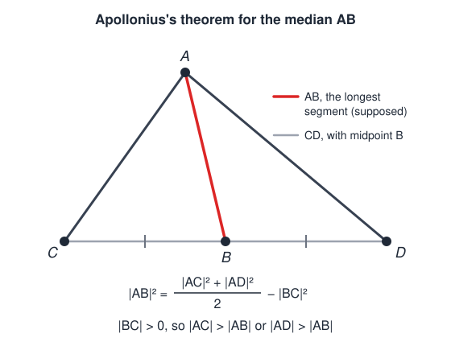

# 3 Combinatorics

## 3.1 Introduction

**Combinatorics** is the branch of mathematics that studies the enumeration, combination, and permutation of the elements of sets, and the relations that characterize their properties. Its most classical part, **enumerative combinatorics**, counts the elements of finite sets that satisfy given conditions, with an answer as a closed formula, a recurrence relation, a generating function, or an asymptotic estimate.

The boundaries of the field are not universally agreed upon. In a broader sense, the term also covers graph theory and other areas of discrete mathematics, and the counting part is then called **enumeration**.

In probability, combinatorics counts the outcomes of a finite sample space $\Omega$. If all the outcomes are equally likely, then $P(A) = |A| / |\Omega|$, where $|A|$ is the number of elements of $A$.

## 3.2 Pigeonhole Principle

### 3.2.1 Statement

If $n$ objects go into $m < n$ boxes, then at least one box contains at least two objects. The name comes from $n$ pigeons in $m$ pigeonholes. Dirichlet stated it in 1834 as the *Schubfachprinzip* (**drawer principle**), so it is also called **Dirichlet's box principle**, but the idea already appears in a book of 1624 attributed to Jean Leurechon.

In its simplest form, if $m + 1$ pigeons fly into $m$ pigeonholes, then at least two pigeons share a pigeonhole.

Equivalently, if $A$ and $B$ are finite sets with $|A| > |B|$, then no function $f : A \to B$ is injective, so $f(a_1) = f(a_2)$ for some $a_1 \neq a_2$.

**Proof**

If each box contains at most one object, then there are at most $m < n$ objects, which is a contradiction. $\blacksquare$

The principle proves that such a box exists, but it does not tell which one.

### 3.2.2 Generalized Pigeonhole Principle

If $n$ objects go into $m$ boxes, then at least one box contains at least $\lceil n/m \rceil$ objects, where $\lceil x \rceil$ is the smallest integer $\geq x$. For $n > m$, $\lceil n/m \rceil \geq 2$ gives the simple principle.

In its simplest form, if $km + 1$ pigeons fly into $m$ pigeonholes, then at least $k + 1$ pigeons share a pigeonhole, because $\lceil (km + 1)/m \rceil = k + 1$.

**Proof**

If each box contains at most $\lceil n/m \rceil - 1$ objects, then, because $\lceil x \rceil - 1 < x$ for every real $x$, the total number of objects is at most

$$
m \left( \left\lceil \frac{n}{m} \right\rceil - 1 \right) < m \cdot \frac{n}{m} = n
$$

which is a contradiction. $\blacksquare$

**Example:** with 12 birth months, at least $\lceil 100/12 \rceil = 9$ of 100 people share a birth month.

### 3.2.3 Examples

**Birthdays:** with 366 possible birthdays (February 29 included), at least two of 367 people share a birthday. This certainty needs 367 people, but the probability of a shared birthday is already above 50% with 23 people (the birthday problem).

**Socks:** among three socks taken without looking from a drawer of black and blue socks, at least two have the same color (three objects, two boxes).

**Hairs:** a human head has about 150,000 hairs on average, and we assume that no person has more than 1,000,000, so there are 1,000,001 possible numbers of hairs (0 to 1,000,000). London has more than 9,000,000 people, so at least $\lceil 9{,}000{,}000 / 1{,}000{,}001 \rceil = 9$ of them have exactly the same number of hairs.

**Handshakes:** in a group of $n > 1$ people who shake hands among themselves, at least two people have the same number of handshakes. Each person has between $0$ and $n - 1$ handshakes ($n$ values), but $0$ and $n - 1$ cannot both occur, because a person with $n - 1$ handshakes shakes hands with everyone. So the $n$ people go into at most $n - 1$ boxes.

## 3.3 Diophantine Approximation

**Diophantine approximation** studies how well rational numbers $p/q$ approximate a real number $a$. The name comes from Diophantus of Alexandria, who studied equations with integer solutions. For every $q \geq 1$, the nearest multiple of $1/q$ gives $|a - p/q| \leq 1/(2q)$, and the question is how much smaller the error can be for a small $q$.

### 3.3.1 Problem

**Problem:** given an irrational number $a \in \mathbb{I}$, for every $\varepsilon > 0$ there are $p \in \mathbb{Z}$ and $q \in \mathbb{N}$ with

$$
\left| a - \frac{p}{q} \right| \leq \varepsilon
$$

So we can approximate every irrational number by rational numbers as closely as we want. Decimal truncation already gives this, but the pigeonhole principle gives a much smaller error for the same denominator $q$.

### 3.3.2 Solution with the Pigeonhole Principle

**Step 1.** For any $n \geq 1$, consider the $n + 1$ multiples of $a$.

$$
0, \ a, \ 2a, \ 3a, \ \dots, \ na
$$

**Step 2.** Split each multiple into its integer part $\lfloor ka \rfloor$, the largest integer $\leq ka$, and its fractional part $\lbrace ka \rbrace$.

$$
\lfloor ka \rfloor + \lbrace ka \rbrace = ka \qquad k = 0, 1, \dots, n
$$

This gives $n + 1$ fractional parts in the interval $[0, 1)$.

**Step 3.** Divide $[0, 1)$ into $n$ subintervals of length $1/n$.

$$
I_j = \left[ \frac{j - 1}{n}, \frac{j}{n} \right) \qquad j = 1, \dots, n
$$

There are $n + 1$ fractional parts (the pigeons) and $n$ subintervals (the pigeonholes), so two of them, $\lbrace k_1 a \rbrace$ and $\lbrace k_2 a \rbrace$ with $k_1 < k_2$, are in the same subinterval $I_j$, and $|\lbrace k_2 a \rbrace - \lbrace k_1 a \rbrace| < 1/n$.

**Step 4.** Subtract the two multiples. With $q = k_2 - k_1$ and $p = \lfloor k_2 a \rfloor - \lfloor k_1 a \rfloor$, the integer parts cancel.

$$
|qa - p| = |\lbrace k_2 a \rbrace - \lbrace k_1 a \rbrace| < \frac{1}{n} \qquad 1 \leq q \leq n
$$

Each multiple is an integer plus a fractional part. When we subtract $k_1 a$ from $k_2 a$, the two integer parts give the integer $p$, and the two fractional parts give a small remainder. So $qa = p + (\lbrace k_2 a \rbrace - \lbrace k_1 a \rbrace)$, which means that $qa$ is less than $1/n$ from the integer $p$. Because $k_1 < k_2$ and both are between $0$ and $n$, $q$ is between $1$ and $n$.

**Step 5.** Divide by $q$.

$$
\left| a - \frac{p}{q} \right| < \frac{1}{qn} \leq \frac{1}{n}
$$

For a given $\varepsilon$, take $n \geq 1/\varepsilon$, and the error is less than $\varepsilon$. $\blacksquare$

**Example:** for $a = \sqrt{2}$ and $n = 5$, the subintervals have length $0.2$.

| $k$ | $k\sqrt{2}$ | $\lfloor k\sqrt{2} \rfloor$ | $\lbrace k\sqrt{2} \rbrace$ | Subinterval |
| --- | --- | --- | --- | --- |
| 0 | 0 | 0 | 0 | $I_1 = [0, 0.2)$ |
| 1 | 1.4142 | 1 | 0.4142 | $I_3 = [0.4, 0.6)$ |
| 2 | 2.8284 | 2 | 0.8284 | $I_5 = [0.8, 1)$ |
| 3 | 4.2426 | 4 | 0.2426 | $I_2 = [0.2, 0.4)$ |
| 4 | 5.6569 | 5 | 0.6569 | $I_4 = [0.6, 0.8)$ |
| 5 | 7.0711 | 7 | 0.0711 | $I_1 = [0, 0.2)$ |

The multiples for $k_1 = 0$ and $k_2 = 5$ share the subinterval $I_1$, so $q = 5$ and $p = 7$.

$$
|5\sqrt{2} - 7| \approx 0.0711 < \frac{1}{5} \qquad \left| \sqrt{2} - \frac{7}{5} \right| \approx 0.0142 < \frac{1}{25}
$$

## 3.4 Extremal Principle

### 3.4.1 Statement

The **extremal principle** looks at the objects with an extreme property, such as the smallest or the largest element of a set, the shortest total length, or the minimum area. It has two uses.

1. **Existence.** To prove that a mathematical structure with given properties exists, take the smallest or the largest possible structure and show that it has the properties.
2. **Non-existence.** To prove that a structure cannot exist, assume by contradiction that it exists and take the largest (or smallest) one. Then build from it a structure that is even larger (or smaller), which is a contradiction.

The extreme structure must exist before the proof can use it. A finite nonempty set of real numbers always has a minimum and a maximum, and the **well-ordering principle** states that every nonempty set of nonnegative integers has a least element. An infinite set of real numbers can have no extreme element, for example the interval $(0, 1)$ has no minimum and no maximum.

### 3.4.2 Existence Examples

**Prime divisor:** every integer $n \geq 2$ has a prime divisor.

- **We want to prove** that a prime divisor of $n$ exists.
- **We suppose** that the smallest divisor $d > 1$ of $n$ is not prime.
- **The extreme** is the smallest divisor $d > 1$ of $n$.

The divisors of $n$ greater than $1$ form a nonempty set, because $n$ is one of them. The set can contain many divisors, but only one of them is the smallest, and we call it $d$. If $d$ is not prime, then $d$ has a divisor $e$ with $1 < e < d$, and $e$ also divides $n$. So $e$ is a divisor in the set that is smaller than $d$, which contradicts the choice of $d$ as the smallest. So $d$ is prime. $\blacksquare$

**Red and blue points:** the plane contains $n$ red points and $n$ blue points, with no three points on one line. Then $n$ segments that do not cross can join each red point to a different blue point.

- **We want to prove** that a pairing of the red and blue points without crossing segments exists.
- **We suppose** that two segments of the pairing with the smallest total length cross.
- **The extreme** is the pairing with the smallest total length.

There are $n!$ ways to pair the points, a finite number, so one pairing has the smallest total length. If two segments $R_1 B_1$ and $R_2 B_2$ of this pairing cross at a point $X$, the triangle inequality gives

$$
|R_1 B_2| + |R_2 B_1| < |R_1 X| + |X B_2| + |R_2 X| + |X B_1| = |R_1 B_1| + |R_2 B_2|
$$

The inequality is strict because no three of the points are on one line. So the pairing with $R_1 B_2$ and $R_2 B_1$ is shorter, which contradicts the choice of the shortest pairing. $\blacksquare$

In short, we want to prove that a way to pair the red and blue points without crossings always exists. There are only $n!$ pairings, so one pairing has the smallest total length. We suppose that this shortest pairing has two crossing segments. The swap of the partners of these two segments gives, by the triangle inequality, a pairing that is shorter than the shortest pairing, even if it has other crossings, and this is not possible. So the supposition is false, and the shortest pairing itself is the pairing without crossings.

### 3.4.3 Non-existence Examples

**Irrationality of $\sqrt{2}$:** the number $\sqrt{2}$ is irrational.

- **We want to prove** that a fraction $p/q$ with positive integers $p$ and $q$ that is equal to $\sqrt{2}$ cannot exist.
- **We suppose** by contradiction that such a fraction exists.
- **The extreme** is the fraction $p/q$ equal to $\sqrt{2}$ with the smallest denominator $q$.

Take the fraction $\sqrt{2} = p/q$ with the smallest denominator $q$. Because $1 < \sqrt{2} < 2$, we have $q < p < 2q$, so $0 < p - q < q$. Because $p^2 = 2q^2$, we have $(2q - p) q = 2q^2 - pq = p^2 - pq = (p - q) p$, so

$$
\sqrt{2} = \frac{p}{q} = \frac{2q - p}{p - q}
$$

This fraction has the denominator $p - q < q$, which contradicts the choice of the smallest denominator. $\blacksquare$

**Midpoints:** let $S$ be a set of points in the plane such that each point of $S$ is the midpoint of two other points of $S$. Then $S$ is infinite.

- **We want to prove** that a finite nonempty set with this property cannot exist, which is the same as $S$ infinite.
- **We suppose** by contradiction that $S$ is finite and nonempty.
- **The extreme** is the longest segment $AB$ between two points of $S$.

There are finitely many pairs of points, so one segment $AB$ with $A, B \in S$ has the largest length. Because $B$ is in $S$, $B$ is the midpoint of a segment $CD$ with $C, D \in S$ and $C \neq D$. Apollonius's theorem for the median $AB$ of the triangle $ACD$ gives

$$
|AB|^2 = \frac{|AC|^2 + |AD|^2}{2} - |BC|^2 < \frac{|AC|^2 + |AD|^2}{2}
$$

because $|BC| = |CD|/2 > 0$. The formula also holds if $A$ is on the line $CD$, because it is the parallelogram law for the vectors $B - A$ and $C - B$. So $|AB|^2$ is less than the mean of $|AC|^2$ and $|AD|^2$, and the larger of the two is greater than $|AB|^2$. So $|AC| > |AB|$ or $|AD| > |AB|$, which contradicts the choice of $AB$ as the longest segment. $\blacksquare$

In short, we want to prove that a set of points where each point is the midpoint of two other points cannot be finite. We suppose that it is finite, so it has a longest segment $AB$. The point $B$ is the midpoint of a segment $CD$, so $C$ and $D$ are on opposite sides of $B$, and Apollonius's theorem shows that $AC$ or $AD$ is longer than $AB$. So $AB$ is not the longest segment, the supposition is false, and the set is infinite.